# Aegean Skies glossary

The names we use for the game's effects, systems and working habits, so that "the speed flecks" or
"the pinned base" means the same thing to everyone. Use these names in briefs, reports, commit
messages and conversation. When you introduce a new effect or term, add it here: give its name,
aliases, a definition, its code location, its rules and, where it can be seen, a picture.

Pictures are cropped captures from the game itself (procedural renders), made with the capture
switches listed under each term. Never put film stills or reference images here: they stay in
scratch (`~/dev/tmp/aegean-skies/refs`). Keep each image about 640 px wide and under about 200 KB.

Code locations are given as `file:line function` at the commit the glossary was last updated.
Line numbers drift, so search for the function name. "On `t3/<branch>`" means the term exists only
on that unmerged branch so far.

**Terms at a glance**

- **Sea and water:** [Speed flecks](#speed-flecks) · [Sun glints and the glitter path](#sun-glints-and-the-glitter-path) · [Crest strokes](#crest-strokes) · [Whitecaps](#whitecaps) · [Swell](#swell) · [Shallows band](#shallows-band) · [Shore foam](#shore-foam) · [Rain rings](#rain-rings)
- **Water effects:** [Splash bodies](#splash-bodies) · [Spray curtains](#spray-curtains) · [Bow sheets](#bow-sheets) · [Splash streaks](#splash-streaks) · [Skim spray](#skim-spray) · [Wake](#wake)
- **Rivers and canals:** [River ribbon](#river-ribbon) · [Confluence](#confluence) · [Opaque river prepass](#opaque-river-prepass) · [Bank plants](#bank-plants) · [Riparian ground](#riparian-ground) · [Chart rivers](#chart-rivers)
- **Aircraft:** [Prop disc](#prop-disc) · [Prop arcs](#prop-arcs) · [Arc precession](#arc-precession) · [Idle blades](#idle-blades) · [Vapour wisps](#vapour-wisps) · [Buffet](#buffet) · [Floats, hull and step](#floats-hull-and-step) · [Planing](#planing) · [Hydrofoil take-off](#hydrofoil-take-off) · [Contra-rotating and push-pull props](#contra-rotating-and-push-pull-props) · [Prop torque](#prop-torque) · [Speed scale](#speed-scale) · [Chaotic stalls](#chaotic-stalls) · [Flight model v2](#flight-model-v2) · [Sky Barons port](#sky-barons-port) · [Departure resistance](#departure-resistance) · [Altimeter hands](#altimeter-hands) · [Navigation lights](#navigation-lights) · [Schneider racers](#schneider-racers) · [Race classes](#race-classes) · [Sponsons](#sponsons) · [Push-pull pair](#push-pull-pair) · [Big boats](#big-boats)
- **Sky:** [Cloud body](#cloud-body) · [Cloud forms](#cloud-forms) · [Cumulus field](#cumulus-field) · [Tower growth](#tower-growth) · [Cloud relief](#cloud-relief) · [Cloud shadows](#cloud-shadows) · [Overcast deck](#overcast-deck) · [Deck climb](#deck-climb) · [Anvil](#anvil) · [Weather fixtures](#weather-fixtures) · [Moon](#moon) · [Planet lights](#planet-lights) · [Painted terminator](#painted-terminator) · [Shadow masses](#shadow-masses) · [Cloud bank and tower](#cloud-bank-and-tower)
- **Ground and vegetation:** [Grass blades](#grass-blades) · [Prop wash on grass](#prop-wash-on-grass) · [Grass frontier](#grass-frontier) · [Ground tint](#ground-tint) · [Wind sheen](#wind-sheen) · [Terrain stripes (historical bug)](#terrain-stripes-historical-bug) · [Coast refinement](#coast-refinement) · [Vegetation kinds and groves](#vegetation-kinds-and-groves)
- **Towns and people:** [Quay (code) and dock (player)](#quay-code-and-dock-player) · [Offshore mooring](#offshore-mooring) · [Harbour launch](#harbour-launch) · [Fuel lighter](#fuel-lighter) · [Legacy towns](#legacy-towns) · [Close kit](#close-kit) · [Frontage](#frontage) · [Plinth](#plinth) · [Hill house](#hill-house) · [Regional character](#regional-character) · [Farmstead](#farmstead) · [Paving](#paving) · [Townsfolk](#townsfolk) · [Pilot's scarf](#pilots-scarf) · [Camera wall check](#camera-wall-check) · [Path desk](#path-desk) · [Ambient crowd](#ambient-crowd) · [Action cards](#action-cards) · [Readable type](#readable-type) · [Wading](#wading)
- **Living world:** [Far people](#far-people) · [Notices](#notices) · [Provenance](#provenance) · [Phoenix (money)](#phoenix-money) · [Standing](#standing) · [Contracts](#contracts) · [Battle cards](#battle-cards) · [Voices](#voices) · [Openers and tiered topics](#openers-and-tiered-topics) · [Rotating far checks](#rotating-far-checks) · [Spread minute](#spread-minute)
- **Leisure:** [Leisure places](#leisure-places) · [Hotel Ancora](#hotel-ancora) · [Lantern light](#lantern-light) · [Bar set and singer](#bar-set-and-singer) · [Live source](#live-source) · [Plane work](#plane-work) · [Time skip](#time-skip) · [Tipsy sway](#tipsy-sway) · [Tavli](#tavli) · [Band request](#band-request) · [The paper](#the-paper) · [Dock fishing](#dock-fishing) · [Venue piano](#venue-piano) · [Workshop repair desk](#workshop-repair-desk) · [Table service](#table-service) · [Bill of fare](#bill-of-fare) · [The barber](#the-barber) · [Swimming](#swimming) · [Stargazing](#stargazing) · [Rising notes](#rising-notes)
- **Rendering and engine:** [Render chart](#render-chart) · [Reversed depth](#reversed-depth) · [Log depth](#log-depth) · [Z-fighting](#z-fighting) · [Near clipping](#near-clipping) · [Crisp-text split](#crisp-text-split) · [Quality tiers](#quality-tiers) · [Terrain LOD and contact tiles](#terrain-lod-and-contact-tiles) · [Canonical surface](#canonical-surface) · [WebGL2 compatibility proxy](#webgl2-compatibility-proxy)
- **Audio:** [Receiver chain](#receiver-chain) · [Station levelling](#station-levelling) · [Crackle](#crackle) · [Programme clock](#programme-clock) · [Ambience](#ambience) · [Crowd bed](#crowd-bed) · [Uneven events](#uneven-events) · [Single voices](#single-voices) · [Note events](#note-events) · [Musicians at play](#musicians-at-play)
- **Process:** [Redfox](#redfox) · [Bench lock and bench ledger](#bench-lock-and-bench-ledger) · [Pinned base](#pinned-base) · [Sample gate](#sample-gate) · [Known failures](#known-failures) · [Test tiers](#test-tiers) · [Judging round](#judging-round) · [Tweaks and trials](#tweaks-and-trials) · [Game page and Saved card](#game-page-and-saved-card) · [Spread save](#spread-save) · [Coordinator](#coordinator)
- **Combat:** [Lead marker](#lead-marker) · [Ground fire](#ground-fire) · [Water strikes](#water-strikes) · [Screen aim](#screen-aim) · [Target view righting](#target-view-righting) · [Slipway launch](#slipway-launch) · [Dogfight brain](#dogfight-brain)
- **Input:** [Panels own the wheel](#panels-own-the-wheel)
- **Reference:** [Capture switches](#capture-switches)

---

## Sea and water

### Speed flecks

- **Aliases:** the sea's fine detail, the small coloured circles, specks or blobs, "anime-looking
  colored circles/specks/blobs", sea marks, the marks.
- **Definition:** dense, small, high-frequency flecks of pale foam and darker ripple, fixed to the
  sea surface. They come in three sizes (about 1.3, 3.6 and 10 m) and fade with distance. At speed
  they smear slightly along the direction of motion, like a one-frame shutter. Low over the water,
  they are what makes speed readable.
- **Code:** `src/sea.jo:203 sea_fleck` (one fleck) and `src/sea.jo:227 sea_marks` (the three-size
  field, called from `sea_material`). `docs/FEEL.md` calls it `_marks`, an old name.
- **Rules:** never remove, sparsen, enlarge or restyle them. They carry the sense of speed: when a
  painted-look pass replaced them with larger, sparser brush marks, the user said "your sense of
  speed is completely gone". Every water surface you can take off from (rivers, canals, lakes)
  must use the same flecks at the same scale and density. Check a low fast pass over open water
  (`AEGEAN_FLYING='60 150'`) before and after any change to water, depth, quality tiers or sky.
  Whatever moves the eye must pass its velocity to the sea (`view_velocity`): a moving camera over
  a sea told it is still shows soft, faint marks (the title reel once did;
  `tests/title_reel_detail_test.py` now guards it).
- **Capture:** `AEGEAN_FLYING='8 190'` or `AEGEAN_FLYING='60 150'`; `tools/precision_view.jo`
  with `PRECISION_MARKS=1` isolates the fleck painter.

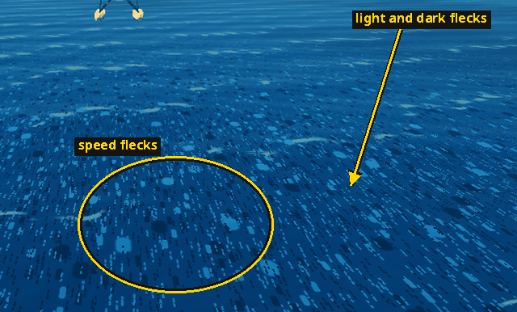

### Sun glints and the glitter path

- **Aliases:** the sun's glitter, sparkle, "small, hard sparkle" (`docs/ART.md`); close to the
  camera, the white ovals on the water.
- **Definition:** **sun glints** are sparse, tiny facets, each tipped at random and re-tipped in
  steps. Far off, each one is a pixel or two of hard white sparkle; close to the camera (beside the
  floats on a take-off or landing run) the same glints are drawn as small, flat white ovals lying on
  the water. Together they form the **glitter path**: the band of glints and soft sheen on the
  water along the sun's bearing.
- **Code:** `src/sea.jo:305 _glints`, with `sea_glint_possible` (a cheap early reject) and
  `sea_glint_anchor`; used in `sea_material`.
- **Rules:** the early reject must not thin the facets. The speed-fleck rule covers glints too:
  keep their density, scale and intensity.
- **Capture:** a low sun (`AEGEAN_HOUR` near 7 or 17) with the camera facing the sun;
  `tools/coast_capture.jo COAST_SITE=beach COAST_RANGE=300`; `tools/splash_frames.jo` close up.

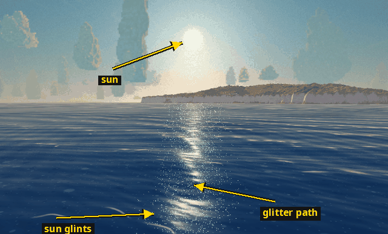

The three kinds of small marks on the water near a float, told apart by switching each off in a
scratch build (the rings mark the same places in each frame): the flat white ovals are **sun
glints**, the hairline white lines beside the splash are **splash streaks**, and the light and dark
blue discs that stay in every frame are **speed flecks**.

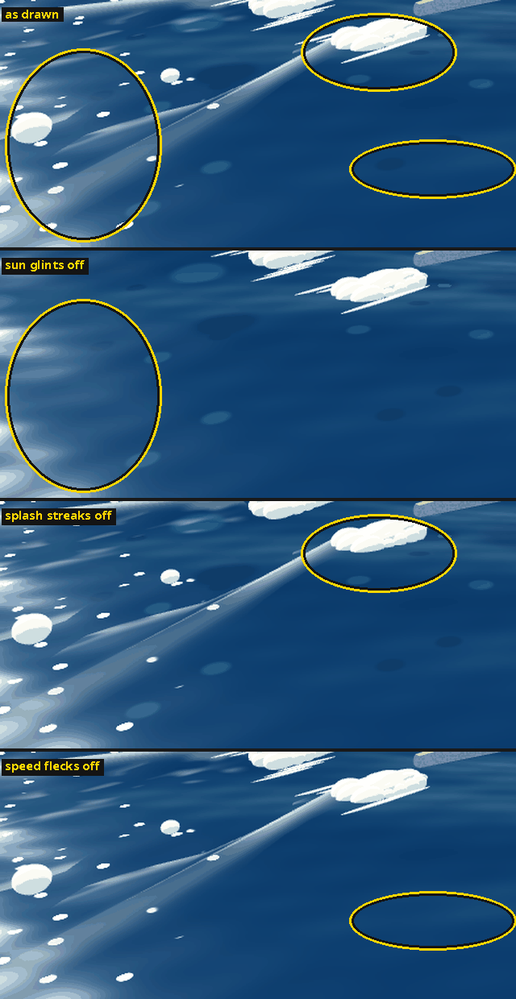

### Crest strokes

- **Aliases:** painted crests, "pale strokes across the wind".
- **Definition:** thin, pale, broken strokes on the downwind face of each swell crest, drawn from
  near to middle distance and stronger in a fresh wind.
- **Code:** `src/sea.jo:172 _strokes` and `src/sea.jo:269 _crest_strokes`; the distance fade is
  in `sea_material`.
- **Rules:** in wet weather they reuse the same field. Add no extra noise layer and no near-field
  marks for them.

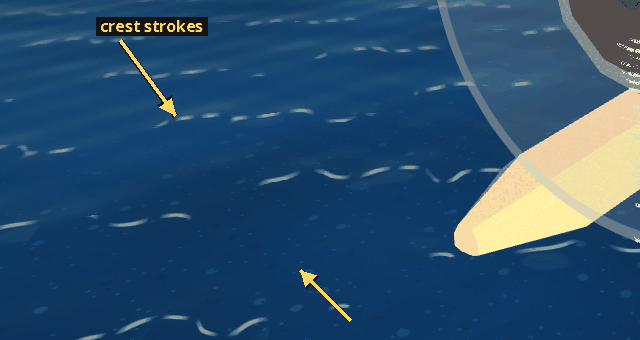

### Whitecaps

- **Definition:** foaming crests in a fresh wind, each trailing a short tail of foam behind its
  crest. Whitecaps are part of the crest-stroke field, not a separate effect.
- **Code:** the `tail` term in `src/sea.jo:172 _strokes`; its strength follows the wind through
  `_swell_amp`.
- **Capture:** `AEGEAN_WEATHER=meltemi` (the meltemi's clear gale), e.g.
  `AEGEAN_VIEW='1340 90 -5126 0.8 -0.45 11'`.

### Swell

- **Aliases:** the waves, `FlightEnv.swell`.
- **Definition:** the physical wave field: height and slope summed over six wave bands, running
  mostly with the wind. Floats, hulls and boats ride the same swell that is drawn, so what you see
  matches what the aircraft feels.
- **Code:** GPU side `src/sea.jo:81 _swell`, `sea_swell_band`, `sea_swell`; CPU side
  `src/sea.jo:763 swell_at(x, z, t)`.
- **Rules:** the decorative layers (flecks, crest strokes, glints) never drive physics. Physical
  swell, bathymetry, shore opacity, wakes and shadows must be preserved by any sea restyling.

### Shallows band

- **Aliases:** the shallows, clear coves, open shelves.
- **Definition:** the depth-driven colour ramp from cobalt in deep water, through turquoise, to
  see-through water at the shore. It reaches deep blue at 12 m on open shelves and 24 m in
  sheltered coves. The sandy seabed shows through with a faint caustic shimmer.
- **Code:** `src/sea.jo:326 sea_shallow_mix(depth, shelter)` and the body colour in
  `sea_material`; seabed caustics in `src/terrain.jo` (`ground_material`, "caustic shimmer").
- **Rules:** only the colour weight may change. Add no texture, sampler, varying or world record
  for it (`docs/painted-materials.md`).

### Shore foam

- **Aliases:** shore break, breaker, "lace at the shoreline".
- **Definition:** the white lace band where water meets land, with a breaker line just offshore.
- **Code:** the `edge`, `breaker` and `foam` terms in `src/sea.jo` `sea_material` (around line
  458).
- **Rules:** it is exactly zero beyond 3 m depth or 5 km range; its noise must not run over
  offshore pixels.
- **Capture:** `tools/coast_capture.jo` with `COAST_SITE=beach COAST_RANGE=50|300`.

### Rain rings

- **Definition:** the rings of rain falling on the water; they are drawn only near the camera
  (fading out by 90 m).
- **Code:** the `ring` term in `src/sea.jo` `sea_material` (around line 394).

---

## Water effects

### Splash bodies

- **Aliases:** the spray, cloud-like spray, billows, scalloped splash.
- **Definition:** opaque, cloud-like spray: overlapping closed lobes that read as one continuous
  body with a scalloped, ragged rim. It sits at each float's water contact and spreads and rises
  behind the step. All splash bodies are one shared mesh and one instanced draw, with no textures.
  Detached bursts (billows) are thrown up by hard impacts.
- **Code:** `src/splash.jo:114 splash_fan` (the body at each float), `splash_instances` (all
  bodies for a craft), `draw_splashes`, `splash_fs` (flat painted regions with a small soft
  terminator on each lobe); billows in `src/world_particles.jo`.
- **Rules:** bodies leave by shrinking to nothing, never by fading their alpha. The sea shader is
  not changed for splashes. NPC spray is capped (160 particles on the low tier, 480 on high).
- **Capture:** `tools/splash_frames.jo` with `POLISH_CASE=takeoff|landing|skim|stall-in`,
  `POLISH_TIME=<seconds>`, `POLISH_KIND=0..15`.

### Spray curtains

- **Aliases:** side curtains, the left and right sheets.
- **Definition:** two narrow, scalloped sheets of spray that rise from each float's chines and peel
  outward and back, leaving a clear trough of water between them, instead of one broad fan. Each
  curtain is a solid volume: its inner face, toward the float, is a fairly flat thin sheet; its
  outer face billows out, thickest along the curling crest and thinning to a knife edge at the root.
  Rows of round **curtain billows** heap up on the outer face. While the float planes, the curtain
  churns: billows are born small near the chine, swell as they roll aft along the sheet, rock
  outward and back, and lift off the crest as shrinking blobs while new ones form behind; the sheet
  lobes' scallops roll over the top and aft, each lobe swells on its own beat, and the whole curtain
  breathes with chop and float bounce (the sheet's **heave**).
- **Code:** `src/splash.jo` `splash_fan` (sheet lobes, kind 3; billows, kind 2, `CURTAIN_ROWS`),
  `curtain_widths` (inner/outer half-widths), `splash_vs` (roll, spin, outer bulge), `splash_fs`
  (curtain tones), `splash_targets` / `step_splash_motion` (heave).
- **Rules:** two painted tones only, white lit side and pale blue-grey shadow: tops lit by the sky
  stay white, overhanging undersides and a thin rim where each lobe turns from the eye take the
  shadow tone (in bright sun the middle tone saturates to white, so curtains skip it). All motion
  is continuous in time, never per-frame noise. Billows and crest drops use the small shared mesh
  (40x24); sheet lobes and other bodies the 64x40 mesh.
- **Capture:** `tools/splash_frames.jo` with `POLISH_CASE=planing` (a held planing run),
  `POLISH_ORBIT="azimuth elevation distance [aim-x aim-z]"`, `POLISH_NOCRAFT=1` to hide the
  aircraft, `POLISH_SEQUENCE=<dir>` for 30 fps strips.
- **Not to be confused with:** rain curtains (under cloud decks).

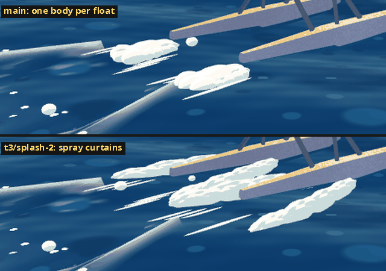

### Bow sheets

- **Definition:** the walls of water the heaviest boats (Do X, Sarafand, H-4) throw off the bow
  and sponsons while the hull climbs over the hump onto the step: bursts of large drops thrown
  sideways and up, drawn as billowing splash bodies, and the boat's [spray curtains](#spray-curtains)
  scaled up by its weight. They thin as it planes and stop in the air.
- **Code:** `src/pilot.jo` `_bow_sheets`; the curtains' scale is `boat_spray_scale` in
  `src/aircraft_boats.jo`, applied in `src/splash.jo` `splash_instances`.
- **Capture:** `AEGEAN_CRAFT=<the Do X> AEGEAN_CAPTURE_LAUNCH=takeoff-side` (a camera abeam on a takeoff run).

### Splash streaks

- **Aliases:** touchdown streaks, white marks, "tapered white marks", water ovals/streaks (the
  `t3/splash-2` comment). Not the white ovals on the water: those are sun glints (see the
  comparison under [Sun glints](#sun-glints-and-the-glitter-path)).
- **Definition:** thin, tapered white hairlines lying on the water in the float's wet footprint,
  three to a side, trailing back beside the splash body.
- **Code:** the "tapered white marks" loop at the end of `src/splash.jo:114 splash_fan`; they are
  splash instances with height `0.018`, placed on `swell_at` + 3.5 cm.
- **Rules:** keep them, in the same places, when the splash is reworked (`t3/splash-2` preserves
  them explicitly).

### Skim spray

- **Aliases:** skim sheet, downwash track, `skim`.
- **Definition:** the fainter fan and wake drawn when flying fast just above the water, starting
  at each float and reaching 4 to 11 m back.
- **Code:** the skim branch of `src/splash.jo` `splash_instances` and the `skim` argument of
  `src/wake.jo wake_step`.
- **Rules:** it starts above about 28 to 60 m/s of true speed with less than about 0.6 span of
  clearance.

### Wake

- **Aliases:** Kelvin wake, churn.
- **Definition:** the trail a hull or float leaves on the sea: two raised ridges spreading at the
  Kelvin angle, with foam where they are steepest, faint transverse waves, and a fading churned
  centre. It lasts about 40 s. Boats and ships use the same wake.
- **Code:** `src/wake.jo wake_step`, `draw_wakes` (constants `WAKE_EVERY`, `WAKE_LIFE`, `KELVIN`).
  `AEGEAN_NOWAKE` turns it off.

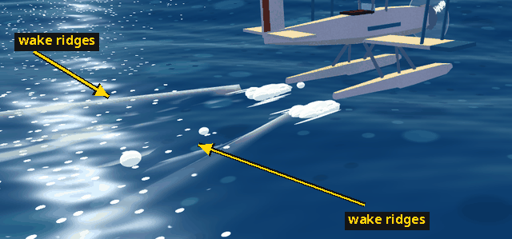

---

## Rivers and canals

On the rivers branch until it lands.

### River ribbon

- **Aliases:** the river water, inland water, the canal water.
- **Definition:** the raised water surface of the mainland river and Neravessa's canals: strips of
  twelve quads across the channel between stations, in batches of four stations grouped by
  sixteen (one material anchor). It uses the sea's
  material with its inland options: the same [speed flecks](#speed-flecks) and
  [sun glints](#sun-glints-and-the-glitter-path), carried by the current, on dark olive water. A
  group or batch wholly beyond 450 m (where flecks and ripples have faded out) uses the cheaper far
  material in one draw, which is exact there.
- **Code:** `src/river_render.jo` (`init_rivers`, `draw_rivers`, `draw_inland_water`);
  the material is `src/sea.jo sea_material` with `inland=true`.
- **Rules:** the speed-fleck rule applies in full. Lakes use the same seam (`draw_inland_water`).

### Confluence

- **Aliases:** river junction, tributary mouth.
- **Definition:** where one of the three tributaries meets its parent river. The tributary's last
  segments flare along circular fillets, so each bank turns to run along the parent's instead of
  meeting it at a square corner; the downstream corner is swept wider (1.3 x) than the upstream
  (0.7 x). The flare is a width along the tributary, so the water field, carve, contact and the
  ribbon (split 32 times along a flared segment) all read the same shape.
- **Code:** `src/river_field.jo` (`RIVER_MOUTHS`, `river_mouth_flare`), `river_strip_end` in
  `src/river_render.jo`.
- **Rules:** a field change bumps `RIVER_VERSION`, which changes the geography key: rebake
  `tools/bake.jo` and `assets/living-routes.bin`.

### Opaque river prepass

- **Definition:** a depth-only pass over the river ribbon's triangles that are at least 2 m deep
  at every vertex, where the water is exactly opaque. Drawn before the terrain, it spares the
  hidden riverbed its shading. It needs no discard, so early depth testing works.
- **Code:** `src/river_render.jo` `river_with_occluder`, `draw_river_occlusion` (one draw per
  group); native
  reversed depth only. Checked by `tests/river_depth_render_test.py`.

### Bank plants

- **Aliases:** bank vegetation, the riparian corridor, river trees and reeds.
- **Definition:** poplars, plane trees, oleanders and waterline reeds along both banks, instanced
  per prototype. Detail by distance: full trees to the grove distance, then the simpler distant
  crowns, without trunks past 600 m; shrubs and reeds end at the grove distance, and past 150 m one
  reed stem in three is drawn. Distant trees end at the tier's reach (low 1.6 km, medium
  2 km, high 3.5 km), as groves do.
- **Code:** `src/river_banks.jo` (`build_river_bank`, `draw_river_banks`, `river_bank_reach`).

### Riparian ground

- **Definition:** the greener moist and alluvial ground of the river corridor, from a baked river
  mask. Its weight and the height above the river are worked out at terrain vertices, not per pixel.
- **Code:** `src/terrain.jo` `ground_riparian` (called from `world_vertex` and `coast_vs`), used
  in `ground_surface`; the mask is `src/river_material.jo`.

### Chart rivers

- **Aliases:** rivers on the map, the canals on the chart.
- **Definition:** inland water drawn on the paper chart wherever an owned sheet covers it: rivers
  as watercolour lines that thicken from source to mouth with the channel (a little wider than
  true at small scales so they read, ink-edged once wide), Neravessa's canals and basins in ink
  between quays once the scale shows them (a fine dark line before that), lakes painted into the
  sheet as a pale wash with an inked shore from the lake source. The river and the canal city are
  named where the labels fit.
- **Code:** `src/chart.jo` `draw_chart_rivers`, `_label_water`; lakes in `build_chart_texture`
  through `lake_at` (`src/lake_field.jo`, a stub until lakes are authored).
- **Rules:** respect coverage (`charted`); the river's name is `CHART_RIVER_NAME` in one place.
- **Capture:** `AEGEAN_MAPS=all AEGEAN_CHART=1 AEGEAN_CHART_FOCUS=aegean-general-1898`, and
  `AEGEAN_CHART_VIEW="-129300 -146000 4200"` to look closer at Neravessa.

---

### Lake shoreline shaping

- **Definition:** a settlement lake's shore moved sideways along its own bank slope (coves and
  points of a few hundred metres) and a drowned valley arm up the inflow, on top of the surveyed
  basin. The takeoff lane, berths, jetty and town frontage stay as surveyed, and no cove comes
  within 45 m of a road.
- **Code:** `lake_depth` in `src/lake_field.jo` (shaped) over `lake_raw_depth`; road guard
  `src/lake_road_guard_data.jo` from `tools/bake_lake_road_guard.jo` (rebake it after road
  changes near lakes, then rebake the world and routes).

### Lake chop

- **Definition:** the short wind chop on open lake water: the sea's swell slopes and crest strokes,
  scaled, with no height. It gives lakes the sky reflection, sheen and glints the sea has at a
  distance. Rivers keep their own current marks.
- **Code:** `SeaParams.inland_chop` in `src/sea.jo`; set by `draw_lakes` (`src/lake_render.jo`).

## Aircraft

### Prop disc

- **Aliases:** the propeller disc, "spinning propellers as a film animator paints them".
- **Definition:** what a spinning propeller is drawn as: a flat, pale disc with a crisp rim in the
  propeller's own plane (no screen-space overlay), with prop arcs on it. All discs in a frame are
  one instanced draw.
- **Code:** `src/prop_disc.jo` (`prop_disc_vs`, `prop_disc_fs`, `queue_prop_discs`,
  `queue_cockpit_prop_discs`, `draw_prop_discs`).
- **Rules:** the disc fades in from 16 to 50 rad/s, the arcs from 26 to 64 rad/s; below 40 rad/s
  the real blades show. Disc and blades are not drawn beyond `PROP_DISC_RANGE` (650 m). Blades and
  disc turn in the aircraft's hand (`prop_turn`, see [Prop torque](#prop-torque)): the game's own
  aircraft are drawn left-hand (counterclockwise from the cockpit), as they always were; a
  right-hand prop's disc is the same disc with its own frame mirrored, so its arcs, their drift and
  precession, the sun-facing band and the sun-side arc are an exact mirror image at the same
  moments (`prop_disc_test` "a right-hand prop's disc is the original's mirror image").
- **Capture:** `tools/prop_disc_frames.jo` with `PROP_VIEW=side|front|close|rear|far|cockpit`,
  `PROP_THROTTLE=0..1`, `PROP_KIND=0..15`.

### Navigation lights

- **Aliases:** nav lights, wingtip lights, side lights, stern lamp, riding light.
- **Definition:** lamps every aircraft and vessel shows after dark, as in the late 1920s: red on
  the port wingtip, green on the starboard, white at the tail; ships red and green at the sides
  and a white stern lamp underway, one white lamp when lying still, small boats (rowing boats,
  dinghies, canal craft) one white lamp. Each is an additive glow point with a soft halo, kept a
  few pixels across out to 12 km and veiled by clouds; all in one particle draw a frame.
- **Code:** `src/nav_lights.jo` (`nav_light_level`, `nav_craft_points`, `nav_vessel_offsets`,
  `draw_nav_lights`); the ships' small emissive lamp boxes in `src/vessel_models.jo`.
- **Rules:** off by day (`nav_light_level` 0 above sun height 0.12), full by sun height -0.10.
  Aircraft lamps sit on the outermost wing contact (biplanes: the wider wing) and are off when
  moored or wrecked. Vessels' bow is +z, so port (red) is +x for them and -x for aircraft.
- **Capture:** `AEGEAN_FLYING="200 190" AEGEAN_HOUR=22`; distance: add
  `AEGEAN_VIEW="2433 210 -3365 0.5711 -0.01 22" SLOPPY_INPUT="2:f2+ 3:f2-"`.

### Prop arcs

- **Aliases:** the short white concentric arcs, pencil arcs, bands, streaks.
- **Definition:** for each blade, a band of short white arcs around the hub, about one every 3%
  of the radius from hub to rim, each with a random length and offset and a few left out. A new
  seed redraws the whole set every other frame ("on twos"). Lines stay 2.3 to 3.3 px wide at any
  distance.
- **Code:** `src/prop_disc.jo:76 _disc_arcs`, `_disc_band_width`.

### Arc precession

- **Aliases:** band speed, band angle, the wagon-wheel drift.
- **Definition:** the designed drift of the arc bands around the hub. Their turning rate cycles
  with engine speed (a smoothed sawtooth of about 2.5 cycles that grows as the engine slows), so
  the arcs creep, reverse and creep back like a wagon wheel on film. The drift lingers near its
  fast extremes over most of the range (`PROP_DRIFT_HOLD`), so the slow passages are brief blips;
  full power keeps its slow creep. At the lowest disc speed it
  matches the blades' real speed, so the hand-over to idle blades is seamless.
- **Code:** `src/prop_disc.jo:176 prop_band_speed` (with `PROP_TOP_SPEED`), `prop_band_angle`
  (integrated per craft); the shaft rate is `src/flight_feedback.jo prop_rotation_speed`.
- **Capture:** `PROP_SWEEP=<seconds>` and `PROP_TRACE` on `tools/prop_disc_frames.jo`, or
  `AEGEAN_PROP_SWEEP` in the game.

### Idle blades

- **Definition:** below 40 rad/s the real blade meshes are drawn instead of a disc; the arc bands
  turn with them and snap gently onto the blades. Idle shows turning blades, cruise shows a disc
  with faint arcs, and full power shows the whole effect.
- **Code:** `src/prop_disc.jo` (`PROP_BLADES_BELOW`, `prop_band_angle`).

### Vapour wisps

- **Aliases:** wingtip trails, vapour trails, vapor, "a thin white stream off each wingtip".
- **Definition:** a camera-facing ribbon from each wingtip that thins and fades behind the
  aircraft. It appears only when the wings pull hard in damp air.
- **Code:** `src/trails.jo` (`trail_step`, drawing); the gate is `src/flight_feedback.jo
  vapour_dampness` and `vapour_strength` (speed, dampness and load factor).
- **Rules:** dampness needs real wet-air evidence (a cool low sea layer, low overcast, rain or
  fog); clear, dry, high air makes none. Wisps are depth-correct against clouds.
- **Capture:** `tools/splash_frames.jo` with `POLISH_CASE=turn POLISH_TIME=0.8` (a wet-air
  fixture).

### Buffet

- **Definition:** the shaking before a stall: flow unsteadiness from 0 to 1 that rises near the
  stall angle or with wing separation, and drives the shake and flex cues.
- **Code:** `src/flight.jo` `CraftState.buffet` (set in the stall model); smoothed in
  `src/flight_feedback.jo`.

### Floats, hull and step

- **Definition:** a **floatplane** rests on two **floats**; a **flying boat** rests on its
  **hull**. The **step** is the notch in the bottom of a float or hull, about at the centre of
  gravity: once fast enough, the craft rides up on the planing surface ahead of it, and the water
  breaks free behind it. Splash bodies rise from behind the step.
- **Code:** the catalogue in `src/aircraft_catalog.jo` (stepped hulls and floats, contacts); hull
  and float planing resistance is `water_drag` in `src/flight.jo`.
- **Capture:** `tools/hangar.jo` (contact sheet of all types), `AEGEAN_CAPTURE=dock`.

### Sponsons

- **Aliases:** stub wings, sea wings (Dornier's *Flossenstummel*).
- **Definition:** short, thick aerofoil stubs at a flying boat's waterline, one each side of the
  hull, in place of wing-tip floats: they keep the hull upright on the water and lift a little in
  the air. The Dornier Wal and Do X have them.
- **Code:** `src/aircraft_boats.jo` (`_build_wal`, `_build_dox`); they are the damage parts
  `left_float` / `right_float` ("port sponson", "starboard sponson") and carry the outboard
  contacts, which sit just above the calm waterline so they only bear load when the hull heels.

### Push-pull pair

- **Aliases:** tandem engines, push-pull, Tandem (Dornier).
- **Definition:** two engines back to back in one nacelle, the front one pulling with a tractor
  propeller and the rear one pushing with a pusher, on a common axis. The S.55 and the Wal have
  one pair above the wing, the Sarafand three between its wings, the Do X six on an auxiliary wing.
- **Code:** `src/aircraft_boats.jo` `_tandem_pair` (shared by the Do X and the Sarafand: radial or
  cowled inline ends, both hubs); `AircraftProfile.discs` in `src/aircraft_catalog.jo` counts a
  pair as one propeller disc for flight model v2.
- **Rules:** the rear hub of a pair is always at least 3 m behind the front one; side-by-side
  discs never touch (tests/aircraft_boats_test.jo).
  How the pair's propellers turn and cancel their torque: [Contra-rotating and push-pull
  props](#contra-rotating-and-push-pull-props) (the big boats set `push_pull`).

### Big boats

- **Aliases:** the big flying boats; offshore-only aircraft (those over 30 m span).
- **Definition:** the Savoia-Marchetti S.55 (twin hulls), Dornier Wal, Dornier Do X, Short
  Sarafand and Hughes H-4. They are built from lofted rings (hulls with flared chines and a step,
  thick aerofoil wings, round nacelles) rather than the catalogue's boxes. The three over 30 m span
  (Do X, Sarafand, H-4) are **offshore-only**: they never use a dock, only an
  [offshore mooring](#offshore-mooring).
- **Code:** `src/aircraft_boats.jo` (`build_big_boat`, `big_boat`, `offshore_only`,
  `swing_radius`, `boat_parts`); profiles in `src/aircraft_catalog.jo` (`draft`, `engines`,
  `discs`); `tools/boats_view.jo` (four views of one model); tests in
  `tests/aircraft_boats_test.jo`.
- **Rules:** `draft` (hull below the waterline at rest) stays under 1.5 m, where the water
  model's buoyancy saturates. Engines over two add a second, detuned engine loop (`src/sound.jo`).

### Landplane

- **Aliases:** wheels, tail skid, three-point attitude.
- **Definition:** an aircraft on fixed wheels that takes off from and lands on land only (the Fiat
  C.R.20). At rest it sits on its two main wheels and its tail skid, nose up (its **three-point
  attitude**). On the ground the rudder steers (helped by the slipstream, so a burst of throttle
  swings it at a crawl, less as it runs fast), the elevator lifts the tail as speed comes and, with
  the stick near the middle, holds it a little nose up and rotates it near the stall; the main
  wheels brake (the water-brake control), the skid drags, and with the throttle closed and at rest
  it holds its brakes. Under the pure speed scale the run's slowing acts on the drawn speed while
  the wheels' pitching moment stays the true one, so a landing rolls out in about the true time
  without standing it on its nose.
- **Code:** `src/flight.jo` `CraftSpec.landplane`, `_landplane_wheel`, the landplane branch of the
  ground controls in `_substep`, `ground_start`; the gear points `landplane_gear_contacts` in
  `src/aircraft_early.jo`; `AircraftProfile.landplane` in `src/aircraft_catalog.jo`.
- **Rules:** a landplane is never put on the water: the pause menu's switch, the tow after a wreck
  and the start put it on an [airfield](#airfield)'s stand.

### Ditching

- **Definition:** a landplane meeting the water: wheels or belly in the sea, a river or a lake, it
  is wrecked (towed home: to its airfield). Its belly gives only a sixth of the buoyancy it would
  need, so it settles low and does not float.
- **Code:** `src/flight.jo` (the gear loop and the wet check in `_substep`; the belly volumes in
  `craft_spec`).

### Early aircraft

- **Definition:** the oldest types in the game, 1912–1926: the Donnet-Lévêque Type A pioneer boat,
  the Macchi M.5 and M.7 and Hansa-Brandenburg CC flying-boat fighters (pusher inlines and a
  Gnome rotary over single-step hulls, tip floats; the CC's **star struts**, four struts meeting in
  the middle of each bay; the Donnet-Lévêque's tail on an open girder below the propeller), and the
  Fiat C.R.20 landplane. Their speeds follow the fleet's rule, design m/s = 85 × (real km/h ÷
  250)^0.6.
- **Code:** `src/aircraft_early.jo` (models, contacts), profiles in `src/aircraft_catalog.jo`;
  `tests/aircraft_early_test.jo`.

### Planing

- **Aliases:** on the step.
- **Definition:** the phase of a take-off or landing run in which the craft rides on its step
  rather than pushing through the water: drag drops, spray moves aft and the aircraft can
  accelerate to lift-off.
- **Code:** `src/flight.jo` `CraftState.planing` (set in the water model as
  `wet > 0 and plane > 0.5`); bow dig-in is in the same water model.
- **Rules:** "planing as one event" (spray, sound and release from the water together) is planned
  work in `docs/FEEL.md`.

### Hydrofoil take-off

- **Aliases:** the P.7's take-off, foil-borne, on the foils, the clutch, the water screw.
- **Definition:** the Piaggio P.7 (1929) has no floats. Its sealed hull floats low with the wings
  just clear of the water and the air propeller feathered and still, its lower blade in the sea.
  Two hydrofoils on struts just ahead of the wing and a third under the tail lift it; a small
  water screw under the tail, driven by the same engine, pushes it. The run goes in four phases:
  1. **Hull-borne:** the screw pushes the hull through the water (it needs nearly full throttle
     to get over the hump). The foils' lift grows with the square of the speed and the hull rises,
     its wetted drag falling as it does.
  2. **Foil-borne:** at about 12 m/s (true) the hull is clear and she rides on the foils alone. A
     foil loses its lift as it nears the surface and all of it once it breaks through, so she
     settles at a ride height by herself; the tail foil sits higher than the forward pair, so the
     ride is a little nose-up. Fast, a foil's lift per square metre tops out (cavitation), which
     keeps her from being pinned to the water.
  3. **The clutch:** once the hull has been clear 0.4 s, the air propeller is out of the water,
     the speed is 14 m/s and the throttle open, the clutch goes over by itself (or when
     `Controls.clutch` asks): the screw is let go first, then the air propeller is clutched in and
     comes off its feather over about 1.4 s. In that gap nothing much pushes and she slows.
  4. **Into the air:** the air propeller pulls her along on the foils; as the wing takes her
     weight the foils rise to the surface and break out, and she flies. Holding the stick back on
     the foils gets her off at about 40 m/s; hands off it takes until about 60 m/s.
  It is meant to be challenging but achievable. It fails when: the throttle is under about 85%
  (she never gets over the hump on the screw); the nose is pushed down on the foils (the
  propeller dips into the sea and the engine is wrecked); the clutch is thrown with the propeller
  in the water (it beats the sea, gives no thrust and hurts the engine); or the swell is big
  (wind over about 8 m/s: the wing tips catch the waves and tear). Closing the throttle at under
  5 m/s on the water puts the clutch back to the screw for another try.
- **Code:** `src/hydrofoil.jo` (the foils' lift and drag, `foil_force`; the screw,
  `screw_thrust`; the clutch, `clutch_step`; the P.7's foils and screw, `P7_FOILS`, `P7_SCREW`),
  `src/hydrofoil_solver.jo` `hydrofoil_contacts` (called from the water model in `src/flight.jo`
  `_substep`) and `hydrofoil_air` (the clutch kept going in the air, all three flight models);
  `CraftState.foil` holds the clutch and the telemetry (`foilborne`, `lift`, `screw`,
  `prop_wet`). The model is `_p7` in `src/italian_racers.jo`.
- **Rules:** the foils are not float contacts: they never set the waterline or the static
  buoyancy, and only the hull's contacts decide "hull clear". The P.7's hull is not a planing
  hull (`hull_planing` 0.15). The UI still needs a clutch key and an indicator (see the racers'
  report).
- **Test:** `tests/italian_racers_test.jo` "the P.7 takes off from her hull to her foils and into
  the air".

### Contra-rotating and push-pull props

- **Definition:** two propellers on one axis turning opposite ways. The Macchi M.C.72 has a
  **coaxial contra-rotating** pair at the nose (the Fiat AS.6 drives each from one of its halves);
  the Savoia-Marchetti S.65 has a **push-pull tandem**, a tractor at the nose and a pusher behind
  the cockpit. Each hub carries a spin against the aircraft's hand (+1 its hand, -1 the other); a -1
  hub carries the mirror-handed blades (`CraftModel.prop_alt`) and its disc is drawn mirrored. The
  M.C.72's front rotor and the S.65's tractor are right-hand.
  Their torque reactions cancel, so neither swings on its run (see [Prop torque](#prop-torque)).
- **Code:** `CraftModel.prop_spins`, `prop_alt`, `prop_spin`, `prop_turn`, `prop_frame`, `prop_mesh` in
  `src/planes.jo`; the hubs in `italian_racer_hubs` (`src/italian_racers.jo`); the discs in
  `queue_prop_discs` (`src/prop_disc.jo`).

### Prop torque

- **Aliases:** torque swing, torque reaction.
- **Definition:** a Tweaks trial (off by default): the propeller's reaction rolls the aircraft
  against the propeller's turning, about a fifth of the static thrust at the blade tip, with the
  throttle. A right-hand propeller (clockwise seen from the cockpit, as most engines of the period
  turned) rolls her to port: on the take-off run the port float digs in, and in the air (flight
  model v2) the left wing wants to drop. A left-hand one does the opposite. Each profile carries
  the hand (`AircraftProfile.prop_hand`): the game's own sixteen are left-hand, as their props have
  always been drawn; the historical types right-hand (the default), the S.6B's from the record (its
  torque buried the port float, so it carried its fuel in the starboard float). The prop is drawn
  turning in that hand, so the torque always rolls against what is seen. A contra-rotating pair or a push-pull
  tandem has none, and nor does a Schneider racer with its own torque swing (`CraftSpec.torque_share`
  0).
- **Code:** `prop_torque` in `src/flight.jo` (+ is to port); `tweaks.prop_torque` in
  `src/tweaks.jo`.
- **Test:** `tests/italian_racers_test.jo` "contra-rotating and push-pull pairs have no net torque
  swing" and "the prop torque trial rolls against each propeller's turning".

### Speed scale

- **Aliases:** drawn speed versus true speed, pure scale, `liked-speed-3.3x`.
- **Definition:** the world is flown at 3.3 times the aircraft's true speed. Drawn (visual)
  speed is true speed times the scale. The capture switch `AEGEAN_FLYING='alt speed'` takes the
  drawn speed.
- **Code:** `set_speed_scale` in `src/flight.jo`; the `pure_scale` flag in `src/tweaks.jo`;
  `pure_k` converts back to true speed.
- **Rules:** a plain scalar, not a curve; the approved version is tagged `liked-speed-3.3x`.
  Distance-dependent speed tricks (near boost, detail flow, whole-sea flow, axial stretch;
  `AEGEAN_SPEED_MODE`, `AEGEAN_NEAR_BOOST`) were rejected on 2026-11-10 and must not be revived.

### Chaotic stalls

- **Aliases:** the stall trial.
- **Definition:** the Tweaks option for a more physical stall, with left and right wing separation,
  stall breaks and spins (the user's aim includes a hammerhead with prop-wash rudder authority).
  With it off, the liked arcade flight model is unchanged.
- **Code:** `chaotic_stalls` in `src/tweaks.jo`; `wing_separation` and `_stall_rotation` in
  `src/flight.jo`; `tools/stalllab.jo`, `tools/stallframes.jo`.
- **Rules:** near the water the old model is used up to 1 span of clearance and blended in by 3
  spans. Landings must forgive firm touchdowns.

### Flight model v2

- **Aliases:** v2, the trial flight model, fdm2; the liked model (its counterpart: the default).
- **Definition:** a Tweaks option (off by default) that flies the player's aircraft in the air as a
  rigid body with forces: lift from the angle of attack with a soft stall per wing, drag, a
  fixed-pitch propeller with rpm, honest gravity, and assists (path hold, coordination, departure
  resistance, a g limit). Water, land and contacts stay on the liked solver; NPCs stay on the liked
  model. Worked in true units: the drawn world is the true one at the [speed scale](#speed-scale).
- **Code:** `src/flight_v2.jo` `fly_air_v2`, `steer_v2`, `Fdm2Tuning`; dispatched from
  `src/flight.jo` `_substep` and `steer` by `tweaks.flight_model`; `tools/fdm_compare.jo`,
  `tools/fdm_plots.py`, `tools/fdm_frames.jo`, `tests/flight_v2_test.jo`. On `t3/flight-v2`.
- **Rules:** the stick asks for a rate of the flight path (as the liked model's); released, the
  path is held. The default stays the liked model until the user prefers v2.
- **Capture:** `AEGEAN_TWEAKS=fdm2`; strobes with `tools/fdm_frames.jo` (`FDM_MODEL=0|1`).

### Sky Barons port

- **Aliases:** flight model 2, the Sky Barons model, fdmsb.
- **Definition:** Sky Barons' own `fly_air` (examples/skybarons/sim.jo) flying this game's aircraft,
  for reference beside the liked model and [flight model v2](#flight-model-v2): the nose turned at
  fixed rates, the path following it, speed from thrust, drag on speed squared and gravity along the
  path. Worked in true units with the catalog's figures and drawn at the [speed scale](#speed-scale).
  The water, land and contacts stay on the liked solver; the player's aircraft only.
- **Code:** `src/flight_sb.jo` `fly_air_sb`; chosen on the pause menu's Flight v2 page (or
  `AEGEAN_TWEAKS=fdmsb`); `tests/flight_sb_test.jo`; a column of `tools/fdm_compare.jo`.

### Departure resistance

- **Aliases:** the AoA limit, the assist's stall margin.
- **Definition:** in [flight model v2](#flight-model-v2), the pilot's assist never pulls the wing
  past its stall angle with the stick alone, so a keyboard's full stick turns as hard as the wing
  allows without snapping. The wing still stalls when speed runs out faster than the nose can
  follow (a zoom), and then falls and recovers by its own aerodynamics.
- **Code:** `src/flight_v2.jo` `Fdm2Tuning.departure` (1 = full resistance; 0 lets a full stick
  go 0.2 rad past the stall).

### Altimeter hands

- **Aliases:** the altimeter, the two dials (as the user asked for them), coarse and fine altitude.
- **Definition:** the period altimeter: one face numbered 0 to 9 round the whole circle, a tick
  every 20 m, with a long thin hand for the hundreds of metres (one turn per 1,000 m) and a short
  broad hand for the thousands (one turn per 10,000 m). 1,250 m reads short hand a quarter past
  1, long hand at 2½. The face says "×100 m" (on the panels "M X100").
- **Code:** `src/hud.jo altimeter_dial` and `altimeter_hands` (the HUD gauge); in
  `src/cockpit.jo` the full-circle face in `build_cockpit`, the `short_hand` mesh, and the long
  hand from `cockpit_values` (index 1), drawn in `draw_cockpit`, on every aircraft's panel.
- **Rules:** keep the brass dial style; the short hand sits under the long one.
- **Capture:** `AEGEAN_FLYING='1250 60'` (HUD) and `AEGEAN_FLYING='1250 60 cockpit'`.

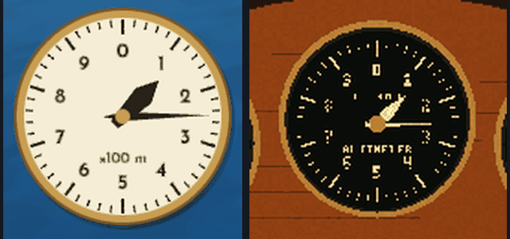

### Schneider racers

- **Aliases:** the racers, the historical racers; the Macchi M.33, Curtiss R3C-2, Supermarine
  S.6B and Sea Lion II (Craft `macchi_m33`, `curtiss_r3c2`, `supermarine_s6b`, `sea_lion_ii`).
- **Definition:** four real racing seaplanes of the Schneider Trophy years (1922–1931), each built
  to its own layout: the M.33's shoulder wing and engine nacelle on N-struts above the hull, the
  R3C-2's tiny biplane wings with brass surface radiators, the S.6B's low wing with radiators over
  the wings and float tops, the Sea Lion II's biplane boat with its pusher between the wings. Their
  `top` is the real top speed in true m/s (the S.6B's 655 km/h record; 600 m/s drawn at the 3.3
  scale), so they compare with one another as they did; the original fictional types sit faster
  than real 1920s aircraft of their roles.
- **Code:** models in `src/racer_planes.jo` (dispatched from `src/planes.jo`); profiles at the end
  of `AIRCRAFT` in `src/aircraft_catalog.jo`; `tests/aircraft_racers_test.jo`;
  `tools/racer_view.jo` (model check), `tools/racer_runs.jo` (every type's take-off run).
- **Rules:**
  - **Torque swing** (Tweaks: "Racers' propeller torque", on by default, the player's aircraft
    only): `swing` in the profile, rad/s² of roll at full throttle. On the run the port float is
    pressed in and the nose swings to port until the hull planes (rudder holds it); just off the
    water a roll to port that fades out by 2.4 times the stall speed (the wings were rigged for
    it at speed). Both flight models. These four take no [Prop torque](#prop-torque) (the
    generic trial) on top: `torque_share` is 0 for any type with a `swing`.
  - **Ground lift** (`ground_lift`, default 1): the wing's lift on and just off the water over the
    free air's. The water model lets a hull or float pitch to about 0.1 rad before its tail digs
    in at speed, so a wing as heavily loaded as the S.6B's (204 kg/m²) could not unstick at a sane
    speed; 1.4 stands for the ground effect of a low wing near the water.
  - **Water thrust** (`water_thrust`, default 1): the pull at a standstill over the force model's,
    full by 1.2 times the stall. A fixed-pitch propeller made for 650 km/h is stalled at low
    speed: the S.6B's 0.35 gives it the longest take-off run of the racers (about 45 s).
  - Their `AIRFRAMES` rows exist for the player's records; no seeded fleet flies them yet.

### Race classes

- **Aliases:** the club class, the Schneider class, the open class; club racers, the long course.
- **Definition:** air races are held in classes so speeds are fair. The **club class** is for the
  game's own types (the first sixteen); the **Schneider class** is open to the historical
  racers (S.6B, M.C.72, S.65, P.7, M.33, R3C-2, Sea Lion II). On a capital's feast day it holds
  one race of each: the Schneider race at eleven, the club race at five. Each capital's flying
  club fields two club-class aircraft and up to three Schneider racers from its country's
  tradition (Kalyrassa: M.C.72, S.65, M.33; Orenthessa: S.6B, R3C-2, Sea Lion II), each the
  newest a twentieth of the club's purse allows, so a poorer club flies the older racers. The
  player enters in their own aircraft if its class matches; the fee is the class's.
- **Code:** `src/air_classes.jo` (classes, lines, the funding rule, pace, course scale, windows,
  fees); `AirMeet.race_class` and `scale` in `src/air_race.jo`; the clubs and meets in
  `src/air_events.jo` `prepare_air_events`; the club moorings along a capital's pier in
  `src/far_scene.jo` `_club_moorings`; the cards in `src/race_view.jo`; tests in
  `tests/air_events_test.jo`.
- **Rules:**
  - The Schneider class flies a **long course**: the club oval at three times the size (2.5 or 2
    where open water is short), gates about 3.4 km apart, 660 m wide and 500 m high, so a racer at
    600 m/s has the room to turn. Its pylons stand taller; its racing lasts 180 minutes (the
    club's 120) for its slowest racers.
  - NPC racing pace: the club class 140 m/s drawn as before; the Schneider class 80% of each
    type's top speed up to 160 m/s times the course scale (480 m/s on the long course).
  - A Schneider race is held only where the club fields a Schneider racer; the club class always.
  - On the way home a clubmate yields the approach only to another coming home, and one already
    down or on final keeps its landing. Under the chaotic-stalls trial the autopilot's arrival at
    1.4 times the stall can stall a racer's sharp wing (default tweaks are fine).
- **Capture:** `AEGEAN_CAPTURE_RACE=schneider` with `AEGEAN_CRAFT` a Schneider racer (the S.6B is
  21): the long course off the home harbour, the player at the third gate's approach, three rivals
  flown by the flight model.

---

## Sky

### Cloud body

- **Definition:** one cloud's volume: a heaped cumulus with crisp cream tops, slate-blue shaded
  sides and a flat, darker base on its air mass's condensation level.
- **Code:** forms in `src/cloud_density.jo`, placement in `src/cloud_field.jo`, drawing and
  painted light in `src/cloud_volume.jo`; the atlas is baked by `tools/bake_clouds.jo` into the
  ignored `assets/clouds.png`. See `docs/cloud-paint.md`.

### Cloud forms

- **Definition:** the 28 procedural shapes a cloud body takes, built at their true proportions
  and only ever scaled uniformly (never stretched): **humilis** (flat caps, wider than tall),
  **fractus** (torn pieces), **cluster** (a clump or short street of cells on one base),
  **mediocris** (heaped), **congestus** (towers of stacked lobes), **twin** towers, **anvil**
  (a massive body under a flat plate spreading downwind) and **mass** (a large complex).
- **Code:** `cloud_make_form`, `cloud_heap`, `cloud_stamp_kind` in `src/cloud_density.jo`;
  `CLOUD_STAMP=n` in `tools/cloud_pilot.jo` shows one.
- **Rules:** a taller tower gets more lobes, not taller ones. Side turrets lean on the main
  column (apart, their heads arch over a window).

### Cumulus field

- **Aliases:** the field, cloud streets.
- **Definition:** the population of fair-weather clouds: clumps of small clouds, a main cloud
  with satellites, and streets along a heading, gathered by a coarse clumping cascade and
  wind-aligned rows with clear lanes between; power-law sizes in three octaves.
- **Code:** `cloud_octave_group`, `world_clouds` in `src/cloud_field.jo`.

### Tower growth

- **Definition:** how a heaped cell becomes a towering cumulus while the air builds towers
  (towers weather, or afternoon heating over land): the tower rises at its own proportions out
  of the heaped cloud, which wears away inside it.
- **Code:** `cloud_tall`, `cloud_forms_shown`, `cloud_evolve` in `src/cloud_field.jo`.

### Cloud relief

- **Definition:** the lumpy, broken edge of a cloud seen close: billowed noise in the cloud's
  own metres that breaks the silhouette into rounded bulges, faded out with distance and kept
  off the flat base; mostly not in the light, so faces keep their painted masses.
- **Code:** `cloud_relief` in `src/cloud_volume.jo`.

### Cloud shadows

- **Definition:** the dark, soft-edged patches the clouds cast on land, sea, rivers, lakes and
  towns, offset from each cloud by the sun's angle and moving with clouds and sun; deep water
  goes navy, clear shallows a deeper teal, land keeps some colour.
- **Code:** the map in `src/cloud_shadow.jo` (sun-projected coverage from each form's footprint
  slabs), the sample `cloud_shadow_at` in `src/cloud_shadow_map.jo`; `AEGEAN_CLOUD_SHADOWS=0`
  turns them off.

### Overcast deck

- **Aliases:** the deck, cloud deck.
- **Definition:** a bounded, climbable layer of cloud with a base and a top, the same ellipse as
  in the weather simulation. **Rain curtains** are the slanted, grey, vertically coherent shafts
  hanging below a deck.
- **Code:** deck and squall in `src/cloud_field.jo`; deck coverage and rain curtains in
  `src/cloud_volume.jo`.
- **Capture:** `AEGEAN_CAPTURE=weather-above|weather-below AEGEAN_WEATHER=overcast`.

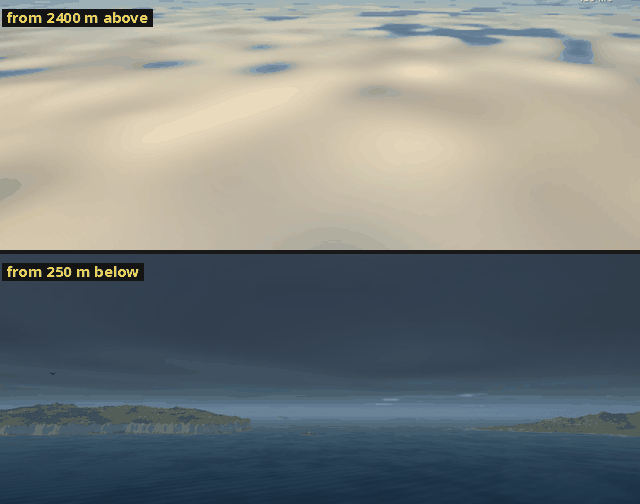

### Deck climb

- **Definition:** the set piece of climbing from a dark, rainy sea up through the overcast deck
  and breaking out into blue sky over a bright white top (`docs/DESIGN.md`).
- **Capture:** `AEGEAN_WEATHER=overcast` with `AEGEAN_VIEW` at heights from 300 to 1900 m (the
  clouds reports' deck series).

### Anvil

- **Definition:** the dark, flat-crowned top of a thunderstorm's column, at the storm centre: a
  plate flattened at the tropopause and spreading downwind over a massive body.
- **Code:** the storm branch of `src/cloud_field.jo`; the form (`CLOUD_ANVIL`, its plate in
  `cloud_form_distance`) in `src/cloud_density.jo`.
- **Capture:** `AEGEAN_CAPTURE=weather-storm AEGEAN_WEATHER=storm
  AEGEAN_WEATHER_CENTER='0 -26000'`.

### Weather fixtures

- **Definition:** the named weathers: fair, towers, overcast, front, rain, storm (thunderstorm),
  fog, meltemi (the clear summer gale) and calm.
- **Code:** `weather_fixture` (via `AEGEAN_WEATHER=<name>`), `src/weather_scene.jo`.

### Moon

- **Definition:** a sphere lit by the actual sun direction, never a painted phase mask. On
  `t3/splash-2` its disc is the same apparent size as the sun's.
- **Code:** `src/celestial.jo sky_moon`, `moon_illumination`; the disc in `src/sky.jo`.

### Planet lights

- **Definition:** Venus, Jupiter, Mars and Saturn as calendar-driven points of light, hidden by
  clouds in front of them.
- **Code:** on `t3/splash-2` (`src/celestial.jo`, `src/sky.jo`, `tools/sky_frames.jo` with
  `SKY_TARGET=moon|venus|jupiter|mars|saturn`, `SKY_DAY`, `SKY_HOUR`). Not on main yet.

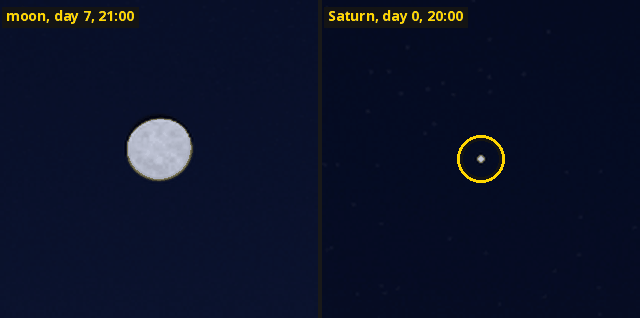

### Painted terminator

- **Definition:** the narrow, soft edge between the lit and shaded sides of a rounded form,
  drawn as a step in a painted light ramp rather than a smooth falloff. It is used on clouds,
  splash lobes and other painted materials.
- **Code:** the shared stepped ramp in `src/paint.jo`; `src/cloud_volume.jo` ("a drawn terminator
  on every rounded head"); `splash_fs` in `src/splash.jo`.

### Shadow masses

- **Definition:** large, coherent areas of cool shadow on clouds and foliage, taken from the big
  parent forms rather than from each small lobe, so shading reads as a few big shapes instead of
  "polka-dot shadows".
- **Code:** `cloud_paint` in `src/cloud_volume.jo` (the mass normal mixed with a broad
  distance gradient; no sunward self-shadow on lit faces).
- **Rules:** cool shadow belongs to foliage and cloud masses, not a blue dye over every wall
  (`docs/ART.md`).

---

## Ground and vegetation

### Grass blades

- **Aliases:** meadow blades, the tuft (the mesh).
- **Definition:** single-triangle blades, instanced in 1 m cells on a fixed world grid, drawn at
  full density within a short radius around the viewer. Wind, the prop's slipstream and contact
  with the pilot are done in the vertex shader; blades are lit by the ground beneath them.
- **Code:** `src/grass.jo` (`grass_vs`, `grass_fs`, `build_tuft`, `build_grass`, `draw_grass`,
  `grass_cover` for where grass may grow).
- **Rules:** blades per cell are 72 on low, 240 on medium and 3072 on high; the draw radius is 8,
  11 and 12 m. No alpha fade or discard in the grass material. No grass on streets, plots, quays,
  steep slopes or below 3 m above sea level.
- **Capture:** `tools/grass_sample.jo`; `AEGEAN_GRASS_DENSITY`, `AEGEAN_GRASS_RADIUS`.

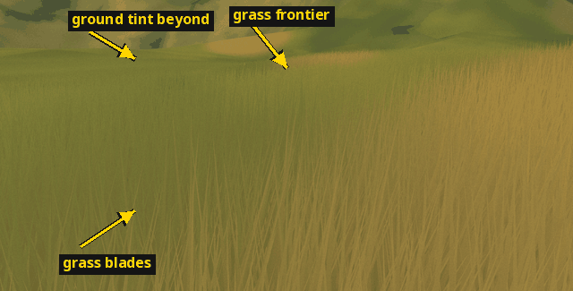

### Prop wash on grass

- **Aliases:** slipstream, airflow.
- **Definition:** grass pressed flat in a widening cone behind a running propeller, and pushed
  outward under low wings, weakening with height and engine load.
- **Code:** the `grass_airflow` branch of `src/grass.jo grass_vs`.
- **Capture:** `tools/grass_sample.jo GRASS_CASE=wash`.

### Grass frontier

- **Aliases:** the frontier, the growth edge, the noisy frontier.
- **Definition:** the outer edge of the grass field. Over the last 4 m the blades shrink to
  nothing, and value noise moves the edge by about ±1.5 m so it never reads as a circle.
- **Code:** `src/grass.jo grass_fade_range` and the `edge` noise in `grass_vs`.
- **Rules:** the last blades stay low so their silhouette never covers a differently coloured
  ground band beyond the frontier.
- **Not to be confused with:** the war frontier (`war_frontier_hops` in `src/living_war.jo`).

### Ground tint

- **Aliases:** blade-root colour, pigment wash, ground mean.
- **Definition:** the ground colour under the grass, which is also the blade-root colour, so the
  field fades into the terrain with no visible edge. (In the terrain shader, `tint` is also the
  per-vertex dryness, maquis, ridge and high-land values that drive the ground material.)
- **Code:** `src/terrain.jo ground_material`; `src/look.jo meadow_blade_response` and the
  projected pigment wash in `src/grass.jo grass_vs`.
- **Rules:** the grass-2 gate was a mean colour difference under ΔE 3 between the grass field and
  the bare ground, seen edge-on.

### Wind sheen

- **Aliases:** meadow wave, wind wash, gusts over the grass.
- **Definition:** travelling waves of paler, bent grass that sweep across meadows with the wind,
  shared by the blades and the ground under them. The sheen is additive: it brightens and never
  darkens the base colour.
- **Code:** `src/look.jo:137 meadow_wave`; used in `src/grass.jo grass_vs` and
  `src/terrain.jo ground_material`.
- **Rules:** like all ground detail it is full strength to 60 m and gone by 260 m (the near-detail
  envelope); it must never repeat over whole hills seen from altitude (see terrain stripes).

### Terrain stripes (historical bug)

- **Aliases:** wavy ground stripes, dune lines, repeated wind bands.
- **Definition:** a bug from the first grass merge (071e319): the wind sheen was applied to the
  ground at every distance, so whole hills seen from the air were covered in regular stripes.
  Fixed in 3e2d530 by limiting it to the near-detail envelope (`meadow *= near` in
  `src/terrain.jo`). A second form (2026-11-14): the pigment tile's alpha wash, a sum of
  sinusoids repeating every 320 m, shifted the mainland's vegetation patch edges in a regular
  diagonal herringbone seen from 1-4 km; the mainland now uses value noise there (`wash` in
  `ground_surface`).
- **Rules:** the original archipelago must stay pixel-identical through ground-shader fixes.
- **Capture:** `tools/stripe_capture.jo STRIPE_SITE=mainland|islands STRIPE_ALTITUDE=300|1000|3000`.

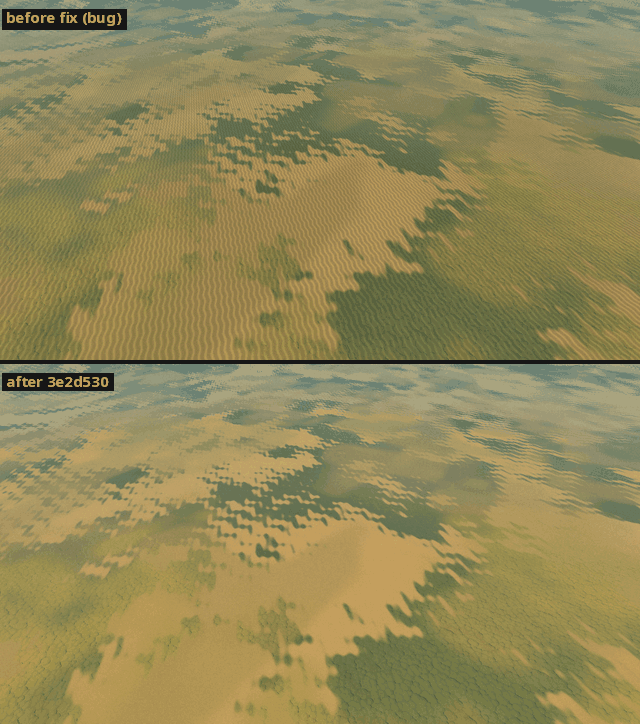

### Coast refinement

- **Aliases:** sub-source coast, the coast pattern, refined contact.
- **Definition:** near the shoreline the 14 m canonical terrain triangles are subdivided down to
  about 0.22 m with a baked pattern, so beaches and rock edges have real small-scale shape.
  Walking, landing and vessels all touch the refined heights.
- **Code:** `src/coast_field.jo` (`coast_height_detail`, `coast_contact`),
  `src/coast_pattern.jo build_coast_pattern`, `src/coast_mesh.jo init_coast_mesh`;
  `docs/coast-refinement.md`.
- **Rules:** canonical corners never move; it stays a heightfield (no overhangs or decorative
  collision rocks). Changing the pattern constants changes contact geometry. `AEGEAN_COAST=0`
  turns it off.
- **Capture:** `tools/coast_capture.jo COAST_SITE=legacy|new|beach|harbor COAST_RANGE=2000|300|50|2`.

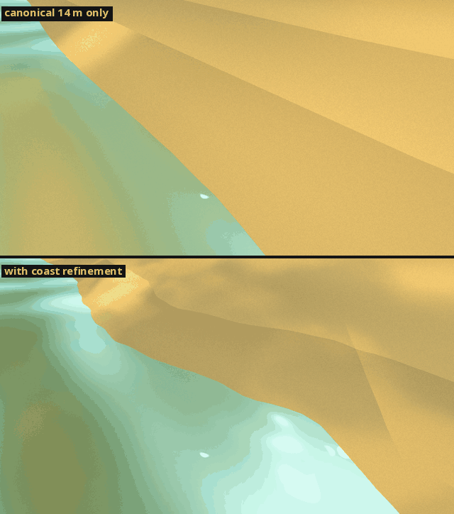

### Vegetation kinds and groves

- **Definition:** six shared plant meshes: umbrella pine, cypress, maquis, olive, oleander and
  prickly pear. **Groves** are the streamed stands of trees in the new world; olive rows sit on
  terraces at constant height.
- **Code:** `src/plants.jo` (`PLANT_KINDS`, `summer_cover`, `orchard_cover`),
  `src/world_groves.jo`.
- **Rules:** don't cut tree counts to pay for paint effects.

---

## Towns and people

### Quay (code) and dock (player)

- **Aliases:** dock, pier, wharf, harbour, waterfront (in what the player reads or hears).
- **Definition:** "quay" is the code's word for the walkable stone edge of a harbour where aircraft
  and boats moor and people step ashore: `Quay`, `Town.quays`, `QUAY_TOP`, `VenueKind.quay`,
  `CargoWhere.quay`, and keys such as `legacy:{place}:scene:quay`.
- **Rules:** never show "quay" to the player; many people won't know it. In prompts, panels, map
  labels, notices, dialogue and scenario text, say **dock** for where you moor or step ashore (the
  default), **pier** for a structure out into the water, **harbour** or **waterfront** for the
  general place ("down to the harbour", "on the waterfront"), and occasionally **wharf** for a
  working goods landing. Vary them in dialogue so it sounds natural. Don't rename the code
  identifiers, keys or save fields.
- **Code:** `ctx_venue` and `venue_errand` (`src/living_talk_context.jo`) speak `VenueKind.quay`
  as "the harbour"; map mooring labels read "{town} dock {n}".

### Offshore mooring

- **Aliases:** the buoy, a mooring buoy.
- **Definition:** where a [big boat](#big-boats) too large for a harbour's docks lies: a red and
  white buoy in open water off the harbour. Each sea harbour has up to three for each swing
  radius, in water at least 3 m deep under the whole **swing circle** (the circle the moored
  aircraft can sweep as it swings round its buoy), no shoal within 15 m of it, clear of every quay,
  mole, dock, the seaplane buoy, the harbour's boats and the ships' anchorage, out of the
  seaplanes' approach lanes, with a straight run for the [harbour launch](#harbour-launch) from a
  dock, and as sheltered as the coast allows. The aircraft is made fast facing the harbour, then
  **swings to the wind**: nose to the buoy and into the wind, turning faster the stronger the wind
  and slower the bigger the aircraft, damped so it settles (a Do X comes round 90 degrees in about
  20 s in 8 m/s); in a calm it lies as it is.
- **Code:** `src/offshore_moorings.jo` (`offshore_moorings`, `verify_mooring`,
  `clear_water_near`, `buoy_swing`, `moored_centre`); in play, `moor_on_buoy` / `settle_big_craft` /
  `swing_on_buoy` in `aegean.jo`.
- **Rules:** deterministic (terrain and port data only, cached per harbour and radius). The world
  audit re-checks every mooring found with independent rings ("offshore mooring fouled" is severe)
  and warns where a harbour has none. `tools/mooring_survey.jo` reports all 318 sea harbours.
- **Capture:** `AEGEAN_CRAFT=<the H-4> AEGEAN_ABOARD=1` (the H-4 starts on its buoy off Porto Vecchio).

### Harbour launch

- **Aliases:** the launch, the boatman.
- **Definition:** the small motor boat (the canal launch's model) that takes the pilot between a
  dock and their aircraft on an [offshore mooring](#offshore-mooring): offered at the dock ("take
  the harbour launch out to your Do X") and aboard ("call the harbour launch to go ashore"). The
  ride is seen, the camera behind the launch and the pilot seated on a thwart on its foredeck, or
  cut short with F (a [time skip](#time-skip)). A
  fare of ¤1.50 a trip goes to the harbour's market through the ledger; with an empty purse the
  boatman lets it go.
- **Code:** `src/harbour_launch.jo` (`launch_ride`, `launch_pose`, `pay_launch`, `draw_launch`,
  `draw_buoy`); `start_launch` / `launch_step` / `finish_launch` in `aegean.jo`.
- **Rules:** no saving during a ride; a saved game restores the aircraft on its buoy (found again
  from the line's anchor).
- **Capture:** `AEGEAN_CRAFT=<a big boat> AEGEAN_CAPTURE_LAUNCH=out|ashore|cut|save|switch:ID`.

### Fuel lighter

- **Aliases:** the lighter, the lighterman.
- **Definition:** a small tank boat (the [harbour launch](#harbour-launch)'s hull with a riveted
  fuel tank, a hand pump and a hose reel) that brings fuel out to an aircraft on an
  [offshore mooring](#offshore-mooring). Aboard on the buoy with room in the tank: "call the fuel
  lighter out (88 λ a litre, ¤2 to come out)". The call-out goes to the harbour through the ledger
  (refused with an empty purse); the lighter comes alongside and the fuel panel ("Fuel lighter")
  sells the harbour pier's own fuel at its price and dues, from its market's stock, as at the pier.
  It goes home when the panel closes, or turns back if the aircraft casts off.
- **Code:** `src/harbour_launch.jo` (`pay_harbour`, `LIGHTER_FEE`, `draw_lighter`); `lighter_offer`,
  `call_lighter`, `lighter_step` in `aegean.jo`; the sale is `src/living_refuel.jo` `buy_tank_fuel`.
- **Capture:** `AEGEAN_CRAFT=<a big boat> AEGEAN_ABOARD=1 AEGEAN_CAPTURE_LAUNCH=lighter` (also
  `swing`: the wind held abeam, seen from above).

### Legacy towns

- **Aliases:** the original six towns, the original archipelago.
- **Definition:** the hand-placed first towns and islands, which predate the generated world.
- **Rules:** their house, close-kit, prop and paving fingerprints must stay byte-identical through
  town work (checked by `tools/town_legacy_probe.jo`).

### Cliff stair

- **Aliases:** stairway, kalderimi (the stone-paved stepped path of the islands).
- **Definition:** a built stone stair that climbs a steep shore from the foot of a quay to the
  houses above: flights at a steady grade with flat landings, each tread standing on the slope,
  masonry down to the ground and a parapet on the open side. Its treads are the walking surface.
- **Code:** `src/stairways.jo` (`plan_cliff_stair`, `stair_height`, `add_stairway_mesh`,
  `stair_top_reaches`); legacy harbours in `build_town` (`src/objects.jo`), contact in
  `walk_height_from_surface`.
- **Rules:** a harbour whose quay cannot reach its houses over ground no steeper than 45° gets one.
  One direction only (no switchbacks): flights stacked over one another in plan cannot share
  walking contact. The stair keeps climbing until the ground inland of its top carries on gently.
- **Where:** Kryfo Cove and Agios Nikolaos; the island landings below sea cliffs (see Landing
  cliff stair).

### Landing cliff stair

- **Definition:** a cliff stair from the root of an island community's jetty up a sea cliff to the
  ground above, where a plateau is ringed by cliffs and no path reaches the shore. It runs
  diagonally along the face (no switchbacks: on these 80-degree faces a hairpin's upper flight
  would stand over the lower one, and walking contact has one height per place), with a landing
  every 15-21 m of rise. Built against the rock: pale dressed treads notched against the face, a
  rough-cut rock wall rising on the inner side, a short masonry skirt (1 m at the arch crowns,
  2.5 m at the springing) carried by raking corbels back into the cliff, and a sloped limewashed
  parapet on the open side. Monastery and chapel islands have a small limewashed wayside shrine
  in the rock wall at alternate landings. Above it the stepped landing path carries on to the
  square. From the air it is a pale thread: treads in blocks of four and the parapet line.
- **Code:** `LandingAccess.stair_from` (the route from that index down to the root is the stair,
  with tread heights), `cliff_stair_clear`/`cliff_stair_fault` in `src/access_path_bake.jo`,
  `add_cliff_stair_mesh` and `add_stair_hexa` in `src/stairways.jo`, `landing_stair_runs` in
  `src/landing_stairs.jo`; surveyed by `tools/survey_island_climb.jo`, re-planned by
  `tools/replan_cliff_stairs.jo`. Stone surfaces carry the masonry/plaster surface tags so their
  shade takes the neutral fill rather than blue skylight.

### Landing walk time

- **Definition:** at an island landing 1 km or more below its square, the pier's notice board
  gives the distance and the time on foot, by the hill walkers' rule (5 km an hour plus ten
  minutes for each 100 m of climb), rounded to words: "about an hour", "an hour and a half".
- **Code:** `walk_time_text`, `landing_walk`, `landing_walk_text` and `access_notice_lines` in
  `src/access_notices.jo`; the access manifest uses the same text.

### Stepped landing path

- **Definition:** the approach from a clifftop chapel or hill village down to its own cove landing
  where a wagon track cannot get there: one person wide (1.2 m), up to a 45° grade, with the same
  dry, building and walking-contact rules. Never a cart route.
- **Code:** `LandingAccess.stepped` (`src/landing_access_types.jo`), `stepped_segment_clear` and
  `access_track(..., stepped=true)` in `src/access_path_bake.jo`; surveyed by
  `tools/probe_island_shore.jo ... stepped`.

### Lake waterfront

- **Definition:** a lake town's houses lining the path from its square to the jetty, timber boat
  sheds open to the water with slipways, and a dressed stone edge along the shore at the jetty root.
- **Code:** `lake_waterfront` (`src/lake_ports.jo`), `lake_waterfront_mesh` (`src/lake_port_mesh.jo`).

### Thermal terraces

- **Definition:** a bath set into a hillside in three terraces: bathhouse and inn on the upper one
  against the slope, the hot pool on the middle one, a cooler pool below, stone stairs between them
  and a last flight down to the path from the town. The ground under the complex is cut to just
  below the lowest terrace; the upper terraces stand on masonry walls. Steam is densest in the
  cool of morning and evening and is visible from the air.
- **Code:** `src/thermal_sites.jo` (`THERMAL_TERRACES`, `thermal_carve`, `thermal_contact`),
  `src/thermal_render.jo`; layout and paths from `tools/thermal_layout.jo`.

### Close kit

- **Definition:** the walking-level detail of a town: balconies, window openings, flowers,
  domestic tools, paving, courtyard fixtures and small props. It is built on the first visit at
  walking level, never at startup and never for a town seen from the air.
- **Code:** `src/world_towns.jo` (`prepare_close_town`, `close_sites`, `draw_close_town`,
  `close_town_meshes`, `close_town_props`).
- **Rules:** opaque close detail draws before the big house meshes; site counts and radii are
  limited per quality tier (`close_site_limit`, `close_site_radius`).
- **Capture:** `AEGEAN_CAPTURE=place:<kind>:ground`, `AEGEAN_AT='x z yaw'`,
  `tools/town_walk_probe.jo`.

### Frontage

- **Aliases:** frontage strips, house frontages, service forecourts (at harbours).
- **Definition:** the paved strip in front of each house's door. It is also where townsfolk stand
  for their routines.
- **Code:** `src/world_towns.jo` ("Frontage strips join only nearby frontages").
- **Rules:** strips join only nearby frontages, never across house centres.

### Plinth

- **Definition:** a stone base under a wall or statue. On regional houses the stone lower wall
  *is* the plinth: no separate plinth or frontage plane is laid over it.
- **Code:** `src/town_regional_mesh.jo`, `src/town_architecture.jo` (comment above
  `arch_regional`); the statue plinth in `src/town_details.jo`.
- **Rules:** no coplanar overlays (they z-fight).

### Hill house

- **Aliases:** stepped house, house cut into the hill.
- **Definition:** a far-town house on a sloping lot. A drop of about a storey becomes a lower storey
  with its own windows on the downhill side, taken out of the storeys seen from uphill, so the face
  towards the sea keeps the designed height; under 2 m of plain wall is left below it, and a house
  squeezed narrow by a steep lane stays low. Lots steeper than 5 m across stay empty.
- **Code:** `place_ground_lot` in `src/settlements.jo`.
- **Rules:** never stretch a house over the slope (that made blank towers seen from the sea).

### Regional character

- **Definition:** each country's own architecture and street furniture. Kalyra has steep clay
  gables, limestone lower walls, timber balconies, square campaniles, cypresses, green signs and
  bracketed lamps; Orenthia has low white terraces with stair-head rooms, iron balconies, domed
  chapels with twin bells, olives, blue signs and globe lamps.
- **Code:** `src/town_region.jo`, `src/town_architecture.jo:150 arch_regional`,
  `src/town_regional_mesh.jo`.

### Farmstead

- **Aliases:** farm, farm yard.
- **Definition:** an inland home with an enclosed, planted yard: walls, a gate, paths and fruit
  trees.
- **Code:** `src/town_architecture.jo:335 arch_farmstead`; `src/town_sites.jo` (`site_farm_yard`,
  `site_farm_gate`, `site_farm_walls`).
- **Rules:** `site_farm_yard` gives exact plot bounds, which `grass_cover` uses to keep grass out.
- **Capture:** `AEGEAN_CAPTURE=place:7:air|ground`.

### Paving

- **Aliases:** street ribbons, paving shoulders.
- **Definition:** streets and quays drawn as ground-hugging ribbons that follow the canonical
  terrain triangles, with shoulders blending them into the ground.
- **Code:** `src/town_paving.jo` (`town_paving_shoulder`, `town_street`), `src/coast_paving.jo`.

### Townsfolk

- **Aliases:** folk, the people.
- **Definition:** the visible people in towns: each is a living-world person, dressed by trade
  and placed at their routine. A seeded share of grown men wear mustaches. Town cats live
  alongside them.
- **Code:** `src/townsfolk.jo` (`sync_folk`, `update_folk`, `draw_folk`, `dress_of`),
  `src/folk.jo:81 build_figure`, `mustache_of`; cats in `src/cats.jo`, `src/cat_bonds.jo`.
- **Rules:** a person's living-world pose is authoritative; never move decorative duplicates
  (`docs/life.md`).
- **Capture:** `tools/folkview.jo`; `tools/faceview.jo` (`FACEVIEW=pilot|follow|folk|cats`).

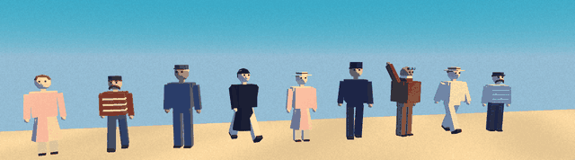

### Pilot's scarf

- **Aliases:** the scarf, its tails or ends, worn cloth.
- **Definition:** the pilot's white silk scarf, wrapped round his neck (part of his figure) with
  two loose ends made fresh each frame as ribbons ([Lantern light](#lantern-light) and all, lit
  as he is). In flight's wind they stream and flutter back from the knot; ashore they blow in
  the breeze and his own walking or running, or hang down his back. Worn, the ends stay
  outside his torso (a box from the hips to the shoulders that each point is pushed out of) and
  hang no lower than the small of his back, above the jacket's hem: what's left bends out
  behind him. They go on with his torso as it bobs, sits, leans or kneels.
- **Code:** `src/fabric.jo pilot_scarf`, `cloth_vertices`, `ClothWearer`, `_kept_off`,
  `_two_sided`; `src/folk.jo figure_pose`, `Figure.back`; drawn from `aegean.jo` after the
  wake and trails (`draw_cloths`).
- **Rules:** the flutter in flight is untouched by the collider (`tests/fabric_test.jo`). Each
  face of the ribbon is lit by its own normal toward the eye; after dark a face turned down is
  lit as if turned up, since the sun below the horizon would otherwise light it from below,
  cold and blue, as nothing on the wearer is (the change grows from nothing as the sun sets).
- **Capture:** `AEGEAN_LEISURE=bar AEGEAN_CAPTURE_MINUTES=766` (at the bar at 22:16);
  `AEGEAN_LEISURE=listen-walk|listen-run AEGEAN_CAPTURE_MINUTES=330` (walking or running away
  across the terrace in the afternoon).

### Ambient crowd

- **Aliases:** unnamed townsfolk, the crowd, passers-by.
- **Definition:** unnamed people in a big town (ports and capitals): sitting at the square's
  benches and café tables, talking in pairs, a vendor or two at striped market stalls in market
  hours, strolling round the square, along the waterfront and up the main streets. Pure
  presentation: no simulation, identity, money or saving; named residents ([Townsfolk](#townsfolk))
  are unchanged. Fullest in the morning and for the evening walk, thin in the afternoon heat,
  next to nobody at night; low and medium quality show about 35% and 50% of the high tier.
- **Code:** `src/ambient_crowd.jo` (`ambient_layout`, `ambient_layout_step`, `ambient_update`,
  `ambient_draw`, `ambient_density`); called from `aegean.jo update_frame` and `draw_world`.
- **Rules:** baked whole figures (6 outfits × 5 poses) drawn with one instanced call per outfit
  and pose through the town shader, within 150 m; laid out once per town as it comes within
  450 m, a loop a frame (no arrival hitch); spots and loops that touch a building are refused;
  those who stand or sit are walking solids, strollers are not.
- **Capture:** `AEGEAN_AT='-117963.77 -84900.62 0' AEGEAN_HOUR=17 AEGEAN_CAPTURE_LIFE=1`
  (Kalyrassa's square); `SHOT` lines report `crowd N`, the number drawn.

### Action cards

- **Aliases:** offers, prompts, what can be done here.
- **Definition:** every action open to the pilot at once gets a card of its own, stacked above
  the first: the first that wants F has it, one more that wants F takes R (stepping ashore on F,
  fuel on R at a fuel pier); T talks and G works on the aircraft. Cards and keys come from one
  list, so one press does one thing; on a touch screen the card is the button.
- **Code:** `aegean.jo walk_offers`, `aboard_offers`, `offer_add`, `offer_pressed`, `draw_offers`.

### Readable type

- **Aliases:** minimum type size, readable().
- **Definition:** no text is set smaller than 12.5 points on the screen (a page's CSS pixels):
  on a phone on its side (about 0.54 points per 2D unit) speech bubbles, name tags, prompt
  cards, the clock and purse, conversations, the ledger, the notice board and the fuel pier grow
  until it reads; on a desktop window nothing changes. A bubble with no room above a head goes
  beside it, never over the face.
- **Code:** `src/hud.jo ui_points`, `readable`, `readable_k`, `READABLE_POINTS`.

### Wading

- **Definition:** a walker steps through water up to 0.85 m deep (a strip of shallows at a
  beach or a dock's side), not into the sea. The world audit still checks every place is
  reachable without wading at all.
- **Code:** `src/objects.jo WALK_WADE_DEPTH`, `walk_step_precise`.

### Camera wall check

- **Aliases:** camera pull-in, keeping the view out of houses.
- **Definition:** on foot, the follow camera is brought in to just short of the first building on
  the line from the pilot's head out to where the camera would be, so a house never stands
  between the view and the pilot and the camera never sits inside one (where its walls, culled
  from inside, would show the street through them). It eases back out when the wall is passed.
- **Code:** `aegean.jo follow_clear_of_walls` (called from `update_player_follow`), using
  `town_avoid_buildings` (the walking solids) and the engine's `pull_in`.
- **Rules:** only solids taller than the pilot count (benches, tables and garden walls do not);
  never closer than a metre behind the head; samples every 0.45 m (about 0.02 ms a frame). A line
  that only grazes a corner is left alone.
- **Capture:** `AEGEAN_AT='461.50 -6325.68 -0.891'` (a Porto Vecchio house behind the pilot).

---

## Living world

The living world is the simulation of people, goods, money, news and war that runs whether or not
you watch (`docs/SIM_SPEC.md`, `src/living_*.jo`).

### Path desk

- **Aliases:** shared path search, walking-path budget.
- **Definition:** how the scenes' people (far residents, daily life, households, carriers) get
  their walking routes without a frame stall: one street search at a time, about 2 ms of it each
  frame, stopping between single walk steps and resuming next frame; the walker waits where they
  stand until the route is ready. The search visits the same nodes in the same order, so the path
  is the one a search in one go finds.
- **Code:** `src/cargo_scene.jo` `walk_search` / `walk_search_step` (the resumable search),
  `scene_walk_path` / `walk_paths_frame` (the desk); `aegean.jo update` sets the frame budget.
- **Rules:** keys name the leg (person and route revision or target); a request nobody asked for
  since the last frame gives up the desk. Headless callers and tests (no frame budget) get the
  path at once (`cargo_walk_path`). `tests/cargo_scene.jo` holds the sliced search to the same path.
### Far people

- **Definition:** named residents of the far (non-core) towns, promoted from a town's population
  when they are needed. Each is a full person with one purse. Drawing them never creates,
  destroys or renames anyone.
- **Code:** `src/living_far_people.jo:78 promote_far_person`, `far_people_minute`,
  `far_resident_views`; `FarPerson` in `src/living_far_types.jo`.

### Notices

- **Aliases:** the notice board, job notices; notes (in the notebook).
- **Definition:** posted jobs and news on a harbour board. The player pins them into the notebook.
- **Code:** `struct Notice` in `src/panels.jo`; `job_notices` in `src/townsfolk.jo`;
  `military_notices` in `src/war_view.jo`.
- **Rules:** townsfolk retell notices in their own words (past tense, with their source) rather
  than reading them out; routine logistics notices are not repeated as news.
- **Capture:** `AEGEAN_CAPTURE_PANEL=notebook AEGEAN_HOUR=8 AEGEAN_CAPTURE_MINUTES=1170`.

*Image to come: the notebook capture (`AEGEAN_CAPTURE_PANEL=notebook`) pins notices only when
open home-board jobs exist at that minute, and none did when the glossary's images were made.*

### Provenance

- **Definition:** the saved record of why a job exists: who asked, who supplies, where and when
  it was asked, and the money for goods and freight.
- **Code:** `src/living_work_types.jo:2 struct WorkProvenance`.
- **Rules:** speech gives short offers; the full provenance stays in the notebook and the contract
  panel. News is never silently refreshed: what people repeat are dated beliefs.

### Phoenix (money)

- **Aliases:** the money, the purse, phoenixes; in speech phoinix / phoinikes; small change in
  lepta (one lepton). The old name, lire, is gone from the game.
- **Definition:** the game's currency, after Greece's first modern currency (1828), whose coin
  showed a phoenix rising from flames; a phoenix is 100 lepta. Written amounts are the phoenix
  sign and the figure (`¤120`, `¤3.50`); an amount under one phoenix is written in lepta
  (`30 λ`), everywhere: the purse, menus, notices, contracts, refuelling, the map shop, the Game
  page's slots and the notebook. The sign is drawn, never an image: a stylised phoenix with its
  wings raised over a flame, filled (gold over an amber flame on the purse) or in outline (the
  bird drawn round, the flame solid). Under 19 px tall (text up to about 25 px: the purse, the
  ledger, menus, the Game page's slots) the bird would read as a yen sign, so the small sign is
  the phoenix's letter instead: a Φ standing on three tongues of flame (`PHOENIX_SMALL`).
- **Code:** `src/phoenix.jo` (`phoenix_text` writes an amount; `draw_phoenix` draws the sign;
  `ptext`, `ptext_centered` and `ptext_width` draw words with "¤" in them as the phoenix);
  speech in `src/living_talk_words.jo say_money`.
- **Rules:** the ledger keeps whole lepta (`cents` in the code; `12000` = ¤120), unchanged, so
  saves load as before. Written words carry the sign as "¤" (the generic currency sign) and are
  drawn with `ptext`, never `text`, so the phoenix shows. People say the money aloud ("near
  enough nineteen phoinikes", "thirty lepta"), rounded; speech never shows the sign or exact
  lepta. `tests/phoenix_test.jo` keeps the formats and finds any "lire" left in the sources.
- **Capture:** the purse is in every HUD capture; `AEGEAN_LEISURE=menu`, `AEGEAN_UI=board`,
  `AEGEAN_CAPTURE_PANEL=game` (with saved slots) show it on paper.

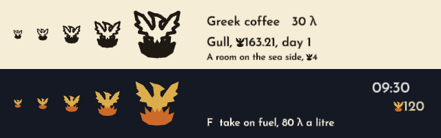

### Standing

- **Aliases:** regard, reputation.
- **Definition:** what a town or person thinks of the player, from -1000 to 1000.
- **Code:** `src/living_world.jo:120 town_regard`; the notebook's `standing_lines` in
  `src/rescue_view.jo`.
- **Not to be confused with:** race standings (`air_standings` in `src/air_race.jo`).

### Contracts

- **Aliases:** missions, commissions, military contracts.
- **Definition:** war and rescue work offered as notices and signed at an office counter.
- **Code:** `src/war_view.jo` (`contract_title`, `contract_answers`, `contract_marks`,
  `contract_act`); commission kinds (freight, mail, escort, smuggling, rescue, reconnaissance) in
  `src/living_far_types.jo`.
- **Rules:** signing needs the player at the counter with no other sortie open.
- **Capture:** `AEGEAN_CAPTURE_LIFE=1 AEGEAN_CAPTURE_WAR=contract` (about 400 frames).

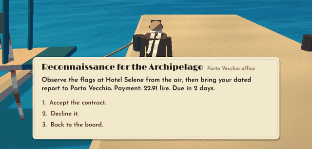

### Battle cards

- **Definition:** the title card ("Place, date") shown once, when a named battle first comes into
  sight (within 6 km), for 7 seconds.
- **Code:** `src/war_view.jo` (`BattleCard`, `battle_card_step`, `draw_battle_card`).
- **Rules:** shown once per engagement, and remembered across saves.
- **Capture:** `AEGEAN_CAPTURE_LIFE=1 AEGEAN_CAPTURE_WAR=card` (about 150 frames; the card
  shows for 7 s).

### Game slots and autosave

- **Definition:** three player-selected saved games, each with two recovery **banks**. A complete
  checkpoint includes the living world, exact player/aircraft state, physical battle/fleet,
  races, notebook, cat friendship and other presentation progress. **Autosave** updates the
  active slot after reaching a safe mooring or town on foot, and on a safe timer.
- **Code:** `src/game_session.jo`, `src/game_slots.jo`, `src/living_save.jo`; shell requests in
  `aegean.jo`. API, format and failure rules: [Game saves](../game-saves.md).
- **Rules:** a queued request is not a successful save. Browser completion means the IndexedDB
  transaction committed. Never overwrite an unknown schema or the last intact bank on failure;
  never attach a new story to a previous slot without a selection. Rendering handles are rebuilt,
  not serialized. Slots are numbered 0–2 in the API; the menu chooses their displayed labels.

### Title screen

- **Definition:** what the game starts on: the name alone, then Continue (the newest save), New
  game, Saved games and, quieter, Situations, over the **title reel**. No tagline or subtitle,
  ever. The **loading propeller** shows before it, with no words: a small two-bladed propeller
  turning slowly on the dusk, a faint ring round it filling as the islands and towns are prepared
  (the web page's own card while the module loads; natively the game draws the same).
- **Code:** `src/title_screen.jo` (`title_screen`, `title_latest`, `_soft_shade`); `aegean.jo`
  (`title_wanted`, `title_prepare`, `title_update`, `draw_title_screen`); `src/web_compat.js`
  (the loading card and its progress); `draw_loading_propeller`.
- **Rules:** the world loads once; the title only stands in front of it. Continue never asks;
  New game asks only before it would save over a slot. A soft radial shade behind the buttons and
  a fainter one behind the name, no visible edge. Test and capture runs skip it
  ([Game saves](../game-saves.md#the-title-screen)).
- **Capture:** `AEGEAN_TITLE=1 SLOPPY_FRAMES=600` (with `SLOPPY_SAVE_DIR` holding saves for the
  Continue state; `SLOPPY_WINDOW=390x844 SLOPPY_TOUCH=1` for a phone).

### Title reel

- **Aliases:** the backdrop, the title's shots.
- **Definition:** the live world behind the title in unordered shots of 18-28 s with a dip to dusk
  between them: a **low pass** over open water at the top speed (free, chasing a Gull, overtaken by
  one, or a **race**: two Falcos, flown by the real flight model, overtake, bank hard round an
  air-race pylon and pull away); **high at sunset** above the clouds; a **town and its waterfront** (a low
  run along the harbour front from just offshore, a slow golden-hour arc, or along Neravessa's
  canals). Each shot sets its own hour and fair weather. The Adagietto plays as from a cockpit
  radio and leads; aircraft sounds are a faint bed about 20 dB under it.
- **Code:** `src/title_shots.jo` (`title_next_shot`, `title_view`); `aegean.jo` (`title_cut`,
  `title_sound`, the free camera it flies).
- **Rules:** never rain; never the same kind twice running; banks of 7 degrees at most; a town shot
  never looks straight down into the streets; the low pass's water reads as flight's at that speed
  (the sea gets the reel camera's velocity; the eye at the chase camera's height, 13-16 m;
  `tests/title_reel_detail_test.py`). The world behind it is never saved: a new game puts
  back the startup's world. It costs no more than ordinary play at each quality tier.
- **Capture:** `AEGEAN_TITLE=1 AEGEAN_TITLE_SHOT=low-pass|high|city-Kalyrassa:arc|...`,
  `AEGEAN_TITLE_SEED`, `AEGEAN_TITLE_FRAMES=dir`; `tests/title_shots_test.jo` checks the rules.

### Voices

- **Definition:** the fourteen ways townsfolk talk, chosen from trade, age and temperament: salt,
  shop, formal, anxious, warm, measured, wry, guarded, plain, devout, brisk, chatty, eager and
  elder.
- **Code:** `enum VoiceKind` in `src/life_types.jo`; `voice_of_context` in
  `src/living_talk_context.jo`.

### Openers and tiered topics

- **Definition:** an **opener** is the interjection that starts a line ("Well!", "Oh,"), said
  once per listener per conversation. **Tiered topics** are how a subject unfolds when you ask
  again: first a personal answer, then a dated, second-hand particular, then a referral to whoever
  would know, then an honest end. A second notice of the same kind gets a short **follow-on**
  ("They're after grain as well") instead of the same frame again.
- **Code:** `src/living_talk_context.jo:42 fresh_opener`; `src/living_talk_words.jo`
  (`say_money`, `say_ago`, `who_said`, referrals).
- **Rules:** greetings are at most 140 characters, with no exact figures, record words or clock
  times (`tests/living_speech_style.jo`).
- **Capture:** `AEGEAN_TALK=1`; `tools/talklog.jo` for transcripts.

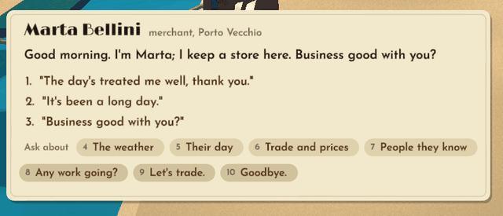

### Rotating far checks

- **Aliases:** check slices, rotated validation.
- **Definition:** how the game (recovery mode) checks the far world each minute without a frame
  stall: every dimension, index, uniqueness and conservation check runs every minute, while the
  per-record details (restocking orders, dated reports, field crops, supplier quotes, journey
  agreements) run for one sixteenth of the districts, vehicles and journeys, a different sixteenth
  each minute, so each record is checked at least every 16 game minutes.
- **Code:** `src/living_far_checks.jo:11 FAR_CHECK_SLICES`, `validate_far(w, route_points, slice,
  slices)`; chosen in `src/living_far_economy.jo` `far_economy_minute`.
- **Rules:** strict runs (tests, tools), saves and loads always check everything. The checks only
  read the world, so rotation never changes what the simulation does; the test is
  `tests/living_far_check_rotation.jo`.

### Spread minute

- **Aliases:** world-minute slices, held clock.
- **Definition:** a world minute's rules run as ordered pieces over a few frames (about 4 ms a
  frame) instead of in one frame. While a minute is in progress the scene takes no new tick and
  the frame's other World writers wait, so nothing else touches the World between its pieces: the
  same rules, in the same order, on the same World. A frame with input, a menu or the pause
  screen finishes the minute at once first; a save or load waits until it is done.
- **Code:** `src/living_sim.jo` `MinuteRun`, `minute_run_step`, `_minute_unit`;
  `src/living_scene.jo` `scene_clock_end_spread` / `scene_clock_resume`; `src/traffic.jo`
  (the held tick); `aegean.jo` `update` (`world_held`, the frame budget).
- **Rules:** headless runs and tests run each minute whole; a minute in pieces gives exactly the
  World the whole minute gives (`tests/living_minute_spread.jo`). NPC aircraft, which move only on
  scene ticks, pause for the held frames and catch up after.
## Leisure

Optional activities: eating, drinking, music, resting and working on the aircraft, for the pleasure
of it. There are no needs meters and no penalties, ever (`docs/leisure.md`).

### Leisure places

- **Definition:** a spot in a town that offers activities: its keeper (a living-world person whose
  purse takes the money), opening hours, menu, and rooms if any. Every order and room is one
  `transfer` from the player to the keeper, so the money balance holds.
- **Code:** `src/leisure.jo` (`LeisurePlace`, `leisure_order`, `leisure_take_room`,
  `spare_room_hosts`, `leisure_tinker`); menus in `src/leisure_menu.jo` (`HOTEL_FOOD`,
  `drinks_catalogue`, `keeper_remark`); panels in `src/leisure_view.jo`.
- **Rules:** dishes and drinks made from a market good follow that good's price in the town; the
  keeper's remarks never read out figures; a spare room is offered only by someone grateful (a
  remembered delivery or rescue, or warmth enough) and is free.
- **Capture:** `AEGEAN_LEISURE=menu|search|order|rest|coffee|tinker|spare` with
  `AEGEAN_CAPTURE_MINUTES` for the hour.

### Hotel Ancora

- **Definition:** the pilots' bar: a two-storey hotel on a stone pier off the Porto Vecchio
  waterfront, a plank terrace on piles over the water with four tables, a bar under a striped
  awning, lanterns on wires and a bandstand; kept by Sofia Marinou. Pilots (couriers, racers, the
  patrol) and its keeper go there of an evening as a living-world rule, so whoever is in town is
  really there, seated at its tables.
- **Code:** `src/bar_scene.jo` (`hotel_site`, `build_hotel`, `draw_band`, `draw_served`);
  the venue rule in `src/living_life_seed.jo` (`choose_life_venue`, `life_aviator`) and
  `src/living_life.jo`; seating in `src/townsfolk.jo`.
- **Rules:** the walkable deck is published as quays; the building stands over water, so it
  cannot be walked into. The terrace venue key ends with `TERRACE_VENUE_SUFFIX`.
- **Capture:** `AEGEAN_LEISURE=exterior|harbour|terrace|sit`.

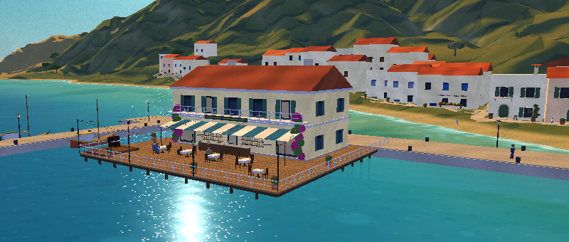

### Lantern light

- **Definition:** after dark, things near the hotel or the coffee house (the building, the people,
  the band, the table) are drawn with a warm fill added to the shade, as if lit by its lanterns
  and windows; the sea and the hills stay dark.
- **Code:** `src/bar_scene.jo` `leisure_light`.

### Bar set and singer

- **Definition:** the hotel's evening music, live from 19:00 to 23:30: a quiet set of real
  public-domain pieces (Satie's Gymnopédie No. 1, Gounod's Ave Maria, Debussy's Clair de lune,
  Tárrega's Adelita, Fauré's Berceuse) arranged for the small band (piano, violin, guitar,
  mandolin), heard through the terrace's room (the facade's reflection, a short tail, air by
  distance; no radio filter). A singer (a harmonic formant voice) sings the Ave Maria's line while
  the violin plays softer. Each evening starts one number further on, so every piece comes round.
- **Code:** `src/bar_band.jo` (`BAR_SET`, `bar_set_position`, `singer_line`, `singer_render`,
  `bar_room_sample`); the line-ups on the stand in `src/bar_scene.jo` (`draw_band`); clips with
  `tools/bar_music_clip.jo`; note sources and permissions in `data/music/SOURCES.md`.
- **Rules:** scheduled on the living world's clock, so it is where it should be after resting.

### Live source

- **Aliases:** positional live music, the band heard in place.
- **Definition:** live music heard from where it is played rather than straight into the ears: a
  constant-power pan from the camera's right with a little interaural delay and head shadow, a
  softened top when the source is behind, level and treble falling with distance (the room's share
  falling more slowly), muffled and quieter through walls and a shut door, and a room that depends
  on where the listener stands (the terrace's open air and facade, the quay with a late slap off
  the buildings, a small dense room indoors). Close by, the harbour's background ambience is
  ducked (the cafe's own murmur excepted). For the bar's band now; for a gramophone or a street
  musician later.
- **Code:** `src/live_source.jo` (`live_hearing`, `live_targets`, `live_process`, `live_duck`,
  `box_blocks`); the band's geometry in `src/bar_scene.jo` (`band_hearing`, `hotel_occlusion`,
  `hotel_zone`); `Ambience.duck` in `src/ambience.jo`; the camera's look kept as `ear_forward` in
  `aegean.jo`; `tests/live_source_test.jo`.
- **Rules:** only a tenth of a second is queued ahead, so a turn of the head is heard at once.
- **Capture:** `AEGEAN_LEISURE=listen-turn|listen-walk` with `AEGEAN_AUDIO_CAPTURE`; offline paths
  with `BAR_PATH=turn|walk|room` in `tools/bar_music_clip.jo`.

### Plane work

- **Aliases:** working on the aircraft, tinkering.
- **Definition:** a job on one's own moored aircraft done by hand: the pilot walks there, hauls the
  line in if she lies off, does the job from the quay when it is within an arm's reach, else steps
  aboard (onto a float or a flying boat's deck) and climbs a strut to the lower wing's root (over
  the fuselage to the far side if need be), works in a pose that fits (reaching up, leaning in,
  crouching), and comes back ashore. The sun moves while he works; the world's clock catches up at
  the end.
- **Code:** `src/plane_work.jo` (`craft_layout` from each model's flat parts, hub, head and
  step-off point; `task_stops`, `choose_stand`, `choose_boarding`, `craft_route`, `plan_work`);
  the stepper `plane_job_step` in `aegean.jo`; `tests/plane_work_test.jo`.
- **Rules:** reach is 1.15 m from the feet, from 0.35 m below them to 2.1 m above; the quay is
  preferred over climbing, and the near side over the far one. Small real effects only on light
  wear (`leisure_tinker`).
- **Capture:** `AEGEAN_LEISURE=work:wipe|inspect|oil|tune|patch|polish` with
  `AEGEAN_LEISURE_FRAMES=<dir>` (and `AEGEAN_CRAFT` for another airframe).

### Tavli

- **Aliases:** Portes, backgammon.
- **Definition:** the board game at the coffee house, played against a townsperson for small stakes.
  The rules are Portes: as many dice as can be played must be, the larger die when only one of two
  can be, and a gammon counts double. Each opponent plays with a personality from their traits and
  age: care (from fast and loose to careful), boldness, pace, and a voice for their remarks. The
  stake moves by one `gambling` transfer. Wins and losses are kept per person, warm their regard a
  little, and bring a word about the last game when one meets them.
- **Code:** `src/tavli.jo` (rules, `tavli_choose`, `tavli_settle`, `tavli_partners`),
  `src/tavli_view.jo` (the drawn board, dice physics, input); `tavli_frame` in `aegean.jo`;
  `tests/tavli_test.jo`; `tools/tavli_board.jo` stages a position.
- **Plakoto:** the second game, chosen with the stake: a single checker on a point is pinned, not
  hit, and freed when the pinner leaves; pinning the other's last checker at home (the "mother")
  wins double. The opponent sits across the table in the scene, framed in a window the board's
  panel leaves open (`camera_into_window`), with gestures from the game (`src/tavli_view.jo`); the
  dice's rattle and clacks and the checkers' clicks are made in code (`src/tavli_sound.jo`).
- **Capture:** `AEGEAN_LEISURE=tavli-choose|tavli|tavli-mid|tavli-plakoto`
  (`AEGEAN_TAVLI_GESTURE` for a gesture).

### Band request

- **Definition:** a number asked of the Hotel Ancora's band, with a phoenix in the hat (a transfer
  to the house). It is played as soon as the number playing (and the pause after it) is over, or it
  opens the evening. The set then carries on where it was. Only one request may wait at a time.
- **Code:** `BandRequest` (`src/band_request.jo`), `bar_set_position(tick, requests)` and
  `bar_request_start` in `src/bar_band.jo`; `leisure_request` in `src/leisure.jo`.
- **Capture:** `AEGEAN_LEISURE=request|requested`.

### The paper

- **Aliases:** the newspaper, the Courier.
- **Definition:** today's paper at the coffee house: a broadsheet column made from what the town
  has heard. It carries the harbour's and its people's news, telegrams (far reports), shortages,
  the market's prices with the latest word of them elsewhere, the harbour office's weather, and
  posted work and air meets as notices. It is read-only, and bought once a day.
- **Code:** `src/newspaper.jo`, `src/newspaper_view.jo`; `leisure_buy_paper` in `src/leisure.jo`.
- **Capture:** `AEGEAN_LEISURE=paper` (`AEGEAN_PAPER_SCROLL=<px>`).

### Dock fishing

- **Aliases:** fishing from the dock, the catch, the bucket, the fish stall, the locker.
- **Definition:** fishing from a dock or quay in a harbour town: cast, wait for the float, and
  strike while it is under. Bites come livelier at dawn and dusk.
  - **The catch in hand:** a fish landed is in the pilot's hand, at its kind's size and colours,
    flapping hard at first and then in fits. He walks with it.
  - **No casting while holding one:** the fish goes into a bucket within reach (B) or back into
    the sea (X, an arc and a small splash). No card offers what wants the hand he holds it in
    (fishing again, a cat, hauling the line, the waters, work on the aircraft).
  - **Buckets are objects in the world:** each belongs to someone and is always somewhere: in the
    player's locker, at its owner's (by a fisherman's boat, a chandler's or office counter), set
    down on a dock, or carried. Nothing appears in the hand; B picks a bucket up where it is and
    puts it down where he stands, and a bucket left on a dock stays there and is saved.
  - **Where buckets come from:**
    - his own is in his locker at the home port;
    - he can borrow one: ask a fisherman, the harbour office or the chandler; friendlier people
      lend more readily, and they remember whether it came back, and how late;
    - he can buy one at a chandler's or store, where it is put on the counter for him.
  - **Returning:** a borrowed bucket goes back to its owner, handed over in talk or set at their
    boat or counter.
  - **Carrying:** a bucket of fish is carried by its handle: no running with fish in it. A crate
    wants both hands, so the bucket goes down first.
  - **The stock:** the catch is not in the living world's stock while held. It enters it only at
    the town's fish stall, sold there through the ledger (production into his pocket at the
    market, `record_creation` and `cargo_mint`, then `trade`), or at the Hotel Ancora, where the
    kitchen grills a plate of it (production, then consumption, both recorded, and the cook's
    charge to the house). The fish sold from a borrowed bucket are his own.
  - **The stall:** each harbour town but the smugglers' cove has a fish stall on open quay ground
    (or its square), found from the town's fixed geometry, clear of buildings, props, paths and
    moorings. Its trestle and poles are solid to walk round. The world audit fails one in a
    building or out of reach.
  - **Saves** keep the fish in the hand and every bucket: where it is, whose, its fish, and the
    loans remembered.
- **Code:**
  - `src/fishing.jo`: `Angling`, `FishHold`, `Bucket`, `BucketLoan`; `fish_take`,
    `fish_into_bucket`, `fish_pick_up`, `fish_put_down`, `fish_ask_bucket`,
    `fish_return_bucket`, `fish_sell`, `fish_grill`, `fish_buy_bucket`.
  - `src/fish_buckets.jo`: where the world's buckets are kept.
  - `src/fish_stall.jo`: the stall's and the locker's spots, and their solids.
  - `src/fish_view.jo`: the fish, the bucket, the stall, the locker, and the held pose via
    `figure_hand` in `src/folk.jo`.
  - `fishing_frame`, `fish_offers` and `draw_catch_scene` in `aegean.jo`.
  - Tests: `tests/fishing_test.jo`; the stall and locker checks in `tests/world_audit_test.jo`.
- **Capture:** `AEGEAN_LEISURE=fishing|fishing-bite|fish-dock|fish-hold|fish-walk|fish-market|fish-throw|fish-locker|fish-stow|fish-borrow|fish-borrowed`.
  - `AEGEAN_FISH_KIND`: the kind held.
  - `AEGEAN_FISH_AGE`: seconds since it was landed.
  - `AEGEAN_FISH_VIEW`, `AEGEAN_FISH_DIST`, `AEGEAN_FISH_PITCH`: the camera's turn from behind, its
    distance and its pitch.
  - `AEGEAN_FISH_BACK`: the step back from the locker.
  - `AEGEAN_FISH_WARM`: the lender's regard.

### Venue piano

- **Aliases:** the bar's upright, the honky-tonk, the concert grand.
- **Definition:** the piano follows where the music is heard, not the piece.
  - Live at the bar or any period venue: the 1920s honky-tonk upright, whatever the number.
  - On the radio: the classical programme the grand; popular and dance programmes the upright.
  - Elsewhere (auditions): the grand.
- **Code:** `music_set_piano` (`src/music_synth.jo`), set by `bar_music_load` (`src/bar_band.jo`)
  and `radio_music_program` (`src/radio_synth.jo`); `MusicPiece.piano` is only the usual venue's
  piano, for the tools. See `docs/music-orchestra.md`.

### Table service

- **Aliases:** the waiter, the tray, drinking at one's own pace, holding a drink.
- **Definition:** what is ordered is paid at once and brought: the hotel's waiter from the end of
  the bar on a tray (three things a trip), the barkeep along the counter to one standing at the
  bar, the coffee house's boy from the door. Each thing goes on a free spot; empties stay until
  the waiter has seen them stand a while (45 s) and comes for them, never one in hand or not
  finished. Holding an item's number or button lifts it: a drink to the lips (the arm bent at
  the elbow, the forearm turned in), the level going down only while it is there; a plate stays
  on the table and the fork goes to the mouth with a bite. Let go: the glass is held at the chest.
  Another item, or Escape, puts it down. Glasses and plates are drawn in two parts, the vessel
  and what is in it, which goes down (a glass's level, a plate's food all round); the hotel's
  china has a blue band so a plate reads on the white cloth. The tipsy sway is as it was.
- **Code:** `src/table_service.jo` (`Waiter`, `waiter_step`, `Taking`, `take_step`, `take_label`);
  `Served.amount`, `held`, `empty_for` and `LeisureState.coming` in `src/leisure.jo`;
  `build_serve_parts`, `draw_serving` in `src/bar_scene.jo`; `service_step`, `draw_service`,
  `draw_table_things`, `pilot_arm_pose` in `aegean.jo`; the bent arm (`Figure.upper`, `fore`,
  `elbows`, `reach`, `twist`, `figure_hand_local`) in `src/folk.jo`; `table_bar` in
  `src/leisure_view.jo`; `tests/table_service_test.jo`. A save keeps what is still coming (the
  waiter brings it again after a load).
- **Capture:** `AEGEAN_LEISURE=deliver|drink|held|eat|bar-drink|empties`.

### Bill of fare

- **Aliases:** the menu card, the chalk board, the secret line.
- **Definition:** what a house offers at a glance: the Hotel Ancora's printed card (double rule,
  dotted leaders) and the coffee house's chalk board, a handful of things by section with their
  prices, ordered by 1 to 9 or a click. The faint line at the foot ("Other wines and spirits on
  request"; "and whatever else the house has"), or 0, opens the house's whole book: the deep
  drinks list, searchable, unchanged. The line stays faint but is a finger's height on a phone.
- **Code:** `BILL_HOTEL`, `BILL_COFFEE`, `leisure_bill` in `src/leisure.jo`; `bill_of_fare` in
  `src/leisure_view.jo`; leisure stage 13 and `leisure_open_book` in `aegean.jo`.
- **Capture:** `AEGEAN_LEISURE=bill|bill-coffee`; the book: `menu|search`.

### The barber

- **Definition:** Stavros's chair on the waterfront at the Hotel Ancora's corner, facing a gilt
  mirror on the hotel wall: a shave and a trim, or a new mustache (clean-shaven, handlebar,
  walrus, chevron) seen in the glass as one chooses, paid by one transfer to the house while time
  passes and he talks in the dialogue's way. The style is saved with the game.
- **Code:** `src/barber.jo`; `GameSession.mustache`, `set_pilot_mustache` in `aegean.jo`;
  `tests/barber_test.jo`.
- **Capture:** `AEGEAN_LEISURE=barber|barber-walrus|barber-clean`.

### Swimming

- **Definition:** in from a beach or off the end of a dock (a dive): wading while one can stand,
  then the crawl along the surface, riding the swell from the unified water query; quays and pier
  stone are walls; out where the ground rises, or climbing onto a dock from deep water. Spray in
  the approved splash look. At night the moon's glitter lies on the sea (silver and faint, only
  once the sun is well down; the speed flecks untouched). Saving mid-swim keeps the pilot where he
  went in.
- **Code:** `src/swimming.jo`; the moon in `src/sea.jo`; `tests/swimming_test.jo`.
- **Capture:** `AEGEAN_LEISURE=swim-dock|swim-beach|swim-wade|swim-night`.

### Stargazing

- **Definition:** lying back at night on a hilltop or the end of the hotel's pier, the view drifting
  slowly round the sky. The brighter stars stand at their places on the game's own celestial
  sphere (its pole 20 degrees up toward the north, the summer sun at 6h on the equator, as
  `src/celestial.jo` turns the sun and moon), and the names of stars, constellations, the
  planets and the moon show faintly, in transliterated period Greek and in English, as one looks
  at them. T lets an hour pass. The pilot's scarf is not drawn while he lies back (tied at a
  standing neck, it hung over the view).
- **Code:** `src/stargazing.jo` (`SKY_NAMES`, `sky_star`, `Gaze`, `name_alpha`); `gaze_*` and
  `draw_gaze_sky` in `aegean.jo`; `tests/stargazing_test.jo`.
- **Capture:** `AEGEAN_LEISURE=stars|stars-hill` (`AEGEAN_GAZE_TURN` turns the view).

### Rising notes

- **Aliases:** the floating notes, musical notes over the band.
- **Definition:** small notes float up from whoever plays music in the world (not the radio), bob
  and fade, so music heard from afar can be found by looking round. Each is a real note: its
  onset from the source's note feed (`src/live_notes.jo`), thinned to about two a second (never
  closer than 0.3 s), the tune's notes (the lead part or the singer's line) before the others,
  which show only when the tune has been quiet a while; no burst after a seek or a new number.
  Higher notes rise from a little higher; louder ones are larger; a short note is an eighth with
  its flag, a longer one a quarter. Ink by day, warm cream after dark; fainter with distance
  about as the music is (gone at 140 m) and through walls. None while one sits at the hotel (a
  table or the bar), where the band is in view. Options: "Musical notes rising from music played
  nearby" (on by default).
- **Sources:** the Hotel Ancora's band (its feed `band_notes`, as `band_step` keeps it with what is
  heard; each note from its part's player, `band_spots`) and the nearest street musician, the one
  `src/life_audio.jo` plays (their phrase, `street_events`, loaded as a feed about now; heard to
  70 m, so the fade runs over half the band's distance). A cue keeps its place in a feed by frame,
  so a whole piece and a sliding window read alike, and it never steps the shared feed itself.
- **Code:** `src/note_cue.jo` (`NoteCue`, `note_cue_pick`, `note_cue_rise`, `draw_note_cue`);
  `music_cues_step`, `draw_music_cues` in `aegean.jo`; `tests/note_cue_test.jo`;
  `tools/note_cue_bench.jo` counts its work per frame.
- **Capture:** `AEGEAN_LEISURE=notes|notes-near` in the evening (`AEGEAN_CAPTURE_MINUTES=644`).

### Time skip

- **Definition:** time passing at an inn, a table or the aircraft: the screen darkens to a card with
  the clock, the scene's people and craft are folded back into the world, the world's clock runs
  on in fifteen-minute steps, and the screen comes back.
- **Code:** `leisure_time_step` in `aegean.jo`; `rest_minutes` in `src/leisure.jo`.

### Tipsy sway

- **Definition:** a gentle sway of the view after several strong drinks within three hours; it wears
  off. Nothing else changes. Off with the Options page's "A gentle sway after a few drinks".
- **Code:** `leisure_sway` in `src/leisure.jo`; `tipsy_sway` in `src/options.jo`.

---

## Rendering and engine

### Workshop repair desk

- **Aliases:** the Neravessa workshop, the repair panel.
- **Definition:** the paid repair service at Neravessa's canal workshop as the player meets it: on
  foot within 70 m with one's own aircraft moored at the slipway, a card (or the aircraft's G
  panel) asks for a quote (part, condition, parts, materials, labour, total, work time); starting
  charges for the parts and holds the labour; a mechanic works through the world's own minutes
  (waiting it out is the ordinary time skip); stopping keeps the fitted parts used and refunds the
  unused labour. Repairs bring a part to 80%, the engine first, then the hull.
- **Code:** `src/repair_desk.jo` (read-only view of the saved obligation; `desk_start`,
  `desk_cancel` through the standard dispatchers), `src/repair_panel.jo`, `workshop_panel` in
  `aegean.jo`; backend `src/canal_service.jo`; `tests/repair_desk_test.jo`.
- **Rules:** never advance the work from the UI; read progress from the obligation.
- **Capture:** `AEGEAN_CAPTURE_WORKSHOP=prompt|quote|underway|confirm|interrupted|done|refused|poor`.

### Render chart

- **Aliases:** camera-relative rendering, local chart, render origin.
- **Definition:** all GPU geometry is placed relative to an origin near the camera (snapped to
  1024 m), so 32-bit floats keep sub-centimetre precision anywhere in a country-sized world.
  Geography, saves and audio stay in absolute world coordinates.
- **Code:** `src/render_space.jo` (`render_origin`, `render_view_proj`, `render_model`,
  `precise_camera`); `docs/render-precision.md`.
- **Rules:** never build the local view-projection by multiplying an absolute one by
  `translation(origin)`; an already-local mesh uses `params.model = mat4()`. `ObjOut.world` and
  `GroundOut.world` are render-chart coordinates, not geography.
- **Not to be confused with:** the paper chart (the in-game map).

### Reversed depth

- **Aliases:** reversed Z, reversed float depth.
- **Definition:** on native Vulkan the depth buffer is a float with near at 1 and far at 0, which
  spreads precision evenly over huge distances.
- **Code:** `src/depth_space.jo` (`enable_world_depth`, `world_reverse_depth_active`,
  `world_depth_compare`).
- **Rules:** clear value, compare and decode must change together. Software and Metal fall back to
  conventional depth. `AEGEAN_LOG_DEPTH` turns it off.

### Log depth

- **Aliases:** logarithmic depth, full-log.
- **Definition:** on WebGL2 (which has no reversed Z) depth is written per fragment as
  `log2(1 + distance)`. **Split depth** is the default there: ordinary depth below 128 m and log
  depth beyond, so near geometry keeps early depth testing.
- **Code:** `src/depth_space.jo` (`world_log_depth`, `world_depth_encode`,
  `world_split_depth_active`, `world_bounded_shader`).
- **Rules:** vertex-only log depth is not allowed: it breaks large shoreline triangles.
  `AEGEAN_FULL_LOG_DEPTH=1` and `AEGEAN_LINEAR_DEPTH` are diagnostic controls.

### Z-fighting

- **Definition:** flicker where two surfaces lie in the same plane and the depth test can't decide
  which is in front.
- **Rules:** never lay coplanar overlays (a plinth on a wall, a disc on a disc); share edges
  instead (`src/planes.jo`, `src/port_mesh.jo`).

### Near clipping

- **Aliases:** near plane, the web-near bug, cut-away quay.
- **Definition:** geometry cut away because it is closer than the near plane (3.5 cm here). In
  browsers a bug once clipped whole quay triangles that crossed behind the eye; it was fixed by
  giving every vertex the same affine clip depth.
- **Code:** `src/depth_space.jo`; regression check `tools/test_web_near.mjs`.

### Crisp-text split

- **Aliases:** crisp text, scene resolution versus HUD resolution.
- **Definition:** the 3D scene renders at a capped pixel budget, while the HUD, menus, speech and
  touch controls draw at the full device resolution, so text stays sharp without paying for a
  full-resolution world.
- **Code:** `full_resolution()` in `aegean.jo` before the HUD; `src/quality.jo
  quality_next_frame`; the canvas logic in `src/web_compat.js`.
- **Rules:** change the render scale only after drawing, never mid-frame. The software renderer
  can't split, so its text stays low-resolution.

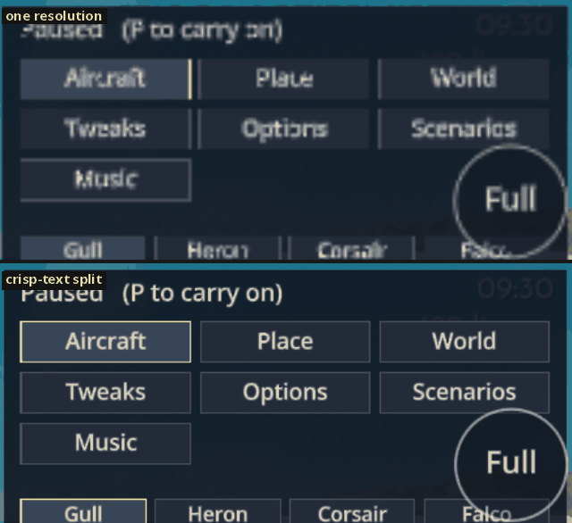

### Quality tiers

- **Aliases:** low, medium, high; tier 0, 1, 2; `AEGEAN_QUALITY`.
- **Definition:** startup-only rendering budgets; auto picks low for phones, medium for
  integrated or software GPUs and high otherwise. Simulation, controls and canonical terrain never
  depend on the tier.

  | | Low | Medium | High |
  |---|---|---|---|
  | Scene pixel cap | 230,400 | 518,400 | 2,600,000 |
  | Cloud fields | 28 | 45 | 70 |
  | Tree stride, tree distance | 3, 2.5 km | 2, 5 km | 1, 9 km |
  | Grove distance | 450 m | 550 m | 700 m |
  | Grass blades per cell, radius | 72, 8 m | 240, 11 m | 3072, 12 m |
  | Terrain error | 2.0 | 1.5 | 1.0 |

- **Code:** `src/quality.jo` (`RenderQuality`, `quality_profile`, `init_quality`); per-feature
  choices read `render_quality.tier`.
- **Rules:** coastlines and horizon silhouettes stay complete on every tier; near-contact terrain
  is canonical on every tier. Performance gates are measured on low and medium.

No image: the tiers differ in budgets more than in any single view.

### Terrain LOD and contact tiles

- **Definition:** distant terrain is drawn from nested patch grids chosen by screen error, with
  balanced neighbours and continuous morphing so it never pops. **Contact tiles** are the nine
  finest tiles around the player; collision always uses them, never a camera-dependent level of
  detail.
- **Code:** `src/terrain_lod.jo select_terrain`, `src/world_terrain.jo` (`prepare_world_terrain`,
  `world_prepare_contact`); `docs/world-renderer-design.md`.

### Canonical surface

- **Definition:** the one 14 m triangle surface (from the 8 m source) that drawing, placement and
  collision all share, so what you see is what you touch.
- **Code:** `src/world.jo surface_height`, `src/world_source.jo`; baked by `tools/bake.jo`.

### WebGL2 compatibility proxy

- **Definition:** headless Chromium (on redfox: ANGLE over Vulkan on the Intel UHD 620, 844×390
  at device pixel ratio 3, low tier), standing in for a phone.
- **Rules:** always call it a proxy; never claim its numbers as phone performance. Respect the
  WebGL2 minimum limits for uniforms, varyings, samplers and texture size.

---

## Audio

### Receiver chain

- **Aliases:** the radio chain, AM character.
- **Definition:** the radio's sample-by-sample signal model in three layers: record wear (narrow
  band, horn resonance, wow and flutter, hiss and dust), reception (fading, detuning, treble loss,
  the adjacent-carrier whistle) and the receiver itself (filters, cabinet resonance, speaker
  roll-off and a soft clip).
- **Code:** `src/radio_chain.jo` (`RadioChain`, `make_radio_chain`, `radio_chain_sample`).
- **Rules:** controls are smoothed per sample, so block size never changes the sound; its noise
  uses its own random stream and never touches the game's.

### Station levelling

- **Aliases:** the leveller.
- **Definition:** a slow gain leveller, compressor and look-ahead peak limiter on the station's
  music, before record wear and reception, so quiet passages can be heard without loud ones
  blaring.
- **Code:** `src/radio_station.jo` (`StationLevel`, `station_level`, `station_level_block`);
  applied in `src/radio_synth.jo radio_render`; the "Station levelling" checkbox on the pause
  menu's Music page.
- **Rules:** on by default. The block path must equal the per-sample path exactly
  (`tests/radio_station.jo`).

### Crackle

- **Definition:** the dense fine crackle of a weak signal: overlapping packets of tiny contacts,
  not isolated pops.
- **Code:** `src/radio_chain.jo`; `RadioSynth.crackle` in `src/radio_synth.jo`.
- **Rules:** no isolated large pops or crashes, and crackle never feeds the station leveller's
  detector.

### Programme clock

- **Definition:** each station's half-hour schedule: five minutes of news, five of editorial,
  advertisement or quiz, then music; it runs on the living world's clock. There are six stations,
  including the Aegean Maritime Service (Morse bulletins) and The Night Gull (19:00 to 03:00).
- **Code:** `src/radio.jo` (`radio_stations`, `radio_tune`, `radio_receive`); `docs/radio.md`.

### Ambience

- **Definition:** the world's background sound in nine switchable categories: bells, harbour,
  cafés, music, shore, nature, animals, ships and weather.
- **Code:** `src/ambience.jo` (scheduler and mixer), `src/ambience_synth.jo` (instruments),
  `src/ambience_scene.jo`; `docs/ambience.md`.
- **Rules:** sounds are synthesized, never recorded; ambient murmurs are never dialogue.

### Crowd bed

- **Aliases:** the harbour murmur, the cafe murmur.
- **Definition:** the looped sound of a crowd under the harbour and cafe ambience: three talkers
  near and five across the square speaking invented syllables (consonants and vowels, never
  words) in phrases whose pitch falls, conversations swelling and fading, the many beyond as a
  breathing noise, low air under it, people walking past, a short outdoor reverb; stereo, the
  ears partly alike. The cafe's has one more talker near, a smaller room and glasses and cups.
  Its parameters are fitted to CC0 and public-domain recordings of real squares, promenades, a
  wharf and cafes (`docs/crowd-reference.md`); nothing recorded ships.
- **Code:** `src/ambience_crowd.jo` (`CrowdFit`, `crowd_bed`); `tools/crowdlab.jo`.
- **Rules:** a 7 s loop with no loudness rhythm shorter than it and no held pure pitch; louder
  single voices are events from real people, never baked into the loop (`tests/ambience.jo`).
  The first version, four gated pure hums in a 2.4 s loop, was heard as a little repeating tune
  (A F# A A F#) on the quay.

### Uneven events

- **Definition:** single ambient sounds (hammering, creaks, halyard slaps, waves, animals, birds,
  single voices) played at uneven moments: time is cut into cells of the event's mean period and
  each cell holds one event at its own hashed moment, so gaps run from almost nothing to nearly
  twice the period. Each event plays one of a few takes, its pitch spread a little.
- **Code:** `src/ambience.jo` (`ambience_due`, `ambience_hash`, `ambience_take`);
  `src/ambience_scene.jo` (`ambience_event`).
- **Rules:** never a fixed period (hull hammering was once a blow every 4.7 s to the frame).

### Single voices

- **Definition:** now and then a greeting, a laugh, a call or a short exchange (a question and its
  companion's answer) from a real person near the listener; vowel-only synthesis, never words.
- **Code:** `src/ambience_scene.jo` (`ambience_voices`), `src/ambience_synth.jo`
  (`ambience_voice_take`, `ambience_utter`).
- **Rules:** from awake people out and about within 40 m (calls 90 m); even ids men's voices, odd
  women's, as the figures are dressed; rarer at night. Not the radio announcer.

### Note events

- **Aliases:** the note feed, what the band is playing note by note.
- **Definition:** a live music source's notes as they are heard, for anything that shows the music
  rather than plays it: the musicians' hands and bows, notes floating over a source. A feed is
  loaded with the note events the synthesizer plays when a piece starts (the bar's with the
  singer's line as part 14) and stepped to the frame being heard: the audio stream's position
  (what was pushed less what still waits to be heard) while the music plays, the schedule's when
  it is silent. It gives the notes that started since the last step; a seek or a skip re-syncs it
  without a burst of old ones. The live source has no travel delay, so neither has this.
- **Code:** the shared feed `src/live_notes.jo` (`LiveNote`, `LiveNoteFeed`, `live_notes_load`,
  `live_notes_step`, `live_notes_heard_frame`, `live_notes_clock_frame`; `feed.notes` sorted by
  start; velocity against the piece's loudest note, as the scores' gains run past 1); the band's in `src/bar_band.jo` (`BandFeed`,
  `bar_note_feed`, `bar_note_events`); the street phrase in `src/street_phrase.jo`; the players'
  places in `src/bar_scene.jo` (`band_spots`); `band_notes` in `aegean.jo`.
- **Rules:** one feed interface for every consumer, so what is seen and what is heard can't drift
  apart. The scores carry no slur marks, so no note is slurred.

### Musicians at play

- **Aliases:** the players' motion, bowing, the musicians' poses.
- **Definition:** the hotel band's players and the street musicians holding their instruments the
  way they are held and playing what is heard (see [Note events](#note-events)). The violin under
  the chin on the left shoulder, the left hand on the neck (higher up for the higher notes), the
  bow across the strings by the bridge: a stroke per note, down and up in turn (down again to open
  a phrase after a breath), as long as the note and as fast as it is loud, the bow tipped for the
  string the note is on, the strokes shared out over the bow so none runs out of it (a short rest
  lets the bow be lifted and set down again). The pianist at the keys, each hand over the part of
  the keyboard its notes are in (below middle C the left), dipping on each onset, the body leaning
  toward the hand furthest out. A guitar, a mandolin or a bouzouki across the body, the left hand
  along the neck with the pitch, the right hand plucking at the sound hole, sweeping across for a
  chord. The accordion's bellows opening through one phrase and closing through the next, the
  right hand on the keys (high notes lower down). A clarinet to the mouth, the fingers moving on
  the notes, the bell lifting into the phrases and the accents. The double bass plucked, the left
  hand lower on the neck for the higher notes. The singer swaying, her mouth open on the sung
  notes. The arms are two bones each, reaching for where the hands must be. The players' clock
  runs with the frame and is drawn to the frame being heard, set outright a quarter second off.
- **Code:** `src/musician_pose.jo` (`InstrumentKit`, `Rig`, `draw_rig`, `rig_elbow`,
  `Performance`, `perform_follow`, `note_groups`, `bow_strokes`, `bow_at`, `bellows_strokes`, `hand_track`, `play_violin`,
  `play_piano`, `play_plucked`, `play_accordion`, `play_clarinet`, `play_bass`, `play_singer`,
  `play_street`); the stand's places in `src/bar_scene.jo` (`band_spots`, `draw_band`); the street
  musicians in `src/townsfolk.jo` (`draw_folk`); `tests/musicians_test.jo`; every player side by
  side in `tools/musician_view.jo`.
- **Rules:** every number of the set and its players' motions are made when the game starts
  (about 16 ms on the desktop, the violin's bow plan most of it), so a number starting costs
  nothing; a piece forced for a capture is made when it starts. The piano's keys (white, the
  black in their groups) are drawn within 25 m of the stand. The violin is drawn 1.4 times a
  real one's size, as the figures' heads are large; the players' arm bones are a little longer
  than the walking figures' so the hands reach (`tests/musicians_test.jo` checks the violinist's).
- **Capture:** `AEGEAN_BAND='piece lineup [from]'` (a catalogue piece in a line-up, 0 the pianist
  alone ... 6 violin and guitar, from that second, at any hour; not heard) with
  `AEGEAN_LEISURE=band` and `AEGEAN_HOUR`.

---

## Process

### Redfox

- **Aliases:** the laptop.
- **Definition:** the quiet, always-on laptop (`ssh dsamson@192.168.1.79`; Intel i5-8350U with
  UHD 620 graphics), the only machine used for wall-clock and GPU timing and for anything that
  opens a window. Not to be confused with the desktop, `desktop-msi-redfox`, which runs builds,
  tests and instruction counts headless.
- **Rules:** work only in your own clone or `~/dev/tmp` there; one job at a time under the bench
  lock; label every measurement with its host.

### Bench lock and bench ledger

- **Definition:** the **bench lock** (`flock ~/dev/tmp/bench.lock` on redfox) lets only one timing
  job run at a time. The **bench ledger** (`~/dev/tmp/aegean-skies/bench-ledger.md`) gets one
  line per booking: who, base and candidate SHA, expected minutes, and queued, start and end
  times.
- **Rules:** build and copy outside the lock; keep each locked batch under about 20 minutes and
  release it between matrices; reject candidates first with desktop instruction counts where
  possible.

### Pinned base

- **Aliases:** base SHA, frozen base.
- **Definition:** the main commit you last merged, named by its SHA, against which a candidate is
  measured with the same camera, seed, resolution, warm-up and statistic.
- **Rules:** merge main at the start and before final measurement, then freeze base and
  candidate. The default frame budget is +0.5 ms at the harbour and on open water while moving,
  on the low and medium tiers; an optimisation must gain at least 1%.

### Sample gate

- **Definition:** before a full measurement matrix on creative work, show cheap in-game samples
  (near, far and moving captures, or a short audio clip) and wait for a go. The user's eye and ear
  are the gate; "like the film" is an aspiration judged by the user, not a pass/fail test.

### Known failures

- **Definition:** test failures on main accepted by their exact signature, so reports can say
  "known failures unchanged" instead of re-diagnosing them. Any other failure must be explained.
  The list lives in `~/dev/tmp/aegean-skies/common.md`. `tests/flight_test.jo` must always pass.

### Test tiers

- **Definition:** **smoke** (`sloppy check`, the tests of the files you touched, and
  `tests/flight_test.jo`) on every iteration; **affected subsystems** before handing back; **long
  replays** (multi-seed living saves, the 30-day market) only when the work touches the living
  world or saves, once on the final candidate.

### Judging round

- **Definition:** a rare milestone review by independent outside judges (Sol, a fresh Astra,
  Grok) of a fixed capture pack, each scoring a seven-item rubric and naming the three worst
  problems. Single-judge claims are checked before acting.
- **Code:** `docs/JUDGING.md`; the pack is built by `tools/judge_pack.sh`.

### Tweaks and trials

- **Aliases:** the Tweaks page, trial flags, baseline tags.
- **Definition:** when the user approves a feel, tag it in git (for example `liked-speed-3.3x`).
  Later changes to feel, handling, sound or camera ship as checkboxes on the pause menu's Tweaks
  page, off by default, so they can be compared with the approved baseline.
- **Code:** `src/tweaks.jo` (`Tweaks`, `set_tweaks`); the page in `src/debugmenu.jo`.

### Game page and Saved card

- **Aliases:** the save menu, the slots page, the autosave toast.
- **Definition:** the **Game page** is the pause menu's first tab: the three saved-game slots, each
  with its world time, place and a short summary (aircraft, purse, day), a mark on the slot the
  autosave writes to, and Save here, Load and Delete. Saving over a slot, loading and deleting
  each ask first; a successful load closes the menu. A note under the slots says where the
  autosave goes or why it is off. The **Saved card** is the quiet "Saved" that fades in and out
  at the upper right, under the clock and the purse, when an autosave finishes.
- **Code:** `src/debugmenu.jo game_page` (drawing, confirmation); `src/game_menu.jo game_row`
  (slot header to words); `aegean.jo game_page_view` / `game_page_apply` (backend requests,
  notes); `src/hud.jo saved_toast`. Backend contract in `docs/game-saves.md`.
- **Rules:** reads only cached slot headers, never a World, so it is cheap to draw every frame.
  Upright on a phone the panel spans the screen and the page's type and buttons are 1.45 times
  bigger (1.15 on a phone on its side, where three slots must still fit); tabs grow with it.
  There is no start screen, so there is no Continue: a fresh start with saves present plays on,
  and the player loads from this page.
- **Capture:** `AEGEAN_CAPTURE_PANEL=game` (or `game-confirm`, a load waiting on slot 2) with an
  `SLOPPY_SAVE_DIR` holding slots, `SLOPPY_FRAMES=150`; `AEGEAN_CAPTURE_PANEL=saved` shows the
  Saved card; add `AEGEAN_TOUCH=1` and `SLOPPY_WINDOW=390x844` for a phone.

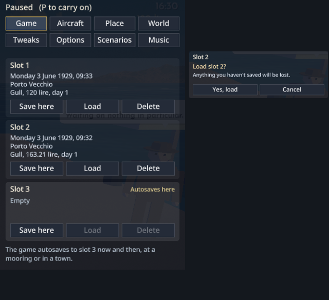

### Spread save

- **Aliases:** incremental save, stepped save.
- **Definition:** how the game saves without a frame stall: the request frame only takes a
  copy-on-write checkpoint; then, a few milliseconds after each frame's update (more while paused,
  none on a frame that ran a world minute), the save's checks run in steps, the World's text is
  written a container element at a time from a small template, hashed as it goes and compressed
  by a resumable deflate; the finished save is stored as before. Picking the bank to overwrite
  reads only headers and body sizes; the full check of a stored game happens on load.
- **Code:** `src/game_slots.jo save_game_slot` (spread) / `step_game_slots`;
  `src/living_save_stream.jo world_text_build_step`; `src/save_stream.jo` (text, hash, deflate);
  `src/living_save.jo save_check_step`; `aegean.jo step_game_save`.
- **Rules:** same save format; the streamed text is byte for byte `canonical_text`
  (`tests/living_save_stream.jo`). `tools/test_stutter.py --autosave-at` measures a stay that
  spans one.
### Coordinator

- **Definition:** the thread (Claude Opus) that plans, dispatches agents, merges their branches and
  owns UI and UX; agents expose clean APIs and data and list the UI they need.

---

## Airfield

- **Aliases:** aerodrome, strip, turf, apron.
- **Definition:** a grass military field for landplanes: a mown **strip** (bands of light and dark
  turf, white boundary markers and threshold bars, a landing circle and a landing T), the **apron**
  of worn grass before arched hangars, the office, a fuel point and windsocks that stream with the
  wind. It lies on naturally flat ground, never regraded. The **turf** is laid on the terrain's own
  14 m lattice cells and stands 0.2 m above them inside, meeting the ground over its edge cells;
  the wheels and feet stand on the turf, the same surface that is drawn. The fuel point sells from
  the stores of the town the field serves.
- **Code:** `src/airfields.jo` (data, turf, contact, walls), `src/airfield_render.jo` (meshes,
  windsocks), `src/airfield_audit.jo` (audit checks), `tools/airfield_survey.jo` (site search).
- **Rules:** a field is axis-aligned and on the 14 m lattice; trees are cleared from the whole
  field, tall grass from the turf; no road or house may cross the field (the audit checks).

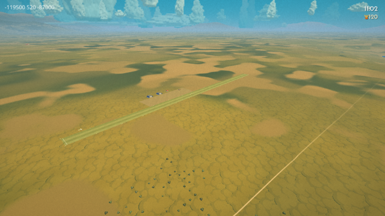

## World audit

- **Definition:** the offline sanity check over every harbour, landing, placed prop, building, door,
  bath, airfield and road: harbours that cannot be walked to their houses, landings whose approach is
  blocked, props floating above or buried in the walking surface or on ground too steep to stand
  on, berths aground or within 6 m of rock, cliffs behind quays, buildings built into one another,
  doors that open onto nothing, airfields whose strip is uneven or wet, whose approaches are blocked
  or that a road crosses, and roads that end away from their places.
- **Code:** `src/world_audit.jo` (checks, walking search), `src/world_audit_run.jo`
  (enumeration), `tools/world_audit.jo OUT.txt [all|legacy|ID,...] [reach]` (ranked report),
  `tests/world_audit_test.jo` with `tests/world_audit_allow.txt` (reviewed exceptions).
- **Rules:** walking means the real contact (stairs, quays, bridges, baths) and the collision
  grid, with steps allowed and no slope steeper than 45° over two metres. A new severe finding
  fails the test unless its key is reviewed into the allow-list.

---

## Combat

### Lead marker

- **Aliases:** the lead ring, the deflection marker, "where to aim".
- **Definition:** a small hostile-coloured ring with a dark rim and a centre dot showing where to put
  the gunsight so the rounds meet a moving hostile. It follows Sky Barons' `lead_from`: time of
  flight refined twice, the rounds keeping the aircraft's own velocity, drop added back as aim
  above. It is drawn at the guns' 450 m convergence, so it lines up with the gunsight ring in any
  view, with a faint tie back to the target. It fills when the gunsight sits on it.
- **Code:** `src/lead_marker.jo` `gun_lead`, `lead_mark` (selected hostile, else the nearest in a
  25° cone, within 1 km), `draw_lead_mark`.
- **Capture:** `AEGEAN_SCENARIO=strait AEGEAN_CAPTURE_DOGFIGHT="420 -160 20"`.

### Ground fire

- **Aliases:** ground posts, riflemen and machine-gun posts, the gunners on the roofs.
- **Definition:** scenario-owned fixed guns (`GroundGun` in a Battle) with stable negative owner IDs.
  Riflemen take aimed single shots; machine guns fire bursts behind sandbags. They lead with the
  round's time of flight and drop, wander by skill, swing at a limited rate (a close crossing
  outruns them and the fire falls in behind), and wait a reaction time after first sighting. Their
  rounds are ordinary combat rounds: the same hits, damage, tracers, muzzle flashes, whizzes and
  splashes. Posts can be shot and fall silent.
- **Code:** `src/combat.jo` `step_ground_fire`, `ground_sight`; `src/canal_ground_fire.jo`
  (the canal takeoff's posts); `src/ground_fire_view.jo` (figures, sandbags, guns).
- **Rules:** they belong to the scenario, never to the living world's population; they hold fire
  until the slipway hand-over. A machine-gun nest swings only 110° either side of the way it faces
  (its sandbag ring's open back stays behind the gunner). Rooftop posts stand on flat-roofed houses
  only (their parapet slab), the iron bridge's gun at the head of its approach stair, clear of the
  truss. `tests/canal_scenario_test.jo` bounds their hits on a takeoff run; `tests/ground_fire_test.jo`
  the arc, waking, silencing and the sounds.
- **Sound:** a rifle's crack or a machine gun's duller report, dulled further with distance and
  heard late by the sound's travel, then the canal's **flutter echo** (slaps off either wall in
  turn, each duller) and a short tail; a ground round passing close makes a sharp supersonic snap;
  each spout a short spit and plunk. `src/combat_sound.jo` `ground_report`, `bullet_snap`,
  `spout_report`, `ground_shot_cue`; offline listening: `sloppy --release tools/groundfire_audio.jo DIR`.

### Dogfight brain

- **Aliases:** the AI pilots, the enemy pilots' tactics.
- **Definition:** how combat pilots fight: Sky Barons' fighter (lead pursuit, target choice, break
  off when too close) with lag pursuit, defensive breaks and scissors, head-on passes, extending
  and coming back, unloading, zooming and wingmen's cover made explicit, shaped by skill,
  aggression, caution and nerve, with deliberate mistakes.
- **Code:** `src/combat.jo` `_dogfight`, `combat_controls`; personalities in `src/scenarios.jo`
  `STRAIT_PILOTS`; tests `tests/dogfight_test.jo`; harness `tools/dogfight_lab.jo`.
- **Capture:** `AEGEAN_SCENARIO=strait AEGEAN_CAPTURE_DOGFIGHT_PILOT=1 AEGEAN_FRAMES="dir 840 1740 2"`
  (the brain flies the player's aircraft; frames for a clip).

### Water strikes

- **Aliases:** bullet spouts, strikes on the water.
- **Definition:** where a round (any gun's, aircraft or ground) hits the water: a thin spout a
  metre or two tall that falls back within half a second, so a burst's strikes walk along the water
  in a line. Only a wreck going in raises the big lingering mist column.
- **Code:** `src/combat_view.jo` `combat_effect_events` (`.splash`); `src/combat.jo`
  `step_combat_rounds` raises the event for every owner, ground guns included.

### Screen aim

- **Definition:** mouse and drag moves push the flight aim ring along the drawn camera's right
  and up (chase, target or cockpit view, any roll), so the ring always moves the way the hand
  did on the screen.
- **Code:** `src/pilot.jo` `screen_aim`, `remember_screen_axes`.

### Target view righting

- **Definition:** the target-follow camera's up rolls back toward the horizon at a bounded rate
  (never a snap; held when looking near the vertical), and every chase frame's up is carried
  from the frame last drawn, so a look-at never flips. Before this, a target passing overhead
  could leave the picture upside down for good.
- **Code:** `src/pilot.jo` `camera_horizon_up`, `steady_camera_up`, `chase_frame`;
  `tests/camera_mouse_test.jo`.

### Slipway launch

- **Definition:** the canal takeoff's opening: the aircraft on a timber cradle on the greased ways
  inside Neravessa's workshop, engine running; the chocks come away, it slides down into the canal,
  floats off the cradle with the ordinary splash bodies, and the yard swings it to the canal's
  heading before handing over. The cradle stays at the foot of the ways.
- **Code:** `src/slipway.jo` `step_slip_launch`, `draw_slip_cradle`; `src/canal_geometry.jo`
  `slip_point` (the ramp); `src/canal_render.jo` (ways, sleepers, winch).

---
## Input

### Panels own the wheel

- **Aliases:** the wheel leak, the menu zooming the camera.
- **Definition:** while any menu, panel or overlay is open, the mouse wheel is the panel's (one
  that scrolls, scrolls) and never brings a camera nearer or farther: every `Ui` state
  (conversations, the board, handling, trade, contracts, the map counter, fuel, the leisure panels
  with their table bar, bill of fare, book, tavli, paper, barber and fishing, the workshop), the
  pause menu, the notebook, the chart and its maps, time passing, and sitting at a table or at the
  bar. A new panel is covered by being a `Ui` state.
- **Code:** `src/ui_state.jo` (`Ui`, `Overlays`, `overlays_open`, `wheel_kept`); `menus_open()` in
  `aegean.jo`, applied after every camera step that can read the wheel: the walking follow camera
  (the library's zoom and the game's own), the aboard orbit camera (`fly`), the parachute camera.
- **Tests:** `tests/camera_wheel_test.jo` (every state against the rule); `tools/wheel_probe.jo`
  turns the real wheel (`SLOPPY_INPUT` `n:wheel=1`) in the running game with each state open in
  turn, and once with nothing open to see it zoom (the command is at the top of the file).

## Capture switches

The game and its tools take environment switches for repeatable headless captures. Run them with
`env -u DISPLAY -u WAYLAND_DISPLAY SLOPPY_NO_AUDIO=1 SLOPPY_THREADS=1 SLOPPY_SEED=12345
SLOPPY_WINDOW=1280x720 SLOPPY_FRAMES=<n> SLOPPY_SCREENSHOT=<out.png> sloppy --release <program>`.

| Switch | What it does |
|---|---|
| `AEGEAN_FLYING='alt speed [cockpit]'` | start in the air off the home harbour (drawn speed, m/s); `cockpit`: in the cockpit view |
| `AEGEAN_AIRFIELD=stand|fuel|runway` | aboard at the nearest airfield: on its apron stand, at its fuel point, or at the strip's southern threshold heading down it (a landplane; with `AEGEAN_CRAFT`) |
| `AEGEAN_SWITCH=id` | after the start, change to that aircraft (Craft ID) as the pause menu's Aircraft page does |
| `AEGEAN_HOUR=h` | time of day |
| `AEGEAN_WEATHER=<name>` | weather fixture (`AEGEAN_WEATHER_CENTER='x z'` for storms) |
| `AEGEAN_CAPTURE=<recipe>` | fixed cameras from `tools/judge_scene.jo`: `home`, `dock`, `flight`, `weather-above`, `weather-below`, `weather-storm`, `weather-fog`, `cliff`, `mainland`, `place:<kind>:air|ground|old`, `port:<id>:air|warehouse|board` |
| `AEGEAN_VIEW='x y z yaw pitch hour'` | free camera |
| `AEGEAN_AT='x z yaw'` | on foot at a spot |
| `AEGEAN_SHOTS='dir 120 600'` | save those frames of a scripted (`SLOPPY_INPUT`) session as `dir/<frame>.png`, each with a `SHOT` line: mode, position, open panel, minute, purse, people within 40 m |
| `AEGEAN_QUALITY=low|medium|high` | quality tier |
| `AEGEAN_CAPTURE_PANEL=notebook|options|scenarios|speech|game|game-confirm|saved` | open a panel (`game`: the pause menu's Game page; `saved`: the autosave's card) |
| `AEGEAN_TALK=1` | talk to the nearest person |
| `AEGEAN_CAPTURE_DOGFIGHT='ahead across up'` | after a battle scenario loads, the nearest hostile placed crossing ahead (lead marker captures) |
| `AEGEAN_CRAFT_VIEW='yaw pitch distance'` | the free camera on the player's aircraft from that side (radians round from its nose and up, metres): moored with `AEGEAN_CRAFT`, or a few frames into `AEGEAN_FLYING` |
| `AEGEAN_CAPTURE_ORBIT='distance yaw pitch'` | the close orbit camera about the aircraft (applies after `AEGEAN_SCENARIO`) |
| `AEGEAN_CAPTURE_DOGFIGHT_PILOT=1` | in a battle, the dogfight brain flies the player's aircraft (chase-camera ride into the melee) |
| `AEGEAN_FRAMES='dir from to step'` | save every step-th frame from..to as `dir/fNNNNN.png` (for clips) |
| `AEGEAN_NO_GROUND_FIRE=1` | remove a scenario's ground posts (A/B timing in one binary) |
| `AEGEAN_CAPTURE_CANAL_RUN=1` | after the slipway hand-over, the tests' canal steering flies the run |
| `AEGEAN_CAPTURE_POST=k` (`AEGEAN_CAPTURE_POST_LOOK=1`) | watch the run from behind ground post k (or look at the post itself from beside it) |
| `AEGEAN_CAPTURE_WAR=card|chart|board|contract` | stage war news |
| `AEGEAN_LEISURE=sit|order|menu|search|rest|coffee|tinker|spare|terrace|bar|exterior|harbour|sleep|band|work:<job>|listen-turn|listen-walk|listen-run` | stage a leisure activity at the start (`AEGEAN_LEISURE_QUERY`, `AEGEAN_LEISURE_SECTION`) |
| `AEGEAN_BAND='piece lineup [from]'` | the hotel's band plays that catalogue piece in that line-up from that second, whatever the hour (not heard; see [Musicians at play](#musicians-at-play)) |
| `AEGEAN_LEISURE=sit|order|menu|search|rest|coffee|tinker|spare|terrace|exterior|harbour|sleep|band|work:<job>|listen-turn|listen-walk` | stage a leisure activity at the start (`AEGEAN_LEISURE_QUERY`, `AEGEAN_LEISURE_SECTION`) |
| `tools/splash_frames.jo` | `POLISH_CASE=takeoff|landing|skim|stall-in|turn|night`, `POLISH_TIME` |
| `tools/prop_disc_frames.jo` | `PROP_VIEW`, `PROP_THROTTLE`, `PROP_SWEEP` |
| `tools/coast_capture.jo` | `COAST_SITE`, `COAST_RANGE` |
| `tools/grass_sample.jo`, `tools/stripe_capture.jo`, `tools/folkview.jo`, `tools/hangar.jo` | fixed sample scenes |
