# Aegean Skies glossary

The names we use for the game's effects, systems and working habits, so that "the speed flecks" or
"the pinned base" means the same thing to everyone. Use these names in briefs, reports, commit
messages and conversation. When you introduce a new effect or term, add it here: give its name,
aliases, a definition, its code location, its rules and, where it can be seen, a picture.

Pictures are cropped captures from the game itself (procedural renders), made with the capture
switches listed under each term. Never put film stills or reference images here: they stay in
scratch (`~/dev/tmp/aegean-skies/refs`). Keep each image about 640 px wide and under about 200 KB.

Code locations are given as `file:line function` at the commit the glossary was last updated.
Line numbers drift, so search for the function name. "On `t3/<branch>`" means the term exists only
on that unmerged branch so far.

**Terms at a glance**

- **Sea and water:** [Speed flecks](#speed-flecks) · [Sun glints and the glitter path](#sun-glints-and-the-glitter-path) · [Crest strokes](#crest-strokes) · [Whitecaps](#whitecaps) · [Swell](#swell) · [Shallows band](#shallows-band) · [Shore foam](#shore-foam) · [Rain rings](#rain-rings)
- **Water effects:** [Splash bodies](#splash-bodies) · [Spray curtains](#spray-curtains) · [Splash streaks](#splash-streaks) · [Skim spray](#skim-spray) · [Wake](#wake)
- **Rivers and canals:** [River ribbon](#river-ribbon) · [Opaque river prepass](#opaque-river-prepass) · [Bank plants](#bank-plants) · [Riparian ground](#riparian-ground)
- **Aircraft:** [Prop disc](#prop-disc) · [Prop arcs](#prop-arcs) · [Arc precession](#arc-precession) · [Idle blades](#idle-blades) · [Vapour wisps](#vapour-wisps) · [Buffet](#buffet) · [Floats, hull and step](#floats-hull-and-step) · [Planing](#planing) · [Speed scale](#speed-scale) · [Chaotic stalls](#chaotic-stalls)
- **Sky:** [Cloud body](#cloud-body) · [Cloud bank and tower](#cloud-bank-and-tower) · [Overcast deck](#overcast-deck) · [Deck climb](#deck-climb) · [Anvil](#anvil) · [Weather fixtures](#weather-fixtures) · [Moon](#moon) · [Planet lights](#planet-lights) · [Painted terminator](#painted-terminator) · [Shadow masses](#shadow-masses)
- **Ground and vegetation:** [Grass blades](#grass-blades) · [Prop wash on grass](#prop-wash-on-grass) · [Grass frontier](#grass-frontier) · [Ground tint](#ground-tint) · [Wind sheen](#wind-sheen) · [Terrain stripes (historical bug)](#terrain-stripes-historical-bug) · [Coast refinement](#coast-refinement) · [Vegetation kinds and groves](#vegetation-kinds-and-groves)
- **Towns and people:** [Legacy towns](#legacy-towns) · [Close kit](#close-kit) · [Frontage](#frontage) · [Plinth](#plinth) · [Regional character](#regional-character) · [Farmstead](#farmstead) · [Paving](#paving) · [Townsfolk](#townsfolk)
- **Living world:** [Far people](#far-people) · [Notices](#notices) · [Provenance](#provenance) · [Standing](#standing) · [Contracts](#contracts) · [Battle cards](#battle-cards) · [Voices](#voices) · [Openers and tiered topics](#openers-and-tiered-topics)
- **Leisure:** [Leisure places](#leisure-places) · [Hotel Ancora](#hotel-ancora) · [Lantern light](#lantern-light) · [Bar set and singer](#bar-set-and-singer) · [Time skip](#time-skip) · [Tipsy sway](#tipsy-sway)
- **Rendering and engine:** [Render chart](#render-chart) · [Reversed depth](#reversed-depth) · [Log depth](#log-depth) · [Z-fighting](#z-fighting) · [Near clipping](#near-clipping) · [Crisp-text split](#crisp-text-split) · [Quality tiers](#quality-tiers) · [Terrain LOD and contact tiles](#terrain-lod-and-contact-tiles) · [Canonical surface](#canonical-surface) · [WebGL2 compatibility proxy](#webgl2-compatibility-proxy)
- **Audio:** [Receiver chain](#receiver-chain) · [Station levelling](#station-levelling) · [Crackle](#crackle) · [Programme clock](#programme-clock) · [Ambience](#ambience)
- **Process:** [Redfox](#redfox) · [Bench lock and bench ledger](#bench-lock-and-bench-ledger) · [Pinned base](#pinned-base) · [Sample gate](#sample-gate) · [Known failures](#known-failures) · [Test tiers](#test-tiers) · [Judging round](#judging-round) · [Tweaks and trials](#tweaks-and-trials) · [Coordinator](#coordinator)
- **Reference:** [Capture switches](#capture-switches)

---

## Sea and water

### Speed flecks

- **Aliases:** the sea's fine detail, the small coloured circles, specks or blobs, "anime-looking
  colored circles/specks/blobs", sea marks, the marks.
- **Definition:** dense, small, high-frequency flecks of pale foam and darker ripple, fixed to the
  sea surface. They come in three sizes (about 1.3, 3.6 and 10 m) and fade with distance. At speed
  they smear slightly along the direction of motion, like a one-frame shutter. Low over the water,
  they are what makes speed readable.
- **Code:** `src/sea.jo:203 sea_fleck` (one fleck) and `src/sea.jo:227 sea_marks` (the three-size
  field, called from `sea_material`). `docs/FEEL.md` calls it `_marks`, an old name.
- **Rules:** never remove, sparsen, enlarge or restyle them. They carry the sense of speed: when a
  painted-look pass replaced them with larger, sparser brush marks, the user said "your sense of
  speed is completely gone". Every water surface you can take off from (rivers, canals, lakes)
  must use the same flecks at the same scale and density. Check a low fast pass over open water
  (`AEGEAN_FLYING='60 150'`) before and after any change to water, depth, quality tiers or sky.
- **Capture:** `AEGEAN_FLYING='8 190'` or `AEGEAN_FLYING='60 150'`; `tools/precision_view.jo`
  with `PRECISION_MARKS=1` isolates the fleck painter.

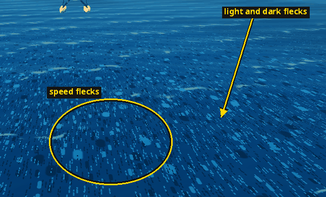

### Sun glints and the glitter path

- **Aliases:** the sun's glitter, sparkle, "small, hard sparkle" (`docs/ART.md`); close to the
  camera, the white ovals on the water.
- **Definition:** **sun glints** are sparse, tiny facets, each tipped at random and re-tipped in
  steps. Far off, each one is a pixel or two of hard white sparkle; close to the camera (beside the
  floats on a take-off or landing run) the same glints are drawn as small, flat white ovals lying on
  the water. Together they form the **glitter path**: the band of glints and soft sheen on the
  water along the sun's bearing.
- **Code:** `src/sea.jo:305 _glints`, with `sea_glint_possible` (a cheap early reject) and
  `sea_glint_anchor`; used in `sea_material`.
- **Rules:** the early reject must not thin the facets. The speed-fleck rule covers glints too:
  keep their density, scale and intensity.
- **Capture:** a low sun (`AEGEAN_HOUR` near 7 or 17) with the camera facing the sun;
  `tools/coast_capture.jo COAST_SITE=beach COAST_RANGE=300`; `tools/splash_frames.jo` close up.

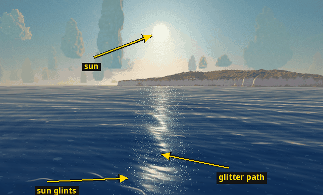

The three kinds of small marks on the water near a float, told apart by switching each off in a
scratch build (the rings mark the same places in each frame): the flat white ovals are **sun
glints**, the hairline white lines beside the splash are **splash streaks**, and the light and dark
blue discs that stay in every frame are **speed flecks**.

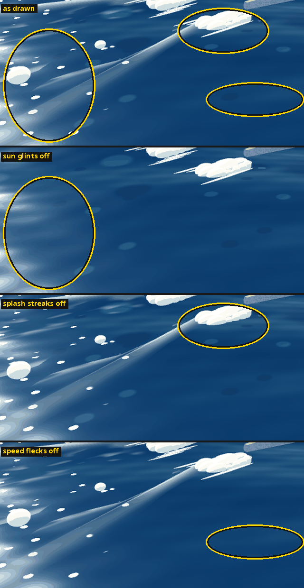

### Crest strokes

- **Aliases:** painted crests, "pale strokes across the wind".
- **Definition:** thin, pale, broken strokes on the downwind face of each swell crest, drawn from
  near to middle distance and stronger in a fresh wind.
- **Code:** `src/sea.jo:172 _strokes` and `src/sea.jo:269 _crest_strokes`; the distance fade is
  in `sea_material`.
- **Rules:** in wet weather they reuse the same field. Add no extra noise layer and no near-field
  marks for them.

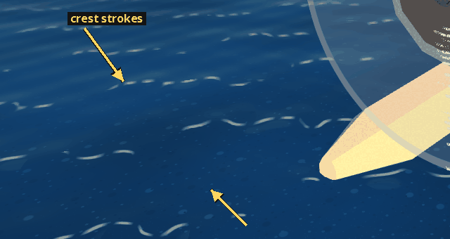

### Whitecaps

- **Definition:** foaming crests in a fresh wind, each trailing a short tail of foam behind its
  crest. Whitecaps are part of the crest-stroke field, not a separate effect.
- **Code:** the `tail` term in `src/sea.jo:172 _strokes`; its strength follows the wind through
  `_swell_amp`.
- **Capture:** `AEGEAN_WEATHER=meltemi` (the meltemi's clear gale), e.g.
  `AEGEAN_VIEW='1340 90 -5126 0.8 -0.45 11'`.

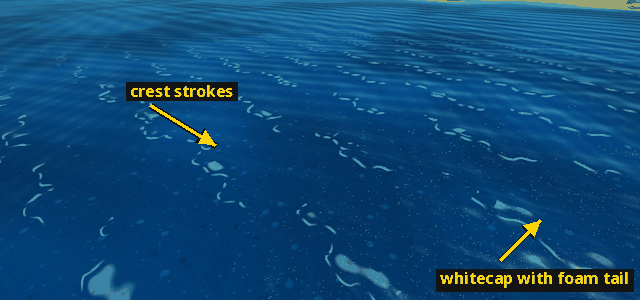

### Swell

- **Aliases:** the waves, `FlightEnv.swell`.
- **Definition:** the physical wave field: height and slope summed over six wave bands, running
  mostly with the wind. Floats, hulls and boats ride the same swell that is drawn, so what you see
  matches what the aircraft feels.
- **Code:** GPU side `src/sea.jo:81 _swell`, `sea_swell_band`, `sea_swell`; CPU side
  `src/sea.jo:763 swell_at(x, z, t)`.
- **Rules:** the decorative layers (flecks, crest strokes, glints) never drive physics. Physical
  swell, bathymetry, shore opacity, wakes and shadows must be preserved by any sea restyling.

### Shallows band

- **Aliases:** the shallows, clear coves, open shelves.
- **Definition:** the depth-driven colour ramp from cobalt in deep water, through turquoise, to
  see-through water at the shore. It reaches deep blue at 12 m on open shelves and 24 m in
  sheltered coves. The sandy seabed shows through with a faint caustic shimmer.
- **Code:** `src/sea.jo:326 sea_shallow_mix(depth, shelter)` and the body colour in
  `sea_material`; seabed caustics in `src/terrain.jo` (`ground_material`, "caustic shimmer").
- **Rules:** only the colour weight may change. Add no texture, sampler, varying or world record
  for it (`docs/painted-materials.md`).

### Shore foam

- **Aliases:** shore break, breaker, "lace at the shoreline".
- **Definition:** the white lace band where water meets land, with a breaker line just offshore.
- **Code:** the `edge`, `breaker` and `foam` terms in `src/sea.jo` `sea_material` (around line
  458).
- **Rules:** it is exactly zero beyond 3 m depth or 5 km range; its noise must not run over
  offshore pixels.
- **Capture:** `tools/coast_capture.jo` with `COAST_SITE=beach COAST_RANGE=50|300`.

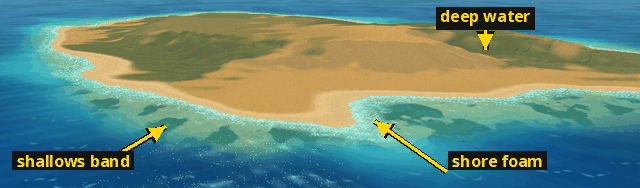

### Rain rings

- **Definition:** the rings of rain falling on the water; they are drawn only near the camera
  (fading out by 90 m).
- **Code:** the `ring` term in `src/sea.jo` `sea_material` (around line 394).

---

## Water effects

### Splash bodies

- **Aliases:** the spray, cloud-like spray, billows, scalloped splash.
- **Definition:** opaque, cloud-like spray: overlapping closed lobes that read as one continuous
  body with a scalloped, ragged rim. It sits at each float's water contact and spreads and rises
  behind the step. All splash bodies are one shared mesh and one instanced draw, with no textures.
  Detached bursts (billows) are thrown up by hard impacts.
- **Code:** `src/splash.jo:114 splash_fan` (the body at each float), `splash_instances` (all
  bodies for a craft), `draw_splashes`, `splash_fs` (flat painted regions with a small soft
  terminator on each lobe); billows in `src/world_particles.jo`.
- **Rules:** bodies leave by shrinking to nothing, never by fading their alpha. The sea shader is
  not changed for splashes. NPC spray is capped (160 particles on the low tier, 480 on high).
- **Capture:** `tools/splash_frames.jo` with `POLISH_CASE=takeoff|landing|skim|stall-in`,
  `POLISH_TIME=<seconds>`, `POLISH_KIND=0..15`.

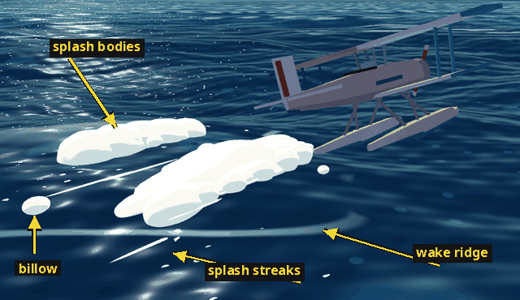

### Spray curtains

- **Aliases:** side curtains, the left and right sheets.
- **Definition:** two narrow, low, scalloped sheets of spray that peel outward and back from each
  float's sides, leaving a clear track of water between them, instead of one broad fan.
- **Code:** on `t3/splash-2` (`src/splash.jo` `splash_fan`, "Two narrow scalloped curtains"). Not
  on main yet.
- **Not to be confused with:** rain curtains (under cloud decks).

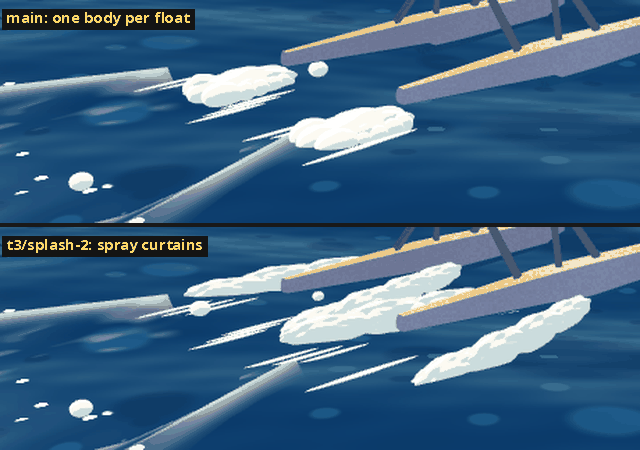

### Splash streaks

- **Aliases:** touchdown streaks, white marks, "tapered white marks", water ovals/streaks (the
  `t3/splash-2` comment). Not the white ovals on the water: those are sun glints (see the
  comparison under [Sun glints](#sun-glints-and-the-glitter-path)).
- **Definition:** thin, tapered white hairlines lying on the water in the float's wet footprint,
  three to a side, trailing back beside the splash body.
- **Code:** the "tapered white marks" loop at the end of `src/splash.jo:114 splash_fan`; they are
  splash instances with height `0.018`, placed on `swell_at` + 3.5 cm.
- **Rules:** keep them, in the same places, when the splash is reworked (`t3/splash-2` preserves
  them explicitly).

### Skim spray

- **Aliases:** skim sheet, downwash track, `skim`.
- **Definition:** the fainter fan and wake drawn when flying fast just above the water, starting
  at each float and reaching 4 to 11 m back.
- **Code:** the skim branch of `src/splash.jo` `splash_instances` and the `skim` argument of
  `src/wake.jo wake_step`.
- **Rules:** it starts above about 28 to 60 m/s of true speed with less than about 0.6 span of
  clearance.

### Wake

- **Aliases:** Kelvin wake, churn.
- **Definition:** the trail a hull or float leaves on the sea: two raised ridges spreading at the
  Kelvin angle, with foam where they are steepest, faint transverse waves, and a fading churned
  centre. It lasts about 40 s. Boats and ships use the same wake.
- **Code:** `src/wake.jo wake_step`, `draw_wakes` (constants `WAKE_EVERY`, `WAKE_LIFE`, `KELVIN`).
  `AEGEAN_NOWAKE` turns it off.

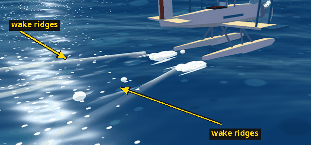

---

## Rivers and canals

On the rivers branch until it lands.

### River ribbon

- **Aliases:** the river water, inland water, the canal water.
- **Definition:** the raised water surface of the mainland river and Neravessa's canals: strips of
  twelve quads across the channel between stations, in batches of four stations. It uses the sea's
  material with its inland options: the same [speed flecks](#speed-flecks) and
  [sun glints](#sun-glints-and-the-glitter-path), carried by the current, on dark olive water. A
  batch wholly beyond 450 m (where flecks and ripples have faded out) uses the cheaper far material,
  which is exact there.
- **Code:** `src/river_render.jo` (`init_rivers`, `draw_rivers`, `draw_inland_water`);
  the material is `src/sea.jo sea_material` with `inland=true`.
- **Rules:** the speed-fleck rule applies in full. Lakes use the same seam (`draw_inland_water`).

### Opaque river prepass

- **Definition:** a depth-only pass over the river ribbon's triangles that are at least 2 m deep
  at every vertex, where the water is exactly opaque. Drawn before the terrain, it spares the
  hidden riverbed its shading. It needs no discard, so early depth testing works.
- **Code:** `src/river_render.jo` `river_with_occluder`, `draw_river_occlusion`; native
  reversed depth only. Checked by `tests/river_depth_render_test.py`.

### Bank plants

- **Aliases:** bank vegetation, the riparian corridor, river trees and reeds.
- **Definition:** poplars, plane trees, oleanders and waterline reeds along both banks, instanced
  per prototype. Detail by distance: full trees to the grove distance, then the simpler distant
  crowns, without trunks past 600 m; shrubs and reeds end at the grove distance, and past 150 m one
  reed stem in three is drawn. Distant trees end at the tier's reach (low 2 km, medium
  2.4 km, high 3.5 km), as groves do.
- **Code:** `src/river_banks.jo` (`build_river_bank`, `draw_river_banks`, `river_bank_reach`).

### Riparian ground

- **Definition:** the greener moist and alluvial ground of the river corridor, from a baked river
  mask. Its weight and the height above the river are worked out at terrain vertices, not per pixel.
- **Code:** `src/terrain.jo` `ground_riparian` (called from `world_vertex` and `coast_vs`), used
  in `ground_surface`; the mask is `src/river_material.jo`.

---

## Aircraft

### Prop disc

- **Aliases:** the propeller disc, "spinning propellers as a film animator paints them".
- **Definition:** what a spinning propeller is drawn as: a flat, pale disc with a crisp rim in the
  propeller's own plane (no screen-space overlay), with prop arcs on it. All discs in a frame are
  one instanced draw.
- **Code:** `src/prop_disc.jo` (`prop_disc_vs`, `prop_disc_fs`, `queue_prop_discs`,
  `queue_cockpit_prop_discs`, `draw_prop_discs`).
- **Rules:** the disc fades in from 16 to 50 rad/s, the arcs from 26 to 64 rad/s; below 40 rad/s
  the real blades show. Disc and blades are not drawn beyond `PROP_DISC_RANGE` (650 m).
- **Capture:** `tools/prop_disc_frames.jo` with `PROP_VIEW=side|front|close|rear|far|cockpit`,
  `PROP_THROTTLE=0..1`, `PROP_KIND=0..15`.

### Prop arcs

- **Aliases:** the short white concentric arcs, pencil arcs, bands, streaks.
- **Definition:** for each blade, a band of short white arcs around the hub, about one every 3%
  of the radius from hub to rim, each with a random length and offset and a few left out. A new
  seed redraws the whole set every other frame ("on twos"). Lines stay 2.3 to 3.3 px wide at any
  distance.
- **Code:** `src/prop_disc.jo:76 _disc_arcs`, `_disc_band_width`.

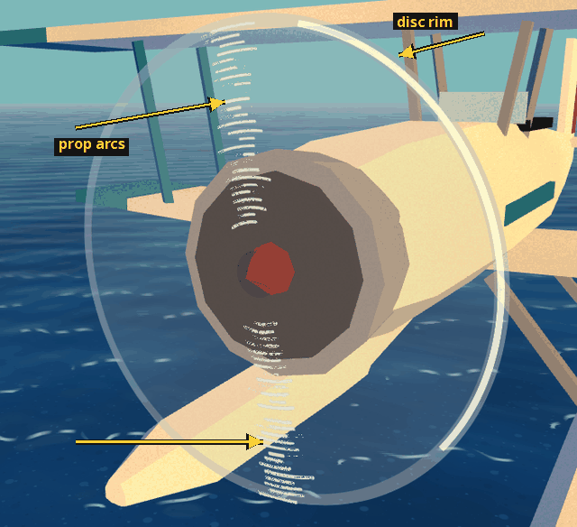

### Arc precession

- **Aliases:** band speed, band angle, the wagon-wheel drift.
- **Definition:** the designed drift of the arc bands around the hub. Their turning rate cycles
  with engine speed (a smoothed sawtooth of about 2.5 cycles that grows as the engine slows), so
  the arcs creep, reverse and creep back like a wagon wheel on film. At the lowest disc speed it
  matches the blades' real speed, so the hand-over to idle blades is seamless.
- **Code:** `src/prop_disc.jo:176 prop_band_speed` (with `PROP_TOP_SPEED`), `prop_band_angle`
  (integrated per craft); the shaft rate is `src/flight_feedback.jo prop_rotation_speed`.
- **Capture:** `PROP_SWEEP=<seconds>` and `PROP_TRACE` on `tools/prop_disc_frames.jo`, or
  `AEGEAN_PROP_SWEEP` in the game.

### Idle blades

- **Definition:** below 40 rad/s the real blade meshes are drawn instead of a disc; the arc bands
  turn with them and snap gently onto the blades. Idle shows turning blades, cruise shows a disc
  with faint arcs, and full power shows the whole effect.
- **Code:** `src/prop_disc.jo` (`PROP_BLADES_BELOW`, `prop_band_angle`).

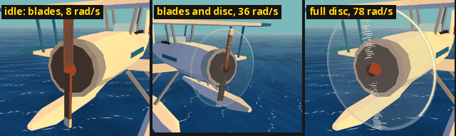

### Vapour wisps

- **Aliases:** wingtip trails, vapour trails, vapor, "a thin white stream off each wingtip".
- **Definition:** a camera-facing ribbon from each wingtip that thins and fades behind the
  aircraft. It appears only when the wings pull hard in damp air.
- **Code:** `src/trails.jo` (`trail_step`, drawing); the gate is `src/flight_feedback.jo
  vapour_dampness` and `vapour_strength` (speed, dampness and load factor).
- **Rules:** dampness needs real wet-air evidence (a cool low sea layer, low overcast, rain or
  fog); clear, dry, high air makes none. Wisps are depth-correct against clouds.
- **Capture:** `tools/splash_frames.jo` with `POLISH_CASE=turn POLISH_TIME=0.8` (a wet-air
  fixture).

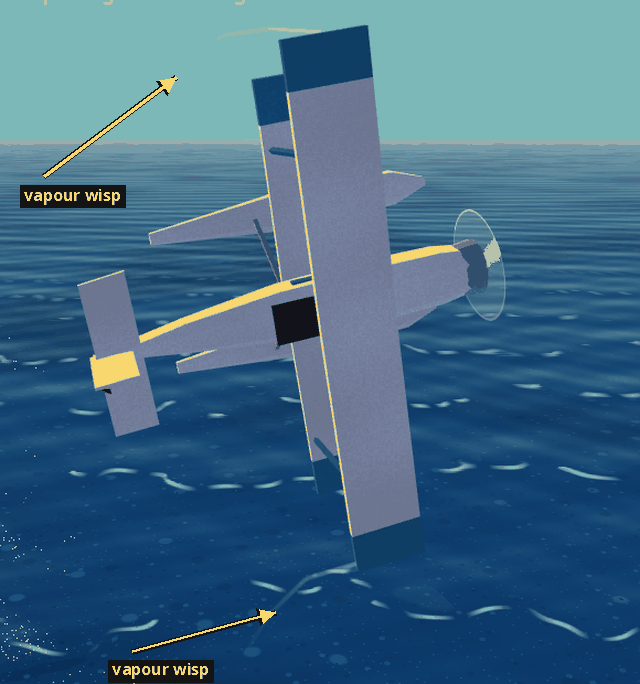

### Buffet

- **Definition:** the shaking before a stall: flow unsteadiness from 0 to 1 that rises near the
  stall angle or with wing separation, and drives the shake and flex cues.
- **Code:** `src/flight.jo` `CraftState.buffet` (set in the stall model); smoothed in
  `src/flight_feedback.jo`.

### Floats, hull and step

- **Definition:** a **floatplane** rests on two **floats**; a **flying boat** rests on its
  **hull**. The **step** is the notch in the bottom of a float or hull, about at the centre of
  gravity: once fast enough, the craft rides up on the planing surface ahead of it, and the water
  breaks free behind it. Splash bodies rise from behind the step.
- **Code:** the catalogue in `src/aircraft_catalog.jo` (stepped hulls and floats, contacts); hull
  and float planing resistance is `water_drag` in `src/flight.jo`.
- **Capture:** `tools/hangar.jo` (contact sheet of all types), `AEGEAN_CAPTURE=dock`.

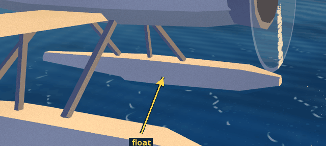

### Planing

- **Aliases:** on the step.
- **Definition:** the phase of a take-off or landing run in which the craft rides on its step
  rather than pushing through the water: drag drops, spray moves aft and the aircraft can
  accelerate to lift-off.
- **Code:** `src/flight.jo` `CraftState.planing` (set in the water model as
  `wet > 0 and plane > 0.5`); bow dig-in is in the same water model.
- **Rules:** "planing as one event" (spray, sound and release from the water together) is planned
  work in `docs/FEEL.md`.

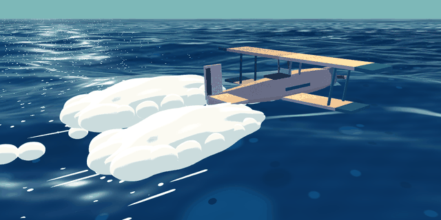

### Speed scale

- **Aliases:** drawn speed versus true speed, pure scale, `liked-speed-3.3x`.
- **Definition:** the world is flown at 3.3 times the aircraft's true speed. Drawn (visual)
  speed is true speed times the scale. The capture switch `AEGEAN_FLYING='alt speed'` takes the
  drawn speed.
- **Code:** `set_speed_scale` in `src/flight.jo`; the `pure_scale` flag in `src/tweaks.jo`;
  `pure_k` converts back to true speed.
- **Rules:** a plain scalar, not a curve; the approved version is tagged `liked-speed-3.3x`.
  Distance-dependent speed tricks (near boost, detail flow, whole-sea flow, axial stretch;
  `AEGEAN_SPEED_MODE`, `AEGEAN_NEAR_BOOST`) were rejected on 2026-11-10 and must not be revived.

### Chaotic stalls

- **Aliases:** the stall trial.
- **Definition:** the Tweaks option for a more physical stall, with left and right wing separation,
  stall breaks and spins (the user's aim includes a hammerhead with prop-wash rudder authority).
  With it off, the liked arcade flight model is unchanged.
- **Code:** `chaotic_stalls` in `src/tweaks.jo`; `wing_separation` and `_stall_rotation` in
  `src/flight.jo`; `tools/stalllab.jo`, `tools/stallframes.jo`.
- **Rules:** near the water the old model is used up to 1 span of clearance and blended in by 3
  spans. Landings must forgive firm touchdowns.

---

## Sky

### Cloud body

- **Definition:** one cloud's volume: a heaped cumulus with crisp cream tops, slate-blue shaded
  sides and a flat, darker base.
- **Code:** population in `src/cloud_field.jo`, drawing in `src/cloud_volume.jo`, painting in
  `src/cloud_paint.jo`; the paint atlas is baked by `tools/bake_clouds.jo` into the ignored
  `assets/clouds.png`.

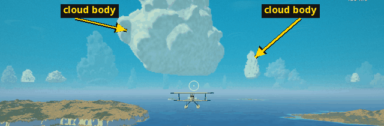

### Cloud bank and tower

- **Definition:** a **bank** is a connected, low, broad mass of cloud (550 to 1550 m tall); a
  **tower** is a tall building cumulus (up to 6500 m), as in the afternoon towers over the warm
  islands.
- **Code:** `src/cloud_field.jo:63 cloud_bank`; the bank-or-tower choice is in the same file.
  Mesh banks and the opaque cloud field described in the clouds-7 reports are on `t3/clouds-7`.

### Overcast deck

- **Aliases:** the deck, cloud deck.
- **Definition:** a bounded, climbable layer of cloud with a base and a top, the same ellipse as
  in the weather simulation. **Rain curtains** are the slanted, grey, vertically coherent shafts
  hanging below a deck.
- **Code:** deck and squall in `src/cloud_field.jo`; deck coverage and rain curtains in
  `src/cloud_volume.jo`.
- **Capture:** `AEGEAN_CAPTURE=weather-above|weather-below AEGEAN_WEATHER=overcast`.

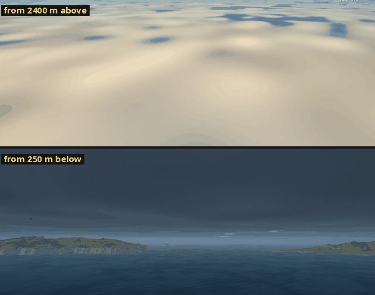

### Deck climb

- **Definition:** the set piece of climbing from a dark, rainy sea up through the overcast deck
  and breaking out into blue sky over a bright white top (`docs/DESIGN.md`).
- **Capture:** `AEGEAN_WEATHER=overcast` with `AEGEAN_VIEW` at heights from 300 to 1900 m (the
  clouds reports' deck series).

### Anvil

- **Definition:** the dark, flat-crowned top of a thunderstorm's column, at the storm centre.
- **Code:** the storm branch of `src/cloud_field.jo` ("A dark anvil and rising column").
- **Capture:** `AEGEAN_CAPTURE=weather-storm AEGEAN_WEATHER=storm
  AEGEAN_WEATHER_CENTER='0 -26000'`.

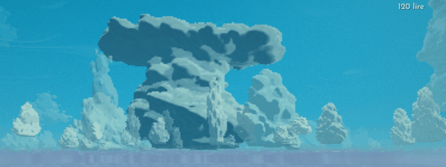

### Weather fixtures

- **Definition:** the named weathers: fair, towers, overcast, front, rain, storm (thunderstorm),
  fog, meltemi (the clear summer gale) and calm.
- **Code:** `weather_fixture` (via `AEGEAN_WEATHER=<name>`), `src/weather_scene.jo`.

### Moon

- **Definition:** a sphere lit by the actual sun direction, never a painted phase mask. On
  `t3/splash-2` its disc is the same apparent size as the sun's.
- **Code:** `src/celestial.jo sky_moon`, `moon_illumination`; the disc in `src/sky.jo`.

### Planet lights

- **Definition:** Venus, Jupiter, Mars and Saturn as calendar-driven points of light, hidden by
  clouds in front of them.
- **Code:** on `t3/splash-2` (`src/celestial.jo`, `src/sky.jo`, `tools/sky_frames.jo` with
  `SKY_TARGET=moon|venus|jupiter|mars|saturn`, `SKY_DAY`, `SKY_HOUR`). Not on main yet.

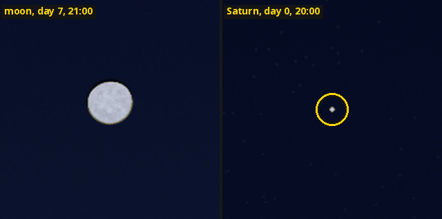

### Painted terminator

- **Definition:** the narrow, soft edge between the lit and shaded sides of a rounded form,
  drawn as a step in a painted light ramp rather than a smooth falloff. It is used on clouds,
  splash lobes and other painted materials.
- **Code:** the shared stepped ramp in `src/paint.jo`; `src/cloud_volume.jo` ("a drawn terminator
  on every rounded head"); `splash_fs` in `src/splash.jo`.

### Shadow masses

- **Definition:** large, coherent areas of cool shadow on clouds and foliage, taken from the big
  parent forms rather than from each small lobe, so shading reads as a few big shapes instead of
  "polka-dot shadows".
- **Code:** `src/cloud_paint.jo` ("children inherit the parent's shadow mass"); the newer
  version is on `t3/clouds-7`.
- **Rules:** cool shadow belongs to foliage and cloud masses, not a blue dye over every wall
  (`docs/ART.md`).

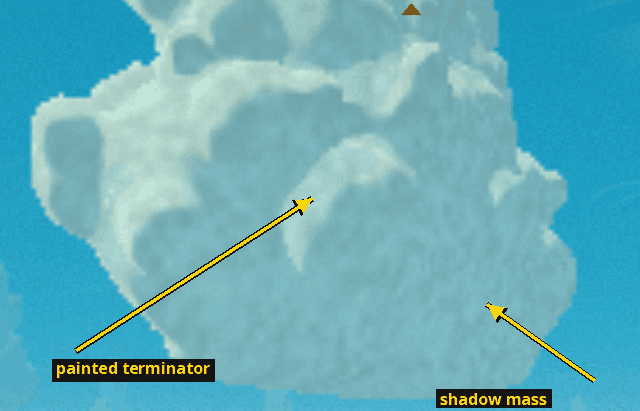

---

## Ground and vegetation

### Grass blades

- **Aliases:** meadow blades, the tuft (the mesh).
- **Definition:** single-triangle blades, instanced in 1 m cells on a fixed world grid, drawn at
  full density within a short radius around the viewer. Wind, the prop's slipstream and contact
  with the pilot are done in the vertex shader; blades are lit by the ground beneath them.
- **Code:** `src/grass.jo` (`grass_vs`, `grass_fs`, `build_tuft`, `build_grass`, `draw_grass`,
  `grass_cover` for where grass may grow).
- **Rules:** blades per cell are 72 on low, 240 on medium and 3072 on high; the draw radius is 8,
  11 and 12 m. No alpha fade or discard in the grass material. No grass on streets, plots, quays,
  steep slopes or below 3 m above sea level.
- **Capture:** `tools/grass_sample.jo`; `AEGEAN_GRASS_DENSITY`, `AEGEAN_GRASS_RADIUS`.

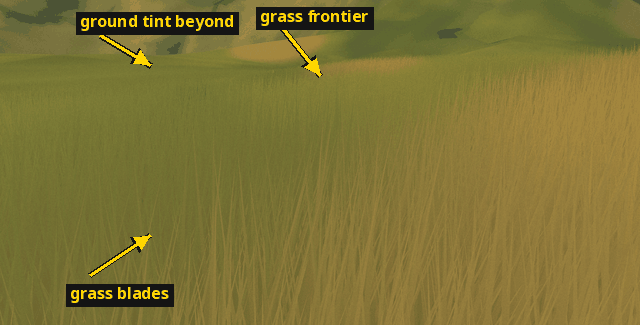

### Prop wash on grass

- **Aliases:** slipstream, airflow.
- **Definition:** grass pressed flat in a widening cone behind a running propeller, and pushed
  outward under low wings, weakening with height and engine load.
- **Code:** the `grass_airflow` branch of `src/grass.jo grass_vs`.
- **Capture:** `tools/grass_sample.jo GRASS_CASE=wash`.

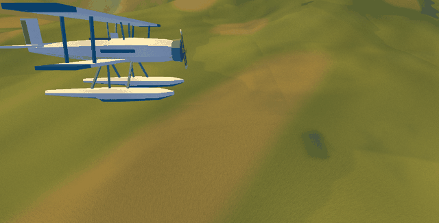

### Grass frontier

- **Aliases:** the frontier, the growth edge, the noisy frontier.
- **Definition:** the outer edge of the grass field. Over the last 4 m the blades shrink to
  nothing, and value noise moves the edge by about ±1.5 m so it never reads as a circle.
- **Code:** `src/grass.jo grass_fade_range` and the `edge` noise in `grass_vs`.
- **Rules:** the last blades stay low so their silhouette never covers a differently coloured
  ground band beyond the frontier.
- **Not to be confused with:** the war frontier (`war_frontier_hops` in `src/living_war.jo`).

### Ground tint

- **Aliases:** blade-root colour, pigment wash, ground mean.
- **Definition:** the ground colour under the grass, which is also the blade-root colour, so the
  field fades into the terrain with no visible edge. (In the terrain shader, `tint` is also the
  per-vertex dryness, maquis, ridge and high-land values that drive the ground material.)
- **Code:** `src/terrain.jo ground_material`; `src/look.jo meadow_blade_response` and the
  projected pigment wash in `src/grass.jo grass_vs`.
- **Rules:** the grass-2 gate was a mean colour difference under ΔE 3 between the grass field and
  the bare ground, seen edge-on.

### Wind sheen

- **Aliases:** meadow wave, wind wash, gusts over the grass.
- **Definition:** travelling waves of paler, bent grass that sweep across meadows with the wind,
  shared by the blades and the ground under them. The sheen is additive: it brightens and never
  darkens the base colour.
- **Code:** `src/look.jo:137 meadow_wave`; used in `src/grass.jo grass_vs` and
  `src/terrain.jo ground_material`.
- **Rules:** like all ground detail it is full strength to 60 m and gone by 260 m (the near-detail
  envelope); it must never repeat over whole hills seen from altitude (see terrain stripes).

### Terrain stripes (historical bug)

- **Aliases:** wavy ground stripes, dune lines, repeated wind bands.
- **Definition:** a bug from the first grass merge (071e319): the wind sheen was applied to the
  ground at every distance, so whole hills seen from the air were covered in regular stripes.
  Fixed in 3e2d530 by limiting it to the near-detail envelope (`meadow *= near` in
  `src/terrain.jo`).
- **Rules:** the original archipelago must stay pixel-identical through ground-shader fixes.
- **Capture:** `tools/stripe_capture.jo STRIPE_SITE=mainland|islands STRIPE_ALTITUDE=300|1000|3000`.

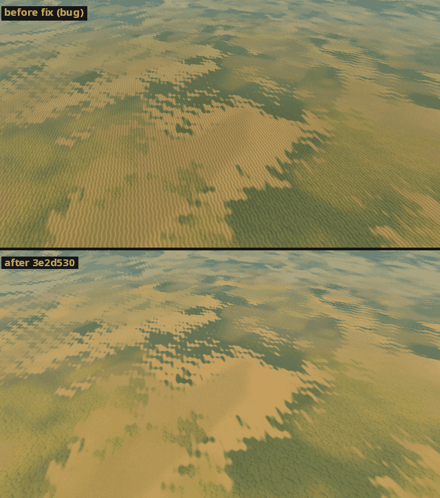

### Coast refinement

- **Aliases:** sub-source coast, the coast pattern, refined contact.
- **Definition:** near the shoreline the 14 m canonical terrain triangles are subdivided down to
  about 0.22 m with a baked pattern, so beaches and rock edges have real small-scale shape.
  Walking, landing and vessels all touch the refined heights.
- **Code:** `src/coast_field.jo` (`coast_height_detail`, `coast_contact`),
  `src/coast_pattern.jo build_coast_pattern`, `src/coast_mesh.jo init_coast_mesh`;
  `docs/coast-refinement.md`.
- **Rules:** canonical corners never move; it stays a heightfield (no overhangs or decorative
  collision rocks). Changing the pattern constants changes contact geometry. `AEGEAN_COAST=0`
  turns it off.
- **Capture:** `tools/coast_capture.jo COAST_SITE=legacy|new|beach|harbor COAST_RANGE=2000|300|50|2`.

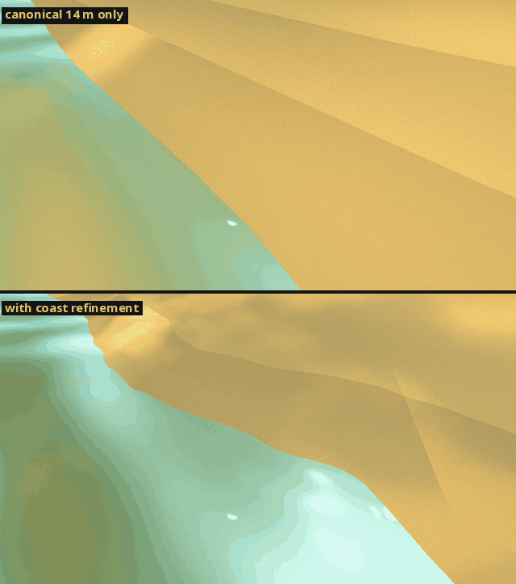

### Vegetation kinds and groves

- **Definition:** six shared plant meshes: umbrella pine, cypress, maquis, olive, oleander and
  prickly pear. **Groves** are the streamed stands of trees in the new world; olive rows sit on
  terraces at constant height.
- **Code:** `src/plants.jo` (`PLANT_KINDS`, `summer_cover`, `orchard_cover`),
  `src/world_groves.jo`.
- **Rules:** don't cut tree counts to pay for paint effects.

---

## Towns and people

### Legacy towns

- **Aliases:** the original six towns, the original archipelago.
- **Definition:** the hand-placed first towns and islands, which predate the generated world.
- **Rules:** their house, close-kit, prop and paving fingerprints must stay byte-identical through
  town work (checked by `tools/town_legacy_probe.jo`).

### Close kit

- **Definition:** the walking-level detail of a town: balconies, window openings, flowers,
  domestic tools, paving, courtyard fixtures and small props. It is built on the first visit at
  walking level, never at startup and never for a town seen from the air.
- **Code:** `src/world_towns.jo` (`prepare_close_town`, `close_sites`, `draw_close_town`,
  `close_town_meshes`, `close_town_props`).
- **Rules:** opaque close detail draws before the big house meshes; site counts and radii are
  limited per quality tier (`close_site_limit`, `close_site_radius`).
- **Capture:** `AEGEAN_CAPTURE=place:<kind>:ground`, `AEGEAN_AT='x z yaw'`,
  `tools/town_walk_probe.jo`.

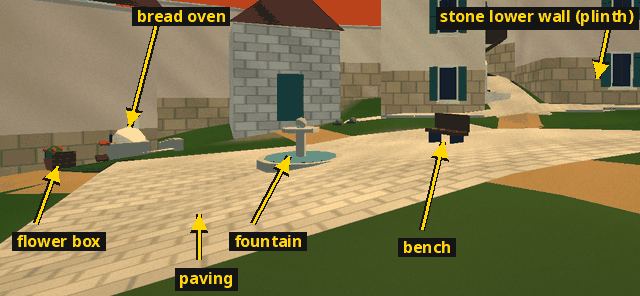

### Frontage

- **Aliases:** frontage strips, house frontages, service forecourts (at harbours).
- **Definition:** the paved strip in front of each house's door. It is also where townsfolk stand
  for their routines.
- **Code:** `src/world_towns.jo` ("Frontage strips join only nearby frontages").
- **Rules:** strips join only nearby frontages, never across house centres.

### Plinth

- **Definition:** a stone base under a wall or statue. On regional houses the stone lower wall
  *is* the plinth: no separate plinth or frontage plane is laid over it.
- **Code:** `src/town_regional_mesh.jo`, `src/town_architecture.jo` (comment above
  `arch_regional`); the statue plinth in `src/town_details.jo`.
- **Rules:** no coplanar overlays (they z-fight).

### Regional character

- **Definition:** each country's own architecture and street furniture. Kalyra has steep clay
  gables, limestone lower walls, timber balconies, square campaniles, cypresses, green signs and
  bracketed lamps; Orenthia has low white terraces with stair-head rooms, iron balconies, domed
  chapels with twin bells, olives, blue signs and globe lamps.
- **Code:** `src/town_region.jo`, `src/town_architecture.jo:150 arch_regional`,
  `src/town_regional_mesh.jo`.

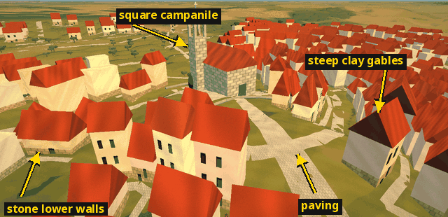

### Farmstead

- **Aliases:** farm, farm yard.
- **Definition:** an inland home with an enclosed, planted yard: walls, a gate, paths and fruit
  trees.
- **Code:** `src/town_architecture.jo:335 arch_farmstead`; `src/town_sites.jo` (`site_farm_yard`,
  `site_farm_gate`, `site_farm_walls`).
- **Rules:** `site_farm_yard` gives exact plot bounds, which `grass_cover` uses to keep grass out.
- **Capture:** `AEGEAN_CAPTURE=place:7:air|ground`.

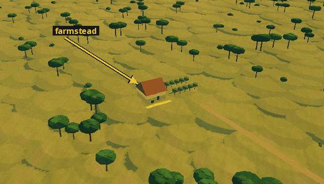

### Paving

- **Aliases:** street ribbons, paving shoulders.
- **Definition:** streets and quays drawn as ground-hugging ribbons that follow the canonical
  terrain triangles, with shoulders blending them into the ground.
- **Code:** `src/town_paving.jo` (`town_paving_shoulder`, `town_street`), `src/coast_paving.jo`.

### Townsfolk

- **Aliases:** folk, the people.
- **Definition:** the visible people in towns: each is a living-world person, dressed by trade
  and placed at their routine. A seeded share of grown men wear mustaches. Town cats live
  alongside them.
- **Code:** `src/townsfolk.jo` (`sync_folk`, `update_folk`, `draw_folk`, `dress_of`),
  `src/folk.jo:81 build_figure`, `mustache_of`; cats in `src/cats.jo`, `src/cat_bonds.jo`.
- **Rules:** a person's living-world pose is authoritative; never move decorative duplicates
  (`docs/life.md`).
- **Capture:** `tools/folkview.jo`; `tools/faceview.jo` (`FACEVIEW=pilot|follow|folk|cats`).

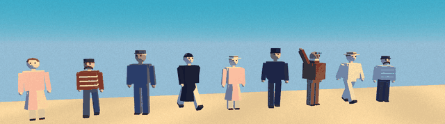

---

## Living world

The living world is the simulation of people, goods, money, news and war that runs whether or not
you watch (`docs/SIM_SPEC.md`, `src/living_*.jo`).

### Far people

- **Definition:** named residents of the far (non-core) towns, promoted from a town's population
  when they are needed. Each is a full person with one purse. Drawing them never creates,
  destroys or renames anyone.
- **Code:** `src/living_far_people.jo:78 promote_far_person`, `far_people_minute`,
  `far_resident_views`; `FarPerson` in `src/living_far_types.jo`.

### Notices

- **Aliases:** the notice board, job notices; notes (in the notebook).
- **Definition:** posted jobs and news on a harbour board. The player pins them into the notebook.
- **Code:** `struct Notice` in `src/panels.jo`; `job_notices` in `src/townsfolk.jo`;
  `military_notices` in `src/war_view.jo`.
- **Rules:** townsfolk retell notices in their own words (past tense, with their source) rather
  than reading them out; routine logistics notices are not repeated as news.
- **Capture:** `AEGEAN_CAPTURE_PANEL=notebook AEGEAN_HOUR=8 AEGEAN_CAPTURE_MINUTES=1170`.

*Image to come: the notebook capture (`AEGEAN_CAPTURE_PANEL=notebook`) pins notices only when
open home-board jobs exist at that minute, and none did when the glossary's images were made.*

### Provenance

- **Definition:** the saved record of why a job exists: who asked, who supplies, where and when
  it was asked, and the money for goods and freight.
- **Code:** `src/living_work_types.jo:2 struct WorkProvenance`.
- **Rules:** speech gives short offers; the full provenance stays in the notebook and the contract
  panel. News is never silently refreshed: what people repeat are dated beliefs.

### Standing

- **Aliases:** regard, reputation.
- **Definition:** what a town or person thinks of the player, from -1000 to 1000.
- **Code:** `src/living_world.jo:120 town_regard`; the notebook's `standing_lines` in
  `src/rescue_view.jo`.
- **Not to be confused with:** race standings (`air_standings` in `src/air_race.jo`).

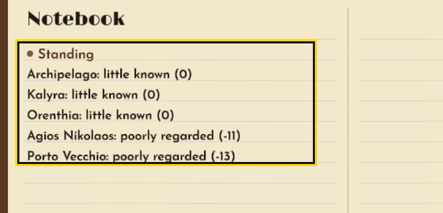

### Contracts

- **Aliases:** missions, commissions, military contracts.
- **Definition:** war and rescue work offered as notices and signed at an office counter.
- **Code:** `src/war_view.jo` (`contract_title`, `contract_answers`, `contract_marks`,
  `contract_act`); commission kinds (freight, mail, escort, smuggling, rescue, reconnaissance) in
  `src/living_far_types.jo`.
- **Rules:** signing needs the player at the counter with no other sortie open.
- **Capture:** `AEGEAN_CAPTURE_LIFE=1 AEGEAN_CAPTURE_WAR=contract` (about 400 frames).

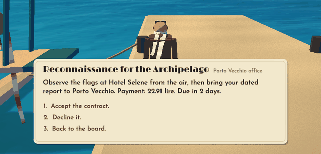

### Battle cards

- **Definition:** the title card ("Place, date") shown once, when a named battle first comes into
  sight (within 6 km), for 7 seconds.
- **Code:** `src/war_view.jo` (`BattleCard`, `battle_card_step`, `draw_battle_card`).
- **Rules:** shown once per engagement, and remembered across saves.
- **Capture:** `AEGEAN_CAPTURE_LIFE=1 AEGEAN_CAPTURE_WAR=card` (about 150 frames; the card
  shows for 7 s).

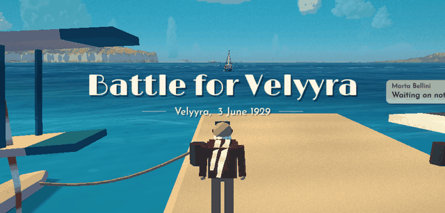

### Voices

- **Definition:** the fourteen ways townsfolk talk, chosen from trade, age and temperament: salt,
  shop, formal, anxious, warm, measured, wry, guarded, plain, devout, brisk, chatty, eager and
  elder.
- **Code:** `enum VoiceKind` in `src/life_types.jo`; `voice_of_context` in
  `src/living_talk_context.jo`.

### Openers and tiered topics

- **Definition:** an **opener** is the interjection that starts a line ("Well!", "Oh,"), said
  once per listener per conversation. **Tiered topics** are how a subject unfolds when you ask
  again: first a personal answer, then a dated, second-hand particular, then a referral to whoever
  would know, then an honest end. A second notice of the same kind gets a short **follow-on**
  ("They're after grain as well") instead of the same frame again.
- **Code:** `src/living_talk_context.jo:42 fresh_opener`; `src/living_talk_words.jo`
  (`say_money`, `say_ago`, `who_said`, referrals).
- **Rules:** greetings are at most 140 characters, with no exact figures, record words or clock
  times (`tests/living_speech_style.jo`).
- **Capture:** `AEGEAN_TALK=1`; `tools/talklog.jo` for transcripts.

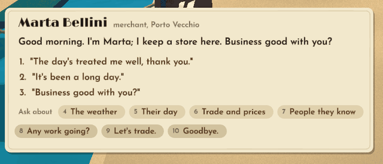

## Leisure

Optional activities: eating, drinking, music, resting and working on the aircraft, for the pleasure
of it. There are no needs meters and no penalties, ever (`docs/leisure.md`).

### Leisure places

- **Definition:** a spot in a town that offers activities: its keeper (a living-world person whose
  purse takes the money), opening hours, menu, and rooms if any. Every order and room is one
  `transfer` from the player to the keeper, so the money balance holds.
- **Code:** `src/leisure.jo` (`LeisurePlace`, `leisure_order`, `leisure_take_room`,
  `spare_room_hosts`, `leisure_tinker`); menus in `src/leisure_menu.jo` (`HOTEL_FOOD`,
  `drinks_catalogue`, `keeper_remark`); panels in `src/leisure_view.jo`.
- **Rules:** dishes and drinks made from a market good follow that good's price in the town; the
  keeper's remarks never read out figures; a spare room is offered only by someone grateful (a
  remembered delivery or rescue, or warmth enough) and is free.
- **Capture:** `AEGEAN_LEISURE=menu|search|order|rest|coffee|tinker|spare` with
  `AEGEAN_CAPTURE_MINUTES` for the hour.

### Hotel Ancora

- **Definition:** the pilots' bar: a two-storey hotel on a stone pier off the Porto Vecchio
  waterfront, a plank terrace on piles over the water with four tables, a bar under a striped
  awning, lanterns on wires and a bandstand; kept by Sofia Marinou. Pilots (couriers, racers, the
  patrol) and its keeper go there of an evening as a living-world rule, so whoever is in town is
  really there, seated at its tables.
- **Code:** `src/bar_scene.jo` (`hotel_site`, `build_hotel`, `draw_band`, `draw_served`);
  the venue rule in `src/living_life_seed.jo` (`choose_life_venue`, `life_aviator`) and
  `src/living_life.jo`; seating in `src/townsfolk.jo`.
- **Rules:** the walkable deck is published as quays; the building stands over water, so it
  cannot be walked into. The terrace venue key ends with `TERRACE_VENUE_SUFFIX`.
- **Capture:** `AEGEAN_LEISURE=exterior|harbour|terrace|sit`.

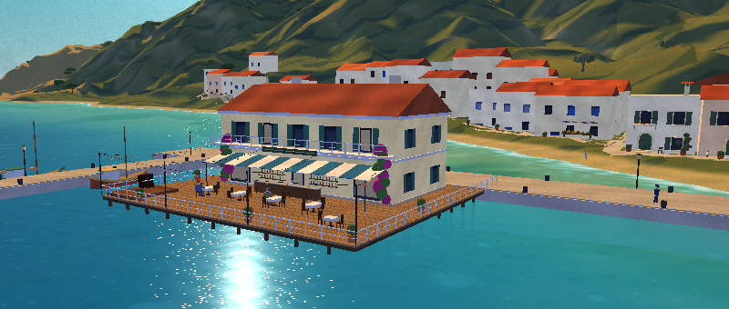

### Lantern light

- **Definition:** after dark, things near the hotel or the coffee house (the building, the people,
  the band, the table) are drawn with a warm fill added to the shade, as if lit by its lanterns
  and windows; the sea and the hills stay dark.
- **Code:** `src/bar_scene.jo` `leisure_light`.

### Bar set and singer

- **Definition:** the hotel's evening music, live from 19:00 to 23:30: the procedural orchestra in
  small line-ups (piano alone, dance band, tango trio, island pair), heard through the terrace's
  room (the facade's reflection, a short tail, air by distance; no radio filter), and a singer: a
  harmonic formant voice that sings each tune's melody (ornaments folded away, glides, a late
  vibrato) while the instrument that carried it plays softer.
- **Code:** `src/bar_band.jo` (`BAR_SET`, `bar_set_position`, `singer_line`, `singer_render`,
  `bar_room_sample`); clips with `tools/bar_music_clip.jo`.
- **Rules:** scheduled on the living world's clock, so it is where it should be after resting.

### Time skip

- **Definition:** time passing at an inn, a table or the aircraft: the screen darkens to a card with
  the clock, the scene's people and craft are folded back into the world, the world's clock runs
  on in fifteen-minute steps, and the screen comes back.
- **Code:** `leisure_time_step` in `aegean.jo`; `rest_minutes` in `src/leisure.jo`.

### Tipsy sway

- **Definition:** a gentle sway of the view after several strong drinks within three hours; it wears
  off. Nothing else changes. Off with the Options page's "A gentle sway after a few drinks".
- **Code:** `leisure_sway` in `src/leisure.jo`; `tipsy_sway` in `src/options.jo`.

---

## Rendering and engine

### Render chart

- **Aliases:** camera-relative rendering, local chart, render origin.
- **Definition:** all GPU geometry is placed relative to an origin near the camera (snapped to
  1024 m), so 32-bit floats keep sub-centimetre precision anywhere in a country-sized world.
  Geography, saves and audio stay in absolute world coordinates.
- **Code:** `src/render_space.jo` (`render_origin`, `render_view_proj`, `render_model`,
  `precise_camera`); `docs/render-precision.md`.
- **Rules:** never build the local view-projection by multiplying an absolute one by
  `translation(origin)`; an already-local mesh uses `params.model = mat4()`. `ObjOut.world` and
  `GroundOut.world` are render-chart coordinates, not geography.
- **Not to be confused with:** the paper chart (the in-game map).

### Reversed depth

- **Aliases:** reversed Z, reversed float depth.
- **Definition:** on native Vulkan the depth buffer is a float with near at 1 and far at 0, which
  spreads precision evenly over huge distances.
- **Code:** `src/depth_space.jo` (`enable_world_depth`, `world_reverse_depth_active`,
  `world_depth_compare`).
- **Rules:** clear value, compare and decode must change together. Software and Metal fall back to
  conventional depth. `AEGEAN_LOG_DEPTH` turns it off.

### Log depth

- **Aliases:** logarithmic depth, full-log.
- **Definition:** on WebGL2 (which has no reversed Z) depth is written per fragment as
  `log2(1 + distance)`. **Split depth** is the default there: ordinary depth below 128 m and log
  depth beyond, so near geometry keeps early depth testing.
- **Code:** `src/depth_space.jo` (`world_log_depth`, `world_depth_encode`,
  `world_split_depth_active`, `world_bounded_shader`).
- **Rules:** vertex-only log depth is not allowed: it breaks large shoreline triangles.
  `AEGEAN_FULL_LOG_DEPTH=1` and `AEGEAN_LINEAR_DEPTH` are diagnostic controls.

### Z-fighting

- **Definition:** flicker where two surfaces lie in the same plane and the depth test can't decide
  which is in front.
- **Rules:** never lay coplanar overlays (a plinth on a wall, a disc on a disc); share edges
  instead (`src/planes.jo`, `src/port_mesh.jo`).

### Near clipping

- **Aliases:** near plane, the web-near bug, cut-away quay.
- **Definition:** geometry cut away because it is closer than the near plane (3.5 cm here). In
  browsers a bug once clipped whole quay triangles that crossed behind the eye; it was fixed by
  giving every vertex the same affine clip depth.
- **Code:** `src/depth_space.jo`; regression check `tools/test_web_near.mjs`.

### Crisp-text split

- **Aliases:** crisp text, scene resolution versus HUD resolution.
- **Definition:** the 3D scene renders at a capped pixel budget, while the HUD, menus, speech and
  touch controls draw at the full device resolution, so text stays sharp without paying for a
  full-resolution world.
- **Code:** `full_resolution()` in `aegean.jo` before the HUD; `src/quality.jo
  quality_next_frame`; the canvas logic in `src/web_compat.js`.
- **Rules:** change the render scale only after drawing, never mid-frame. The software renderer
  can't split, so its text stays low-resolution.

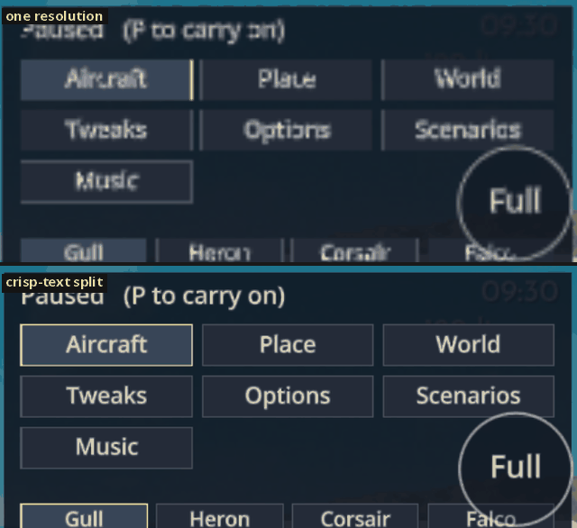

### Quality tiers

- **Aliases:** low, medium, high; tier 0, 1, 2; `AEGEAN_QUALITY`.
- **Definition:** startup-only rendering budgets; auto picks low for phones, medium for
  integrated or software GPUs and high otherwise. Simulation, controls and canonical terrain never
  depend on the tier.

  | | Low | Medium | High |
  |---|---|---|---|
  | Scene pixel cap | 230,400 | 518,400 | 2,600,000 |
  | Cloud fields | 28 | 45 | 70 |
  | Tree stride, tree distance | 3, 2.5 km | 2, 5 km | 1, 9 km |
  | Grove distance | 450 m | 550 m | 700 m |
  | Grass blades per cell, radius | 72, 8 m | 240, 11 m | 3072, 12 m |
  | Terrain error | 2.0 | 1.5 | 1.0 |

- **Code:** `src/quality.jo` (`RenderQuality`, `quality_profile`, `init_quality`); per-feature
  choices read `render_quality.tier`.
- **Rules:** coastlines and horizon silhouettes stay complete on every tier; near-contact terrain
  is canonical on every tier. Performance gates are measured on low and medium.

No image: the tiers differ in budgets more than in any single view.

### Terrain LOD and contact tiles

- **Definition:** distant terrain is drawn from nested patch grids chosen by screen error, with
  balanced neighbours and continuous morphing so it never pops. **Contact tiles** are the nine
  finest tiles around the player; collision always uses them, never a camera-dependent level of
  detail.
- **Code:** `src/terrain_lod.jo select_terrain`, `src/world_terrain.jo` (`prepare_world_terrain`,
  `world_prepare_contact`); `docs/world-renderer-design.md`.

### Canonical surface

- **Definition:** the one 14 m triangle surface (from the 8 m source) that drawing, placement and
  collision all share, so what you see is what you touch.
- **Code:** `src/world.jo surface_height`, `src/world_source.jo`; baked by `tools/bake.jo`.

### WebGL2 compatibility proxy

- **Definition:** headless Chromium (on redfox: ANGLE over Vulkan on the Intel UHD 620, 844×390
  at device pixel ratio 3, low tier), standing in for a phone.
- **Rules:** always call it a proxy; never claim its numbers as phone performance. Respect the
  WebGL2 minimum limits for uniforms, varyings, samplers and texture size.

---

## Audio

### Receiver chain

- **Aliases:** the radio chain, AM character.
- **Definition:** the radio's sample-by-sample signal model in three layers: record wear (narrow
  band, horn resonance, wow and flutter, hiss and dust), reception (fading, detuning, treble loss,
  the adjacent-carrier whistle) and the receiver itself (filters, cabinet resonance, speaker
  roll-off and a soft clip).
- **Code:** `src/radio_chain.jo` (`RadioChain`, `make_radio_chain`, `radio_chain_sample`).
- **Rules:** controls are smoothed per sample, so block size never changes the sound; its noise
  uses its own random stream and never touches the game's.

### Station levelling

- **Aliases:** the leveller.
- **Definition:** a slow gain leveller, compressor and look-ahead peak limiter on the station's
  music, before record wear and reception, so quiet passages can be heard without loud ones
  blaring.
- **Code:** `src/radio_station.jo` (`StationLevel`, `station_level`, `station_level_block`);
  applied in `src/radio_synth.jo radio_render`; the "Station levelling" checkbox on the pause
  menu's Music page.
- **Rules:** on by default. The block path must equal the per-sample path exactly
  (`tests/radio_station.jo`).

### Crackle

- **Definition:** the dense fine crackle of a weak signal: overlapping packets of tiny contacts,
  not isolated pops.
- **Code:** `src/radio_chain.jo`; `RadioSynth.crackle` in `src/radio_synth.jo`.
- **Rules:** no isolated large pops or crashes, and crackle never feeds the station leveller's
  detector.

### Programme clock

- **Definition:** each station's half-hour schedule: five minutes of news, five of editorial,
  advertisement or quiz, then music; it runs on the living world's clock. There are six stations,
  including the Aegean Maritime Service (Morse bulletins) and The Night Gull (19:00 to 03:00).
- **Code:** `src/radio.jo` (`radio_stations`, `radio_tune`, `radio_receive`); `docs/radio.md`.

### Ambience

- **Definition:** the world's background sound in nine switchable categories: bells, harbour,
  cafés, music, shore, nature, animals, ships and weather.
- **Code:** `src/ambience.jo` (scheduler and mixer), `src/ambience_synth.jo` (instruments),
  `src/ambience_scene.jo`; `docs/ambience.md`.
- **Rules:** sounds are synthesized, never recorded; ambient murmurs are never dialogue.

---

## Process

### Redfox

- **Aliases:** the laptop.
- **Definition:** the quiet, always-on laptop (`ssh dsamson@192.168.1.79`; Intel i5-8350U with
  UHD 620 graphics), the only machine used for wall-clock and GPU timing and for anything that
  opens a window. Not to be confused with the desktop, `desktop-msi-redfox`, which runs builds,
  tests and instruction counts headless.
- **Rules:** work only in your own clone or `~/dev/tmp` there; one job at a time under the bench
  lock; label every measurement with its host.

### Bench lock and bench ledger

- **Definition:** the **bench lock** (`flock ~/dev/tmp/bench.lock` on redfox) lets only one timing
  job run at a time. The **bench ledger** (`~/dev/tmp/aegean-skies/bench-ledger.md`) gets one
  line per booking: who, base and candidate SHA, expected minutes, and queued, start and end
  times.
- **Rules:** build and copy outside the lock; keep each locked batch under about 20 minutes and
  release it between matrices; reject candidates first with desktop instruction counts where
  possible.

### Pinned base

- **Aliases:** base SHA, frozen base.
- **Definition:** the main commit you last merged, named by its SHA, against which a candidate is
  measured with the same camera, seed, resolution, warm-up and statistic.
- **Rules:** merge main at the start and before final measurement, then freeze base and
  candidate. The default frame budget is +0.5 ms at the harbour and on open water while moving,
  on the low and medium tiers; an optimisation must gain at least 1%.

### Sample gate

- **Definition:** before a full measurement matrix on creative work, show cheap in-game samples
  (near, far and moving captures, or a short audio clip) and wait for a go. The user's eye and ear
  are the gate; "like the film" is an aspiration judged by the user, not a pass/fail test.

### Known failures

- **Definition:** test failures on main accepted by their exact signature, so reports can say
  "known failures unchanged" instead of re-diagnosing them. Any other failure must be explained.
  The list lives in `~/dev/tmp/aegean-skies/common.md`. `tests/flight_test.jo` must always pass.

### Test tiers

- **Definition:** **smoke** (`sloppy check`, the tests of the files you touched, and
  `tests/flight_test.jo`) on every iteration; **affected subsystems** before handing back; **long
  replays** (multi-seed living saves, the 30-day market) only when the work touches the living
  world or saves, once on the final candidate.

### Judging round

- **Definition:** a rare milestone review by independent outside judges (Sol, a fresh Astra,
  Grok) of a fixed capture pack, each scoring a seven-item rubric and naming the three worst
  problems. Single-judge claims are checked before acting.
- **Code:** `docs/JUDGING.md`; the pack is built by `tools/judge_pack.sh`.

### Tweaks and trials

- **Aliases:** the Tweaks page, trial flags, baseline tags.
- **Definition:** when the user approves a feel, tag it in git (for example `liked-speed-3.3x`).
  Later changes to feel, handling, sound or camera ship as checkboxes on the pause menu's Tweaks
  page, off by default, so they can be compared with the approved baseline.
- **Code:** `src/tweaks.jo` (`Tweaks`, `set_tweaks`); the page in `src/debugmenu.jo`.

### Coordinator

- **Definition:** the thread (Claude Opus) that plans, dispatches agents, merges their branches and
  owns UI and UX; agents expose clean APIs and data and list the UI they need.

---

## Capture switches

The game and its tools take environment switches for repeatable headless captures. Run them with
`env -u DISPLAY -u WAYLAND_DISPLAY SLOPPY_NO_AUDIO=1 SLOPPY_THREADS=1 SLOPPY_SEED=12345
SLOPPY_WINDOW=1280x720 SLOPPY_FRAMES=<n> SLOPPY_SCREENSHOT=<out.png> sloppy --release <program>`.

| Switch | What it does |
|---|---|
| `AEGEAN_FLYING='alt speed'` | start in the air off the home harbour (drawn speed, m/s) |
| `AEGEAN_HOUR=h` | time of day |
| `AEGEAN_WEATHER=<name>` | weather fixture (`AEGEAN_WEATHER_CENTER='x z'` for storms) |
| `AEGEAN_CAPTURE=<recipe>` | fixed cameras from `tools/judge_scene.jo`: `home`, `dock`, `flight`, `weather-above`, `weather-below`, `weather-storm`, `weather-fog`, `cliff`, `mainland`, `place:<kind>:air|ground|old`, `port:<id>:air|warehouse|board` |
| `AEGEAN_VIEW='x y z yaw pitch hour'` | free camera |
| `AEGEAN_AT='x z yaw'` | on foot at a spot |
| `AEGEAN_QUALITY=low|medium|high` | quality tier |
| `AEGEAN_CAPTURE_PANEL=notebook|options|scenarios|speech` | open a panel |
| `AEGEAN_TALK=1` | talk to the nearest person |
| `AEGEAN_CAPTURE_WAR=card|chart|board|contract` | stage war news |
| `AEGEAN_LEISURE=sit|order|menu|search|rest|coffee|tinker|spare|terrace|exterior|harbour|sleep` | stage a leisure activity at the start (`AEGEAN_LEISURE_QUERY`, `AEGEAN_LEISURE_SECTION`) |
| `tools/splash_frames.jo` | `POLISH_CASE=takeoff|landing|skim|stall-in|turn|night`, `POLISH_TIME` |
| `tools/prop_disc_frames.jo` | `PROP_VIEW`, `PROP_THROTTLE`, `PROP_SWEEP` |
| `tools/coast_capture.jo` | `COAST_SITE`, `COAST_RANGE` |
| `tools/grass_sample.jo`, `tools/stripe_capture.jo`, `tools/folkview.jo`, `tools/hangar.jo` | fixed sample scenes |
