# Aegean Skies glossary

The names we use for the game's effects, systems and working habits, so that "the speed flecks" or
"the pinned base" means the same thing to everyone. Use these names in briefs, reports, commit
messages and conversation. When you introduce a new effect or term, add it here: give its name,
aliases, a definition, its code location, its rules and, where it can be seen, a picture.

Pictures are cropped captures from the game itself (procedural renders), made with the capture
switches listed under each term. Never put film stills or reference images here: they stay in
scratch (`~/dev/tmp/aegean-skies/refs`). Keep each image about 640 px wide and under about 200 KB.

Code locations are given as `file:line function` at the commit the glossary was last updated.
Line numbers drift, so search for the function name. "On `t3/<branch>`" means the term exists only
on that unmerged branch so far.

**Terms at a glance**

- **Sea and water:** [Speed flecks](#speed-flecks) · [Sun glints and the glitter path](#sun-glints-and-the-glitter-path) · [Crest strokes](#crest-strokes) · [Whitecaps](#whitecaps) · [Swell](#swell) · [Storm sea](#storm-sea) · [Shallows band](#shallows-band) · [Cliff beds and lip](#cliff-beds-and-lip) · [Deep sea from height](#deep-sea-from-height) · [Shore foam](#shore-foam) · [Surf](#surf) · [Rain rings](#rain-rings)
- **Water effects:** [Splash bodies](#splash-bodies) · [Spray curtains](#spray-curtains) · [Bow sheets](#bow-sheets) · [Spray banks](#spray-banks) · [Splash streaks](#splash-streaks) · [Skim spray](#skim-spray) · [Spindrift](#spindrift) · [Wake](#wake)
- **Rivers and canals:** [River ribbon](#river-ribbon) · [Confluence](#confluence) · [Opaque river prepass](#opaque-river-prepass) · [Bank plants](#bank-plants) · [Riparian ground](#riparian-ground) · [Chart rivers](#chart-rivers) · [Canal cut](#canal-cut) · [Canal basin](#canal-basin) · [Canal crossings](#canal-crossings) · [Canal mirror](#canal-mirror) · [Canal blocks](#canal-blocks)
- **Aircraft:** [Prop disc](#prop-disc) · [Prop arcs](#prop-arcs) · [Arc precession](#arc-precession) · [Idle blades](#idle-blades) · [Vapour wisps](#vapour-wisps) · [Buffet](#buffet) · [Floats, hull and step](#floats-hull-and-step) · [Planing](#planing) · [Hydrofoil take-off](#hydrofoil-take-off) · [Contra-rotating and push-pull props](#contra-rotating-and-push-pull-props) · [Prop torque](#prop-torque) · [Aircraft shadow](#aircraft-shadow) · [Speed scale](#speed-scale) · [Chaotic stalls](#chaotic-stalls) · [Flight model v2](#flight-model-v2) · [Sky Barons port](#sky-barons-port) · [Departure resistance](#departure-resistance) · [Altimeter hands](#altimeter-hands) · [Navigation lights](#navigation-lights) · [Schneider racers](#schneider-racers) · [Race classes](#race-classes) · [Sponsons](#sponsons) · [Push-pull pair](#push-pull-pair) · [Big boats](#big-boats) · [One speed rule](#one-speed-rule) · [Wing-strut streamers](#wing-strut-streamers) · [Paint page](#paint-page) · [Paint by part](#paint-by-part) · [Decals](#decals) · [Paint shop](#paint-shop) · [Pilots' liveries](#pilots-liveries) · [Markings](#markings) · [Velos and Fairey IIIF](#velos-and-fairey-iiif) · [Cockpit arrangements and cabins](#cockpit-arrangements-and-cabins) · [Cockpit lamp and luminous dials](#cockpit-lamp-and-luminous-dials)
- **Sky:** [Cloud body](#cloud-body) · [Cloud forms](#cloud-forms) · [Cumulus field](#cumulus-field) · [Tower growth](#tower-growth) · [Cloud relief](#cloud-relief) · [Cloud shadows](#cloud-shadows) · [Overcast deck](#overcast-deck) · [Deck climb](#deck-climb) · [Anvil](#anvil) · [Storm system](#storm-system) · [Storm sighting](#storm-sighting) · [Storm sound](#storm-sound) · [Weather fixtures](#weather-fixtures) · [Sunset](#sunset) · [Sun disc](#sun-disc) · [Day's air](#days-air) · [Afterglow](#afterglow) · [Warm bounce](#warm-bounce) · [Moon](#moon) · [Planet lights](#planet-lights) · [Painted terminator](#painted-terminator) · [Shadow masses](#shadow-masses) · [Cloud bank and tower](#cloud-bank-and-tower) · [Brushwork](#brushwork) · [Lightning](#lightning) · [Rain shafts](#rain-shafts) · [Storm turbulence](#storm-turbulence) · [Windscreen rain](#windscreen-rain) · [Inside a cloud](#inside-a-cloud)
- **Ground and vegetation:** [Grass blades](#grass-blades) · [Prop wash on grass](#prop-wash-on-grass) · [Grass frontier](#grass-frontier) · [Ground tint](#ground-tint) · [Wind sheen](#wind-sheen) · [Wind study grass (trial)](#wind-study-grass-trial) · [Terrain stripes (historical bug)](#terrain-stripes-historical-bug) · [Coast refinement](#coast-refinement) · [Vegetation kinds and groves](#vegetation-kinds-and-groves) · [Far canopy](#far-canopy) · [Crowns](#crowns) · [Canopy shells](#canopy-shells) · [Far land layers](#far-land-layers) · [Farmland](#farmland) · [Grass egg](#grass-egg)
- **Towns and people:** [Quay (code) and dock (player)](#quay-code-and-dock-player) · [Offshore mooring](#offshore-mooring) · [Harbour launch](#harbour-launch) · [Fuel lighter](#fuel-lighter) · [Legacy towns](#legacy-towns) · [Close kit](#close-kit) · [Frontage](#frontage) · [Plinth](#plinth) · [Hill house](#hill-house) · [Regional character](#regional-character) · [Farmstead](#farmstead) · [Paving](#paving) · [Townsfolk](#townsfolk) · [Wardrobe](#wardrobe) · [Town look](#town-look) · [Wildlife](#wildlife) · [Dolphins](#dolphins) · [Pilot's scarf](#pilots-scarf) · [Camera wall check](#camera-wall-check) · [Path desk](#path-desk) · [Ambient crowd](#ambient-crowd) · [Action cards](#action-cards) · [Readable type](#readable-type) · [Wading](#wading)
- **Living world:** [Far people](#far-people) · [Notices](#notices) · [Dock handover](#dock-handover) · [Provenance](#provenance) · [Phoenix (money)](#phoenix-money) · [Standing](#standing) · [The pilot's name](#the-pilots-name) · [Small talk](#small-talk) · [Spoken lines](#spoken-lines) · [Talk bubbles](#talk-bubbles) · [Talk hold](#talk-hold) · [Leads](#leads) · [The club's table](#the-clubs-table) · [Errands of the islands](#errands-of-the-islands) · [A boat adrift](#a-boat-adrift) · [Contracts](#contracts) · [Battle cards](#battle-cards) · [Voices](#voices) · [Openers and tiered topics](#openers-and-tiered-topics) · [Rotating far checks](#rotating-far-checks) · [Spread minute](#spread-minute)
- **Leisure:** [Leisure places](#leisure-places) · [Hotel Ancora](#hotel-ancora) · [Bar room](#bar-room) · [Lantern light](#lantern-light) · [Bar set and singer](#bar-set-and-singer) · [The band's people](#the-bands-people) · [Live source](#live-source) · [Plane work](#plane-work) · [Time skip](#time-skip) · [Tipsy sway](#tipsy-sway) · [Tavli](#tavli) · [Tip jar](#tip-jar) · [Band request](#band-request) · [The paper](#the-paper) · [Dock fishing](#dock-fishing) · [Venue piano](#venue-piano) · [Workshop repair desk](#workshop-repair-desk) · [Table service](#table-service) · [Bill of fare](#bill-of-fare) · [The barber](#the-barber) · [Swimming](#swimming) · [Stargazing](#stargazing) · [Rising notes](#rising-notes) · [Note value](#note-value) · [Company](#company) · [A night under a roof](#a-night-under-a-roof) · [A new pilot's welcome](#a-new-pilots-welcome) · [Pleasure flight](#pleasure-flight) · [Things to tap](#things-to-tap) · [A picnic](#a-picnic)
- **Rendering and engine:** [Render chart](#render-chart) · [Reversed depth](#reversed-depth) · [Log depth](#log-depth) · [Z-fighting](#z-fighting) · [Near clipping](#near-clipping) · [Crisp-text split](#crisp-text-split) · [Quality tiers](#quality-tiers) · [Terrain LOD and contact tiles](#terrain-lod-and-contact-tiles) · [Canonical surface](#canonical-surface) · [WebGL2 compatibility proxy](#webgl2-compatibility-proxy) · [Drawn vessel pose](#drawn-vessel-pose)
- **Audio:** [Receiver chain](#receiver-chain) · [Station levelling](#station-levelling) · [Crackle](#crackle) · [Programme clock](#programme-clock) · [Announcer](#announcer) · [Diphone trajectory](#diphone-trajectory) · [Broadcast colour](#broadcast-colour) · [Ambience](#ambience) · [Crowd bed](#crowd-bed) · [River sound](#river-sound) · [Birdsong](#birdsong) · [Uneven events](#uneven-events) · [Note events](#note-events) · [Musicians at play](#musicians-at-play)
- **Process:** [Redfox](#redfox) · [Bench lock and bench ledger](#bench-lock-and-bench-ledger) · [Pinned base](#pinned-base) · [Sample gate](#sample-gate) · [Known failures](#known-failures) · [Test tiers](#test-tiers) · [Judging round](#judging-round) · [Tweaks and trials](#tweaks-and-trials) · [Game page and Saved card](#game-page-and-saved-card) · [Spread save](#spread-save) · [Coordinator](#coordinator)
- **Combat:** [Lead marker](#lead-marker) · [Player toughness, generous hits, aim assist](#player-toughness-generous-hits-aim-assist) · [Ground fire](#ground-fire) · [Water strikes](#water-strikes) · [Screen aim](#screen-aim) · [Target view righting](#target-view-righting) · [Slipway launch](#slipway-launch) · [Dogfight brain](#dogfight-brain) · [Side colours](#side-colours) · [Going home](#going-home) · [Pilots in the water](#pilots-in-the-water) · [Deeds](#deeds)
- **Input:** [Panels own the wheel](#panels-own-the-wheel) · [Gamepads and flight sticks](#gamepads-and-flight-sticks) · [Pad focus](#pad-focus) · [Pad hints](#pad-hints)
- **Reference:** [House style](#house-style) · [Capture switches](#capture-switches)

---

## Sea and water

### Speed flecks

- **Aliases:** the sea's fine detail, the small coloured circles, specks or blobs, "anime-looking
  colored circles/specks/blobs", sea marks, the marks.
- **Definition:** dense, small, high-frequency flecks of pale foam and darker ripple, fixed to the
  sea surface. They come in three sizes (about 1.3, 3.6 and 10 m) and fade with distance. At speed
  they smear slightly along the direction of motion, like a one-frame shutter. Low over the water,
  they are what makes speed readable.
- **Code:** `src/sea.jo:203 sea_fleck` (one fleck) and `src/sea.jo:227 sea_marks` (the three-size
  field, called from `sea_material`). `docs/FEEL.md` calls it `_marks`, an old name.
- **Rules:** never remove, sparsen, enlarge or restyle them. They carry the sense of speed: when a
  painted-look pass replaced them with larger, sparser brush marks, the user said "your sense of
  speed is completely gone". Every water surface you can take off from (rivers, canals, lakes)
  must use the same flecks at the same scale and density. Check a low fast pass over open water
  (`AEGEAN_FLYING='60 45.5'`) before and after any change to water, depth, quality tiers or sky.
  Whatever moves the eye must pass its velocity to the sea (`view_velocity`): a moving camera over
  a sea told it is still shows soft, faint marks (the title reel once did;
  `tests/title_reel_detail_test.py` now guards it).
- **Capture:** `AEGEAN_FLYING='8 57.6'` or `AEGEAN_FLYING='60 45.5'`; `tools/precision_view.jo`
  with `PRECISION_MARKS=1` isolates the fleck painter.

### Sun glints and the glitter path

- **Aliases:** the sun's glitter, sparkle, "small, hard sparkle" (`docs/ART.md`); close to the
  camera, the white ovals on the water.
- **Definition:** **sun glints** (and the moon's at night) are facets of the waves, one to a cell of
  the water, each tipped at random and re-tipped a few times a second; the tilts gather toward
  level, so the glitter is dense in its core and thins toward its edges, and a low light draws it
  out into a column toward the eye. A facet that catches the light is painted as a short soft dash
  across the view, a few pixels long whatever the distance (far off a pixel or so high, as the
  water is foreshortened), leaning a little with the wave's slope; some are little crescents, a few
  are larger, brighter flashes, and each fades in and out as its facet turns. The cells are about
  three pixels high on the screen, so a glint never shrinks to one hard pixel. Close to the camera
  (beside the floats on a take-off or landing run) they are small, flat white ovals and crescents
  lying on the water. Together they form the **glitter path**: the band of glints and soft sheen
  on the water along the light's bearing.
- **Code:** `src/sea.jo _glints` (`GLINT_ACCEPT`, `SeaParams.glint_pixel`), with
  `sea_glint_possible` (a cheap early reject) and `sea_glint_anchor`; used in `sea_material`.
  `tools/glint_view.jo` shows the glitter for a chosen light height, eye and look.
- **Rules:** the early reject must not thin the facets (its bound follows `GLINT_ACCEPT`). Keep the
  glints' density and intensity as they are (the user asked for their shape in 2026-11: dashes and
  crescents, never square pixels).
- **Capture:** a low sun (`AEGEAN_HOUR` near 7 or 17) with the camera facing the sun;
  `tools/coast_capture.jo COAST_SITE=beach COAST_RANGE=300`; `tools/splash_frames.jo` close up.

The three kinds of small marks on the water near a float, told apart by switching each off in a
scratch build (the rings mark the same places in each frame): the flat white ovals are **sun
glints**, the hairline white lines beside the splash are **splash streaks**, and the light and dark
blue discs that stay in every frame are **speed flecks**.

### Crest strokes

- **Aliases:** painted crests, "pale strokes across the wind".
- **Definition:** thin, pale, broken strokes on the downwind face of each swell crest, drawn from
  near to middle distance and stronger in a fresh wind.
- **Code:** `src/sea.jo:172 _strokes` and `src/sea.jo:269 _crest_strokes`; the distance fade is
  in `sea_material`.
- **Rules:** in wet weather they reuse the same field. Add no extra noise layer and no near-field
  marks for them.

### Whitecaps

- **Definition:** foaming crests in a fresh wind, each trailing a short tail of foam behind its
  crest. Whitecaps are part of the crest-stroke field, not a separate effect.
- **Code:** the `tail` term in `src/sea.jo:172 _strokes`; its strength follows the wind through
  `_swell_amp`.
- **Capture:** `AEGEAN_WEATHER=meltemi` (the meltemi's clear gale), e.g.
  `AEGEAN_VIEW='1340 90 -5126 0.8 -0.45 11'`.

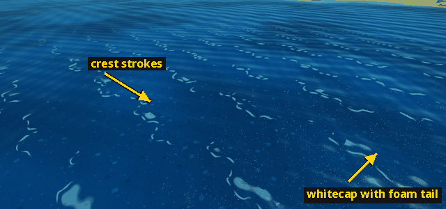

### Swell

- **Aliases:** the waves, `FlightEnv.swell`.
- **Definition:** the physical wave field: height and slope summed over six wave bands, running
  mostly with the wind. Floats, hulls and boats ride the same swell that is drawn, so what you see
  matches what the aircraft feels.
- **Code:** GPU side `src/sea.jo:81 _swell`, `sea_swell_band`, `sea_swell`; CPU side
  `src/sea.jo:763 swell_at(x, z, t)`.
- **Rules:** the decorative layers (flecks, crest strokes, glints) never drive physics. Physical
  swell, bathymetry, shore opacity, wakes and shadows must be preserved by any sea restyling.
- **Spectrum:** each band's share follows the wind (`SeaState.gains`, a Pierson–Moskowitz-like
  shape peaking near 0.83·U² m): in an ordinary breeze the long, fast bands are low and the sea
  is carried by its short waves; the long bands grow in with the wind. Phase speeds follow deep
  water (c = √(gλ/2π)).

### Harbour shelter and the shallows' limit

- **Aliases:** harbour calm, the basin, sheltered water, `sea_harbour`, `sea_band_keep`.
- **Definition:** where each band of the swell is allowed to be. A wave runs at its deep-water
  speed only where the water is deep enough for it (c² = g/k·tanh(kd)): in water a quarter of
  its length deep it has slowed 4%, in a ninth 30%. So each band is whole from a quarter of its
  length of water and gone by a ninth: the 61 m swell fades between 15 and 7 m of water, the
  4 m chop between 1 m and 0.45 m, and no long, fast swell runs through shallows or up a beach.
  And a harbour has no fetch for a sea to grow in: inside its basin (calm out past the docks,
  the buoy and the mole's end, fading to the open sea's full state 450 m further out) the three
  long bands are gone, the 13 m one all but, and the short ones lap low (0.22 and 0.6 of their
  open-sea height). The ripples, glints and marks are as everywhere.
- **Code:** `src/sea.jo` `sea_band_keep` (shader and CPU alike), `sea_calm` / `sea_calm_at`,
  `SeaHarbour`, `SEA_HARBOUR_GAINS`, uniform `harbour`; `src/harbour_shelter.jo`
  `harbour_basin`, `harbour_shelter_at`, `harbour_shelter_step` (the harbour nearest the player,
  each frame).
- **Rules:** the drawn sea and `swell_at` keep each band by the same rule, so the floats ride
  what is seen. No wave may pass faster than 1.3 times a real one of its length in that depth:
  tests/sea_speed_test.jo (a wave gauge array on `swell_at`) and
  tests/sea_speed_render_test.py (the drawn frames, `tools/sea_speed_view.jo`).

### Storm sea

- **Aliases:** the storm regime, heavy seas, `sea_storm`.
- **Definition:** not the ordinary sea turned up but a sea of its own. It sets in from a near
  gale (about 13 m/s, full by 22) or under a thunderstorm. The swell's bands stretch to 2.4
  times their length and grow half again in steepness, so long, high seas several metres high
  run with the wind. Their crests peak and their troughs flatten (a second harmonic, as in a
  Stokes wave). Over shallow water they lose their height (none higher than about 0.6 of the
  depth). The water goes a dark, heavy grey-teal, lit through the thin tops of the big seas. The
  crests break white on their downwind faces in ragged patches, and behind them lies a dense
  marbled web of foam: fine veins bent by the waves, crossing into a net, thick in the lee of the
  crests; close by, torn into small patches, holes and bubbles and a fine net of breaking lines; a
  ragged white line of foam along the very top of each sea. The sky closes in: heavy overcast, low grey light, haze that
  keeps the sea readable to a few hundred metres. Spindrift blows off the tops; a gale tears
  the aircraft's spray banks away downwind. Floats feel the storm's swell rising and falling
  under them and most of its slope, so alighting or ditching in it can break a hull or capsize.
- **Code:** `src/sea.jo` `sea_state` / `SeaState` (CPU, shared by the drawn sea and `swell_at`),
  `sea_storm_of`, `sea_wave_profile`, `sea_shoal`, `sea_storm_foam` (its noise from the tile
  `sea_storm_noise_image`), `sea_storm_light`; uniforms `swell_gain`, `sea_storm`, `storm_noise`.
  The storm water is its own shader variant (`storm_water`, `sea_storm_shaders`), made the
  first time a storm is up; an ordinary sea draws the ordinary program. Floats:
  `FlightEnv.swell_rate`, `swell_slope_share` (`src/flight.jo`, set in `src/pilot.jo`); the
  chase camera lifts over crests between it and the aircraft (`Flyer.storm_lift`).
- **Rules:** the CPU swell and the drawn swell stay identical, ordinary and storm
  (tests/precision_test.jo). Speed flecks and the sea's fine detail are untouched.
- **Capture:** `AEGEAN_WEATHER=meltemi AEGEAN_WIND_BIAS=10` (about 23 m/s), e.g. with
  `AEGEAN_FLYING="35 50"` or `AEGEAN_CAPTURE_TAKEOFF=1`.

### Shallows band

- **Aliases:** the shallows, clear coves, open shelves.
- **Definition:** the depth-driven colour ramp from cobalt in deep water, through turquoise, to
  see-through water at the shore. It reaches deep blue at 12 m on open shelves and 24 m in
  sheltered coves. The sandy seabed shows through with a faint caustic shimmer.
- **Code:** `src/sea.jo sea_shallow_mix(depth, shelter)` (the weight) and `sea_shallow_ramp` (the
  colour) in `sea_material`; the seabed (pale sand tinted by the water above it, scattered weed
  beds and stones, the drifting caustic network) in `src/terrain.jo ground_surface`.
- **Rules:** the shallow/deep weight and the shallows' own depth ramp (`sea_shallow_ramp`: clear
  aqua over the sand, turquoise, teal; no green in the water itself) may change. Add no texture,
  sampler, varying or world record for it, and never touch the deep sea's flecks, marks or glints
  (`docs/painted-materials.md`).

### Deep sea from height

- **Aliases:** the navy sea; its opposite is "Brighter ocean" (the Tweaks checkbox).
- **Definition:** the open sea's deep-water colour darkens toward navy as the eye climbs (none below
  60 m, full by 700 m), and the haze over the sea darkens a little with it, so the sea's horizon
  band sits below the sky's. The shallows band, clear bays and the low-level sea keep their
  luminous teal; the speed flecks, glints and crest strokes are drawn over the body as before.
- **Code:** `sea_from_height` in `src/sea.jo` (`DEEP_SEA_NAVY`): `SeaParams.deep` and `.haze` set on
  the CPU for the sea and the far sea only (lakes and rivers keep theirs); no shader work. The
  darker air seen down from height (`air_down` in `src/look.jo`) is the land's too (the islands'
  and the mainland's ground and the objects on it): with the sea's haze darker and the land's
  not, islands 5-15 km off from 600 m up faded into flat, pale, stair-edged cut-outs of the sky's
  haze against the navy.
  `tweaks.brighter_ocean` (`AEGEAN_BRIGHT_SEA=1`) skips it.
- **Rules:** colour and gradients only: never thin, dim or restyle the sea's fine detail for it.
- **Capture:** `AEGEAN_FLYING=600`, or a free view looking down, `AEGEAN_VIEW="0 600 9000 0 -0.5 11"`.

### Cliff beds and lip

- **Aliases:** strata, ledges, the cliff top, the fringe, the cliff's foot.
- **Definition:** Coastal limestone has stacked beds about 3 m thick. Grass gives way to
  crumbling soil at the lip, with a soft shadow just beneath it. At the foot, loose pale stone
  darkens where the sea wets it.
- **Code:** `cliff_station`, `cliff_map_image` and `cliff_contact` in `src/terrain_lod.jo`
  describe the shelf. `ground_material` and `ground_surface` in `src/terrain.jo` paint it.
- **Rules:** Sample the shelf in terrain-map coordinates at the vertices. Gentle ground contributes its elevation
  weighted by how much soil it can hold. Compare the reconstructed shelf elevation with each
  fragment's height so a single steep triangle can cross the whole face without stretching the
  grass or the soil band down it. Ordinary triangles skip this work. Subpixel soil, shadow and gravel detail
  fade with pixel size. All terrain detail levels and the phone use the same rim and toe.
- **Capture:** `AEGEAN_VIEW="4793 25 -5162 -2.129 -0.024 12.5"` (cliff from the sea, island),
  `"139848 25 79652 -0.783 -0.073 12.5"` (mainland).

### Shore foam

- **Aliases:** shore break, breaker, "lace at the shoreline".
- **Definition:** the white lace band where water meets land, with a breaker line just offshore.
- **Code:** the `edge`, `breaker` and `foam` terms in `src/sea.jo` `sea_material` (around line
  458).
- **Rules:** it is exactly zero beyond 3 m depth or 5 km range; its noise must not run over
  offshore pixels.
- **Capture:** `tools/coast_capture.jo` with `COAST_SITE=beach COAST_RANGE=50|300`.

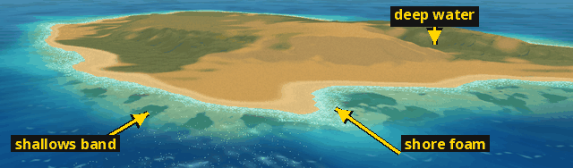

### Surf

- **Aliases:** the Surf tweak, breaking waves, run-up, swash, lace foam, ships' white water.
- **Definition:** waves breaking on the shore and ships' white water, on by default since
  2026-11-20 (the Tweaks page's "Surf" box; `AEGEAN_SURF=0` at start turns it off), replacing
  [shore foam](#shore-foam).
  - **Waves:** waves peel in along the shore, each stretch a little out of step. A wave breaks as
    a crisp white **lip** at the break line (1.6–2.7 m deep, deeper in a fresh sea) and runs in as
    a **bore** with **lace foam** behind it: pale foam broken by dark rounded holes, thinning as it
    ages.
  - **Swash:** the water riding up the sand thins to a crisp foam edge with lace through the thin
    sheet, then slides back. The sand it reached stays dark and wet.
  - **Rock:** on rock faces white water bursts up the face as each wave strikes.
  - **Ships:** ships under way in a rough sea throw painted spray off the bow each time it digs
    into a crest (the [spray bank](#spray-banks)'s lobes). Lace white water hugs the hull from the
    bow cheeks aft and churns out astern.
- **Code:** `src/surf.jo` (`surf_phase`, `surf_lace`, `surf_sea_foam`, `surf_swash`,
  `surf_ship_foam`). Used by `src/sea.jo` `sea_material(..., surf=true)` and `src/terrain.jo`
  `ground_material(..., surf=true)`; these are their own shader variants, made the first time Surf is
  needed. Ships: `src/vessel_spray.jo`.
- **Rules:** with Surf off, the sea and coast are drawn by exactly the plain shaders (the
  sea-detail guard's output is identical). The open sea, its [speed flecks](#speed-flecks) and its
  fine detail are untouched either way: the surf is zero beyond the surf zone's depth and
  1.5 km. The lace's edges stay about a pixel wide near or far.
- **Capture:**
  - `tools/coast_capture.jo` with `COAST_RUN=1` (the sea's time runs) and
    `COAST_FRAMES="dir from to step"`;
  - `tools/vessellab.jo` with `VESSEL_MOVE=1`, `VESSEL_WIND=14` and `VESSEL_FRAMES=...`.

### Rain rings

- **Definition:** the rings of rain falling on the water; they are drawn only near the camera
  (fading out by 90 m).
- **Code:** the `ring` term in `src/sea.jo` `sea_material` (around line 394).

---

## Water effects

### Splash bodies

- **Aliases:** the spray, cloud-like spray, billows, scalloped splash.
- **Definition:** opaque, cloud-like spray: overlapping closed lobes that read as one continuous
  body with a scalloped, ragged rim. It sits at each float's water contact and spreads and rises
  behind the step. All splash bodies are one shared mesh and one instanced draw, with no textures.
  Detached bursts (billows) are thrown up by hard impacts.
- **Code:** `src/splash.jo:114 splash_fan` (the body at each float), `splash_instances` (all
  bodies for a craft), `draw_splashes`, `splash_fs` (flat painted regions with a small soft
  terminator on each lobe); billows in `src/world_particles.jo`.
- **Rules:** bodies leave by shrinking to nothing, never by fading their alpha. The sea shader is
  not changed for splashes. NPC spray is capped (160 particles on the low tier, 480 on high).
- **Capture:** `tools/splash_frames.jo` with `POLISH_CASE=takeoff|landing|skim|stall-in`,
  `POLISH_TIME=<seconds>`, `POLISH_KIND=0..15`.

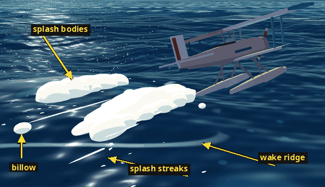

### Spray curtains

- **Aliases:** side curtains, the left and right sheets.
- **Definition:** two narrow, scalloped sheets of spray that rise from each float's chines and peel
  outward and back, leaving a clear trough of water between them, instead of one broad fan. Each
  curtain is a solid volume: its inner face, toward the float, is a fairly flat thin sheet; its
  outer face billows out, thickest along the curling crest and thinning to a knife edge at the root.
  Rows of round **curtain billows** heap up on the outer face. While the float planes, the curtain
  churns: billows are born small near the chine, swell as they roll aft along the sheet, rock
  outward and back, and lift off the crest as shrinking blobs while new ones form behind; the sheet
  lobes' scallops roll over the top and aft, each lobe swells on its own beat, and the whole curtain
  breathes with chop and float bounce (the sheet's **heave**). Where the spray is still thin sea
  water (the rising sheet, the undersides of the billows, the foot of the [spray bank](#spray-banks)
  by the floats) it is painted light aqua with white streaks running up it, as the film paints a
  thrown sheet, turning to the spray's cream where it breaks and as the wall runs aft.
- **Code:** `src/splash.jo` `splash_fan` (sheet lobes, kind 3; billows, kind 2, `CURTAIN_ROWS`),
  `curtain_widths` (inner/outer half-widths), `splash_vs` (roll, spin, outer bulge), `splash_fs`
  (curtain tones), `splash_targets` / `step_splash_motion` (heave).
- **Rules:** two painted tones only, white lit side and pale blue-grey shadow: tops lit by the sky
  stay white, overhanging undersides and a thin rim where each lobe turns from the eye take the
  shadow tone (in bright sun the middle tone saturates to white, so curtains skip it). All motion
  is continuous in time, never per-frame noise. Billows and crest drops use the small shared mesh
  (40x24); sheet lobes and other bodies the 64x40 mesh. Spray only at the water: skimming
  counts within 6 m of the sea whatever the span, and a sheet is never drawn between an aircraft
  and the sea. The [big boats](#big-boats) throw theirs from **spray stations** (`_boat_targets`):
  each hull, sponson and float's contacts, each wet or dry with hysteresis (wet on touching the
  water, dry only well clear of it), the curtain's root sliding along the hull (eased, at most
  12 m/s) to the aftmost wet station instead of jumping between contacts; the fans start at the
  hull's chines; skimming low, the sheet is on the sea under the part
  (`tests/boat_spray_test.jo`).
- **Capture:** `tools/splash_frames.jo` with `POLISH_CASE=planing` (a held planing run),
  `POLISH_ORBIT="azimuth elevation distance [aim-x aim-z]"`, `POLISH_NOCRAFT=1` to hide the
  aircraft, `POLISH_SEQUENCE=<dir>` for 30 fps strips.
- **Not to be confused with:** rain curtains (under cloud decks).

### Bow sheets

- **Definition:** the walls of water the heaviest boats (Do X, Sarafand, H-4) throw off the bow
  and sponsons while the hull climbs over the hump onto the step: bursts of large drops thrown
  sideways and up, drawn as billowing splash bodies, and the boat's [spray curtains](#spray-curtains)
  scaled up by its weight. They thin as it planes and stop in the air.
- **Code:** `src/pilot.jo` `_bow_sheets`; the curtains' scale is `boat_spray_scale` in
  `src/aircraft_boats.jo`, applied in `src/splash.jo` `splash_instances`.
- **Capture:** `AEGEAN_CRAFT=<the Do X> AEGEAN_CAPTURE_LAUNCH=takeoff-side` (a camera abeam on a takeoff run).

### Spray banks

- **Aliases:** spray walls, the hanging bank, the film's take-off spray.
- **Definition:** the big, slow spray behind a planing float: lobed, painted masses that roll up
  and back off each float's outer chine into a wall taller than the float is long at full
  planing, and hang over the water for two to four seconds after the aircraft has gone, drifting
  and settling downwind, then shrink away. A touchdown or a bounce throws a burst of them all
  round the float, bigger the harder it comes down; rough water throws more and taller; a flying
  boat's wingtip float digging in throws hard; a propeller low over rough water whips up mist.
  The spray curtains are the sheet at the float; the bank is what they leave behind.
  The bank is one continuous wall: each float side's lobes are chained in the order they are
  thrown, and neighbours are joined by low **bridging lobes** seated on the water, sized from both
  ends, so there are no gaps while every lobe grows and shrinks on its own. Lobes vary in
  proportions and turn a little off the run; crowns bulge out of the bigger ones.
- **Code:** `src/spray_bank.jo` (`step_spray_bank`, `spray_run_puff`, `spray_burst`,
  `spray_prop_mist`, `spray_lobe`, `spray_bank_instances`); stepped and drawn in `src/splash.jo`
  `draw_splashes`, on their own mesh (10x16 on the low tier, 20x32 otherwise).
- **Rules:** presentation only (no forces, no shared particles, no draws on the game's random
  numbers); every puff seated on the water, never hanging in the air; bodies shrink, never fade;
  painted as the film's spray, a cream lit side and a flat aqua-grey shade about 20 L* below it;
  lower within the chase camera's few spans so the aircraft stays in view. Cap: 80 puffs on the
  low tier (no stacked lobes there, one bridge per gap), 170 medium, 220 high.
- **Capture:** `AEGEAN_CAPTURE_TAKEOFF=1` (take-off), `=land` (a landing with a bounce),
  `AEGEAN_WATCH="ahead side up [look]"` (a fixed camera to watch a bank hang),
  `AEGEAN_WEATHER=meltemi` (rough water), `AEGEAN_CRAFT=5` (a flying boat).

### Spindrift

- **Definition:** in a storm sea, spray torn off the wave tops by the wind and streamed downwind
  as soft smoke. Each wisp is torn from a crest near the eye and drawn as a stream of soft round
  puffs, one for each parcel of spray, facing the eye: faint as it leaves the crest, densest a
  little way off, growing and thinning away downwind over two to three seconds. Never thin
  bright rays.
- **Code:** `src/spindrift.jo` (`step_spindrift`, `draw_spindrift`), drawn after the splashes in
  `aegean.jo`, with the battle trails' soft-edged shader (`src/combat_trails.jo`): each puff a
  fan of triangles from a centre to a rim, so the shader's edge falloff rounds it.
- **Rules:** presentation only (crests found with `swell_at`; no forces, no shared particles, no
  draws on the game's random numbers); nothing unless the sea is stormy. Cap: 60 wisps on the
  low tier, 100 otherwise, within 380 m of the eye; four puffs each, none within 12 m of the eye.

### Splash streaks

- **Aliases:** touchdown streaks, white marks, "tapered white marks", water ovals/streaks (the
  `t3/splash-2` comment). Not the white ovals on the water: those are sun glints (see the
  comparison under [Sun glints](#sun-glints-and-the-glitter-path)).
- **Definition:** thin, tapered white hairlines lying on the water in the float's wet footprint,
  three to a side, trailing back beside the splash body.
- **Code:** the "tapered white marks" loop at the end of `src/splash.jo:114 splash_fan`; they are
  splash instances with height `0.018`, placed on `swell_at` + 3.5 cm.
- **Rules:** keep them, in the same places, when the splash is reworked (`t3/splash-2` preserves
  them explicitly).

### Skim spray

- **Aliases:** skim sheet, downwash track, `skim`.
- **Definition:** the fainter fan and wake drawn when flying fast just above the water, starting
  at each float and reaching 4 to 11 m back.
- **Code:** the skim branch of `src/splash.jo` `splash_instances` and the `skim` argument of
  `src/wake.jo wake_step`.
- **Rules:** it starts above about 28 to 60 m/s of true speed with less than about 0.6 span of
  clearance.

### Wake

- **Aliases:** Kelvin wake, churn.
- **Definition:** the trail a hull or float leaves on the sea: two raised ridges spreading at the
  Kelvin angle, with foam where they are steepest, faint transverse waves, and a fading churned
  centre. It lasts about 40 s. Boats and ships use the same wake.
- **Code:** `src/wake.jo wake_step`, `draw_wakes` (constants `WAKE_EVERY`, `WAKE_LIFE`, `KELVIN`).
  `AEGEAN_NOWAKE` turns it off.

---

## Rivers and canals

On the rivers branch until it lands.

### River ribbon

- **Aliases:** the river water, inland water, the canal water.
- **Definition:** the raised water surface of the mainland river and Neravessa's canals: strips of
  twelve quads across the channel between stations, in batches of four stations grouped by
  sixteen (one material anchor). It uses the sea's
  material with its inland options: the same [speed flecks](#speed-flecks) and
  [sun glints](#sun-glints-and-the-glitter-path), carried by the current, on dark olive water (teal
  to slate on Neravessa's canal: [canal mirror](#canal-mirror)). A
  group or batch wholly beyond 450 m (where flecks and ripples have faded out) uses the cheaper far
  material in one draw, which is exact there.
- **Code:** `src/river_render.jo` (`init_rivers`, `draw_rivers`, `draw_inland_water`);
  the material is `src/sea.jo sea_material` with `inland=true`.
- **Rules:** the speed-fleck rule applies in full. Lakes use the same seam (`draw_inland_water`).

### Canal cut

- **Aliases:** Neravessa's walls, the canal side, the deep cut.
- **Definition:** Neravessa's canal and its arms run between dark slate stone walls standing 5 m over
  the water (`CANAL_STREET`), with a wet band at the waterline, coursed joints, iron mooring plates,
  and a stone parapet on top. Behind the wall the street is paved: an 8 m promenade with plane trees,
  poplars, cast-iron lamps (lit after dark), benches and a few people before the front row of
  houses, or warehouses and works standing straight on the wall. Four arms serve the timber yards,
  mill, fish market and dyers. At the market bridges traders unpack under striped canvas. Stairs down to the water sit in the
  wall's thickness with a landing at the foot. The workshop's yard and slipway keep a low quay 2 m
  over the water, with stairs up to the street at either end. The street behind an arm's wall runs
  20 m back (the carve's bank falls below the sea's level within that, and the sea's surface would
  show in the trench), clipped where it would meet the through-channel. Contact (walls, parapets, streets,
  stairs) and the drawing come from the same layout (`canal_banks`, `canal_solids`).
- **Code:** `src/canal_geometry.jo` (`init_canal_geometry`, `canal_frontage`, `CANAL_WATER_STAIRS`);
  drawn by `src/canal_city.jo` (`canal_bank_mesh`, `canal_promenade`) through `src/canal_render.jo`.
  Over the cut the terrain keeps finer cells further out (`world_tile_canal` in
  `src/world_terrain.jo`) so the cut stays open from the air.
- **Rules:** player-facing text says canal side, dock or waterfront, never "quay".

### Canal basin

- **Aliases:** the basin, where the arm joins.
- **Definition:** partway along the escape (stations 44-53), where the mill-water arm joins it, the
  canal opens into a basin some 120 m across and 540 m long: room to turn, evade and line up on the
  water between the narrow cuts. Its walls flare out along the wall line (the solids follow it too),
  with promenades, trees and lamps all round, a stone arch at its entry (44) and exit (53), barges
  and a launch moored 5 m off its walls and one barge at a buoy out on its water, and riflemen and a
  machine gun on its far quays and the exit bridge's head.
- **Code:** `tools/bake_river.py` (`canal_width`, baked into `src/river_data.jo`; `world.bin` and
  `assets/living-routes.bin` follow it); `src/river_field.jo` (the carve's reach capped at 140 m past
  a wide basin's wall); `src/canal_geometry.jo` (`canal_line_slab`); `src/canal_traffic.jo`;
  `src/canal_ground_fire.jo`.

### Canal lagoon

- **Aliases:** the lagoon, the open water, the wide reach.
- **Definition:** beside the canal's last straight (stations 58-67, past the footbridge at 57) the
  water opens into a lagoon some 280 m across and 875 m long. The escape reaches it after a 2.26 km
  water run from the workshop and takes off toward the sunrise:
  room to line up, dodge boats and climb out. It opens away from the river: a stadium of water of its
  own (a straight arm 140 m in half width, closed by round walls at both ends) laid beside the cut,
  its river-side edge just inside the cut's river-side wall, so the cut's far wall gives way to it
  and the round ends meet that wall at about 40 degrees. Houses stand round its walls; barges lie
  moored along both sides, a barge and a rowing boat at buoys out on the water, and two patrol
  launches circle across the run. In the escape each launch carries a rifleman, and riflemen and
  machine guns hold both walls.
- **Code:** `tools/bake_river.py` (`LAGOON_RADIUS`, `LAGOON_OUT`, baked into `src/river_data.jo`;
  `assets/living-routes.bin` follows it); `src/canal_geometry.jo` (`canal_frontage` 3 along it, the
  arms' round ends); `src/river_render.jo` and `src/river_field.jo` (`river_arm_open_start`: water
  over its first end too); `src/canal_traffic.jo` (`CANAL_PATROLS`, `canal_patrol_loop`);
  `src/canal_ground_fire.jo` (`canal_launch_guns`, `canal_ride_launches`).

### Canal crossings

- **Aliases:** the canal bridges.
- **Definition:** a crossing every 100-300 m of the canal run (`CANAL_BRIDGES`): single-span stone
  arches (a flat ellipse from wall to wall, springing ~3.6-4 m and crowned ~8-9 m over the water,
  with a humped road, balustrades, lamps and someone leaning on the parapet), a high steel truss
  and a low iron footbridge (5 m clear) at the lagoon's mouth. A planing Gull's top wing is ~3.9 m over the
  water: held within ~8 m of the centre line it passes under every crossing with a metre or more
  to spare; a pilot who lifts off early must stay under the arches or hop the decks.
- **Code:** `src/canal_geometry.jo` (`CANAL_BRIDGES`, `canal_bridge_under`, `canal_bridge_top`);
  `src/canal_city.jo` `canal_bridge_mesh`; `tests/canal_test.jo`.

### Canal mirror

- **Aliases:** the canal's reflections.
- **Definition:** on Neravessa's canal the water is teal to slate, darker than its walls, and its
  Fresnel reflection mirrors the cut instead of only the sky: the reflected ray is tested against
  the two walls (vertical planes at the canal's half width), giving the dark stone up to the
  parapet, then the promenade's trees and the facades, then the sky. Flecks and glints are unchanged.
- **Code:** `src/sea.jo` `canal_mirror` (with `SeaParams.inland_walls`); set per batch in
  `src/river_render.jo` (`RiverBatch.walls`, `CANAL_WATER_DEEP`, `CANAL_WATER_SHALLOW`).

### Canal blocks

- **Aliases:** Neravessa's houses, the canal facades.
- **Definition:** the city's blocks, 4-6 storeys on the water: muted cream, grey and stone stucco
  with one in six or seven an ochre, pink or rust accent; a darker rusticated base, string course,
  frieze and cornice; framed recessed windows with shutters (some closed), sills, balconies and
  awnings; roofs in the towns' palette: weathered terracotta in six tones with a lit pitch (facing
  the midday sun) and a shaded, redder one, slate mansards, lead, and flat roofs with a tarred deck
  inside a parapet. The arms are lined too: a row of plainer blocks on the wall's street and one
  behind (kind 16). One in seven windows is lit after dark. Front rows are fully detailed,
  the next two rows have openings and trim, deeper rows are plain blocks on paved plinths. The
  skyline's set pieces (`CANAL_SKYLINE`: domed churches, bell towers, works chimneys) end the
  canal's vistas at its bends. The cells draw nearest first; the low tier keeps full detail within
  300 m (750 m otherwise) and the promenade trees in their simpler build.
- **Code:** `src/canal_city.jo` (`canal_block`, `canal_pitch`, `canal_church`, `canal_tower`,
  `canal_chimney`); `src/canal_render.jo` (`init_canal`, `draw_canal`).

### Confluence

- **Aliases:** river junction, tributary mouth.
- **Definition:** where one of the three tributaries meets its parent river. The tributary's last
  segments flare along circular fillets, so each bank turns to run along the parent's instead of
  meeting it at a square corner; the downstream corner is swept wider (1.3 x) than the upstream
  (0.7 x). The flare is a width along the tributary, so the water field, carve, contact and the
  ribbon (split 32 times along a flared segment) all read the same shape.
- **Code:** `src/river_field.jo` (`RIVER_MOUTHS`, `river_mouth_flare`), `river_strip_end` in
  `src/river_render.jo`.
- **Rules:** a field change bumps `RIVER_VERSION`, which changes the geography key: rebake
  `tools/bake.jo` and `assets/living-routes.bin`.

### Opaque river prepass

- **Definition:** a depth-only pass over the river ribbon's triangles that are at least 2 m deep
  at every vertex, where the water is exactly opaque. Drawn before the terrain, it spares the
  hidden riverbed its shading. It needs no discard, so early depth testing works.
- **Code:** `src/river_render.jo` `river_with_occluder`, `draw_river_occlusion` (one draw per
  group); native
  reversed depth only. Checked by `tests/river_depth_render_test.py`.

### Bank plants

- **Aliases:** bank vegetation, the riparian corridor, river trees and reeds.
- **Definition:** poplars, plane trees, oleanders and waterline reeds along both banks, instanced
  per prototype. Detail by distance: full trees to the grove distance, then the simpler distant
  crowns, without trunks past 600 m; shrubs and reeds end at the grove distance, and past 150 m one
  reed stem in three is drawn. Distant trees end at the tier's reach (low 1.6 km, medium
  2 km, high 3.5 km), as groves do.
- **Code:** `src/river_banks.jo` (`build_river_bank`, `draw_river_banks`, `river_bank_reach`).

### Riparian ground

- **Definition:** the greener moist and alluvial ground of the river corridor, from a baked river
  mask. Its weight and the height above the river are worked out at terrain vertices, not per pixel.
- **Code:** `src/terrain.jo` `ground_riparian` (called from `world_vertex` and `coast_vs`), used
  in `ground_surface`; the mask is `src/river_material.jo`.

### Chart rivers

- **Aliases:** rivers on the map, the canals on the chart.
- **Definition:** inland water drawn on the paper chart wherever an owned sheet covers it: rivers
  as watercolour lines that thicken from source to mouth with the channel (a little wider than
  true at small scales so they read, ink-edged once wide), Neravessa's canals and basins in ink
  between quays once the scale shows them (a fine dark line before that), lakes painted into the
  sheet as a pale wash with an inked shore from the lake source. The river and the canal city are
  named where the labels fit.
- **Code:** `src/chart.jo` `draw_chart_rivers`, `_label_water`; lakes in `build_chart_texture`
  through `lake_at` (`src/lake_field.jo`, a stub until lakes are authored).
- **Rules:** respect coverage (`charted`); the river's name is `CHART_RIVER_NAME` in one place.
- **Capture:** `AEGEAN_MAPS=all AEGEAN_CHART=1 AEGEAN_CHART_FOCUS=aegean-general-1898`, and
  `AEGEAN_CHART_VIEW="-129300 -146000 4200"` to look closer at Neravessa.

---

### Lake shoreline shaping

- **Definition:** a settlement lake's shore moved sideways along its own bank slope (coves and
  points of a few hundred metres) and a drowned valley arm up the inflow, on top of the surveyed
  basin. The takeoff lane, berths, jetty and town frontage stay as surveyed, and no cove comes
  within 45 m of a road.
- **Code:** `lake_depth` in `src/lake_field.jo` (shaped) over `lake_raw_depth`; road guard
  `src/lake_road_guard_data.jo` from `tools/bake_lake_road_guard.jo` (rebake it after road
  changes near lakes, then rebake the world and routes).

### Lake chop

- **Definition:** the short wind chop on open lake water: the sea's swell slopes and crest strokes,
  scaled, with no height. It gives lakes the sky reflection, sheen and glints the sea has at a
  distance. Rivers keep their own current marks.
- **Code:** `SeaParams.inland_chop` in `src/sea.jo`; set by `draw_lakes` (`src/lake_render.jo`).

## Aircraft

### Paint page

- **Aliases:** repainting, liveries, colour schemes.
- **Definition:** the pause menu's Paint tab (beside Aircraft and Plane): the player's aircraft
  repainted, in four tabs. **Livery:** a livery valid for the type (its own first, its period
  paints, the civil ones and its family's) and its four colours (main, trim, wings, stripe).
  **Parts:** [paint by part](#paint-by-part). **Decals:** [decals](#decals). **Marks:** national
  insignia, operator bars, rudder stripes and a tail number where the type wears them. Colours
  are period dopes, lacquers and trims, or any colour by hue, saturation and brightness (Mix any
  colour). Free, it applies at once (a model of the player's own, built from the paint: other
  aircraft of the type keep theirs) and is saved with the game. The Flying now card's Paint button
  opens it.
- **Rules:** colours and drawn marks only, no textures. The session's `Paint` is the save field
  (the aircraft's record mirrors its livery and keeps the paint written out); a game saved before
  it loads as built, or in the period paint its record wore. The page has three standings
  (`PaintPageMode`): free, a [paint shop](#paint-shop)'s (a draft, priced), or closed (painting is
  done at a paint shop). `paint_free_anywhere` in `aegean.jo` is the one switch between free and
  price-and-time: the sandbox's "Paint the aircraft anywhere, at any time" (`sandbox.paint_anywhere`,
  off unless the player turns it on).
- **Code:** `src/aircraft_paint.jo` (`Paint` in `src/markings.jo`; `paint_livery`, `paint_build`,
  `paint_support`, `paint_changes`, `paint_from_spec`), `src/aircraft_paint_view.jo`
  (`paint_page`); `set_player_paint`, `paint_step`, `player_model` in `aegean.jo`;
  `tests/aircraft_paint_test.jo`.
- **Capture:** `AEGEAN_SANDBOX=paint AEGEAN_CAPTURE_PANEL=paint` (`paint-parts`, `paint-decals`,
  `paint-marks` for the other tabs; without the sandbox switch the page is closed and says where
  the paint shops are); `AEGEAN_PAINT='livery=2 insignia=1 bars=0 rudder=1 number=K-AB3 body=0.2,0.3,0.6
  part.lwing=stripes:0.8,0.1,0.1:0.9,0.9,0.8:0:6 decal=roundel:wing-top'` or a paint's name
  (`AEGEAN_PAINT='Greek Naval Air Service'`); `AEGEAN_CAPTURE_LAUNCH=paintsave` saves and loads it.

### Paint by part

- **Aliases:** part paint, per-part colours.
- **Definition:** each part of an aircraft in its own paint: fuselage (a boat's hull), left wing,
  right wing, floats, struts, cowling, tail, rudder. A part takes one colour, a gradient of two,
  or 2 to 12 stripes of two, along the part (nose to tail; a wing: root to tip) or across it.
- **Rules:** the colours ride in the aircraft's own mesh, a colour a corner: no texture, no
  shader change, no extra draw. Stripes cut the part's triangles where the bands meet. Which
  triangles are paint is found by building the aircraft twice, once in four **key colours**
  (`PAINT_KEYS`): a corner that comes out in a key colour, or a shade of one, is paint; one that
  is the same both times (metal, glass, a cockpit, an insignia) is left alone. A part is the
  damage bin a triangle was built in, its strut tag, and tags the kit lays in a corner's texture
  coordinates, which the shaders ignore on an aircraft: 192 the rudder, 193 a mark in a livery
  colour (operator bars, a tail number: left as they are), 194 bare metal that takes paint all
  the same (a cowling). The fuselage's paint carries on into the tail bin's length of fuselage.
  An aircraft with no part painted takes the old path untouched. A new builder's rudder needs
  `kit_tag_rudder` to be paintable (`tests/paint_parts_test.jo` checks every type has one).
- **Code:** `src/paint_parts.jo` (`paint_parts_apply`, `paint_part_of`, `paint_share`);
  `build_painted_craft`, `kit_repaint`, `kit_paint_keying` in `src/planes.jo` (the one hook where
  a model is finished); `PartPaint` in `src/markings.jo`.
- **Capture:** `AEGEAN_PAINT='part.<fuselage|lwing|rwing|floats|struts|cowling|tail|rudder>=
  <plain|gradient|stripes>:r,g,b[:r,g,b[:across[:bands]]]'`.

### Decals

- **Aliases:** motifs, nose art.
- **Definition:** motifs painted on an aircraft: shapes (circle, ring, band, square, triangle,
  diamond, chevron), marks (roundel, star, cross, flags, chequers, stripes), period motifs
  (lightning, arrow, anchor, sun, crescent, card suits, compass rose), animals (gull, swallow,
  stork, dolphin, fish, cat) and letters and numbers. A decal goes at one of the usual **spots**
  (rudder, fuselage sides, cowling, wing tops, wing bottoms, fin), found on each type as it is
  built, or anywhere: a side it is seen from and a place there, at any size and angle. Up to
  twelve on an aircraft, in up to three colours each, on one side or both.
- **Rules:** every motif is drawn in code as flat convex polygons (`decal_polys`; outlines are
  cut into triangles): nothing is an image, and nothing is generated by an AI. A decal is
  projected onto the surface it meets: its polygons are cut against the aircraft's own triangles
  and laid a centimetre above them, in the damage bin they land on, so they ride in the aircraft's
  mesh (no texture, no extra draw) and go with a part that breaks away. It wraps a curved body
  but does not go through to what lies behind. On the other side an animal is mirrored to face
  the nose; letters still read. At most 5000 triangles of decals an aircraft. Motifs are saved by
  key: append to `DECAL_MOTIFS`, never change a key's meaning.
- **Code:** `src/decals.jo` (`decal_polys`, `decal_frame`, `decals_apply`, `decal_pick`); `Decal`
  in `src/markings.jo`; `tools/decal_sheet.jo` draws every motif on one sheet;
  `tests/decals_test.jo`.
- **Capture:** `AEGEAN_PAINT='decal=<motif>:<spot | left|right|above|below/u/v>[:size[:angle
  [:r,g,b[:r,g,b[:r,g,b[:both[:text]]]]]]]'`.

### Paint shop

- **Aliases:** the workshop, the paint shed, the painter.
- **Definition:** where painting costs money and takes a little time: an open-fronted workshop
  on its own plank deck at the water's edge, in each harbour town a mechanic lives in (Porto
  Vecchio and Kryfo Cove). A lean-to against two plank walls with a bench of paint pots, tins on a
  shelf, the colours on a board, trestles, drums, a ladder and a painted sign; an apron in front;
  and a **berth** on the water where the aircraft lies nose-in to the deck. The town's mechanic
  works there mornings (7:00 to 12:30) and from three till six.
- **The visit:** tapping the workshop's bench or the painter walks the pilot over; the talk
  offers "I'd like her painted". The painter brings the aircraft round to the berth (a few
  minutes pass), and the shop's **panel** opens: the painter's card (name, price and time for
  what is changed) over the paint's four tabs, at the side of the screen (along the bottom of
  one held upright), the view turning round the aircraft with a drag beside it. The paint chosen
  is a draft, shown on the aircraft and priced as it changes (only what differs is charged;
  `paint_quote`). Ordered, the mechanic is paid and the aircraft is **in the shop** until the
  paint is dry: she cannot be boarded and is seen masked, then in primer, then in the new paint
  with its decals going on last (`paint_job_look`). The mechanic says how the work stands and
  one can wait. People remark on a new paint for a day.
- **Rules:** the `PaintJob` is saved with the session; the money moves through the living
  world's `transfer` (a repair payment). The shop is sited by `paint_shed_site`: the first spot
  along the shore from the main quay where the berth floats and deck and berth are clear of
  docks, moored boats, other quays and the hotel; a harbour with no waterfront gets a gangway
  from its quay. A big boat is painted on her buoy and a landplane where she stands (the berth
  takes what fits a harbour's docks). Asked away from the workshop, the mechanic says to come by
  it. The panel is a `Ui` state (`.paint`), not the pause menu.
- **Code:** `src/paint_shed.jo` (the place: `build_paint_shed`, `paint_shed_site`,
  `paint_shed_berth`, `paint_shed_venue`), `src/paint_shop.jo` (the price and the job),
  `src/paint_shop_view.jo` (`paint_shop_panel`); `build_paint_sheds`, `open_paint_shop`,
  `paint_berth_moor`, `paint_shop_panel_step`, `paint_shop_camera`, `paint_job_step` in
  `aegean.jo`; the mechanic's venue in `choose_life_venue` (`src/living_life_seed.jo`) and hours
  in `src/living_life.jo`; `tests/paint_shop_test.jo`, `tests/paint_shed_test.jo`.
- **Capture:** `AEGEAN_CAPTURE_SHED="place [yaw pitch distance]"` (the free camera on a town's
  shop); `AEGEAN_CAPTURE_PANEL=paint-shop` (the panel, staged at the workshop with
  `AEGEAN_PAINT_DRAFT` chosen; `AEGEAN_PAINT_TAB=0..3`); `AEGEAN_CAPTURE_LAUNCH=paintshop` goes
  through asking, ordering, a save and load, waiting and the dry paint, with `PAINTSHOP` lines
  (`AEGEAN_PAINT_STAGE=primer|top` stops the wait mid-paint); `AEGEAN_TALK=mechanic`;
  `AEGEAN_PAINT_AT_SHOPS=1` closes the free page.

### Pilots' liveries

- **Definition:** every other pilot's aircraft in its own paint, so a pilot can be told by their
  colours at a distance. Made once from the pilot's number with the shop's own tools (a base
  livery, two palette colours over the parts, a motif or their initials), then kept with the
  aircraft's record. The named pilots, the far pilots of the flying clubs and anyone else flying
  get their own. The harbour patrol keep the service's livery and carry a number; a pirate's is
  dark with one bold mark.
- **Unit livery:** the air arm at a field and a scenario's squadrons share one: the service's
  paint kept whole, so the side it flies for still reads, the cowling (and for some units the
  struts) in the unit's colour, and each aircraft's own number on fuselage and upper wing
  (`unit_paint`).
- **Rules:** `AircraftRecord.paint` holds the paint written out (`to_text` of a `Paint`), so it
  survives saves and a later change to the generator. Models are built one every four frames,
  shared by paint, and looked up by aircraft each frame once the air traffic is gathered
  (`pilot_livery_remap`); the saved model numbers of far pilots and battle actors are left as
  they were.
- **Code:** `src/pilot_liveries.jo` (`pilot_paint`, `unit_paint`); `assign_pilot_liveries`,
  `pilot_livery_give`, `pilot_livery_model`, `pilot_livery_remap`, `pilot_livery_step` in
  `aegean.jo`.
- **Capture:** `AEGEAN_CAPTURE_LIVERY="k [yaw pitch distance]"`: the camera on the k-th pilot's
  aircraft, and a `PILOT LIVERY` line for every aircraft; `AEGEAN_CAPTURE_FORMATION=1` with
  `AEGEAN_FLYING`: the named pilots' aircraft placed in a vee ahead of the chase view (staged
  for the still).

### Markings

- **Definition:** what is painted on an aircraft besides its colours, all drawn by the kit
  (`src/planes.jo`): national **insignia** on the upper wings (none; the game's two countries,
  Kalyra and Orenthia; Italian, British, Greek, American (a star on a disc) and German (a straight
  cross) for those nations' types), **operator bars** (the civil marking; inboard of an insignia
  when both), **rudder stripes** (`kit_rudder`) and a **tail number** in block capitals on the
  fin ahead of the rudder. What a type can wear is found by building it with and without each
  mark; the first four types and the big boats wear wing marks only when repainted with them, so
  as built every aircraft looks as it did.
- **Extending:** append to `INSIGNIA` or `RUDDERS` (a `nation` limits them to that nation's
  types), add a type to `TYPE_NATIONS`, a livery to `LIVERY_FAMILIES` or `TYPE_LIVERIES`
  (`src/markings.jo`); indices are saved: append, never reorder.
- **Code:** `src/markings.jo`; `livery_insignia`, `livery_bars`, `_wing_mark`, `_rudder`,
  `_tail_number` in `src/planes.jo`; `_boat_marks` in `src/aircraft_boats.jo`.

### Prop disc

- **Aliases:** the propeller disc, "spinning propellers as a film animator paints them".
- **Definition:** what a spinning propeller is drawn as: a flat, pale disc with a crisp rim in the
  propeller's own plane (no screen-space overlay), with prop arcs on it. All discs in a frame are
  one instanced draw.
- **Code:** `src/prop_disc.jo` (`prop_disc_vs`, `prop_disc_fs`, `queue_prop_discs`,
  `queue_cockpit_prop_discs`, `draw_prop_discs`).
- **Rules:** the disc fades in from 16 to 50 rad/s, the arcs from 26 to 64 rad/s; below 40 rad/s
  the real blades show. Disc and blades are not drawn beyond `PROP_DISC_RANGE` (650 m). Blades and
  disc turn in the aircraft's hand (`prop_turn`, see [Prop torque](#prop-torque)): the game's own
  aircraft are drawn left-hand (counterclockwise from the cockpit), as they always were; a
  right-hand prop's disc is the same disc with its own frame mirrored, so its arcs, their drift and
  precession, the sun-facing band and the sun-side arc are an exact mirror image at the same
  moments (`prop_disc_test` "a right-hand prop's disc is the original's mirror image").
- **Capture:** `tools/prop_disc_frames.jo` with `PROP_VIEW=side|front|close|rear|far|cockpit`,
  `PROP_THROTTLE=0..1`, `PROP_KIND=0..15`.

### Navigation lights

- **Aliases:** nav lights, wingtip lights, side lights, stern lamp, riding light.
- **Definition:** lamps every aircraft and vessel shows after dark, as in the late 1920s: red on
  the port wingtip, green on the starboard, white at the tail; ships red and green at the sides
  and a white stern lamp underway, one white lamp when lying still, small boats (rowing boats,
  dinghies, canal craft) one white lamp. Each is an additive glow point with a soft halo, kept a
  few pixels across out to 12 km and veiled by clouds; all in one particle draw a frame.
- **Code:** `src/nav_lights.jo` (`nav_light_level`, `nav_craft_points`, `nav_vessel_offsets`,
  `draw_nav_lights`); the ships' small emissive lamp boxes in `src/vessel_models.jo`.
- **Rules:** off by day (`nav_light_level` 0 above sun height 0.12), full by sun height -0.10.
  Aircraft lamps sit on the outermost wing contact (biplanes: the wider wing) and are off when
  moored or wrecked. Vessels' bow is +z, so port (red) is +x for them and -x for aircraft.
- **Capture:** `AEGEAN_FLYING="200 57.6" AEGEAN_HOUR=22`; distance: add
  `AEGEAN_VIEW="2433 210 -3365 0.5711 -0.01 22" SLOPPY_INPUT="2:f2+ 3:f2-"`.

### Prop arcs

- **Aliases:** the short white concentric arcs, pencil arcs, bands, streaks.
- **Definition:** for each blade, a band of short white arcs around the hub, about one every 3%
  of the radius from hub to rim, each with a random length and offset and a few left out. A new
  seed redraws the whole set every other frame ("on twos"). Lines stay 2.3 to 3.3 px wide at any
  distance.
- **Code:** `src/prop_disc.jo:76 _disc_arcs`, `_disc_band_width`.

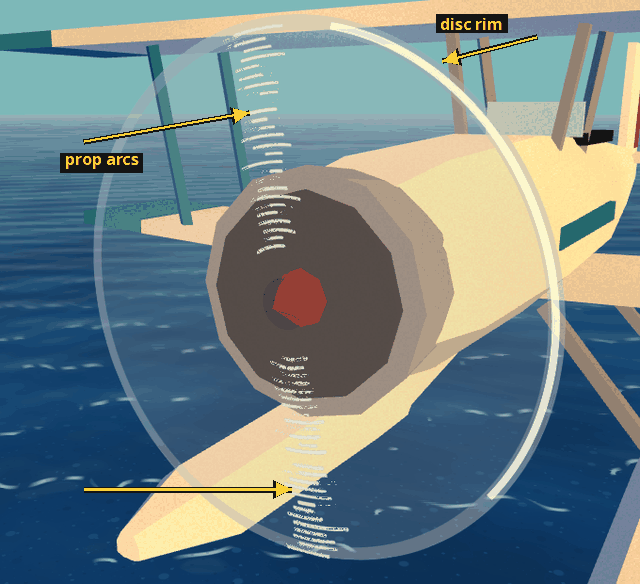

### Arc precession

- **Aliases:** band speed, band angle, the wagon-wheel drift.
- **Definition:** the designed drift of the arc bands around the hub. Their turning rate cycles
  with engine speed (a smoothed sawtooth of about 2.5 cycles that grows as the engine slows), so
  the arcs creep, reverse and creep back like a wagon wheel on film. The drift lingers near its
  fast extremes over most of the range (`PROP_DRIFT_HOLD`), so the slow passages are brief blips;
  full power keeps its slow creep. At the lowest disc speed it
  matches the blades' real speed, so the hand-over to idle blades is seamless.
- **Code:** `src/prop_disc.jo:176 prop_band_speed` (with `PROP_TOP_SPEED`), `prop_band_angle`
  (integrated per craft); the shaft rate is `src/flight_feedback.jo prop_rotation_speed`.
- **Capture:** `PROP_SWEEP=<seconds>` and `PROP_TRACE` on `tools/prop_disc_frames.jo`, or
  `AEGEAN_PROP_SWEEP` in the game.

### Idle blades

- **Definition:** below 40 rad/s the real blade meshes are drawn instead of a disc; the arc bands
  turn with them and snap gently onto the blades. Idle shows turning blades, cruise shows a disc
  with faint arcs, and full power shows the whole effect.
- **Code:** `src/prop_disc.jo` (`PROP_BLADES_BELOW`, `prop_band_angle`).

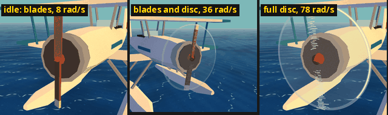

### Vapour wisps

- **Aliases:** wingtip trails, vapour trails, vapor, "a thin white stream off each wingtip".
- **Definition:** a camera-facing ribbon from each wingtip that thins and fades behind the
  aircraft. It appears only when the wings pull hard in damp air.
- **Code:** `src/trails.jo` (`trail_step`, drawing); the gate is `src/flight_feedback.jo
  vapour_dampness` and `vapour_strength` (speed, dampness and load factor).
- **Rules:** dampness needs real wet-air evidence (a cool low sea layer, low overcast, rain or
  fog); clear, dry, high air makes none. Wisps are depth-correct against clouds.
- **Capture:** `tools/splash_frames.jo` with `POLISH_CASE=turn POLISH_TIME=0.8` (a wet-air
  fixture).

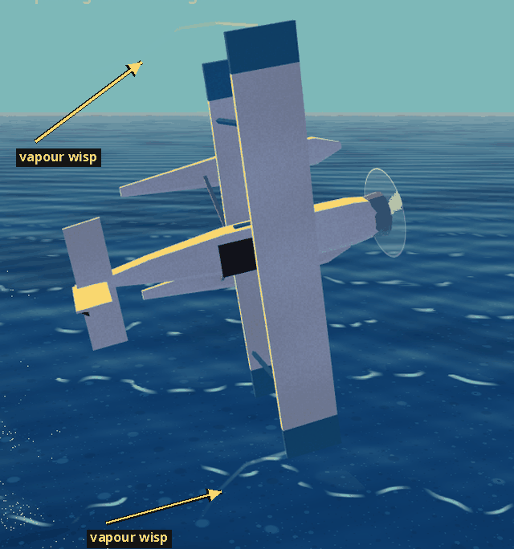

### Buffet

- **Definition:** the shaking before a stall: flow unsteadiness from 0 to 1 that rises near the
  stall angle or with wing separation, and drives the shake and flex cues.
- **Code:** `src/flight.jo` `CraftState.buffet` (set in the stall model); smoothed in
  `src/flight_feedback.jo`.

### Floats, hull and step

- **Definition:** a **floatplane** rests on two **floats**; a **flying boat** rests on its
  **hull**. The **step** is the notch in the bottom of a float or hull, about at the centre of
  gravity: once fast enough, the craft rides up on the planing surface ahead of it, and the water
  breaks free behind it. Splash bodies rise from behind the step.
- **Code:** the catalogue in `src/aircraft_catalog.jo` (stepped hulls and floats, contacts); hull
  and float planing resistance is `water_drag` in `src/flight.jo`.
- **Capture:** `tools/hangar.jo` (contact sheet of all types), `AEGEAN_CAPTURE=dock`.

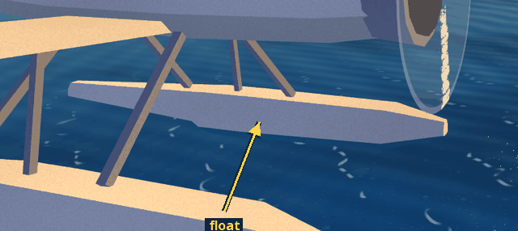

### Sponsons

- **Aliases:** stub wings, sea wings (Dornier's *Flossenstummel*).
- **Definition:** short, thick aerofoil stubs at a flying boat's waterline, one each side of the
  hull, in place of wing-tip floats: they keep the hull upright on the water and lift a little in
  the air. The Dornier Wal and Do X have them.
- **Code:** `src/aircraft_boats.jo` (`_build_wal`, `_build_dox`); they are the damage parts
  `left_float` / `right_float` ("port sponson", "starboard sponson") and carry the outboard
  contacts, which sit just above the calm waterline so they only bear load when the hull heels.

### Push-pull pair

- **Aliases:** tandem engines, push-pull, Tandem (Dornier).
- **Definition:** two engines back to back in one nacelle, the front one pulling with a tractor
  propeller and the rear one pushing with a pusher, on a common axis. The S.55 and the Wal have
  one pair above the wing, the Sarafand three between its wings, the Do X six on an auxiliary wing.
- **Code:** `src/aircraft_boats.jo` `_tandem_pair` (shared by the Do X and the Sarafand: radial or
  cowled inline ends, both hubs); `AircraftProfile.discs` in `src/aircraft_catalog.jo` counts a
  pair as one propeller disc for flight model v2.
- **Rules:** the rear hub of a pair is always at least 3 m behind the front one; side-by-side
  discs never touch (tests/aircraft_boats_test.jo).
  How the pair's propellers turn and cancel their torque: [Contra-rotating and push-pull
  props](#contra-rotating-and-push-pull-props) (the big boats set `push_pull`).

### One speed rule

- **Aliases:** the speed rule; the historical speed rule; how speeds are set.
- **Definition:** how every historical type's speeds are set: one curve from its real top speed,
  design top, true m/s = 80 × (real km/h ÷ 250)^0.76, the single curve closest to the three fleets'
  first scalings (so the real order holds, and slow types sit a little faster than life, near the
  game's own designs). Drag is set so the thrust makes that top (top = √(thrust ÷ drag), as every
  design is balanced); thrust, stall and cruise are the profile's own (the cruise set at the rule's
  top). A historical profile gives no top or drag of its own. The game's own sixteen designs keep
  their hand-set figures.
- **Code:** `real_top_kmh`, `speed_rule_top`, `speed_rule` in `src/aircraft_catalog.jo` (`AIRCRAFT`
  is every profile with the rule applied); `tests/speed_rule_test.jo`; `tools/speed_rule_table.jo`
  (the table of every aircraft's speeds).
- **Rules:** every historical profile must carry `real_top_kmh` (a test checks every type after the
  sixteen) and its cruise between the stall and the top. The living world's trip times
  (`AIRFRAMES` cruise) are not set by it.

### Big boats

- **Aliases:** the big flying boats; offshore-only aircraft (those over 30 m span).
- **Definition:** the Savoia-Marchetti S.55 (twin hulls), Dornier Wal, Dornier Do X, Short
  Sarafand and Hughes H-4. They are built from lofted rings (hulls with flared chines and a step,
  thick aerofoil wings, round nacelles) rather than the catalogue's boxes. The three over 30 m span
  (Do X, Sarafand, H-4) are **offshore-only**: they never use a dock, only an
  [offshore mooring](#offshore-mooring).
- **Paints:** a type's period paints (`boat_paints`) are presets among the liveries on the
  [Paint page](#paint-page); the S.55 wears Silver Dope or the **Greek Naval Air Service**
  (aluminium dope, a dark hull bottom, light-blue and white roundels, blue-white-blue rudders).
  Paints are named, not numbered (`livery_named`).
- **Code:** `src/aircraft_boats.jo` (`build_big_boat`, `big_boat`, `offshore_only`,
  `swing_radius`, `boat_parts`); profiles in `src/aircraft_catalog.jo` (`draft`, `engines`,
  `discs`); `tools/boats_view.jo` (four views of one model); tests in
  `tests/aircraft_boats_test.jo`.
- **Rules:** `draft` (hull below the waterline at rest) stays under 1.5 m, where the water
  model's buoyancy saturates. Engines over two add a second, detuned engine loop (`src/sound.jo`).

### Landplane

- **Aliases:** wheels, tail skid, three-point attitude.
- **Definition:** an aircraft on fixed wheels that takes off from and lands on land only (the Fiat
  C.R.20). At rest it sits on its two main wheels and its tail skid, nose up (its **three-point
  attitude**). On the ground the rudder steers (helped by the slipstream, so a burst of throttle
  swings it at a crawl, less as it runs fast), the elevator lifts the tail as speed comes and, with
  the stick near the middle, holds it a little nose up and rotates it near the stall; the main
  wheels brake (the water-brake control), the skid drags, and with the throttle closed and at rest
  it holds its brakes. Under the pure speed scale the run's slowing acts on the drawn speed while
  the wheels' pitching moment stays the true one, so a landing rolls out in about the true time
  without standing it on its nose.
- **Code:** `src/flight.jo` `CraftSpec.landplane`, `_landplane_wheel`, the landplane branch of the
  ground controls in `_substep`, `ground_start`; the gear points `landplane_gear_contacts` in
  `src/aircraft_early.jo`; `AircraftProfile.landplane` in `src/aircraft_catalog.jo`.
- **Rules:** a landplane is never put on the water: the pause menu's switch, the tow after a wreck
  and the start put it on an [airfield](#airfield)'s stand, and so does a saved or new game whose
  record has it at a harbour's berth (`landplane_ashore`).
- **On the ground, as a player has it (flight model v2):** the mouse's (and the touch screen's) aim
  steers on the wheels by the nose's heading, leaving the stick in the middle at a taxi, so a tail-
  dragger is not pushed onto her nose, and lifts the nose only near flying speed; the stick held back
  on the run (the keys, a gamepad) asks for her best lift, the nose brought to just under her stall,
  the tail lifted off the grass if she sat on it there (her three-point attitude is past it). In a
  crosswind the tyres keep her track (the air's grip that drifts her with the wind is off on the
  wheels), the pilot's hand holds her wings level on the run, and just off the grass the mouse's bank
  is kept within what her wing tip clears. An amphibian on her wheels (the Albatross, the Bat Boat)
  has the same elevator, and brakes as a landplane does. Away from an aerodrome at rest (in a field,
  out of fuel), or an amphibian ashore whose run no strip is long enough for, a lorry or a team can be
  sent for (`stranded_on_land`, `fetch_home`): never a dead end. `tools/ground_survey.jo` (taxiing,
  turning, braking, crosswind take-offs and landings, mouse and keys), `tests/landplane_ground_test.jo`.
- **Capture:** `AEGEAN_CAPTURE_CIRCUIT=1` (with `AEGEAN_CRAFT` a landplane and `AEGEAN_AIRFIELD=stand`):
  taxied out from the visitors' stand, off the strip, once round a short circuit, landed and taxied
  back, as the air arm's sorties go, on the player's own steering.

### Ditching

- **Definition:** a landplane meeting the water: wheels or belly in the sea, a river or a lake, it
  is wrecked (towed home: to its airfield). Its belly gives only a sixth of the buoyancy it would
  need, so it settles low and does not float.
- **Code:** `src/flight.jo` (the gear loop and the wet check in `_substep`; the belly volumes in
  `craft_spec`).

### Greek service

- **Definition:** aircraft flown in and around Greece: the Sopwith Greek Seaplane (1914, a
  two-seat four-bay pusher on two long floats with a tail float, six built for the Hellenic Naval
  Air Service), the Sopwith Bat Boat Type 2 (1914, a pusher flying boat with a sewn-plywood
  "Consuta" hull, its tail on open booms; one went to Greece), here an **amphibian** whose wheels
  fold up beside the hull (as the 1913 Type 1A's did; X, as on the Albatross), the Short Type 184
  (1915, the three-bay torpedo seaplane flown from Ben-my-Chree and Mudros in the Aegean, with its
  torpedo between the floats and air bags under its wing tips) and the KEA Chelidon (1927, the
  Phaleron factory's own two-seat trainer, a landplane that flies from the aerodrome). Greek
  naval liveries: the blue and white roundel, blue rudders with a white band. Their own group in
  the aircraft picker.
- **Code:** `src/aircraft_greek.jo` (models, wheels, contacts), profiles in
  `src/aircraft_catalog.jo`, the picker group in `src/aircraft_picker.jo`;
  `tests/aircraft_greek_test.jo`.

### Early aircraft

- **Definition:** the oldest types in the game, 1912–1926: the Donnet-Lévêque Type A pioneer boat,
  the Macchi M.5 and M.7 and Hansa-Brandenburg CC flying-boat fighters (pusher inlines and a
  Gnome rotary over single-step hulls, tip floats; the CC's **star struts**, four struts meeting in
  the middle of each bay; the Donnet-Lévêque's tail on an open girder below the propeller), and the
  Fiat C.R.20 landplane. Their speeds follow the [One speed rule](#one-speed-rule).
- **Code:** `src/aircraft_early.jo` (models, contacts), profiles in `src/aircraft_catalog.jo`;
  `tests/aircraft_early_test.jo`.

### Planing

- **Aliases:** on the step.
- **Definition:** the phase of a take-off or landing run in which the craft rides on its step
  rather than pushing through the water: drag drops, spray moves aft and the aircraft can
  accelerate to lift-off.
- **Code:** `src/flight.jo` `CraftState.planing` (set in the water model as
  `wet > 0 and plane > 0.5`); bow dig-in is in the same water model.
- **Rules:** "planing as one event" (spray, sound and release from the water together) is planned
  work in `docs/FEEL.md`.

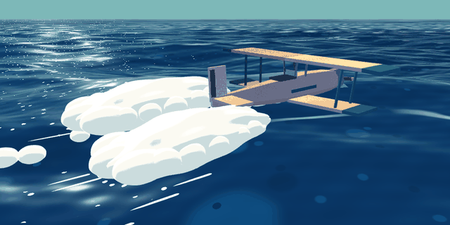

### Hydrofoil take-off

- **Aliases:** the P.7's take-off, foil-borne, on the foils, the clutch, the water screw.
- **Definition:** the Piaggio P.7 (1929) has no floats. Its sealed hull floats low with the wings
  just clear of the water and the air propeller feathered, declutched and windmilling slowly, its
  lower blade in the sea.
  Two hydrofoils on struts just ahead of the wing and a third under the tail lift it; a small
  water screw under the tail, driven by the same engine, pushes it. The run goes in four phases:
  1. **Hull-borne:** the screw pushes the hull through the water (it needs nearly full throttle
     to get over the hump). The foils' lift grows with the square of the speed and the hull rises,
     its wetted drag falling as it does.
  2. **Foil-borne:** at about 12 m/s (true) the hull is clear and she rides on the foils alone. A
     foil loses its lift as it nears the surface and all of it once it breaks through, so she
     settles at a ride height by herself; the tail foil sits higher than the forward pair, so the
     ride is a little nose-up. Fast, a foil's lift per square metre tops out (cavitation), which
     keeps her from being pinned to the water.
  3. **The clutch:** as soon as the foils have held the hull clear and the air propeller with
     0.2 m of air under its lowest blade (`PROP_CLEAR_MARGIN`) for three quarters of a second
     (`PROP_CLEAR_TIME`, against a passing crest), at a speed they can carry her
     (`FOIL_CARRY_SPEED`, 11.5 m/s) and with the throttle open, the clutch goes over by itself
     (or when `Controls.clutch` asks: the X key, the touch screen's Clutch): the screw is let go first, then the air
     propeller is clutched in and comes off its feather over about 1.4 s. In that gap nothing
     much pushes and she slows. If she drops off her foils with the driven propeller in the sea
     for `FALLEN_TIME` (0.75 s), the screw is clutched back in by itself, at any throttle, so she
     climbs up and tries again: she is never stopped dead.
  **At sea:** her foils hang on struts long enough (the forward pair 2.4 m below her centre, the
  tail's 1.6 m) that, riding them, the hull and the air propeller clear a moderate swell; her
  sealed hull's sides and wing tips, which sit at the waterline, meet the water as hull (buoyancy,
  planing, a keel or tip dug in across the flow catches) and never as panels slammed broadside
  (`_substep` in `src/flight.jo`, `sealed`: on land and quays they strike as any aircraft's);
  their lift tops out at the cavitation limit through a soft
  knee (tanh), so it still answers the flow's angle and damps her heave over the waves; a blade
  tip skimming a crest costs thrust in proportion to how far it is in (`air_drive`,
  `CraftState.foil.prop_dip`), and only a propeller well into the sea, driven, takes real blows.
  In the game's own swell (src/sea.jo, rising with the wind) she takes off hands off or with the
  stick back from calm to wind 5 (swell to about 1.24 m) from every one of eight starting points
  in the swell, in 27-46 s at the player's speed scale, with under 1% of hull damage; at wind 6
  from most of them; `tests/italian_racers_test.jo` "the P.7 takes off from the open sea in calm
  and in a moderate swell, wherever she starts" (seven of eight at least, each case).
  On her foils she drags far less than a float plane on its step: the foils' lift is square to
  the flow over them, and at 14-25 m/s their drag with the struts' is 12-17% of her weight,
  against a float plane's 19-40%. The hard part is the hump, on the water screw (8.2 kN,
  falling with speed) where a float plane has its whole air propeller: in calm water at the
  player's speed scale she is foil-borne at 14 s and airborne at 30 s (stick back) to 40 s
  (hands off) at full power, 37-50 s at 85% and 50-68 s at 70%.
  4. **Into the air:** the air propeller pulls her along on the foils; as the wing takes her
     weight the foils rise to the surface and break out, and she flies. Holding the stick back on
     the foils gets her off at about 40 m/s; hands off it takes until about 60 m/s.
  It is meant to be challenging but achievable. It fails when: the engine is short of power
  (under 70%, from wear: the screw barely gets her onto her foils, and a notice says "Her engine
  is too worn to lift her: have it serviced"; `FOIL_MIN_POWER`, `foil_power_short`); the nose is pushed down on the foils (the
  propeller dips into the sea and the engine is wrecked); the clutch is thrown with the propeller
  in the water (it beats the sea, gives no thrust and hurts the engine); or the sea is rough
  (wind about 8 m/s and over: the crests reach her hull on the foils and stop her). Closing the throttle at under
  5 m/s on the water puts the clutch back to the screw for another try.
  **The air propeller as seen:** declutched, the engine drags it round through its feathered
  blades: it whirls with the throttle (12 rad/s idling, 33 flat out, about 315 rpm:
  `windmill_speed`), as fast as solid blades still read, while its disc and arcs are held back
  (`foil_disc_speed`, `prop_disc_speed`), so its solid blades show whirling while a blade can touch
  the sea; where a blade cuts the water it flicks a small throw of spray at each strike
  (`_blade_cuts` in `src/pilot.jo`, the same particles and colour as the bow spray). A blade windmilling through the sea drags a little and does no harm; driven by the
  engine, it wrecks it. From the moment the clutch goes over, out of the sea, it is drawn at the
  engine's full turn, the stylised disc and arcs at once (`foil_prop_speed`, `foil_disc_speed`);
  the unfeathering's slower build of thrust stays in the physics, unshown.
  **No display of the stages:** the foils lift her as before, but there is no plate or warning for
  the screw, the foils or the clutch; the player reads the run from how she rides the water and
  from her propeller (whirling blades on the screw, the spinning disc once the air propeller is
  in). Her one-time hint: "full throttle; once her propeller is spinning, ease the stick back,
  never push".
- **Code:** `src/hydrofoil.jo` (the foils' lift and drag, `foil_force`; the screw,
  `screw_thrust`; the clutch, `clutch_step`; the P.7's foils and screw, `P7_FOILS`, `P7_SCREW`),
  `src/hydrofoil_solver.jo` `hydrofoil_contacts` (called from the water model in `src/flight.jo`
  `_substep`) and `hydrofoil_air` (the clutch kept going in the air, all three flight models);
  `CraftState.foil` holds the clutch and the telemetry (`foilborne`, `lift`, `screw`,
  `prop_wet`). The model is `_p7` in `src/italian_racers.jo`.
- **Rules:** the foils are not float contacts: they never set the waterline or the static
  buoyancy, and only the hull's contacts decide "hull clear". The P.7's hull is not a planing
  hull (`hull_planing` 0.15). The UI still needs a clutch key and an indicator (see the racers'
  report).
- **Test:** `tests/italian_racers_test.jo` "the P.7 takes off from her hull to her foils and into
  the air".

### Contra-rotating and push-pull props

- **Definition:** two propellers on one axis turning opposite ways. The Macchi M.C.72 has a
  **coaxial contra-rotating** pair at the nose (the Fiat AS.6 drives each from one of its halves);
  the Savoia-Marchetti S.65 has a **push-pull tandem**, a tractor at the nose and a pusher behind
  the cockpit. Each hub carries a spin against the aircraft's hand (+1 its hand, -1 the other); a -1
  hub carries the mirror-handed blades (`CraftModel.prop_alt`) and its disc is drawn mirrored. The
  M.C.72's front rotor and the S.65's tractor are right-hand.
  Their torque reactions cancel, so neither swings on its run (see [Prop torque](#prop-torque)).
- **Code:** `CraftModel.prop_spins`, `prop_alt`, `prop_spin`, `prop_turn`, `prop_frame`, `prop_mesh` in
  `src/planes.jo`; the hubs in `italian_racer_hubs` (`src/italian_racers.jo`); the discs in
  `queue_prop_discs` (`src/prop_disc.jo`).

### Prop torque

- **Aliases:** torque swing, torque reaction.
- **Definition:** a Tweaks trial (off by default): the propeller's reaction rolls the aircraft
  against the propeller's turning, about a fifth of the static thrust at the blade tip, with the
  throttle. A right-hand propeller (clockwise seen from the cockpit, as most engines of the period
  turned) rolls her to port: on the take-off run the port float digs in, and in the air (flight
  model v2) the left wing wants to drop. A left-hand one does the opposite. Each profile carries
  the hand (`AircraftProfile.prop_hand`): the game's own sixteen are left-hand, as their props have
  always been drawn; the historical types right-hand (the default), the S.6B's from the record (its
  torque buried the port float, so it carried its fuel in the starboard float). The prop is drawn
  turning in that hand, so the torque always rolls against what is seen. A contra-rotating pair or a push-pull
  tandem has none, and nor does a Schneider racer with its own torque swing (`CraftSpec.torque_share`
  0).
- **Code:** `prop_torque` in `src/flight.jo` (+ is to port); `tweaks.prop_torque` in
  `src/tweaks.jo`.
- **Test:** `tests/italian_racers_test.jo` "contra-rotating and push-pull pairs have no net torque
  swing" and "the prop torque trial rolls against each propeller's turning".

### Aircraft shadow

- **Aliases:** the plane's shadow, the hard shadow.
- **Definition:** the film's cue for height and speed low down: an aircraft's shadow drawn as a flat,
  crisp, dark shape of its own silhouette (wings, floats, struts) on the sea, the land, the grass
  and the docks. Dark and cut sharp near the surface, it fades and softens (the sun's penumbra, a
  hundredth of the height) as it climbs and is gone by about 320 m. It keeps the surface's hue:
  deep navy on the sea, deep green on grass. It slides over the swell and the terrain as drawn.
- **Code:** `src/craft_shadow.jo`. Each frame the nearby aircraft's own meshes are flattened along
  the sunlight into a small top-down mask under the player's shadow (`craft_shadow_mask_pass`, 80 m
  square, 16 cm texels; 31 cm on the low tier); in the cloud composite framebuffer one
  full-resolution pass over the mask's rectangle on screen rebuilds each pixel's world point from
  the scene depth, carries it along the sunlight into the mask and multiplies the scene by a cool
  tint (`craft_shadow_multiply`). The mask keeps each caster's lowest point, so an aircraft never
  shadows itself. Called from `src/cloud_volume.jo`; casters gathered in `aegean.jo`.
- **Rules:** without post-processing (software rendering), and for aircraft outside the mask, the
  older shadows stand (rectangles in the sea shader, `sea.jo add_sea_shadow`; flattened meshes on
  land, `curved_world.jo draw_curved_shadow`). Never thins the sea's speed flecks: it multiplies,
  so they keep their contrast inside it. `AEGEAN_OLD_SHADOWS=1` shows the older ones, for
  comparisons; `AEGEAN_FLYING_OVER=airfield` starts an `AEGEAN_FLYING` capture over grass.
- **Test:** `tests/craft_shadow_test.jo`.

### Speed scale

- **Aliases:** drawn speed versus true speed, pure scale, `liked-speed-3.3x`.
- **Definition:** the world is flown at 3.3 times the aircraft's true speed. Drawn (visual)
  speed is true speed times the scale. The capture switch `AEGEAN_FLYING='alt speed'` takes the
  true speed (m/s, the speedometer's) and draws it at the scale; left out, 1.3 times the stall.
- **Code:** `set_speed_scale` in `src/flight.jo`; the `pure_scale` flag in `src/tweaks.jo`;
  `pure_k` converts back to true speed.
- **Rules:** a plain scalar, not a curve; the approved version is tagged `liked-speed-3.3x`.
  The "true speed on a curve", quick-grip, true-speed airframe and true-speed cloth trials (no
  checkbox, only `AEGEAN_TWEAKS=curve|grip|airframe|cloth`) were retired 2026-11-15: nothing used them.
  Distance-dependent speed tricks (near boost, detail flow, whole-sea flow, axial stretch;
  `AEGEAN_SPEED_MODE`, `AEGEAN_NEAR_BOOST`) were rejected on 2026-11-10 and must not be revived.

### Chaotic stalls

- **Aliases:** the stall trial.
- **Definition:** retired 2026-11-15 (the user judged it not worth keeping): a Tweaks option for a
  more physical stall, with left and right wing separation, stall breaks and spins. The option,
  its checkbox, its `AEGEAN_TWEAKS=stalls` hook, its flight and autopilot code, and its tools and
  tests are gone; the game flies the liked arcade stall as it always did with the option off.
  Flight model v2 keeps a soft stall of its own.
- **Code:** none left. `wing_separation`, `buffet` and `stall_blend` in `CraftState` are written
  only by flight model v2 (`src/flight_v2.jo`, `src/flight_sb.jo`) and read by the flight feedback.

### Flight model v2

- **Aliases:** v2, the trial flight model, fdm2; the liked model (its counterpart: the default).
- **Definition:** a Tweaks option (off by default) that flies the player's aircraft in the air as a
  rigid body with forces: lift from the angle of attack with a soft stall per wing, drag, a
  fixed-pitch propeller with rpm, honest gravity, and assists (path hold, coordination, departure
  resistance, a g limit). Water, land and contacts stay on the liked solver; NPCs stay on the liked
  model. Worked in true units: the drawn world is the true one at the [speed scale](#speed-scale).
- **Code:** `src/flight_v2.jo` `fly_air_v2`, `steer_v2`, `Fdm2Tuning`; dispatched from
  `src/flight.jo` `_substep` and `steer` by `tweaks.flight_model`; `tools/fdm_compare.jo`,
  `tools/fdm_plots.py`, `tools/fdm_frames.jo`, `tests/flight_v2_test.jo`. On `t3/flight-v2`.
- **Rules:** the stick asks for a rate of the flight path (as the liked model's); released, the
  path is held. The default stays the liked model until the user prefers v2.
- **Capture:** `AEGEAN_TWEAKS=fdm2`; strobes with `tools/fdm_frames.jo` (`FDM_MODEL=0|1`).
- **Every type, as a player flies it:** `tools/type_survey.jo` flies each player-selectable aircraft
  on the mouse's aim (as `src/pilot.jo` steers) and sets out a table: the take-off in calm water and
  in wind 3's swell from three places (landplanes on flat grass), the cruise and the top speed level,
  a level 45 degree turn, a stall and its recovery, a landing, a taxi turn and coming to rest, and
  the aim's step, tracking and wiggle. The player's own mouse steering (`steer_v2` for her aircraft,
  not another's nor an autopilot's) holds the nose's attitude on the wheels, and never asks the path to turn harder than the
  wing can at that speed, so a landplane is not sat on her tail on the grass and a flying boat just
  off the water climbs away instead of being pulled into a stall. A flying boat's hull below its
  middle (and the S.55's twin hulls) running through the sea is judged by its sink into the water,
  not by its run along its length, so it is not broken up in a moderate swell, while a hard drop
  still crushes it (`src/flight.jo` `_substep`); `tests/type_flight_test.jo`.
  On v2 the cruise throttle (`cruise_throttle`) is v2's own balance (`fdm2_cruise_throttle`), so every
  type cruises at its catalog cruise on it. The player's steering aims the nose (the guns) wherever she
  flies, and the way she goes only on an approach, the throttle back and slow (under 1.45 times the
  stall, the nose again by 1.6), never while fighting (the guns in use, or a target's lead shown on
  the gunsight: `Flyer.fighting`), so she flies down an approach's aim rather than a degree or two
  below it and a correction of a degree at the guns still lands on the gun line; and a small correction's gentle turn is eased for the fast types (to the
  bank a 75 m/s type takes for it), so the racers no longer bank 7 to 8 degrees for 2 degrees of aim,
  while a big one turns them as briskly as ever.
  The other aircraft on v2 (`fdm2_npcs`) take off on the autopilot's attitude hold, not the mouse's
  steering, and climb away only once flying (1.1 times the stall), so they never pitched up into the
  stall as the player did; thrown off a crest below flying speed they are held low and level. The
  autopilot gives a giant a final as long as her size asks (60 spans) and a slow-nosed type a flare
  begun higher, and a hydrofoil runs straight out on her foils before turning for the dock and
  taxies on her screw at up to half throttle. `tools/npc_survey.jo` flies every type as the other
  aircraft do (take-offs calm and in wind 3, a trip to a dock, the air arm's sortie);
  `tests/npc_flight_test.jo`.

### Sky Barons port

- **Aliases:** flight model 2, the Sky Barons model, fdmsb.
- **Definition:** Sky Barons' own `fly_air` (examples/skybarons/sim.jo) flying this game's aircraft,
  for reference beside the liked model and [flight model v2](#flight-model-v2): the nose turned at
  fixed rates, the path following it, speed from thrust, drag on speed squared and gravity along the
  path. Worked in true units with the catalogue's figures and drawn at the [speed scale](#speed-scale).
  The water, land and contacts stay on the liked solver; the player's aircraft only.
- **Code:** `src/flight_sb.jo` `fly_air_sb`; chosen on the pause menu's Flight v2 page (or
  `AEGEAN_TWEAKS=fdmsb`); `tests/flight_sb_test.jo`; a column of `tools/fdm_compare.jo`.

### Departure resistance

- **Aliases:** the AoA limit, the assist's stall margin.
- **Definition:** in [flight model v2](#flight-model-v2), the pilot's assist never pulls the wing
  past its stall angle with the stick alone, so a keyboard's full stick turns as hard as the wing
  allows without snapping. The wing still stalls when speed runs out faster than the nose can
  follow (a zoom), and then falls and recovers by its own aerodynamics.
- **Code:** `src/flight_v2.jo` `Fdm2Tuning.departure` (1 = full resistance; 0 lets a full stick
  go 0.2 rad past the stall).

### Altimeter hands

- **Aliases:** the altimeter, the two dials (as the user asked for them), coarse and fine altitude.
- **Definition:** the period altimeter: one face numbered 0 to 9 round the whole circle, a tick
  every 20 m, with a long thin hand for the hundreds of metres (one turn per 1,000 m) and a short
  broad hand for the thousands (one turn per 10,000 m). 1,250 m reads short hand a quarter past
  1, long hand at 2½. The face says "×100 m" (on the panels "M X100").
- **Code:** `src/hud.jo altimeter_dial` and `altimeter_hands` (the HUD gauge); in
  `src/cockpit.jo` the full-circle face in `build_cockpit`, the `short_hand` mesh, and the long
  hand from `cockpit_values` (index 1), drawn in `draw_cockpit`, on every aircraft's panel.
- **Rules:** keep the brass dial style; the short hand sits under the long one.
- **Capture:** `AEGEAN_FLYING='1250 60'` (HUD) and `AEGEAN_FLYING='1250 60 cockpit'`.

### Cockpit arrangements and cabins

- **Aliases:** the flight deck, the cabin, the bridge (the Do X's), open single / tandem / side by
  side, the virtual seat (the cabin's drawing frame).
- **Definition:** each type's cockpit as the real one was laid out. Open single and open tandem
  keep the padded oval coaming; the S.55, Wal and Donnet-Lévêque are open for two side by side (a
  shared opening, the Wal's and S.55's flown with wheels, a quadrant between the seats). The
  Heron, Pelican, Albatross, Sarafand, Do X and H-4 have a glazed **cabin** modelled from inside:
  framed windscreen and side windows, roof and rear bulkhead, every face wound toward the pilot so
  it is solid at any head angle; the flying instruments set in its panel at the open cockpit's
  distance, control wheels, a throttle quadrant, a second seat with its own airspeed and
  altimeter, engine gauges, and on the H-4 the flight engineer's board. Outside, each cabin is a
  matching deckhouse (`cabin_exterior`); the hull is cut away round the cabin in the cockpit view.
- **Code:** `src/cockpit_cabins.jo` (`cockpit_layout` per type, `cockpit_look` the head-look's
  limits, `cockpit_glass` the panes for rain on the glass, `cabin_interior`, `cabin_exterior`,
  `fit_cockpit`); `src/cockpit.jo build_cockpit` and `draw_cockpit` (wheels, quadrant, the shifted
  cluster).
- **Rules:** the windscreen's foot sits 0.24 m under the eye and 1.27 m ahead, so the gauges stay
  where the open panel has them and the forward view over the nose is the open cockpit's; nothing
  but frames crosses the glass. `tests/cockpit_cabins_test.jo` casts rays from each cabin's eye:
  every direction must meet a face turned toward it or leave through a pane.
- **Capture:** `tools/cockpitlab.jo` (`COCKPIT_KIND`, `COCKPIT_LOOK="yaw pitch"`, `COCKPIT_HOUR`,
  `COCKPIT_OUTSIDE="yaw pitch distance"`); in the game `AEGEAN_CRAFT=25 AEGEAN_FLYING='80 50 cockpit'` (the speed is the true airspeed; left out, a safe 1.3 times the type's stall).

### Fuel gauge (cockpit)

- **Aliases:** the sight glass, the float gauge, the fuel dial.
- **Definition:** every cockpit reads the tank's real contents (including while refuelling) on
  the coaming beside the compass, where the eye already goes and inside a phone's narrow view.
  Open cockpits have a period sight glass with a cork float: an amber column over pale glass, its
  foot painted red. Cabins and flight decks have a round FUEL dial with a red sector at the empty
  end. Below 15% the float or needle sits in the red (the column itself turns red). The third-person
  HUD keeps its own fuel bar (`src/hud.jo instruments`, beside the throttle).
- **Code:** `src/cockpit.jo` `_cockpit_fuel_face`, `cockpit_fuel_at`, the moving part in
  `draw_cockpit_instruments`; `draw_cockpit(..., fuel01)` from `fuel_reading()` in `aegean.jo`.
- **Capture:** `tools/cockpitlab.jo` with `COCKPIT_FUEL=0..1`.

### Cockpit lamp and luminous dials

- **Aliases:** the panel lamp, instrument glow, night cockpit.
- **Definition:** after dark the cockpit is lit by its lamp's warm light instead of the moon's
  (fully in a cabin, which has a ceiling lamp; less in an open cockpit), and the dials' markings
  and needles glow (their paint carries an alpha below 0.9, the object shader's after-dark glow).
  The airframe outside the cockpit keeps the night's light. A cabin also keeps the sun to what
  comes through its glass, and the rain off its interior.
- **Code:** `src/cockpit.jo cockpit_params` (`cabin`, `lamp`), `COCKPIT_LUMINOUS`.
- **Rules:** never scale a cockpit paint with `*` (it scales the alpha too and the paint glows at
  night: the old panel grain did); use `paint_dim`.

### Schneider racers

- **Aliases:** the racers, the historical racers; the Macchi M.33, Curtiss R3C-2, Supermarine
  S.6B and Sea Lion II (Craft `macchi_m33`, `curtiss_r3c2`, `supermarine_s6b`, `sea_lion_ii`).
- **Definition:** four real racing seaplanes of the Schneider Trophy years (1922–1931), each built
  to its own layout: the M.33's shoulder wing and engine nacelle on N-struts above the hull, the
  R3C-2's tiny biplane wings with brass surface radiators, the S.6B's low wing with radiators over
  the wings and float tops, the Sea Lion II's biplane boat with its pusher between the wings. Their
  speeds come from their real ones by the [One speed rule](#one-speed-rule) (the S.6B's 656 km/h
  record: a top of 166.5 m/s true, 550 m/s drawn at the 3.3 scale), so they compare with one another
  as they did; the original fictional types sit faster
  than real 1920s aircraft of their roles.
- **Code:** models in `src/racer_planes.jo` (dispatched from `src/planes.jo`); profiles at the end
  of `AIRCRAFT` in `src/aircraft_catalog.jo`; `tests/aircraft_racers_test.jo`;
  `tools/racer_view.jo` (model check), `tools/racer_runs.jo` (every type's take-off run).
- **Rules:**
  - **Torque swing** (Tweaks: "Racers' propeller torque", on by default, the player's aircraft
    only): `swing` in the profile, rad/s² of roll at full throttle. On the run the port float is
    pressed in and the nose swings to port until the hull planes (rudder holds it); just off the
    water a roll to port that fades out by 2.4 times the stall speed (the wings were rigged for
    it at speed). Both flight models. These four take no [Prop torque](#prop-torque) (the
    generic trial) on top: `torque_share` is 0 for any type with a `swing`.
  - **Ground lift** (`ground_lift`, default 1): the wing's lift on and just off the water over the
    free air's. The water model lets a hull or float pitch to about 0.1 rad before its tail digs
    in at speed, so a wing as heavily loaded as the S.6B's (204 kg/m²) could not unstick at a sane
    speed; 1.4 stands for the ground effect of a low wing near the water.
  - **Water thrust** (`water_thrust`, default 1): the pull at a standstill over the force model's,
    full by 1.2 times the stall. A fixed-pitch propeller made for 650 km/h is stalled at low
    speed: the S.6B's 0.35 gives it the longest take-off run of the racers (about 45 s). Above 1
    it is a **static pull** factor: a big, slow-turning propeller pulls far harder at a standstill
    than the force model's thrust (derived from the drag at the top speed) allows a slow, heavy
    biplane; the Fairey IIIF's 1.3 brings its run to about 31 s as the player (the Velos needs
    none: 23 s, beside the Short 184's 25; the Gull's is 18).
  - Their `AIRFRAMES` rows exist for the player's records; no seeded fleet flies them yet.

### Wing-strut streamers

- **Aliases:** streamers, the ribbons on the struts.
- **Definition:** a red-and-cream ribbon each side of the player's aircraft, streaming back in
  the wind of flight (the same cloth as the [Pilot's scarf](#pilots-scarf)). Each is tied
  halfway along that type's outermost strut that is clear of the water and no higher than its top
  wing: an interplane strut on a biplane, a wing strut, a float strut on a twin-float
  monoplane, or a tip-float strut on a boat. Of a fore-and-aft pair it takes the rear one. Found
  from the type's own struts, so every type, and any added later, has them on its own structure.
  The Supermarine S.6B and Macchi M.C.72 (cantilever wings) carry them on their float struts; the
  Piaggio P.7, whose only struts are its hydrofoil legs under the water, has none.
- **Code:** `src/craft_struts.jo` (`tag_strut`, `craft_struts`, `streamer_ties`); the strut helpers
  in `src/planes.jo`, `src/racer_planes.jo`, `src/aircraft_boats.jo`, `src/italian_racers.jo`
  tag their boxes; `src/planes.jo craft_tie_streamers` fills `CraftModel.struts` and
  `CraftModel.streamers`; `src/fabric.jo cloths_for`; `tests/streamer_test.jo`.
- **Rules:** a new aircraft's struts must be laid with a strut helper (`_strut`, `kit_strut`,
  `_bstrut`, the racers' `_strut`/`_blade`, `_st`), or call `tag_strut` on the box just pushed;
  the test fails for a type with no strut to tie to unless it's listed as having none.
- **Capture:** `HANGAR_STREAMERS=1 HANGAR_YAW=2.3 HANGAR_KINDS="0,1,3,5,12,16,17,20,21,25,26,32"
  sloppy tools/hangar.jo` (a contact sheet).

### Race classes

- **Aliases:** the club class, the Schneider class, the open class; club racers, the long course.
- **Definition:** air races are held in classes so speeds are fair. The **club class** is for the
  game's own types (the first sixteen); the **Schneider class** is open to the historical
  racers (S.6B, M.C.72, S.65, P.7, M.33, R3C-2, Sea Lion II). On a capital's feast day it holds
  one race of each: the Schneider race at eleven, the club race at five. Each capital's flying
  club fields two club-class aircraft and up to three Schneider racers from its country's
  tradition (Kalyrassa: M.C.72, S.65, M.33; Orenthessa: S.6B, R3C-2, Sea Lion II), each the
  newest a twentieth of the club's purse allows, so a poorer club flies the older racers. The
  player enters in their own aircraft if its class matches; the fee is the class's.
- **Code:** `src/air_classes.jo` (classes, lines, the funding rule, pace, course scale, windows,
  fees); `AirMeet.race_class` and `scale` in `src/air_race.jo`; the clubs and meets in
  `src/air_events.jo` `prepare_air_events`; the club moorings along a capital's pier in
  `src/far_scene.jo` `_club_moorings`; the cards in `src/race_view.jo`; tests in
  `tests/air_events_test.jo`.
- **Rules:**
  - The Schneider class flies a **long course**: the club oval at three times the size (2.5 or 2
    where open water is short), gates about 3.4 km apart, 660 m wide and 500 m high, so a racer at
    600 m/s has the room to turn. Its pylons stand taller; its racing lasts 180 minutes (the
    club's 120) for its slowest racers.
  - NPC racing pace: the club class 140 m/s drawn as before; the Schneider class 80% of each
    type's top speed up to 160 m/s times the course scale (480 m/s on the long course).
  - A Schneider race is held only where the club fields a Schneider racer; the club class always.
  - The race card names the class while racing; the results card lists the field (place, pilot,
    aircraft, time or lap); the gate's label sits above or below its bracket, off the player's
    aircraft. The chase camera's fall-back at speed is held at 1.9 times its rest distance for a
    Schneider racer (3.4 for the rest), so the racer reads at 600 m/s.
  - The capital club's pilot cohort (`AIR_CLUB_PILOTS`, five) and an aerodrome's air arm (two)
    are reserved together.
  - On the way home a clubmate yields the approach only to another coming home, and one already
    down or on final keeps its landing.
- **Capture:** `AEGEAN_CAPTURE_RACE=schneider` with `AEGEAN_CRAFT` a Schneider racer (the S.6B is
  21): the long course off the home harbour, the player at the third gate's approach 41 s into the
  race, five rivals flown by the flight model; `schneider-finish` the results card;
  `schneider-empty` the same flight with no race (frame-time comparisons).

### Velos and Fairey IIIF

- **Aliases:** the Greek naval types; the Blackburn T.3 Velos (Craft `blackburn_velos`), the
  Fairey IIIF (`fairey_iiif`).
- **Definition:** two aircraft of the Greek naval air service, on twin floats. The **Velos** (1925)
  is the Blackburn Dart's two-seat torpedo and training biplane built for the Greek navy (four
  from Brough, twelve licence-built at Palaion Faliro, the first aircraft built in Greece): two-bay
  wings, a Napier Lion behind a nose radiator under a navy-blue cowl, the observer raised behind
  with a Lewis gun, a torpedo between the floats; 172 km/h. The **Fairey IIIF** (1931 in Greek
  service) is the naval-cooperation biplane the Greek navy flew on floats from Phaleron Bay until
  1941: a metal fuselage round a Lion XIA in a pointed cowl, a belly radiator, the tall Fairey
  rudder, pilot, observer and gunner; 209 km/h.
- **Code:** `src/greek_planes.jo` (models; `greek_roundel`), built with the racer kit
  (`src/racer_planes.jo` `rk_*`); profiles in `src/aircraft_catalog.jo` (with `real_top_kmh`);
  `tests/aircraft_greek2_test.jo`; listed beside greek-1's types in [Greek service](#greek-service).
- **Rules:** their default is the Greek Naval Air Service livery (marking 3: the Greek insignia
  from `src/markings.jo` on the upper wings by `kit_wing_mark`, under the lower wings and on the
  fuselage sides by `greek_side_mark`, blue-white-blue vertical stripes on the rudder by `kit_rudder`),
  its dope a cool silver so it still reads silver in warm light. Its family is "greek": the
  [Paint page](#paint-page) offers them the Greek-service liveries and the civil ones, and the Greek
  and British insignia and rudders (`TYPE_NATIONS`). Their game speeds follow
  the [One speed rule](#one-speed-rule) from `real_top_kmh` as every historical type's do (60 and 70 m/s); the
  IIIF has a static pull of 1.3 (see Schneider racers, water thrust). Both are in the picker's
  Greek service group, and their struts are tagged for streamers (the racer kit's `rk_strut` and
  `rk_blade`).

---

## Sky

### Cloud body

- **Definition:** one cloud's volume: a heaped cumulus with crisp cream tops, slate-blue shaded
  sides and a flat, darker base on its air mass's condensation level.
- **Code:** forms in `src/cloud_density.jo`, placement in `src/cloud_field.jo`, drawing and
  painted light in `src/cloud_volume.jo`; the atlas is baked by `tools/bake_clouds.jo` into the
  ignored `assets/clouds.png`. See `docs/cloud-paint.md`.

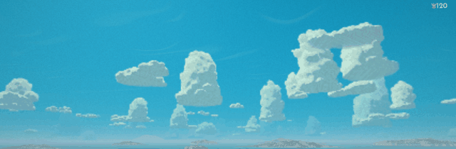

### Cloud forms

- **Definition:** the 28 procedural shapes a cloud body takes, built at their true proportions
  and only ever scaled uniformly (never stretched): **humilis** (flat caps, wider than tall),
  **fractus** (torn pieces), **cluster** (a clump or short street of cells on one base),
  **mediocris** (heaped), **congestus** (towers of stacked lobes), **twin** towers, **anvil**
  (a massive body under a flat plate spreading downwind) and **mass** (a large complex).
- **Code:** `cloud_make_form`, `cloud_heap`, `cloud_stamp_kind` in `src/cloud_density.jo`;
  `CLOUD_STAMP=n` in `tools/cloud_pilot.jo` shows one.
- **Rules:** a taller tower gets more lobes, not taller ones. Side turrets lean on the main
  column (apart, their heads arch over a window).

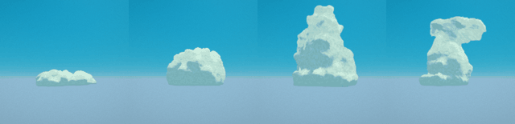

### Cumulus field

- **Aliases:** the field, cloud streets.
- **Definition:** the population of fair-weather clouds: clumps of small clouds, a main cloud
  with satellites, and streets along a heading, gathered by a coarse clumping cascade and
  wind-aligned rows with clear lanes between; power-law sizes in three octaves.
- **Code:** `cloud_octave_group`, `world_clouds` in `src/cloud_field.jo`.

### Tower growth

- **Definition:** how a heaped cell becomes a towering cumulus while the air builds towers
  (towers weather, or afternoon heating over land): the tower rises at its own proportions out
  of the heaped cloud, which wears away inside it.
- **Code:** `cloud_tall`, `cloud_forms_shown`, `cloud_evolve` in `src/cloud_field.jo`.

### Cloud relief

- **Definition:** the lumpy, broken edge of a cloud seen close: billowed noise in the cloud's
  own metres that breaks the silhouette into rounded bulges, faded out with distance and kept
  off the flat base; mostly not in the light, so faces keep their painted masses.
- **Code:** `cloud_relief` in `src/cloud_volume.jo`.

### Brushwork

- **Aliases:** brush strokes, painted bands.
- **Definition:** what keeps the clouds hand drawn: flat painted bands of light with narrow
  edges, brush strokes curling round each lobe that break those edges into dry-brush cuts, and
  scalloped brush dabs on the silhouette a few pixels across at any distance. A storm's cloud
  carries the same at its own scale, layered darker toward its base.
- **Code:** `cloud_paint`, `cloud_strokes` and `cloud_brush` in `src/cloud_volume.jo`.

### Cloud shadows

- **Definition:** the dark patches with defined edges that the clouds cast on land, sea,
  rivers, lakes and towns, offset from each cloud by the sun's angle and moving with clouds
  and sun; deep water goes navy, clear shallows a deeper teal, land keeps some colour. The
  edge is a quick ramp with a hint of softness (`cloud_shadow_edge`). Seen from height they
  grow lighter and softer, and small clouds' shadows fade, as in the film; near the ground
  they keep their edge.
- **Code:** `src/cloud_shadow.jo`: the map (sun-projected coverage from each form's footprint
  slabs) and `apply_cloud_shadows`, a screen-space pass over the scene depth; the sea's glints
  per vertex in `src/sea.jo`. `AEGEAN_CLOUD_SHADOWS=0` turns them off.

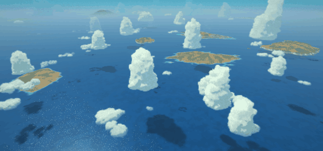

### Overcast deck

- **Aliases:** the deck, cloud deck.
- **Definition:** a bounded, climbable layer of cloud with a base and a top, the same ellipse as
  in the weather simulation. **Rain curtains** are the slanted, grey, vertically coherent shafts
  hanging below a deck.
- **Code:** deck and squall in `src/cloud_field.jo`; deck coverage and rain curtains in
  `src/cloud_volume.jo`.
- **Capture:** `AEGEAN_CAPTURE=weather-above|weather-below AEGEAN_WEATHER=overcast`.

### Deck climb

- **Definition:** the set piece of climbing from a dark, rainy sea up through the overcast deck
  and breaking out into blue sky over a bright white top (`docs/DESIGN.md`).
- **Capture:** `AEGEAN_WEATHER=overcast` with `AEGEAN_VIEW` at heights from 300 to 1900 m (the
  clouds reports' deck series).

### Anvil

- **Definition:** the dark, flat-crowned top of a thunderstorm's column, at the storm centre: a
  plate flattened at the tropopause and spreading downwind over a massive body.
- **Code:** the storm branch of `src/cloud_field.jo`; the form (`CLOUD_ANVIL`, its plate in
  `cloud_form_distance`) in `src/cloud_density.jo`.
- **Capture:** `AEGEAN_CAPTURE=weather-storm AEGEAN_WEATHER=storm
  AEGEAN_WEATHER_CENTER='0 -26000'`.

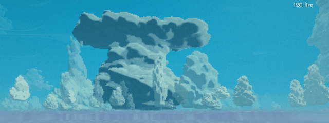

### Storm system

- **Aliases:** thunderstorm, storm cell (in the weather simulation).
- **Definition:** a thunderstorm about 26 km across, minutes to fly through: a dark deck from a
  ragged 1150 m base to above the highest an aircraft can climb, a tiered **shelf cloud** along
  its leading (downwind) edge, four embedded cells at their stages (towers, a mature anvil, a
  dissipating mass) under one painted **anvil canopy** near 9-10 km, rain shafts under the
  cells, and a slate rain veil from its base to the sea that reads from 10-40 km. Painted in
  the film's storm palette: near-black slate belly and deck, cream-grey lit tops. The air is
  rough throughout its deck and violent in the cells. Born about 30 km out, it
  crosses the home waters at 120 m a minute, closing the routes under it for about three and a
  half hours: one waits it out, goes round, or pushes through.
- **Code:** `storm_cells` (the shared layout) in `src/lightning.jo`; `storm_system_clouds` in
  `src/cloud_field.jo`; weather kinds 9 (shelf), 10 (storm deck) and 11 (canopy) in
  `src/cloud_volume.jo`; the schedule in `src/living_weather.jo`.
- **Capture:** `AEGEAN_WEATHER=storm AEGEAN_WEATHER_CENTER='x z'` (with `AEGEAN_FLYING` the storm
  centres on the aircraft).

### Storm sighting

- **Definition:** a thunderstorm in sight of a place (up to about 60 km beyond its edge), told
  as an observation, never a forecast: islanders name where it stands, how far, and whether it
  comes on or moves off; the radio's harbour weather report names it too.
- **Code:** `storm_sighting` in `src/living_conditions.jo`; `context_weather` in
  `src/living_talk_context.jo`; `radio_weather_content` in `src/radio_content.jo`.

### Storm sound

- **Definition:** a storm heard from the aircraft: rain drumming on fabric and wood, wind gusting
  with the rough air, and thunder from each strike the bolts show, a crack and a roll near, a
  darker roll far, arriving after its distance at the speed of sound. All synthesized.
- **Code:** `src/storm_sound.jo`. On the ground the ambience's own thunder plays instead.

### Lightning

- **Aliases:** strikes, bolts.
- **Definition:** a thunderstorm's strikes, one every five to ten seconds, cloud to ground or
  within the cloud: a branching channel with three or four return strokes over half a second,
  the cloud lit from inside around it, the sky flashing near it, and thunder heard after the
  distance at the speed of sound. One deterministic schedule per storm drives all of them.
- **Code:** the schedule and the channels in `src/lightning.jo`; the bolts in
  `src/storm_render.jo`; the inner flash (`cloud_flash`) in `src/cloud_volume.jo`; the thunder
  in `ambience_thunder`.

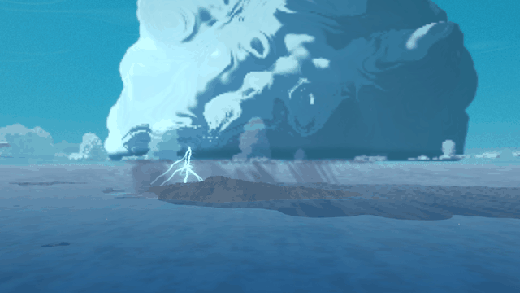

### Rain shafts

- **Definition:** the dark columns and curtains of rain hanging from a storm system's base
  (1150 m) to the sea under each of its cells, clear air between them, the lower rain carried
  downwind, with ragged scud under the base. Hazed far less than the air around them, so from 30
  to 40 km they are the grey streaks that say "storm". A squall's lighter **rain curtains** hang under its deck.
- **Code:** weather kind 8 in `volume_sample`, `src/cloud_volume.jo`.

### Storm turbulence

- **Aliases:** rough air, buffeting.
- **Definition:** the air inside a cloud's body is rough, mildly in fair cumulus and violently
  in a thunderstorm, and gusty under a storm. It acts through the flight model: eddies and
  drafts in the wind it meets (vertical jolts and airspeed swings), and roll, pitch and yaw
  kicks with a fast shudder that knock the aircraft about its path and let it come back,
  and the storm's push, scaled to each type: left alone it is banked and off its heading
  within seconds, and with the mouse steering it holds level but is turned off its course
  (the aim turns with it), so a storm is flown by the instruments, correcting.
- **Code:** `weather_turbulence`, `weather_turbulent_gust` in `src/weather_scene.jo`;
  `_turbulence_kick` in `src/flight.jo`; `tests/storm_test.jo`.

### Windscreen rain

- **Definition:** in rain, seen from the cockpit, beads land on the windscreen and run up and
  back with the airflow, faster the faster one flies, leaving wet trails; a storm adds a denser
  downpour of streaks rushing past.
- **Code:** `draw_windscreen_rain` in `src/storm_render.jo`; the downpour in `src/rain.jo`.

### Inside a cloud

- **Definition:** the view from within a cloud: a mist of its own colour, darker in a storm,
  with darker and lighter masses drifting past that carry the sense of speed; in a storm's rain
  the view closes in.
- **Code:** the inside mist in `cloud_body_hit`, `src/cloud_volume.jo`; its tuning constants
  `CLOUD_INSIDE_*` (or `AEGEAN_CLOUD_INSIDE="size contrast brightness"`).

### Weather fixtures

- **Definition:** the named weathers: fair, towers, overcast, front, rain, storm (thunderstorm),
  fog, meltemi (the clear summer gale) and calm.
- **Code:** `weather_fixture` (via `AEGEAN_WEATHER=<name>`), `src/weather_scene.jo`.

### Sunset

- **Definition:** the light while the sun is low or touching the water: a dusky violet-blue sky
  overhead, rose lower down and round the whole horizon, and a deep orange band low on the sun's
  side (hottest at the horizon toward the sun, the rest of the horizon a pink belt). The sea goes a
  deep blue-violet under it, the orange carried by its glitter. Clouds take the light from below:
  their bases go gold, edges toward the sun lit through, shaded sides rose-violet, and the sides
  away from the sun orange. Hands over to the afterglow by about 18:30.
- **Code:** the sunset keys (sun height 0 and 0.15) of `TWILIGHT_*` in `src/look.jo`, with
  `Light.sunset` (how much the sun on the water reddens the glow band, `draw_glow_band` in
  `src/sky.jo`); the clouds' sunset shade (`VOLUME_SUNSET_SHADE`) and low-sun light in
  `src/cloud_volume.jo` (`cloud_paint`).
- **Capture:** `AEGEAN_VIEW="-30000 50 36000 1.5708 0.06 17.85"` (at sea, looking west).

### Sun disc

- **Definition:** the sun's disc, white high up. Low down it is graded, pale gold at its top to
  amber at its foot, and reddens as it sinks; flattened by the air and drawn up to 1.8 times larger
  near the horizon, its foot wavering in slices into a short mirage where it meets the water. In
  thick air (the day's air) the change starts about 20 degrees up and comes on gradually, deep red
  only near the horizon on a heavy-dust day; a reddened sun keeps a hot yellow-orange core grading
  to a red limb and a warm glow about it in the air, so it reads as light, never a painted dot.
- **Code:** `draw_sun_disc` and `sun_disc_look` in `src/sky.jo`: a small billboard drawn over the
  sky and the glow band (the sky's own shader keeps only the sun's glow; its colours, size and
  shape worked out on the CPU from the sun's height over the visible horizon).

### Day's air

- **Definition:** how clear or thick the low air is on a given day, which colours the sunset.
  One kind a day, the same for everyone, from the day's number, nudged by the weather where the
  eye is (rain or a deck overhead: humid; a clearing wind: clear or washed). **Clear** is the
  baseline sunset. **Hazy**: the disc orange from about 15 degrees up, the glow band broader.
  **Dusty** (Saharan dust): the whole sky milky all day, a pale buff-grey veil from the horizon
  well up past the sun with the blue weak and only overhead, no bright glare round the sun, a
  flatter, warmer light; the disc orange to red from about 20 degrees, a little dimmer and
  softer-edged, the band broad and red. **Hazy** days the same, less.
  **Humid**: a softer, pinker glow, the disc orange from about 12 degrees. **Washed** (after
  rain, a clean wind): crisp air, the disc yellow almost to the water, the band narrower.
- **Code:** `src/day_air.jo` (`day_air_kind`, `day_air_light`, worked out on the CPU into the
  frame's Light; `Light.turbidity` for the disc, `Light.glare` scales the sky's glare, `sun_disc_look` in `src/sky.jo`).
  `AEGEAN_SKY_AIR=clear|hazy|dusty|humid|washed` fixes the kind for captures.

### Afterglow

- **Aliases:** twilight, golden hour, blue hour.
- **Definition:** the day's light keyed by the sun's height: after sunset the sky keeps a bright
  amber band low on the sun's side (orange at the horizon, peach-gold above, a faint rose round
  the rest) for over an hour, while land, sea and cloud bellies go dark beneath it as silhouettes;
  then a teal blue hour (about 19:45) and night with stars by about 20:30. Dawn mirrors it. The
  sea lays a glitter path toward the band, and the moon's glitter takes over as the glow fades.
  The same on every quality tier.
- **Code:** `light_at`, `twilight_light` and its `TWILIGHT_*` keyframes in `src/look.jo`
  (`Light.afterglow`: strength, 1 / band height, the way to the sun; `Light.stars`). The band is
  its own strip of the sky dome round the horizon (`draw_glow_band` in `src/sky.jo`: 72 bearings
  by 10 heights, colour and cover worked out per vertex, the pixels only passing them on), drawn
  over the plain sky; the sea's glitter path toward it comes from the sea's own sheen and glints
  about a sun a little above the horizon on the real sun's bearing, once the real sun is down
  (`glow_sea_sun`, `glow_sea_share` in `src/look.jo`), its water's colour held at its dusk value.
  The same on every quality tier: any addition to the sky's or the sea's own shaders cost Intel
  UHD 620 about half a millisecond, even a single blend.
- **Capture:** `AEGEAN_VIEW="0 200 9000 1.5708 -0.05 19.35"` (looking west into the glow);
  `AEGEAN_HOUR_RATE` (hours per second) runs a whole dusk in a short clip.

### Warm bounce

- **Aliases:** bounce light.
- **Definition:** plaster, paving and masonry in shade are lit by the sunlit ground's bounce in the
  sun's own colour (straw and limestone) rather than a cool grey fill: as strong as the old fill at
  noon, warm in the evening, gone with the sun.
- **Code:** `paint_plaster_bounce` in `src/paint.jo`, reckoned once a frame into
  `ObjParams.plaster_bounce` (`src/objects.jo`, `src/cockpit.jo`).
- **Capture:** `AEGEAN_CAPTURE=port:10001:ground AEGEAN_HOUR=17`.

### Moon

- **Definition:** a sphere lit by the actual sun direction, never a painted phase mask. On
  `t3/splash-2` its disc is the same apparent size as the sun's. By day it is seen through the
  sky in front of it: its lit side a pale, faintly blue wash low in contrast against the blue,
  its dark side only sky; through dusk it becomes the night Moon.
- **Capture:** `AEGEAN_SKY_DAYS=d` fixes its age (the sky's day count).
- **Code:** `src/celestial.jo sky_moon`, `moon_illumination`; the disc in `src/sky.jo`.

### Planet lights

- **Definition:** Venus, Jupiter, Mars and Saturn as calendar-driven points of light, hidden by
  clouds in front of them.
- **Code:** on `t3/splash-2` (`src/celestial.jo`, `src/sky.jo`, `tools/sky_frames.jo` with
  `SKY_TARGET=moon|venus|jupiter|mars|saturn`, `SKY_DAY`, `SKY_HOUR`). Not on main yet.

### Painted terminator

- **Definition:** the narrow, soft edge between the lit and shaded sides of a rounded form,
  drawn as a step in a painted light ramp rather than a smooth falloff. It is used on clouds,
  splash lobes and other painted materials.
- **Code:** the shared stepped ramp in `src/paint.jo`; `src/cloud_volume.jo` ("a drawn terminator
  on every rounded head"); `splash_fs` in `src/splash.jo`.

### Shadow masses

- **Definition:** large, coherent areas of cool shadow on clouds and foliage, taken from the big
  parent forms rather than from each small lobe, so shading reads as a few big shapes instead of
  "polka-dot shadows".
- **Code:** `cloud_paint` in `src/cloud_volume.jo` (the mass normal mixed with a broad
  distance gradient; no sunward self-shadow on lit faces).
- **Rules:** cool shadow belongs to foliage and cloud masses, not a blue dye over every wall
  (`docs/ART.md`).

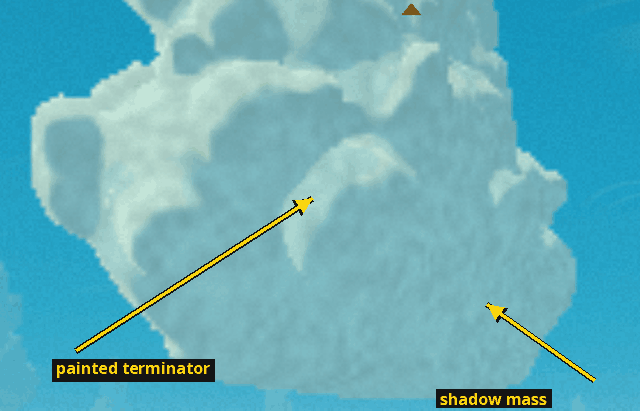

---

## Ground and vegetation

### Grass blades

- **Aliases:** meadow blades, the tuft (the mesh), the far tuft.
- **Definition:** single-triangle blades, instanced in 1 m cells on a fixed world grid and drawn inside
  the **grass egg**. A blade is about 0.6-1.1 m tall (twice the old height and width), so a cell holds a
  third of the old blade count and covers the same ground. Cells past half way out use the **far tuft**
  (about half as many blades, half again as wide) so the vertex work goes where the eye is. Wind, the
  prop's slipstream and contact with the walker are done in the vertex shader. Blades are lit by the
  ground beneath them: the cell carries the terrain's surface-detail slope (`grass_detail_slope`), so
  hill shading and the soft sun shadows of the relief carry through the field; the cloud-shadow pass is a
  screen-space multiply and covers blades like any other pixel.
- **Clumps and turning:** each cell turns its tuft by its own angle (no one-metre lattice of rows), and
  blades gather toward the centres of a jittered ~0.9 m world lattice. A clump has its own height, lean
  and a slight tint; each blade also has its own height, lean and yaw off the wind's line.
- **Code:** `src/grass.jo` (`grass_vs`, `grass_fs`, `build_tuft`, `build_grass`, `draw_grass`,
  `grass_cover` for where grass may grow).
- **Rules:** blades per cell (near / far tuft) are 24 / 12 on low, 72 / 36 on medium and 1024 / 506 on
  high; the base radius is 8, 11 and 12 m (see the egg for the reach). No alpha fade or discard in the
  grass material. No grass on streets, plots, quays, steep slopes or below 3 m above sea level.
- **Capture:** `tools/grass_sample.jo`; `AEGEAN_GRASS_DENSITY`, `AEGEAN_GRASS_RADIUS`.

### Grass egg

- **Aliases:** the drawn region, the reach, the grass shape.
- **Definition:** the region of cells that grow blades, shaped like an egg stretched along the view: it
  reaches 2.5 times the base radius ahead of the camera (20, 27.5 and 30 m on low, medium and high), 1.2
  times to each side and 0.8 times behind (so a quick turn does not show grass growing in). Looking steeply down, as from a low aircraft, it relaxes
  toward a disc a little wider than the base radius. Chunks and cells outside it (or the view frustum)
  are never uploaded.
- **Code:** `src/grass.jo grass_shape`, `grass_view_shape`, `grass_reach_for`, `draw_grass`; the shader
  reads it from `GroundParams.grass_view` and `grass_actor.w`.
- **Rules:** the egg is centred on the camera, not the player, so a walker seen from behind stands well
  inside it; one normalized distance (1.0 on the rim) drives culling, thinning and the near/far split.

### Prop wash on grass

- **Aliases:** slipstream, airflow.
- **Definition:** grass pressed flat in a widening cone behind a running propeller, and pushed
  outward under low wings, weakening with height and engine load.
- **Code:** the `grass_airflow` branch of `src/grass.jo grass_vs`.
- **Capture:** `tools/grass_sample.jo GRASS_CASE=wash`.

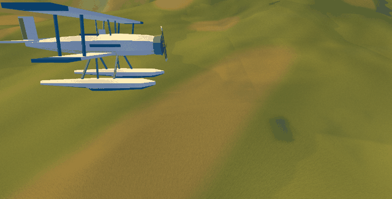

### Grass frontier

- **Aliases:** the frontier, the growth edge, the thinning, the noisy frontier.
- **Definition:** the outer part of the grass egg, where the field thins out. From 30% of the way to the
  rim, every blade has its own threshold and shrinks away to nothing (height and width) when the
  field's density, which falls smoothly to zero at the rim, passes it; a little value noise moves the rim.
  The field therefore scatters out over most of the reach instead of ending in a ring.
- **Code:** `src/grass.jo grass_keep` and the `pick`/`fade` thinning in `grass_vs`.
- **Rules:** the last blades are small and take the ground's own colour and value (their
  root-to-tip contrast fades with their size), so no silhouette stands against a different ground band.
- **Not to be confused with:** the war frontier (`war_frontier_hops` in `src/living_war.jo`).

### Ground tint

- **Aliases:** blade-root colour, pigment wash, ground mean.
- **Definition:** the ground colour under the grass, which is also the blade-root colour, so the
  field fades into the terrain with no visible edge. (In the terrain shader, `tint` is also the
  per-vertex dryness, maquis, ridge and high-land values that drive the ground material.)
- **Code:** `src/terrain.jo ground_material`; `src/look.jo meadow_blade_response` and the
  projected pigment wash in `src/grass.jo grass_vs`.
- **Rules:** the grass-2 gate was a mean colour difference under ΔE 3 between the grass field and
  the bare ground, seen edge-on.

### Wind sheen

- **Aliases:** meadow wave, wind wash, gusts over the grass, bands.
- **Definition:** bands of paler, bent grass that roll downwind across meadows, shared by the blades and
  the ground under them. The sheen is additive: it brightens and never darkens the base colour. The
  bands have a fixed wavelength (5.5 m); wind speed raises how often a blade is swept (0.4 Hz in a calm,
  about 1 Hz at 8 m/s, 3 Hz at 30 m/s) and the steady lean (and so how far the bands swing on top of
  it), never the spacing. Each blade is sampled at its own root, with a few percent of flutter, so
  neighbours never move in lockstep.
- **Code:** `src/look.jo meadow_wave`, `meadow_step`, `meadow_wind`, `meadow_lean`; used in
  `src/grass.jo grass_vs` and `src/terrain.jo ground_material`.
- **Rules:** the phase is one scalar carried in f64 on the CPU (anchored at the viewer, turned with the
  wind about the viewer) so a turning wind never swirls the pattern; it is passed to the shaders as
  `wind.w`. Like all ground detail it is full strength to 60 m and gone by 260 m (the near-detail
  envelope); it must never repeat over whole hills seen from altitude (see terrain stripes).

### Wind study grass (trial)

- **Aliases:** gust patches, dabs, cat's paws on grass, the wind study.
- **Definition:** a Tweaks trial (off by default, "Wind study grass"; `AEGEAN_TWEAKS=windstudy`) that
  replaces the wind sheen's wave trains from 5 m/s up (below 2.5 m/s the trains are untouched). Built
  from a study of videos of wind over grass: **gust patches** (100-250 m, about a third of the field or
  less, drifting downwind and changing shape as they go) and
  **dabs** (3-8 m spots of laid-over grass that form, run and fade within a second or two, at about half
  strength between gusts, full strength inside them). Blades lean further and flutter more in a gust and
  read the field a moment late by clump (0.1-0.5 s), so they lay over and stand again unevenly. The
  ground's sheen uses the same field: dabs out to 150-600 m, the gust patches over far fields to
  1.4-2.6 km (the trains stop at 260 m).
- **Code:** `src/look.jo` (`meadow_noise_texture`, `build_meadow_noise`, the `sa`/`sb`/`r1`/`r2`
  offsets in `meadow_step`), `src/terrain.jo` (`meadow_study`, `meadow_study_share`, `meadow_fill`,
  the sheen in `ground_surface`), `src/grass.jo grass_vs`.
- **Rules:** the noise tile is procedural (a 128-square tileable fBm made by the game when the trial is
  first switched on); every layer's period divides `GUST_PERIOD`, so wrapped offsets are seamless.
  The gust layers are large enough not to repeat over a hill, which is why they may go further than the
  near-detail envelope (see terrain stripes).

### Terrain stripes (historical bug)

- **Aliases:** wavy ground stripes, dune lines, repeated wind bands.
- **Definition:** a bug from the first grass merge (071e319): the wind sheen was applied to the
  ground at every distance, so whole hills seen from the air were covered in regular stripes.
  Fixed in 3e2d530 by limiting it to the near-detail envelope (`meadow *= near` in
  `src/terrain.jo`). A second form (2026-11-14): the pigment tile's alpha wash, a sum of
  sinusoids repeating every 320 m, shifted the mainland's vegetation patch edges in a regular
  diagonal herringbone seen from 1-4 km; the mainland now uses value noise there (`wash` in
  `ground_surface`).
- **Rules:** the original archipelago must stay pixel-identical through ground-shader fixes.
- **Capture:** `tools/stripe_capture.jo STRIPE_SITE=mainland|islands STRIPE_ALTITUDE=300|1000|3000`.

### Coast refinement

- **Aliases:** sub-source coast, the coast pattern, refined contact.
- **Definition:** near the shoreline the 14 m canonical terrain triangles are subdivided down to
  about 0.22 m with a baked pattern, so beaches and rock edges have real small-scale shape.
  Walking, landing and vessels all touch the refined heights.
- **Code:** `src/coast_field.jo` (`coast_height_detail`, `coast_contact`),
  `src/coast_pattern.jo build_coast_pattern`, `src/coast_mesh.jo init_coast_mesh`;
  `docs/coast-refinement.md`.
- **Rules:** canonical corners never move; it stays a heightfield (no overhangs or decorative
  collision rocks). Changing the pattern constants changes contact geometry. `AEGEAN_COAST=0`
  turns it off.
- **Capture:** `tools/coast_capture.jo COAST_SITE=legacy|new|beach|harbor COAST_RANGE=2000|300|50|2`.

### Vegetation kinds and groves

- **Definition:** six shared plant meshes: umbrella pine, cypress, maquis, olive, oleander and
  prickly pear. **Groves** are the streamed stands of trees in the new world; olive rows sit on
  terraces at constant height.
- **Code:** `src/plants.jo` (`PLANT_KINDS`, `summer_cover`, `orchard_cover`),
  `src/world_groves.jo`.
- **Rules:** don't cut tree counts to pay for paint effects.

### Crowns

- **Aliases:** clumps, leaf clumps, crown clumps, tree crowns, wood crowns, the woods' crowns.
- **Definition:** every tree and every crown of the woods drawn as itself, at its real size, at
  every distance it shows. A clump is one camera-facing card whose shader casts the view ray at a
  lumpy ellipsoid of leaves: its outline lumps and leaf tufts come from the tufts' sheet (a small
  procedural texture read on the clump's facing cube side, so they turn with the clump), lit by
  its own rounded normal leaned toward the whole crown's, darker in its core, underside and the
  gaps between tufts, the outline dithered over a pixel and a half. A tree (umbrella pine,
  cypress, olive, plane, maquis bush) is a near set of clumps on a trunk and limbs; farther, the
  same tree as a few merged clumps with the same outline, colour and light; farther still, one
  crown. Each tree crosses between sets at its own distance, so a wood changes one tree at a
  time. The **wood crowns** are the painted canopy's own maquis crowns stood up (the sheet's
  crowns where the stand cover is above each crown's draw): domes, low spreads and loose bunches,
  their near clumps to about 80 m.
- **Code:** `src/crowns.jo` (`crown_vs`, `crown_fs`, the species' generators, `crown_wood`,
  `crown_tuft_sheet`); placed by `src/world_groves.jo` (`crowns_of_lists`, `wood_row`,
  `wood_step`); the stand cover from the terrain's tile jobs (`wood_stand`, `src/world_terrain.jo`).
- **Rules:** the woods' crowns are made a millisecond's rows a frame (never one tile's whole
  making in a frame). The old islands still draw the grove meshes.

### Canopy shells

- **Aliases:** shells, the far canopy's relief, fur.
- **Definition:** past the crowns' reach, the far woods' relief: one layer of the wooded terrain
  tiles lifted a fraction of a crown's height, kept where the painted canopy's crown under it
  stands higher than the lift. The bumps grow with distance (crowns, then the clumps and masses
  they gather in), so a wooded ridge stays rough and lumpy at a few kilometres, the depths between
  crowns dark; they thin out by 4.2 km. The stand cover and the land's aerial perspective are
  worked out per vertex.
- **Code:** `src/world_terrain.jo` (`world_shell_vertex`, `world_shell_fragment`,
  `draw_world_shells`, `world_shell_scale`).

### Far land layers

- **Definition:** the far land's aerial perspective, painted in layers: the land keeps its own
  colour a long way (about two thirds at 5 km, half at 10, a quarter at 20), each farther ridge a
  step paler and bluer, turning to the haze only far off. Valleys hold extra air, so a far ridge's
  foot is paler than its crest. **Painted layers** (on by default; Tweaks › Look to compare, `AEGEAN_PAINTED_LAYERS=0` turns
  them off) reckons the air at bands twice as far apart each time (1, 2, 4 ... 32 km) in air two
  and a half times as thick, with a crisp edge between them, so the land parts into painted layers
  by distance even on rounded hills; the trees' crowns and canopy shells step with the ground.
- **Code:** `land_aerial` in `src/canopy.jo` (`LAND_FADE`, `LAND_MIST`; `land_step_scale` and
  `GroundParams.land_steps` for the layers; `land_aerial_terms` per vertex for the crowns and
  canopy shells). Other objects use look.jo `aerial`; foliage that should layer with the ground
  calls `land_aerial` or `land_aerial_terms`.

### Far canopy

- **Aliases:** the canopy, the crown mass, grove crowns, painted trees, the far tree texture.
- **Definition:** trees and maquis painted into the ground material, beyond and under the grove
  meshes, so a wooded hillside reads as a mottled surface of crowns rather than flat green
  patches. Two classes, both as sparse or dense as the land itself: the **trees** (the streamed
  groves' own pines, found again in the shader from the same cell query and the same density
  field: inside the meshes' reach a kept tree's painted crown is only its shade on the ground and
  nothing is painted where no mesh stands; past it the painted crown is the tree, the tier's
  thinned trees arriving cell by cell over the next 400 m), and the **maquis** (the summer
  cover's scrub and understory: a sheet of scalloped crowns at about 9 m, scattered on dry grass
  at its edges and closed over a shaded floor where it is dense, and farther off the **clumps**
  they gather in, about 55 m, lightening and darkening the ground's own colour so its mean and its
  patch edges stay put). On medium and high each crown is lit by its own rounded normal through a
  wrapped painted ramp (its terminator shifted crown to crown), with a short sunward shadow; on
  low its light is painted into its colour and the trees are the meshes alone, with their mean
  past their reach.
  Far off, a third octave of **masses** (180 m cells; medium and high) keeps the far hills lumpy,
  and every octave is modelled by the **canopy light**, the sun's bearing held low at every hour,
  so even at noon each lump has a lit side and a shaded side. The far land itself is shaded by a
  **land light** (the same held-low sun, weighted in; medium and high), so slopes turned from the
  sun band darker, and takes the **land aerial**: with distance, scaled to the eye's height, it
  turns toward a deep teal-blue (land in shadow, never a fog) before the shared haze takes it at
  the horizon, so far ridges read as blue silhouettes a value step under the sky.
- **Code:** `src/canopy.jo` (`grove_layout`, `grove_chances`, `grove_sibling`, `grove_keep`,
  `grove_kind_at`, `grove_field`, `grove_crown`, `canopy_sheet_pixel`, `canopy_paint`,
  `canopy_paint_low`, `canopy_far_value`, `canopy_light`, `land_light`, `land_air_weights`, `apply_land_air`); used by `ground_surface` in `src/terrain.jo` (`canopy_detail`: the low
  tier's terrain shaders are compiled with `canopy_paint_low` only) and by `world_grove_lists`
  in `src/world_groves.jo`. The density field is the terrain materials' `tint.x`. The sheet is
  baked as `assets/baked/canopy-sheet-v1.png` by `tools/bake.jo`.
- **Rules:** one cell query and one density field for meshes and paint: change the new world's
  placement only through them. No painted tree where no tree stands near the camera. Crowns stay
  physically sized (they never grow in screen space); the clumps are a second physical octave.
  Keep the Mediterranean palette (`docs/ART.md`), not the autumn colours of the reference
  photos. Linear ramps, not `smoothstep`, in these shader paths (each one cost visible time on
  redfox). The old islands' groves keep their own placement; nothing is painted under their
  meshes.

### Farmland

- **Aliases:** the fields, the patchwork, hedgerows, tree lines, lanes.
- **Definition:** the gentle lowland drawn as a patchwork of straight-edged fields (about 30 to
  110 m), each one flat crop colour (greens, straw, tilled brown, striped vines and olive rows),
  in districts of about 500 m whose direction varies, as the film's farmland is. Hedgerows and
  tree lines run along a share of the field edges, scalloped, lit on their sun side, casting a
  shadow onto the field away from the canopy light (held low, so they read at noon). Lanes run
  between districts, a hedgerow along about half. A settlement's working land and the olive
  country are drawn as the same patchwork, taking their own crops. Woods keep the pine stands;
  the lowland's maquis gives way to the fields. Far off, the fields turn to their mean. One look
  on every tier, at about low's cost: each terrain sample's field colour and share are baked on
  the CPU (the new world's tiles, the old islands' tiles at load, each grass cell), and the
  hedgerows, lanes, field edges and hedge shadows come from the field map, a wrap-around texture
  of 3 m texels round the camera drawn in 64-texel blocks by a small GPU pass as the camera
  moves (redrawn a few blocks a frame when the light's bearing turns). The ground reads it with
  one sample.
- **Code:** `src/fields.jo` (`field_at`, `field_share`, `field_bake`, `field_crop_low`,
  `field_colour`, `field_palette`); `src/field_map.jo` (`field_layout`, `update_field_map`);
  used by `ground_surface` in `src/terrain.jo`; baked in `world_tile_job_rows`
  (`src/world_terrain.jo`), `island_working` (`src/terrain_lod.jo`) and `grass_build_step`
  (`src/grass.jo`).
- **Rules:** the palette is a switch until the look is decided: `AEGEAN_FIELD_PALETTE=dry` gives
  the dry straw summer (docs/ART.md); green valleys by default. Low's terrain shader is at a
  register-pressure cliff on redfox: measure any addition to its low path there, alone and
  together. Field detail goes into the bake or the field map, not into per-pixel work.
---

## Towns and people

### Quay (code) and dock (player)

- **Aliases:** dock, pier, wharf, harbour, waterfront (in what the player reads or hears).
- **Definition:** "quay" is the code's word for the walkable stone edge of a harbour where aircraft
  and boats moor and people step ashore: `Quay`, `Town.quays`, `QUAY_TOP`, `VenueKind.quay`,
  `CargoWhere.quay`, and keys such as `legacy:{place}:scene:quay`.
- **Rules:** never show "quay" to the player; many people won't know it. In prompts, panels, map
  labels, notices, dialogue and scenario text, say **dock** for where you moor or step ashore (the
  default), **pier** for a structure out into the water, **harbour** or **waterfront** for the
  general place ("down to the harbour", "on the waterfront"), and occasionally **wharf** for a
  working goods landing. Vary them in dialogue so it sounds natural. Don't rename the code
  identifiers, keys or save fields.
- **Code:** `ctx_venue` and `venue_errand` (`src/living_talk_context.jo`) speak `VenueKind.quay`
  as "the harbour"; map mooring labels read "{town} dock {n}".

### Offshore mooring

- **Aliases:** the buoy, a mooring buoy.
- **Definition:** where a [big boat](#big-boats) too large for a harbour's docks lies: a red and
  white buoy in open water off the harbour. Each sea harbour has up to three for each swing
  radius, in water at least 3 m deep under the whole **swing circle** (the circle the moored
  aircraft can sweep as it swings round its buoy), no shoal within 15 m of it, clear of every quay,
  mole, dock, the seaplane buoy, the harbour's boats and the ships' anchorage, out of the
  seaplanes' approach lanes, with a straight run for the [harbour launch](#harbour-launch) from a
  dock, and as sheltered as the coast allows. The aircraft is made fast facing the harbour, then
  **swings to the wind**: nose to the buoy and into the wind, turning faster the stronger the wind
  and slower the bigger the aircraft, damped so it settles (a Do X comes round 90 degrees in about
  20 s in 8 m/s); in a calm it lies as it is.
- **Code:** `src/offshore_moorings.jo` (`offshore_moorings`, `verify_mooring`,
  `clear_water_near`, `buoy_swing`, `moored_centre`); in play, `moor_on_buoy` / `settle_big_craft` /
  `swing_on_buoy` in `aegean.jo`.
- **Rules:** deterministic (terrain and port data only, cached per harbour and radius). The world
  audit re-checks every mooring found with independent rings ("offshore mooring fouled" is severe)
  and warns where a harbour has none. `tools/mooring_survey.jo` reports all 318 sea harbours.
- **Capture:** `AEGEAN_CRAFT=<the H-4> AEGEAN_ABOARD=1` (the H-4 starts on its buoy off Porto Vecchio).

### Drawn vessel pose

- **Aliases:** boat interpolation, vessel smoothing, jerky boats (the bug it fixed).
- **Definition:** where a vessel is drawn this frame, apart from where the simulation holds it.
  The fleet steps hulls at a fixed 1/30 s, and external hulls (fishing workboats, far-sea coasters)
  are placed from the living world, the workboats once a world minute (two seconds of play) and
  everything waiting while a world minute runs. Drawn at those poses, boats moved on every other
  frame and jumped 15 m every two seconds, like a lagging network game. A stepped hull is drawn
  between the start and end of its current step at the fleet clock's fraction of a step; an
  external hull is carried on at its velocity and eased (0.25 s) toward the world's last pose
  carried on by that velocity since it arrived, and put there at once on a jump over 25 m. The
  wave bob, pitch and roll are sampled at render time at the drawn position, so the sway is
  continuous too.
- **Code:** `src/vessel_motion.jo` (`vessel_render_ships`, `vessel_stepped_pose`), called in
  `prepare_vessel_view` (`src/vessel_view.jo`); `Vessel.previous` set in `vessel_tick`; the
  navigation lights read the drawn ships (`vessel_view.drawn`).
- **Rules:** only drawing reads drawn poses: saved state, collisions, targets and moorings keep the
  simulated ones. `tests/vessel_motion_test.jo`: at a steady 60 fps no frame's drawn step is more
  than 1.5 times a neighbour's, for stepped and external hulls, and a long frame moves a hull by its
  time, not a jump.

### Harbour launch

- **Aliases:** the launch, the boatman.
- **Definition:** the small motor boat (the canal launch's model) that takes the pilot between a
  dock and their aircraft on an [offshore mooring](#offshore-mooring): offered at the dock ("take
  the harbour launch out to your Do X") and aboard ("call the harbour launch to go ashore"). The
  ride is seen, the camera behind the launch and the pilot seated on a thwart on its foredeck, or
  cut short with F (a [time skip](#time-skip)). A
  fare of ¤1.50 a trip goes to the harbour's market through the ledger; with an empty purse the
  boatman lets it go.
- **Code:** `src/harbour_launch.jo` (`launch_ride`, `launch_pose`, `pay_launch`, `draw_launch`,
  `draw_buoy`); `start_launch` / `launch_step` / `finish_launch` in `aegean.jo`.
- **Rules:** no saving during a ride; a saved game restores the aircraft on its buoy (found again
  from the line's anchor).
- **Capture:** `AEGEAN_CRAFT=<a big boat> AEGEAN_CAPTURE_LAUNCH=out|ashore|cut|save|switch:ID`.

### Fuel lighter

- **Aliases:** the lighter, the lighterman.
- **Definition:** a small tank boat (the [harbour launch](#harbour-launch)'s hull with a riveted
  fuel tank, a hand pump and a hose reel) that brings fuel out to an aircraft on an
  [offshore mooring](#offshore-mooring). Aboard on the buoy with room in the tank: "call the fuel
  lighter out (88 λ a litre, ¤2 to come out)". The call-out goes to the harbour through the ledger
  (refused with an empty purse); the lighter comes alongside and the fuel panel ("Fuel lighter")
  sells the harbour pier's own fuel at its price and dues, from its market's stock, as at the pier.
  It goes home when the panel closes, or turns back if the aircraft casts off.
- **Code:** `src/harbour_launch.jo` (`pay_harbour`, `LIGHTER_FEE`, `draw_lighter`); `lighter_offer`,
  `call_lighter`, `lighter_step` in `aegean.jo`; the sale is `src/living_refuel.jo` `buy_tank_fuel`.
- **Capture:** `AEGEAN_CRAFT=<a big boat> AEGEAN_ABOARD=1 AEGEAN_CAPTURE_LAUNCH=lighter` (also
  `swing`: the wind held abeam, seen from above).

### Call for help

- **Aliases:** help on the R/T, a tow, the flare.
- **Definition:** down on the sea and unable to go on (the tank dry, the engine or hull too far
  gone, wrecked or aground), the [R/T](#rt) pad offers "Call for help" first (R does too on a
  wreck). Whoever is really near answers. One of the player's flight (in a fight, for fuel only)
  lands into the wind off to one side, taxis to lie alongside and hands over two two-gallon cans
  out of its own tank, then takes off again. Outside a fight, a pilot of the world flying a trip
  within 15 km does the same (the cans paid to them at the pier's price), or for a wreck takes the
  pilot along to wherever they are bound, the harbour there fetching the aircraft in after for a
  fee; their trip is taken up again once they are back up. Failing that, the nearest passing ship of the living
  world turns aside (a hull stands in for it, the ship itself held on its route and not drawn
  meanwhile) and tows the aircraft into the nearest town harbour. Failing that, that harbour's
  launch comes out and tows it in. The radio answers with a rough time ("about twenty minutes");
  the boat sails the fleet's own sea lanes, round the land, and is seen coming; "Wait for them"
  skips the wait ([time skip](#time-skip)) to the last 60 m, or a tow to the harbour. The tow
  draws up alongside, takes the line and hauls the aircraft round onto it; in at the harbour the
  aircraft is warped in to a free berth (a wreck patched up, as the old tow home had it). A
  wreck's pilot is taken off: they drop into the water, swim across in their vest (the camera
  behind them) and climb onto the boat's after deck, and ride in watching
  the wreck in tow (the camera with them, F to skip ahead), stepping ashore by it at the harbour;
  or, in a fight with a base, one of the flight lands, they swim to its float and up into its
  second seat, and it flies
  them back to the base (F skips the flight), the harbour's boat fetching the aircraft in after
  for a fee. The
  cans are paid for at the nearest pier's price to the wingman, the tow by distance to the
  skipper or the harbour (the launch's call-out on top); short of money, it is owed (a debt, which
  the reputation keeps). Out of the R/T's reach (40 km to a town harbour or the flight), the line
  reads "Fire a flare": a red star goes up and the nearest ship or harbour within 8 km comes.
  A pilot who parachuted into the sea can signal with the same flare. A boat searches even
  without a signal, boards the pilot from the water, and carries them to a safe harbour or the
  tender. Pickup preserves the pilot's side and engagement when a situation hands back to play.
  If a live rescue route fails, "Wait for a search boat" advances the clock through the search
  and the return to harbour. A pilot ashore on an island without a harbour can signal for passage
  back to Porto Vecchio. A saved tow or rescue resumes with the boat and the line in place.
  When the flight turns for home its leader says where ("then back to Ardevanti").
- **Code:** `src/radio_help.jo` (`help_need`, `help_eta_words`, `tow_fee`, `help_alongside`,
  `tow_place`, `lane_advance`, `help_pay`, `help_cans`); `send_assist` / `release_assist` /
  `end_assist` in `src/combat.jo`; `help_call`, `help_step`, `help_wait`, `help_arrive` in
  `aegean.jo`. Recovery state is kept in `src/game_session.jo`.
- **Capture:** `AEGEAN_ABOARD=1 AEGEAN_CAPTURE_HELP=tow|wreck|flare` (3 km off the home harbour),
  `AEGEAN_SCENARIO=strait AEGEAN_ABOARD=1 AEGEAN_CAPTURE_HELP=cans|wingwreck`,
  `AEGEAN_ABOARD=1 AEGEAN_CAPTURE_HELP=passing|passwreck` (ahead of the first world aircraft seen
  flying), `AEGEAN_CAPTURE_HELP=tender`; HELP lines say what happened.

### Wireless

- **Aliases:** the cockpit radio, the receiver, the set (in code: `radio`).
- **Definition:** the broadcast receiver in the cockpit: stations, music, bulletins and Morse.
  Named "wireless" on screen (the period British word for a broadcast set: the touch screen's
  Wireless button, Settings → Sound → Wireless volume, "Wireless off"), so it is never confused
  with the [R/T](#rt), which sends orders to one's own flight.
- **Code:** `src/radio.jo`, `src/radio_synth.jo`, `src/radio_content.jo`; `docs/radio.md`.

### Morse subtitles

- **Aliases:** the Morse strip, the slip, the paper slip by the wireless.
- **Definition:** what Morse says, shown as it is keyed: a slip of cream paper with the message
  in plain English ("Aegean Maritime Service: harbours open"), the letters as received smaller
  beneath ("SEA PORT OPEN"), and the dots and dashes of the character being sent inked after
  them. A letter shows only once its last dot or dash has sounded, and a word's plain reading
  once the gap after it has passed, so the slip is never ahead of the key (it is held a
  twentieth of a second behind the game's mix, for the sound device's own delay). Prosigns, Q codes and
  the operators' abbreviations are read out (CQ, DE, K, R, SOS, QTH, QRU ...), a call sign first
  as the station's name. It follows reception: a letter keyed while the signal is down in the
  static is a gap ("S__ PORT"), a word with gaps reads "…", and the slip fades when the dial
  leaves the station, the signal goes or the set is switched off. It shows for the
  [wireless](#wireless)'s Morse bulletins, the short cues under the flight's words on the
  [R/T](#rt) (marked "R/T") and a [lamp](#signals-between-aircraft)'s word as it is flashed
  (marked "Lamp"; a plain word, so shown as spelt and not read as code). Beside the wireless in the cockpit; under the compass in the outside view and
  wherever there is no room beside the set. Settings → Accessibility → Morse subtitles, on
  unless switched off.
- **Code:** `src/morse_subtitles.jo` (the reading and the following), `src/morse_strip.jo` (the
  slip and what feeds it), `radio_keying` in `src/radio.jo`; `tests/morse_subtitles_test.jo`.
- **Capture:** `AEGEAN_FLYING="300 60 cockpit" AEGEAN_RADIO=1260` (the maritime service; without
  the announcer's data every bulletin is in Morse; `AEGEAN_RADIO=1270` for poor reception).
  `AEGEAN_MORSE_TRACE=1` prints each change of the slip with its frame (MORSE lines), to set
  against a capture's own sound (`AEGEAN_AUDIO_CAPTURE`).

### R/T

- **Aliases:** the radio-telephone, the pad, orders to the flight (not the [wireless](#wireless),
  the broadcast set).
- **Definition:** a small pad of set words by the cockpit radio, opened with Y (a tap on the R/T
  plate; a controller's D-pad left). It stays open, however long one reads it, until a word is
  sent or it is put away (Escape, or its Close line). Down on the sea in trouble its first line is the
  [call for help](#call-for-help) ("Wait for them" while help comes); with a flight in the air,
  the flight leader's words follow: form on me, circle here and wait, attack my target, break off
  and go home, lead me home. A number, a click or tap sends one, or Y steps and F sends. The
  nearest of the flight answers in a few plain words, by [signal](#signals-between-aircraft) when
  in sight.
- **Code:** `src/rt_pad.jo`; `give_order` in `src/combat.jo`; `rt_lines`, `rt_tick`, `rt_send`
  in `aegean.jo`.

### Signals between aircraft

- **Aliases:** hand signals, the Aldis lamp, by hand, by lamp.
- **Definition:** a word from one of the player's flight in sight of the player comes by signal,
  not the R/T: within 260 m the pilot's arm goes up out of the cockpit and waves; out to 2.2 km
  an Aldis lamp over the cockpit flashes the line's first word in Morse, over and over. The
  caption names the way ("Kalyra 1, by lamp: Close up."), and no Morse cue sounds. Farther off,
  the line comes by the R/T as before.
- **Code:** `src/flight_signals.jo`; `update_homeward` and `draw_homeward_signal` in
  `src/homeward_view.jo`.

### The Ierax (seaplane tender)

- **Aliases:** the tender, the depot ship, Kalyra's forward base.
- **Definition:** a Kalyran seaplane tender, a converted steamer of the 1920s the size of HMS
  Pegasus (101.5 m by 13.1 m, 4.6 m draught, 3,070 tons), anchored as a depot
  ship in the bight on the west coast of the island 25 km west of the strait, in the lee of its
  southern cape (an Orenthian island: a forward base, Kalyra's own nearest harbour being
  Ardevanti, 89 km off). She carries fuel, ammunition and mechanics, a derrick aft that swings out
  past her side, and four booms swung out from her seaward side with a trot of buoys astern. The
  strait's Kalyran flight comes home to her: round the island's low north end (its ridge of 1,200 m
  lies between her and the strait; the leader takes the flight round it, a point at a time, at a pace
  the player's own aircraft cruises at), puts down on a line off her side (across a light wind when
  the high ground lies under the way in from downwind), its run ending by her moorings, and moors
  in turn along the booms and astern, each made fast within a minute or so of alighting while the
  rest still land; moored, they ride the swell. Alongside, the crew warp the aircraft in by a line
  until its float reaches her Jacob's ladder, clear of the wing and booms. At a boom's end her
  pulling boat rows round to the float's bow, takes the rescued person aboard and brings them
  to the ladder. A hand helps them over the rail and they walk her side deck to the midships
  house. The ladder, the hand and the walker follow the hull's heave, pitch and roll.
  Hoisted in, they step off the float straight onto her after deck. The tender sends survivors to Ardevanti, a foe of
  Kalyra's held below until an exchange. Anyone may moor alongside (moor here) and take on fuel from her bunkers (Kalyra's,
  drawn from Ardevanti at its pier's price), be hoisted aboard (warped aft under the derrick,
  lifted, swung in over the after deck and set down), have her mechanics bring the aircraft back
  to 80% in hull and engine on her deck (free to a Kalyran pilot, at a workshop's rate to anyone
  else), and be lowered over the side again. Her launch answers a call for help when she is nearer
  than any harbour, and tows the aircraft in to her moorings.
- **Code:** `src/tender.jo` (`TENDER_AT`, `tender_slot`, `tender_home`, `hoist_point`); the booms
  and derrick in `src/vessel_models.jo`; `strait_homes` in `src/scenarios.jo`; `tender_fuel`,
  `tender_hoist_start`, `tender_step`, `tender_repair` and the help call's `by_tender` in `aegean.jo`.
- **Capture:** `AEGEAN_ABOARD=1 AEGEAN_CAPTURE_TENDER=hoist`; `AEGEAN_ABOARD=1
  AEGEAN_CAPTURE_HELP=tender`; `AEGEAN_CAPTURE_TENDER=passenger-direct` at the ladder
  or `AEGEAN_CAPTURE_TENDER=passenger` at a boom. The flight home: `AEGEAN_SCENARIO=strait
  AEGEAN_CAPTURE_STRAIT_AFTER=arrive AEGEAN_ARRIVE_KM=3 AEGEAN_ARRIVE_FORMED=1
  AEGEAN_CAPTURE_TENDER_CAM=1` (with `AEGEAN_FRAMES` and `AEGEAN_FRAMES_ONLY=1` for a time-lapse).

### Legacy towns

- **Aliases:** the original six towns, the original archipelago.
- **Definition:** the hand-placed first towns and islands, which predate the generated world.
- **Rules:** their house, close-kit, prop and paving fingerprints must stay byte-identical through
  town work (checked by `tools/town_legacy_probe.jo`).

### Cliff stair

- **Aliases:** stairway, kalderimi (the stone-paved stepped path of the islands).
- **Definition:** a built stone stair that climbs a steep shore from the foot of a quay to the
  houses above: flights at a steady grade with flat landings, each tread standing on the slope,
  masonry down to the ground and a parapet on the open side. Its treads are the walking surface.
- **Code:** `src/stairways.jo` (`plan_cliff_stair`, `stair_height`, `add_stairway_mesh`,
  `stair_top_reaches`); legacy harbours in `build_town` (`src/objects.jo`), contact in
  `walk_height_from_surface`.
- **Rules:** a harbour whose quay cannot reach its houses over ground no steeper than 45° gets one.
  One direction only (no switchbacks): flights stacked over one another in plan cannot share
  walking contact. The stair keeps climbing until the ground inland of its top carries on gently.
  Its parapet holds: a step off the treads onto ground more than 0.6 m below them is refused
  (`stair_parapet_blocks`, also on the island landings' stairs); its foot and top stay open. On a
  stair the pilot walks at 3.4 m/s (`on_any_stair`). From its top a stepped lane carries on over
  the hillside to the nearest house's front step (`plan_hill_lane`: a 1.5 m grid search keeping to
  grades of 0.85 and less, clear of the houses, pulled into straight runs and resampled every 2 m
  on the ground), drawn and walked as the stair's second run, its parapet only where the ground
  falls away. An island landing's path already begins at its settlement's square.
- **Where:** Kryfo Cove and Agios Nikolaos; the island landings below sea cliffs (see Landing
  cliff stair).

### Landing cliff stair

- **Definition:** a cliff stair from the root of an island community's jetty up a sea cliff to the
  ground above, where a plateau is ringed by cliffs and no path reaches the shore. It runs
  diagonally along the face (no switchbacks: on these 80-degree faces a hairpin's upper flight
  would stand over the lower one, and walking contact has one height per place), with a landing
  every 15-21 m of rise. Built against the rock: pale dressed treads notched against the face, a
  rough-cut rock wall rising on the inner side, a short masonry skirt (1 m at the arch crowns,
  2.5 m at the springing) carried by raking corbels back into the cliff, and a sloped limewashed
  parapet on the open side. Monastery and chapel islands have a small limewashed wayside shrine
  in the rock wall at alternate landings. Above it the stepped landing path carries on to the
  square. From the air it is a pale thread: treads in blocks of four and the parapet line.
- **Code:** `LandingAccess.stair_from` (the route from that index down to the root is the stair,
  with tread heights), `cliff_stair_clear`/`cliff_stair_fault` in `src/access_path_bake.jo`,
  `add_cliff_stair_mesh` and `add_stair_hexa` in `src/stairways.jo`, `landing_stair_runs` in
  `src/landing_stairs.jo`; surveyed by `tools/survey_island_climb.jo`, re-planned by
  `tools/replan_cliff_stairs.jo`. Stone surfaces carry the masonry/plaster surface tags so their
  shade takes the neutral fill rather than blue skylight.

### Landing walk time

- **Definition:** at an island landing 1 km or more below its square, the pier's notice board
  gives the distance and the time on foot, by the hill walkers' rule (5 km an hour plus ten
  minutes for each 100 m of climb), rounded to words: "about an hour", "an hour and a half".
- **Code:** `walk_time_text`, `landing_walk`, `landing_walk_text` and `access_notice_lines` in
  `src/access_notices.jo`; the access manifest uses the same text.

### Stepped landing path

- **Definition:** the approach from a clifftop chapel or hill village down to its own cove landing
  where a wagon track cannot get there: one person wide (1.2 m), up to a 45° grade, with the same
  dry, building and walking-contact rules. Never a cart route.
- **Code:** `LandingAccess.stepped` (`src/landing_access_types.jo`), `stepped_segment_clear` and
  `access_track(..., stepped=true)` in `src/access_path_bake.jo`; surveyed by
  `tools/probe_island_shore.jo ... stepped`.

### Lake waterfront

- **Definition:** a lake town's houses lining the path from its square to the jetty, timber boat
  sheds open to the water with slipways, and a dressed stone edge along the shore at the jetty root.
- **Code:** `lake_waterfront` (`src/lake_ports.jo`), `lake_waterfront_mesh` (`src/lake_port_mesh.jo`).

### A picnic

- **Aliases:** the picnic basket, a blanket on the shore.
- **Definition:** an opt-in leisure (`src/picnic.jo`):
  - **The basket:** "A picnic basket" is on the bill of fare at the hotel (bread, cheese, olives,
    tomatoes and a bottle of the house's white, with a blanket, ¤2.40) and the coffee house
    (¤1.80). It isn't brought to the table: it's made up and handed over, and he carries it on his
    arm, aboard and wherever he flies.
  - **A spot:** low land above the water and under four metres high, with the sea within twenty
    metres. Not a quay or a pier (the land itself must be above the sea, with nothing built up
    over it), and not a town (no house within a dozen metres) (`picnic_spot_at`).
  - **Spreading the blanket:** with the basket along, tap or click the sand there. With the mouse,
    a small label says "Spread the blanket", or F where he stands. He walks over, the striped
    blanket unrolls, he sits down by degrees facing the sea, and the basket, bread, olives and
    bottle are set out.
  - **Sitting:** the afternoon goes by unhurried, about a minute of the world's clock a second. A
    bite now and then, his hand to his mouth. The view sits behind him and to one side.
  - **Packing up:** tap the basket, or Escape, or walk off. He gets up by degrees, and the notebook
    has a line ("A picnic on the shore near Porto Vecchio: bread, cheese and the sea.").
- **Code:** `src/picnic.jo` (`Picnic`, `picnic_sea_angle`, `picnic_spot_ok`, `picnic_note`);
  `picnic_spot_at`, `picnic_begin`, `picnic_step`, `picnic_pack`, `draw_picnic` and the basket's
  ordering in `_leisure_order` in `aegean.jo`; `PICNIC_ITEM` in `src/leisure_menu.jo`;
  `tests/picnic_test.jo`.
- **Capture:** `AEGEAN_LEISURE=picnic AEGEAN_FOOT_GO=60:picnic;1300:pack` takes the basket to a
  quiet shore across the bay from the hotel.

### Taking the waters

- **Aliases:** the hot springs, the baths, a soak, the bathhouse keeper.
- **Definition:** an opt-in leisure at the [thermal terraces](#thermal-terraces), done by the things
  themselves rather than cards (`src/bath.jo`):
  - **The keeper:** tap him at the bathhouse door. He asks thirty lepta for the waters (paid to the
    town's innkeeper if it has one, else the town's account), good all that day at that spring.
  - **Changing:** he goes into the cabin, is out of sight a moment, and comes out in a bathing
    costume (`build_figure(bathing = true)`). His scarf stays with his clothes.
  - **What is worn:** as at the island baths of the twenties and thirties, a one-piece suit of
    knitted wool, dark (navy, black, maroon, bottle green), to the mid-thigh. It is sleeveless for
    a man, held up by a narrow strap over each bare shoulder, some of them striped, and has short
    sleeves for a woman. Arms, shins and feet are bare
    (`BATH_SUITS`). The open pool is mixed and in costume. Separate men's and women's baths,
    where bathing was in the nude, were indoors, and none is shown.
  - **Getting in:** tap the hot pool. He walks to its steps by the terraces' stairs and round the
    pool's coping (`bath_route_to`, `_round_pool`), steps over and settles into the water by
    degrees (`bath_path`).
  - **Soaking:** a few of the town's grown people sit in the water to their shoulders, the same
    ones all day. They talk in turn every ten seconds or so: the water's small talk, the dialogue's
    own remark for them (`table_remark`), and once a soak a lead ("Marta has oil for Kalamos, I
    heard. If you're flying that way.", from the town's or its harbour's open jobs). The world's
    clock runs on unhurried, about a minute a second. F (an hour) and T (until evening) still hurry
    it. There are no cards: the steps are the way out.
  - **Getting out:** tap the steps, or R, or walk. He comes up out of the water by degrees, goes
    back to the cabin, and comes out dressed.
- **Lifts:** now and then the one who asks at the aircraft for a flight wants a lift instead: to the
  harbour below the nearest springs within 120 km ("Would you be going anywhere near the
  Saryerenos baths? I'd pay for a lift as far as Delyavouna."). Set down there, they pay ¤1.50 if
  they have it and thank the pilot ("there" is moored within 1.5 km of the harbour on the map:
  the living world's own places are the old harbours only). Set down anywhere else, they say "Not here, I'm afraid" and
  stay in the seat (`ride_lift_choice`, `Joyride.dest`).
- **The sign** reads "THERMAL BATHS", by the game's convention for signs: Latin capitals and plain
  English trade words ("BARBER", "INN", the notice boards, the airfields' names), with only the
  hotel's own Italian name, "HOTEL ANCORA". There is no Greek lettering anywhere. Both springs
  are in the invented mainland countries, Kalyra and Orenthia, not the Greek archipelago.
- **History:** springs like Loutraki, Aidipsos, Ikaria and Methana were in use in the islands then,
  with plain bathhouses and a keeper taking a few lepta.
- **Code:** `src/bath.jo` (`Bath`, `bath_pick_line`, `bath_pay`, `lift_fare_pay`); `bath_step`,
  `bath_go_in`, `bath_walk_to`, `bath_get_out`, `draw_bath_people`, `draw_bath_talk` and leisure
  stage 21 (the keeper) in `aegean.jo`; `ride_lift_*` in `src/joyride.jo`; `tests/bath_test.jo`.
- **Capture:** `AEGEAN_LEISURE=ride-lift-land AEGEAN_RIDE_TRACE=1` sets a lift down at Delyavouna's
  dock and shows the fare paid. `AEGEAN_BATH_ARRIVE=<place> AEGEAN_BATH_PAY=1 AEGEAN_FOOT_GO=60:The waters;3000:bath-out` walks up
  from the path, pays, changes and gets in. `AEGEAN_LEISURE=ride-ask AEGEAN_RIDE_LIFT=1` shows a lift
  being asked for.

### Thermal terraces

- **Definition:** a bath set into a hillside in three terraces: bathhouse and inn on the upper one
  against the slope, the hot pool on the middle one, a cooler pool below, stone stairs between them
  and a last flight down to the path from the town. The ground under the complex is cut to just
  below the lowest terrace; the upper terraces stand on masonry walls. Steam is densest in the
  cool of morning and evening and is visible from the air.
- **Code:** `src/thermal_sites.jo` (`THERMAL_TERRACES`, `thermal_carve`, `thermal_contact`),
  `src/thermal_render.jo`; layout and paths from `tools/thermal_layout.jo`.

### Close kit

- **Definition:** the walking-level detail of a town: balconies, window openings, flowers,
  domestic tools, paving, courtyard fixtures and small props. It is built on the first visit at
  walking level, never at startup and never for a town seen from the air.
- **Code:** `src/world_towns.jo` (`prepare_close_town`, `close_sites`, `draw_close_town`,
  `close_town_meshes`, `close_town_props`).
- **Rules:** opaque close detail draws before the big house meshes; site counts and radii are
  limited per quality tier (`close_site_limit`, `close_site_radius`).
- **Capture:** `AEGEAN_CAPTURE=place:<kind>:ground`, `AEGEAN_AT='x z yaw'`,
  `tools/town_walk_probe.jo`.

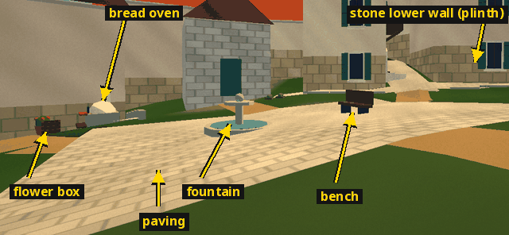

### Frontage

- **Aliases:** frontage strips, house frontages, service forecourts (at harbours).
- **Definition:** the paved strip in front of each house's door. It is also where townsfolk stand
  for their routines.
- **Code:** `src/world_towns.jo` ("Frontage strips join only nearby frontages").
- **Rules:** strips join only nearby frontages, never across house centres.

### Plinth

- **Definition:** a stone base under a wall or statue. On regional houses the stone lower wall
  *is* the plinth: no separate plinth or frontage plane is laid over it.
- **Code:** `src/town_regional_mesh.jo`, `src/town_architecture.jo` (comment above
  `arch_regional`); the statue plinth in `src/town_details.jo`.
- **Rules:** no coplanar overlays (they z-fight).

### Hill house

- **Aliases:** stepped house, house cut into the hill.
- **Definition:** a far-town house on a sloping lot. A drop of about a storey becomes a lower storey
  with its own windows on the downhill side, taken out of the storeys seen from uphill, so the face
  towards the sea keeps the designed height; under 2 m of plain wall is left below it, and a house
  squeezed narrow by a steep lane stays low. Lots steeper than 5 m across stay empty.
- **Code:** `place_ground_lot` in `src/settlements.jo`.
- **Rules:** never stretch a house over the slope (that made blank towers seen from the sea).

### Regional character

- **Definition:** each country's own architecture and street furniture. Kalyra has steep clay
  gables, limestone lower walls, timber balconies, square campaniles, cypresses, green signs and
  bracketed lamps; Orenthia has low white terraces with stair-head rooms, iron balconies, domed
  chapels with twin bells, olives, blue signs and globe lamps.
- **Code:** `src/town_region.jo`, `src/town_architecture.jo:150 arch_regional`,
  `src/town_regional_mesh.jo`.

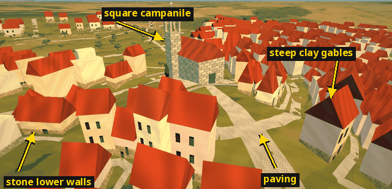

### Farmstead

- **Aliases:** farm, farm yard.
- **Definition:** an inland home with an enclosed, planted yard: walls, a gate, paths and fruit
  trees.
- **Code:** `src/town_architecture.jo:335 arch_farmstead`; `src/town_sites.jo` (`site_farm_yard`,
  `site_farm_gate`, `site_farm_walls`).
- **Rules:** `site_farm_yard` gives exact plot bounds, which `grass_cover` uses to keep grass out.
- **Capture:** `AEGEAN_CAPTURE=place:7:air|ground`.

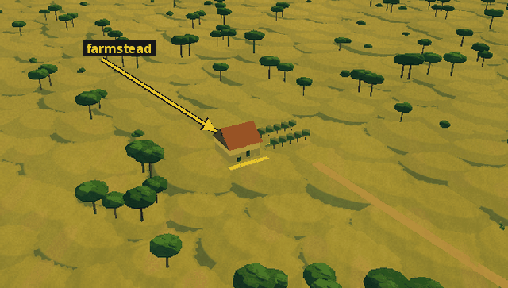

### Paving

- **Aliases:** street ribbons, paving shoulders.
- **Definition:** streets and quays drawn as ground-hugging ribbons that follow the canonical
  terrain triangles, with shoulders blending them into the ground.
- **Code:** `src/town_paving.jo` (`town_paving_shoulder`, `town_street`), `src/coast_paving.jo`.

### Townsfolk

- **Aliases:** folk, the people.
- **Definition:** the visible people in towns: each is a living-world person, dressed by trade
  and placed at their routine. A seeded share of grown men wear mustaches. Town cats live
  alongside them.
- **Code:** `src/townsfolk.jo` (`sync_folk`, `update_folk`, `draw_folk`, `dress_of`),
  `src/folk.jo:81 build_figure`, `mustache_of`; cats in `src/cats.jo`, `src/cat_bonds.jo`.
- **Rules:** a person's living-world pose is authoritative; never move decorative duplicates
  (`docs/life.md`).
- **Capture:** `tools/folkview.jo`; `tools/faceview.jo` (`FACEVIEW=pilot|follow|folk|cats`).

### Wildlife

- **Aliases:** the geese, the ducks, a raft, the harbour gulls, the goats.
- **Definition:** animals about the camera, cosmetic like the cats. **Rafts** of waterfowl as the
  1920s Aegean had them: greylag geese (more and larger rafts in winter; in summer some with
  goslings), and on the lakes and wider river reaches mallards in pairs and coots among them.
  Harbour corners hold greylags, now and then with a pair of mallards. A raft paddles in loose
  lines with small wakes, drifts on the wind and roosts at night. Greylags and mallards **upend** to
  feed: tipped forward, front half and head under, the rear third and tail up at about 55 degrees,
  feet paddling and splashing at the surface. Coots **dive** instead. A raft that an aircraft taxis
  or lands close to, or that someone walks up to, first **moves off**, then is **put up**: each bird
  runs pattering over the water until its wings carry it (lift as the square of its speed; mallards
  spring off soonest), and flies off low behind a leader of its own kind. **Gulls** fly themselves
  too (banking into turns, gliding, flapping when slow or climbing), wheel over the harbours, perch
  on the bollards at the water's edge and on ridges, squabble, and follow fishing caiques.
  **Herds** of goats or sheep graze the slopes above villages; a low aircraft scatters them a little.
  Every bird is cut at its **waterline** (`wild_fs`) and rides the sea's swell, so what is under
  the water is not drawn through the transparent sea.
  A bird's **neck** is two segments and a head (`fowl_neck`, `fowl_neck_frames`): an S with the
  head level swimming, upright alert, stretched out ahead in flight, straight on down feeding,
  folded back with the head on the back asleep, turned down over the shoulder preening. Goats
  are lean and deep-chested with swept-back horns, hanging ears, a beard and a cocked tail; sheep a
  round, low, lumpy fleece over dark legs with a pale face.
- **Code:** `src/wildlife.jo` (`wild_scan`, `wild_harbour_raft`, `wild_hill_herd`,
  `wild_raft_kinds`, `wild_threat_level`, `raft_step`, `colony_step`, `herd_step`, `wildlife_step`),
  `src/wildlife_view.jo` (`_fowl_meshes`, `_pose_fowl`, `wild_fs`, `draw_wildlife`,
  `draw_wildlife_marks`), `src/wildlife_sound.jo` (`wildlife_voices`: honks, quacks, coot calls,
  gull cries, goat bells and bleats as ambience events; the instruments in `src/ambience_synth.jo`).
- **Rules:** where they live comes from the world's places by hash (`wild_hash` of a settlement's
  id, a lake's id, a river node), never from the camera, and is the same from anywhere; the islands'
  town harbours keep a raft all year, others are seasonal. Nothing is saved and nothing touches the
  living world. Zero cost with none in range; nothing simulated above 1,500 m. Tests:
  `tests/wildlife_test.jo` (placement determinism, the take-off trigger, the species and the dive).
- **Capture:** `AEGEAN_WILD_LOOK="raft|upend|duck|gulls|herd distance height bearing"` with
  `AEGEAN_VIEW`; `AEGEAN_WILD_RAFT="ahead 170 14"` with `AEGEAN_CAPTURE_TAKEOFF=1` (and
  `AEGEAN_LAKE=0` for a lake's run) and `AEGEAN_WILD_WATCH="22 1.4 0.5"` for a raft put up by a
  taxiing aircraft; `AEGEAN_WILD_CHASE="3.5 0.6"` beside a gull in the air;
  `AEGEAN_WILD_PORTRAIT="greylag|drake|duck|coot|gosling|gull|goat|sheep distance height bearing"`
  (turnarounds, the bearing from the animal's own heading), `AEGEAN_WILD_POSE=swim|upend|preen|rest|alert`,
  `AEGEAN_WILD_SHEEP=1|0`; `AEGEAN_WILD_TRACE=1`.

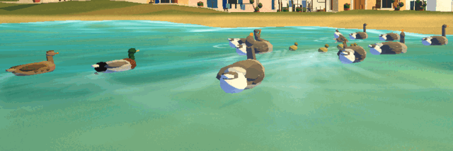

### Dolphins

- **Aliases:** a pod, bow-riding, racing the Gull.
- **Definition:** small pods (3–8, some with a calf) of short-beaked common dolphins (dark cape,
  tan-yellow forward flank, grey behind, white belly) in deep water off the harbours. A roaming pod
  swims slowly about its water, each dolphin rolling up to breathe every 5–19 s (back and fin out, a
  blow, a little spray). A fishing caique underway draws them to **bow-ride** just ahead of its stem;
  a seaplane taxiing or on the start of its run (on the water, 2–11 m/s) they **race** abreast of
  its floats, porpoising in leaps; when it pulls away or lifts off they **peel off** to one side and
  roam again. Each dolphin swims itself: thrust toward its spot with a top speed and turn, buoyancy to
  its depth and up to breathe, gravity alone once clear of the water, so the leaps come from its speed.
  Cut at the sea's surface like the birds. Gulls about a caique **hauling** its nets (stopped on its
  ground) dive to the water astern, sit, and get up again.
- **Code:** `src/dolphins.jo` (`pod_scan`, `pod_site_at`, `make_pod`, `pod_interest`, `pod_step`,
  `dolphins_step`), `src/dolphin_view.jo` (`build_dolphin_meshes`, `draw_dolphins`), gulls in
  `src/wildlife.jo` (`wild_hauling`, the `dive` and `sit` acts of `colony_step`); the blow and the
  splash in `src/ambience_synth.jo`.
- **Rules:** sites hashed from each harbour's key, a pod out on about two days in three; nothing saved.
  Tests: `tests/dolphins_test.jo`, and the hauling test in `tests/wildlife_test.jo`.
- **Capture:** `AEGEAN_WILD_POD="ahead d s"` (placed on the first frame from where the aircraft is),
  `AEGEAN_CAPTURE_TAKEOFF=1 AEGEAN_CAPTURE_TAXI=<seconds>` (taxi out, then the take-off run),
  `AEGEAN_WILD_DOLPHIN_HOLD=1` with `AEGEAN_WILD_PORTRAIT="dolphin d h bearing"` for turnarounds,
  `AEGEAN_WILD_LOOK="pod|hauling d h b"`, `AEGEAN_WILD_RACECAM="side ahead up"` (held beside the player's
  aircraft, looking across at the water off its floats).

### Pilot's scarf

- **Aliases:** the scarf, its tails or ends, worn cloth.
- **Definition:** the pilot's white silk scarf, wrapped round his neck (part of his figure) with
  two loose ends made fresh each frame as ribbons ([Lantern light](#lantern-light) and all, lit
  as he is). In flight's wind they stream and flutter back from the knot; ashore they blow in
  the breeze and his own walking or running, or hang down his back. Worn, the ends stay
  outside his torso (a box from the hips to the shoulders that each point is pushed out of) and
  hang no lower than the small of his back, above the jacket's hem: what's left bends out
  behind him. They go on with his torso as it bobs, sits, leans or kneels.
- **Code:** `src/fabric.jo pilot_scarf`, `cloth_vertices`, `ClothWearer`, `_kept_off`,
  `_two_sided`; `src/folk.jo figure_pose`, `Figure.back`; drawn from `aegean.jo` after the
  wake and trails (`draw_cloths`).
- **Rules:** the flutter in flight is untouched by the collider (`tests/fabric_test.jo`). Each
  face of the ribbon is lit by its own normal toward the eye; after dark a face turned down is
  lit as if turned up, since the sun below the horizon would otherwise light it from below,
  cold and blue, as nothing on the wearer is (the change grows from nothing as the sun sets).
- **Capture:** `AEGEAN_LEISURE=bar AEGEAN_CAPTURE_MINUTES=766` (at the bar at 22:16);
  `AEGEAN_LEISURE=listen-walk|listen-run AEGEAN_CAPTURE_MINUTES=330` (walking or running away
  across the terrace in the afternoon).

### Ambient crowd

- **Aliases:** unnamed townsfolk, the crowd, passers-by.
- **Definition:** unnamed people in a big town (ports and capitals): sitting at the square's
  benches and café tables, talking in pairs, a vendor or two at striped market stalls in market
  hours, strolling round the square, along the waterfront and up the main streets. Pure
  presentation: no simulation, identity, money or saving; named residents ([Townsfolk](#townsfolk))
  are unchanged. Fullest in the morning and for the evening walk, thin in the afternoon heat,
  next to nobody at night; low and medium quality show about 35% and 50% of the high tier.
- **Code:** `src/ambient_crowd.jo` (`ambient_layout`, `ambient_layout_step`, `ambient_update`,
  `ambient_draw`, `ambient_density`); called from `aegean.jo update_frame` and `draw_world`.
- **Rules:** baked whole figures (6 outfits × 5 poses) drawn with one instanced call per outfit
  and pose through the town shader, within 150 m; laid out once per town as it comes within
  450 m, a loop a frame (no arrival hitch); spots and loops that touch a building are refused;
  those who stand or sit are walking solids, strollers are not.
- **Capture:** `AEGEAN_AT='-117963.77 -84900.62 0' AEGEAN_HOUR=17 AEGEAN_CAPTURE_LIFE=1`
  (Kalyrassa's square); `SHOT` lines report `crowd N`, the number drawn.

### Action cards

- **Aliases:** offers, prompts, what can be done here.
- **Definition:** every action open to the pilot at once gets a card of its own, stacked above
  the first: the first that wants F has it, one more that wants F takes R (stepping ashore on F,
  fuel on R at a fuel pier); T talks and G works on the aircraft. Cards and keys come from one
  list, so one press does one thing; on a touch screen the card is the button.
- **Code:** `aegean.jo walk_offers`, `aboard_offers`, `offer_add`, `offer_pressed`, `draw_offers`.

### Readable type

- **Aliases:** minimum type size, readable().
- **Definition:** no text is set smaller than 12.5 points on the screen (a page's CSS pixels):
  on a phone on its side (about 0.54 points per 2D unit) speech bubbles, name tags, prompt
  cards, the clock and purse, conversations, the ledger, the notice board and the fuel pier grow
  until it reads; on a desktop window nothing changes. A bubble with no room above a head goes
  beside it, never over the face.
- **Code:** `src/hud.jo ui_points`, `readable`, `readable_k`, `READABLE_POINTS`.

### Wading

- **Definition:** a walker steps through water up to 0.85 m deep (a strip of shallows at a
  beach or a dock's side), not into the sea. The world audit still checks every place is
  reachable without wading at all.
- **Code:** `src/objects.jo WALK_WADE_DEPTH`, `walk_step_precise`.
- **Rules:** the limit is under the still water (a lake or river's level, else the sea's mean), never
  the swell's. Anyone standing deeper than it (out of a swim, put down by a load) may still walk
  toward ground rising that way (3-9 m ahead against 3-9 m behind), so no one is ever left with
  nowhere to step; going deeper from there is refused.

### Camera wall check

- **Aliases:** camera pull-in, keeping the view out of houses.
- **Definition:** on foot, the follow camera is brought in to just short of the first building on
  the line from the pilot's head out to where the camera would be, so a house never stands
  between the view and the pilot and the camera never sits inside one (where its walls, culled
  from inside, would show the street through them). It eases back out when the wall is passed.
- **Code:** `aegean.jo follow_clear_of_walls` (called from `update_player_follow`), using
  `town_avoid_buildings` (the walking solids) and the engine's `pull_in`.
- **Rules:** only solids taller than the pilot count (benches, tables and garden walls do not);
  never closer than a metre behind the head; samples every 0.45 m (about 0.02 ms a frame). A line
  that only grazes a corner is left alone.
- **Capture:** `AEGEAN_AT='461.50 -6325.68 -0.891'` (a Porto Vecchio house behind the pilot).

---

### Town look

- **Aliases:** gap 8, the hill town, painted roofs.
- **Definition:** how the island towns read (art direction gap 8). Walls are muted plaster (cream,
  grey stone, grey-green) as the midday sun lights them, C* about 10-14, with one house in six an
  accent (ochre, pink); the paints are near neutral because the sun is warm. Every pitched roof
  shows a lit and a shaded pitch, painted (the one facing the midday sun lit, the other darker and
  redder, roof_shade), so the town has its value step at any hour; the terracotta varies by house
  (six weathered tones and a faded one), one roof in ten is slate, about three in ten hipped, one
  in six flat. The home town and the villages climb the slope behind the waterfront in tiers that
  taper up the hill, the front row two to four storeys, the rows behind lower; a garden with a fig,
  an olive or a cypress between houses now and then; every nine to twelve houses a landmark of
  another form (a bell tower with a lead dome or a hipped cap, a domed church, a tower house, a
  stand of cypresses), the chapel among them. The houses weathered as the film paints them
  (`house_wall_weather`): a darker plinth where the damp rises, shade under the eaves, stone
  quoins at the corners in long and short courses, grey stains running down from the eaves, a
  patch or two where the plaster has come away and the coursed stone shows at a ragged edge;
  above the street the windows' shutters stand open either side of a dark recess (`SHUTTERS`:
  greens, a grey-blue, a brown), a stone sill under each window; the roofs in courses of barrel
  tiles (`roof_tiles`). Walls carry their own layout (tag 186: across the face, height up it,
  `add_house_walls`) and roofs theirs (tag 185, `roof_uv`), so nothing swims; the stains and
  patches use a value noise that repeats every 64 m (`wall_noise`), steady as the origin moves.
- **Code:** `src/objects.jo` (`WALLS`, `ROOFS`, `SLATE`, `LEAD`, `roof_shade`, `roof_lit_first`,
  `add_gable`, `add_hip`, `add_dome`, `add_cypress`, `add_garden_tree`, `house_roof_kind`,
  `build_town`'s tiers with their own random stream so the harbour's boats stay where they were);
  `tests/town_look_test.jo`.
- **Rules:** the targets (walls C* <= 14 with an accent in five to eight; roof pitches 12 apart in
  L* or more; a home town that spans five tiers and 55 m up its slope; a landmark per fifteen
  houses) are tests, judged as the midday sun lights the paints.

### Wardrobe

- **Aliases:** townsfolk clothing, dressed by trade.
- **Definition:** what the town's people wear, by trade and standing, in the clothes of the
  1920s-30s Mediterranean, each trade in a man's and a woman's version (a woman's by the town's
  record, person_woman). Fishermen in jerseys and caps, the fish market's women in headscarves,
  aprons and rolled sleeves; dockhands in shirtsleeves; shopkeepers in waistcoats and aprons, the
  women in a blouse, skirt and apron; the well-to-do in light suits and boaters or a drop-waist
  dress and a cloche; farmers and pressers in wide straw hats; the priest in a cassock and round
  hat; the patrol in tunics and kepis; flyers in leather and helmets, the same for anyone; the
  hotel's waiter in a white jacket and long apron, the barkeep in a waistcoat, the errand boy in a
  cap. The band's players change into evening clothes (a frock with a low waist, a dark suit) out
  of sight before their evening. Mostly pale and neutral, a clear colour about one in five; hats on
  most men and half the women. Women's and girls' long hair shows (`add_long_hair`): fuller over
  the ears, and a bun high on the back, a low knot at the nape, a plait down the back or worn down
  to the shoulders (the old mostly up; under a headscarf or a cloche down or in a knot); a girl's
  two plaits with ribbons.
- **Code:** `src/wardrobe.jo` (`outfit_for`, `evening_outfit`, `waiter_outfit`, `barkeep_outfit`,
  `errand_boy_outfit`, `walker_outfit`); `src/folk.jo` (`Outfit`, `Garb`, `build_outfit_figure`,
  `dress_outfit` for the old dress kinds); `person_figure` and `Folk.day`/`Folk.evening` in
  `src/townsfolk.jo`; `tools/wardrobe_view.jo` shows them all; `tests/wardrobe_test.jo`.
- **Rules:** built once into each person's figure (the same draws as before); a change of clothes
  only out of sight.

## Living world

The living world is the simulation of people, goods, money, news and war that runs whether or not
you watch (`docs/SIM_SPEC.md`, `src/living_*.jo`).

### Path desk

- **Aliases:** shared path search, walking-path budget.
- **Definition:** how the scenes' people (far residents, daily life, households, carriers) get
  their walking routes without a frame stall: one street search at a time, about 2 ms of it each
  frame, stopping between single walk steps and resuming next frame; the walker waits where they
  stand until the route is ready. The search visits the same nodes in the same order, so the path
  is the one a search in one go finds.
- **Code:** `src/cargo_scene.jo` `walk_search` / `walk_search_step` (the resumable search),
  `scene_walk_path` / `walk_paths_frame` (the desk); `aegean.jo update` sets the frame budget.
- **Rules:** keys name the leg (person and route revision or target); a request nobody asked for
  since the last frame gives up the desk. Headless callers and tests (no frame budget) get the
  path at once (`cargo_walk_path`). `tests/cargo_scene.jo` holds the sliced search to the same path.
### Far people

- **Definition:** named residents of the far (non-core) towns, promoted from a town's population
  when they are needed. Each is a full person with one purse. Drawing them never creates,
  destroys or renames anyone.
- **Code:** `src/living_far_people.jo:78 promote_far_person`, `far_people_minute`,
  `far_resident_views`; `FarPerson` in `src/living_far_types.jo`.

### Dock handover

- **Aliases:** the receiver on the dock, hand over the cargo, meeting the aircraft.
- **Definition:** a flying job's receiver meets the pilot's aircraft on the dock. Once the cargo is
  aboard, they go down to wait where it comes ashore, whether their home is on the quay or up the
  hill. They wait until it is due, or for as long as the aircraft is bound there or moored there.
  They wave as it comes in and ask after it ("Is that the medicine from Eleni?"). When the pilot
  steps ashore beside them, the card offers **Hand over the medicine**. They thank the pilot and
  take it from the aircraft, and once it is in their hands the job is delivered and paid through
  the ledger. Then they walk home with it.
- **Rules:** the pilot's own cargo comes ashore only at the handover (`cargo_plan_carriage`
  leaves it aboard until `choose_collection` names who carries it). The waiting is the living
  world's own day (`cargo_awaited`, `cargo_meeting_spot`), so the scene and the far world agree;
  one waiting walks the world's way where the scene's paths can't find one. Picking the crate up
  oneself is offered only when nobody waits for it. A new pilot's first job has at least twelve
  hours to its due time.
- **Code:** `src/living_portage.jo` (`cargo_awaited`, `cargo_meeting_spot`,
  `cargo_awaited_words`); `src/living_life.jo` (the waiting day); `src/life_scene.jo`;
  `handover_here`, `handover_act`, `handover_frame` in `aegean.jo`; `Folk.waving`. Tests
  `tests/first_delivery_test.jo`.
- **Capture:** `AEGEAN_CAPTURE_DELIVERY=2 AEGEAN_DELIVERY_MOORED=1` (the medicine for Agios
  Nikolaos taken, loaded, the aircraft tied up there an hour on); `AEGEAN_DELIVERY_TRACE=1` logs
  the job.

### Notices

- **Aliases:** the notice board, job notices; notes (in the notebook).
- **Definition:** posted jobs and news on a harbour board. The player pins them into the notebook.
- **Code:** `struct Notice` in `src/panels.jo`; `job_notices` in `src/townsfolk.jo`;
  `military_notices` in `src/war_view.jo`.
- **Rules:** townsfolk retell notices in their own words (past tense, with their source) rather
  than reading them out; routine logistics notices are not repeated as news. A card opens by a
  click, a tap (on release), the keys' or a controller's focus with Enter or A, or 1-9 for the first
  nine open ones. The Aegean Maritime Service's shipping notices read out two of the work posted on
  the harbour with the most of it (`radio_work_words`, `src/radio_content.jo`).
- **Capture:** `AEGEAN_UI=board`; `AEGEAN_CAPTURE_PANEL=notebook AEGEAN_HOUR=8 AEGEAN_CAPTURE_MINUTES=1170`.

*Image to come: the notebook capture (`AEGEAN_CAPTURE_PANEL=notebook`) pins notices only when
open home-board jobs exist at that minute, and none did when the glossary's images were made.*

### Provenance

- **Definition:** the saved record of why a job exists: who asked, who supplies, where and when
  it was asked, and the money for goods and freight.
- **Code:** `src/living_work_types.jo:2 struct WorkProvenance`.
- **Rules:** speech gives short offers; the full provenance stays in the notebook and the contract
  panel. News is never silently refreshed: what people repeat are dated beliefs.

### Phoenix (money)

- **Aliases:** the money, the purse, phoenixes; in speech phoinix / phoinikes; small change in
  lepta (one lepton). The old name, lire, is gone from the game.
- **Definition:** the game's currency, after Greece's first modern currency (1828), whose coin
  showed a phoenix rising from flames; a phoenix is 100 lepta. Written amounts are the phoenix
  sign and the figure (`¤120`, `¤3.50`); an amount under one phoenix is written in lepta
  (`30 λ`), everywhere: the purse, menus, notices, contracts, refuelling, the map shop, the Game
  page's slots and the notebook. The sign is drawn, never an image: a stylised phoenix with its
  wings raised over a flame, filled (gold over an amber flame on the purse) or in outline (the
  bird drawn round, the flame solid). Under 19 px tall (text up to about 25 px: the purse, the
  ledger, menus, the Game page's slots) the bird would read as a yen sign, so the small sign is
  the phoenix's letter instead: a Φ standing on three tongues of flame (`PHOENIX_SMALL`).
- **Code:** `src/phoenix.jo` (`phoenix_text` writes an amount; `draw_phoenix` draws the sign;
  `ptext`, `ptext_centered` and `ptext_width` draw words with "¤" in them as the phoenix);
  speech in `src/living_talk_words.jo say_money`.
- **Rules:** the ledger keeps whole lepta (`cents` in the code; `12000` = ¤120), unchanged, so
  saves load as before. Written words carry the sign as "¤" (the generic currency sign) and are
  drawn with `ptext`, never `text`, so the phoenix shows. People say the money aloud ("near
  enough nineteen phoinikes", "thirty lepta"), rounded; speech never shows the sign or exact
  lepta. `tests/phoenix_test.jo` keeps the formats and finds any "lire" left in the sources.
- **Capture:** the purse is in every HUD capture; `AEGEAN_LEISURE=menu`, `AEGEAN_UI=board`,
  `AEGEAN_CAPTURE_PANEL=game` (with saved slots) show it on paper.

### Standing

- **Aliases:** regard, reputation.
- **Definition:** what a town or person thinks of the player, from -1000 to 1000.
- **Code:** `src/living_world.jo:120 town_regard`; the notebook's `standing_lines` in
  `src/rescue_view.jo`.
- **Not to be confused with:** race standings (`air_standings` in `src/air_race.jo`).

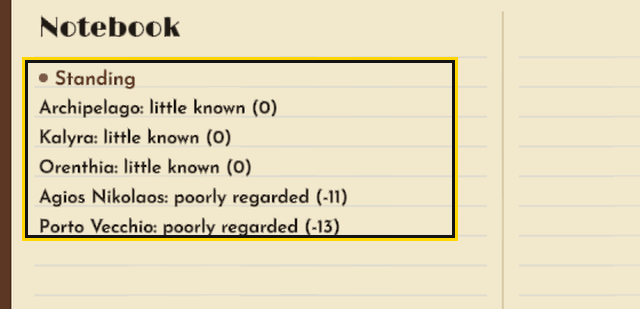

### The pilot's name

- **Aliases:** reputation, what people have heard of him, his name preceding him.
- **Definition:** what the living world's people know of the pilot and think of him, carried in
  how they behave and talk, never shown as a number. Four leanings (warmth, honour, daring,
  reliability) and, from the deeds a listener knows, what he did to and for their own country's
  people. **Deeds** worth telling (a rescue, a victory, a job, a debt) spread as news: the
  witnesses and the town at once, through the town over two or three days of talk, about a town
  a day along the roads and sea lanes while `weight × 0.7^hops` stays above 150, and to every
  town on the wireless when big. Small acts (a chat, a table shared or refused, a tip) stay with
  the people there and their town. It all fades with time. Known as keeping to himself, fewer
  people come over; asked if he may sit with them, they say no, and why. Never a punishment.
  What people say of it is short and leaves most unsaid: one detail at most (the storm, the
  nationality, the place or a name), less from a friend than from a stranger.
- **Code:** `src/reputation.jo` (`rep_record`, `rep_act`, `rep_view`, `reputation_minute`),
  `src/reputation_talk.jo` (greetings, company, prices, the wireless, the notebook's words),
  `src/reputation_types.jo` (`World.rep`); combat deeds come through `src/deeds.jo`
  (`deed_record`). Design: `docs/reputation.md`. Tests: `tests/reputation_test.jo`.
- **Rules:** a person knows of him if they dealt with him or saw a deed, or by the town's word: a
  fixed draw from the seed and their id under the share of the town that has heard. Whoever has
  heard a deed and hasn't met him mentions it once. Company at the hotel and the coffee house,
  "Mind if I sit?" (asked in talk of someone sat at a terrace table), a keeper's bill (up to 6% down, 5% up) and a family's spare room
  follow it.
- **Capture:** `AEGEAN_LEISURE=rep-remark AEGEAN_COMPANY=1` (someone at the bar who has heard of
  a storm rescue off Neravessa); `AEGEAN_LEISURE=rep-decline` (known for turning people away,
  he walks up to someone at a terrace table and asks to sit; `AEGEAN_INVITE=no|yes` fixes the
  answer's roll, `AEGEAN_REP_CAM` the view's angle); `AEGEAN_LEISURE=rep-join` (liked; they say
  yes and he sits at their table); both with `AEGEAN_CAPTURE_MINUTES=630 AEGEAN_HOUR=20` for the evening;
  `AEGEAN_SEAT_FRAMES=<dir> AEGEAN_SEAT_FRAMES_END=<frame>` for a clip (`AEGEAN_SEAT_FRAMES_STEP`
  frames apart, the view turning `AEGEAN_SEAT_FRAMES_TURN` radians a frame, 0 to hold it).

### Small talk

- **Aliases:** the pilot's small talk, the pilot answering on his own.
- **Definition:** someone in the street or at the table occasionally passes the pilot a remark.
  The speaker’s opening carries its own possible answers. Wind, fishing, prices, a flight,
  a delivery or a deed take their detail from the day. The pilot answers after a moment if the
  speaker is still with him. An errand, a purposeful walk or an open panel keeps him quiet.
- **Timing:** a place rests for 36 game minutes and a speaker for 100. Across places the chance
  of a remark recovers over 12–90 minutes after a chat. A conversation the player starts counts too.
  A nearby speaker can warn the pilot during either rest if a thunderstorm is coming their way.
  The pilot hears that warning once per storm, even if he changes town or reloads a save.
- **Code:** `src/town_chat.jo` chooses and remembers an exchange. `src/pilot_talk.jo` keeps the
  pilot’s day. `chat_at` and `pilot_reply_frame` connect the scene to the existing speech bubbles.
  The cooldowns and opening history are saved with the presentation. Older saves start empty.
- **Option:** Settings, Character, “Your pilot makes small talk” controls the automatic reply.
- **Capture:** `AEGEAN_LEISURE=rep-remark AEGEAN_COMPANY=0.5 AEGEAN_SMALL_TALK=always
  AEGEAN_CAPTURE_MINUTES=630 AEGEAN_HOUR=20` admits an eligible opening at the first opportunity.

### Spoken lines

- **Aliases:** streamed text, the typewriter, words arriving.
- **Definition:** what someone says in a panel arrives as it is spoken instead of all at once:
  35 to 50 characters a second by the speaker's voice and age (an old fisherman near the bottom,
  a nurse or a telegraphist near the top), with a breath at a comma and a longer one at a full
  stop, and none inside a figure. The line is wrapped whole first, so no word jumps to the next
  row as it grows.
- **The answers wait:** what can be said back comes once the line is whole, and fades in. Space,
  Enter, a controller's A, or a click or tap on the line (their bubble, or a panel's line)
  finishes it at once. That press does nothing else: it is not also an answer, and Space is held
  from whatever else it does (`hold_space` in `src/touch.jo`) until the line is whole.
  The keys card (H) lists it: "Space  finish a line".
- **Where:** conversations, an office's contract, the hotel desk, a host's spare room, the bath
  keeper and a ride asked for (the choices wait for them); the keeper's word under the bill of
  fare and in the book, the workshop's answer, a line on the wireless, and a spoken card such as
  a tow's answer or a parting word (these only arrive: nothing waits and no press hurries them).
  A notice on the board, the newspaper and the notebook are read, not said, and are there at once.
- **Option:** Settings, Display, "Text speed": Slow, Normal, Fast or Instant (Instant: as panels
  were). Kept with the options; an older file reads as Normal.
- **Code:** `src/speech_stream.jo` (the pace, the pauses and one frame's step: plain arithmetic),
  `src/spoken_view.jo` (`spoken_line` for a panel's line by key, `spoken_heard` for one that only
  arrives, `spoken_peek` for the same words drawn elsewhere). `ptext(..., chars = n)` draws the
  first n characters where the whole text puts them, the phoenix sign included.
- **Tests:** `tests/talk_bubbles_test.jo` (timing, the skip, the answers waiting, the option) and
  `tests/talk_bubbles_test.py` (the game played through a conversation by `tools/panel_probe.jo`).

### Talk bubbles

- **Aliases:** menu-free dialogue, conversation bubbles, the reply fan.
- **Definition:** a conversation has no panel. The person's line is in a speech bubble over their
  head, arriving as it is spoken, with their trade after their name; it stays until they say the
  next thing. What the pilot can say is a short fan of small numbered bubbles beside his head,
  each worded as he would say it (the subject "the weather" reads "How's the weather looking?").
  The one chosen becomes his own speech bubble; their answer begins a moment after.
- **The fan:** four at a time, with Goodbye under every set. More than four: two small arrows
  and "2 / 3" turn the sets. It comes once their line is whole. It stands on the side of his head
  away from the other speaker, clear of both speech bubbles, the clock and a touch screen's
  buttons; on a cramped screen its lines break shorter until it fits; on a phone held upright
  it goes under his head.
- **Keys:** 1 to 4 say the set's reply, 0 or Escape is goodbye, Tab the next set (Shift+Tab the
  one before); a click or tap on a bubble says it. A controller's d-pad steps through the set and
  A says the one reached, the bumpers turn the sets, B is goodbye; its stick is still his feet.
  Space, Enter, A, or a click on their bubble finishes a line still arriving.
- **A question passing:** the answers to a direct question of theirs fade from nine seconds and
  are gone at twelve; the subjects and Goodbye stay.
- **Out of view:** someone behind the camera or off to a side has their bubble at the screen's
  edge on their side, with a small point toward them.
- **Out of earshot:** to 15 m their words come whole; from there to 25 m the bubble fades and
  loses words (the same words each time, a run of them one "…"); past 25 m the talk is over, and
  a word is called after as a spoken card ("Mind how you go!").
- **Code:** `src/talk_bubbles.jo` (who says what, `pilot_asks`, `pilot_says`, `ReplyFan` and its
  sets and keys, `talk_clarity`, `talk_heard`), `reply_bubbles`, `reply_place`, `bubble_box`,
  `bubble_box_edge`, `bubbles_apart` and `bubble_draw` in `src/panels.jo`, `draw_talk_bubbles`
  and the talk case of `draw_ui` in `aegean.jo`. `ctl_talk` in `src/controller.jo` is the
  controller's press in a talk on foot.
- **Still panels:** the office's contract and a notice's terms (`conversation`), and every form:
  the ledger, the notice board, the repair desk, the fuel pier, the map counter, the bills of
  fare, tavli, the band's jar and requests.
- **Tests:** `tests/talk_bubbles_test.jo` and `tests/talk_bubbles_test.py` (the line arriving,
  the fan's bubbles on the screen, the keys, the mouse, a controller, a question passing).
- **Capture:** `AEGEAN_TALK=1` opens a conversation with the nearest person at the start,
  `AEGEAN_TALK=idle` with the nearest who has nowhere to be (the pilot stood beside them), and
  `AEGEAN_TALK_FOLLOW=1` walks the pilot beside whoever he is talking with. With
  `SLOPPY_FIXED_STEP=1` and `SLOPPY_INPUT` (`300:n1+ 303:n1-` says the first reply) it plays the
  same every time.

### Talk hold

- **Aliases:** standing and walking talks, the scene's hold, come along.
- **Definition:** the pilot keeps his feet through a conversation. Someone with nowhere to be
  stands where they are and turns to him, and he to them while he stands; someone seated, at a
  fixture or playing keeps the way that faces them. Someone with somewhere to be (a load in hand,
  a job, work to get to, the church bell, bed, someone waiting) keeps walking, at 0.8 of their
  pace, and he can walk along.
- **Come along:** when a stander's day gives them somewhere to be, they say so ("This won't
  carry itself. Come along.") and set off, the talk still open. Their boat takes them alone,
  with a parting word. The same part of the day given a new spot to stand on is no call, nor the
  first plan of a world just begun; someone at work at their post stands.
- **The lease:** the scene's walkers (the daily walkers, the far people, porters under a load)
  keep their movement lease on a held person and do not step them, and walk a paced one slower.
  The saved plan, its route and the place along it are untouched; a save in the middle of a talk
  folds the lease as ever. Nothing of the hold is saved.
- **Code:** `src/scene_hold.jo` (`scene_hold`, `scene_release`, `scene_walk_with`, `scene_pace`,
  read by `step_life_scene`, `step_far_people_scene` and `step_cargo_scene`), `src/talk_hold.jo`
  (`talk_hold_begin`, `talk_on_the_way`, `talk_hold_step`, `talk_walk_line`, `talk_far_line`),
  `talk_hold_frame` in `aegean.jo`.
- **The camera:** an aircraft's loose box never brings the follow camera closer than 2.6 m during
  a talk, and not at all while the pilot himself stands inside it (under a wing).
- **Tests:** `tests/talk_hold_test.jo` (the lease and the plan under a hold, the talking pace,
  who walks and who stands, each call, the lines) and `tests/talk_hold_test.py` (the game: stood
  for a word, walked off out of earshot, come along, walked along; `tools/panel_probe.jo`'s
  `WHO` line).

### Leads

- **Aliases:** what's going on, things to look into, something he could go and do.
- **Definition:** now and then people mention something real the pilot could go and do: someone
  after a lift (an open passenger job), a load left on a dock a while (an open cargo job), a race
  at a capital on a named day (a club meeting taking entries), a boat overdue (a missing-boat
  story), music at the Ancora tonight (the band's evening). Said plainly, once by each person a
  day (kept in the World, so not again after a load: `World.rep.told_leads`), one kind a day each;
  nearest home first. No quest log and no marker: the player remembers
  it, or writes it in the notebook. Each leads somewhere: the lift's taker is asked in talk; a
  load's owner is named where it waits ("Nefeli's had a load on the dock a while."), and its
  crates carry a label ("read the label on the crates"; someone near says where the owner is);
  the race is entered at the club's table on the capital's quay (the club posts its meeting the
  day before); the music is spoken of only when two of the band's players are in town to play. Mostly when asked what they've heard (half the time) and at
  the table (a third of the remarks), now and then in passing (one remark in seven).
- **Code:** `src/leads.jo` (`leads_for`, `lead_real`, `lead_line`, `lead_to_tell`); `tell_lead`,
  `_lead_meets` and the three places it is said in `aegean.jo`; `tests/leads_test.jo` (every lead
  real, over days of the world; gone once taken, closed or over).
- **Capture:** `AEGEAN_LEISURE=lead-bar AEGEAN_COMPANY=0.5 AEGEAN_COMPANY_GAP=10 AEGEAN_LEADS=always
  AEGEAN_CAPTURE_MINUTES=450 AEGEAN_HOUR=17` (someone at the bar tells of a lift wanted, the band,
  a load); `AEGEAN_LEISURE=lead-ride` (he has walked up to the one who wants the lift).

### Errands of the islands

- **Aliases:** the mail, the papers, the ice run, the sponges, the nurse; period work.
- **Definition:** jobs of a kind the islands had, posted by the one whose work it is at the hour
  it'd be wanted, each to a named person who meets the aircraft on the dock (the
  [dock handover](#dock-handover)) and says something fitting as it's handed over. The mail bag
  at half past seven, out from Porto Vecchio's post to one island one day and back the next, a
  postmaster (clerk, telegraphist, teacher or priest) at each end; the morning papers at five (for a
  pilot up at dawn; the island couriers leave them), for an island's innkeeper by breakfast; block ice from the ice works every other morning for a
  fishmonger, two hours before it's water (late, and the thanks say so); a diver's sponges from
  Mikra every third day for a Porto Vecchio merchant; now and then the nurse from Agios Nikolaos,
  flown to a sick child's family in another harbour (a passenger who sits beside the pilot and
  steps down there). Priced from a base and so much a kilometre (the papers ¤8 to ¤10, ice ¤16
  to ¤19, the nurse ¤24 to ¤28; about what a sealed letter or a load of freight pays).
  Afterwards it is told: people say "You're the one flying the
  mail, aren't you?", the pilot says "Mail run. Nothing to it." of his day, and while it's open
  someone in the sender's harbour mentions it as a lead. Film reels (no cinema yet) and an aerial
  photographer (no photographing flight yet) are not among them.
- **Code:** `src/errands.jo` (`errands_minute`, `errand_parcel`), `src/errand_words.jo`,
  `src/errand_types.jo`, `World.errands`; `tests/errands_test.jo`.

### The club's table

- **Aliases:** the race committee's table, the entry table, giving one's name for a race.
- **Definition:** at a capital's air meeting, from the day before (when the club posts it) until
  the start, a trestle table on the harbour's quay with the entry sheet and the cash box, the
  club's maroon pennant on a pole, and the club's clerk behind it. A race is entered there, on foot
  at the table (no longer from anywhere within twelve kilometres, nor from the water), with one's
  own aircraft fuelled, sound and moored at the host harbour. Afterwards the result is told: a deed
  of the pilot's name (a win talked of far and wide, a Schneider win on the wireless), people's
  remarks ("Heard you came second at Kalyrassa."), the paper of a town that has heard ("Air race at
  Kalyrassa"), and the pilot's day ("Raced at Kalyrassa. Came second.").
- **Code:** `src/club_desk.jo` (`club_desk_at`, `club_desk_near`, `draw_club_desks`);
  `race_offer_here`, `draw_club_tables`, `race_results_told` in `aegean.jo`; `rep_record_race` in
  `src/reputation.jo`; `rep_paper_pieces` in `src/reputation_talk.jo`; the day-ahead posting in
  `prepare_air_events` (`src/air_events.jo`).
- **Capture:** `AEGEAN_CAPTURE_RACELEAD=heard|arrive|desk|after|paper` (the race lead followed).
### A boat adrift

- **Aliases:** an overdue boat, a boat in trouble, Petros's boat.
- **Definition:** now and then (about one fishing trip in forty, more in bad weather) a fishing
  boat that has gone further out loses its engine or its mast, or loses its way, and lies adrift
  on the sea lane out of its harbour, two to four kilometres out, drifting slowly along it. Its
  trip is held there, so it is overdue: the town worries (the missing-boat story) and people say
  so (a [lead](#leads)). It is really there, drawn where it lies; found by flying over and
  looking, with no marker; a boat that lost its mast is drawn with it snapped off and the sail
  over the side. Landed alongside, the pilot takes the skipper aboard (he climbs into the second
  seat, as a rescued pilot does, and is back in it after a load) and sets him ashore at a harbour;
  or signals a passing caique on its way, which turns aside and tows it in; or gets a line across
  to another boat out fishing near; or, having seen it, tells someone of its harbour where it lies,
  and the launch puts out from its berth. The launch and the caique are seen: they come out on the
  fleet's sea lanes, draw up alongside, make fast, and tow the boat in astern on a line to the
  harbour (`src/adrift_help.jo`, with the radio help's pieces); the world waits for them while they
  are in sight and finishes by its own clock once the pilot is far off. Left alone, the lost find their way home
  in some hours, and the others are brought in by a passing boat late the next day. The skipper
  remembers who came for him; the worried and the harbour tell of it ("Heard you found Petros.");
  the pilot's day has it ("Found Petros off Porto Vecchio.").
- **Code:** `src/living_adrift.jo` (`adrift_minute`, `adrift_begin`, `adrift_take_aboard`,
  `adrift_set_ashore`, `adrift_tow`, `adrift_report`), `src/adrift_types.jo` (`World.adrift`, saved);
  the hold in `advance_workboats`; the deed `found_boat` in `src/reputation.jo`; `update_adrift`,
  the offers and the talk card's "… boat is lying off …" in `aegean.jo`; `tests/adrift_test.jo`.
- **Capture:** `AEGEAN_CAPTURE_ADRIFT=heard|search|alongside|home|launch` (launch: the launch
  putting out, the long ways out and in skipped to their last stretch; heard: with
  `AEGEAN_LEADS=always`; search: with `AEGEAN_FLYING=110`).
### Contracts

- **Aliases:** missions, commissions, military contracts.
- **Definition:** war and rescue work offered as notices and signed at an office counter.
- **Code:** `src/war_view.jo` (`contract_title`, `contract_answers`, `contract_marks`,
  `contract_act`); commission kinds (freight, mail, escort, smuggling, rescue, reconnaissance) in
  `src/living_far_types.jo`.
- **Rules:** signing needs the player at the counter with no other sortie open.
- **Capture:** `AEGEAN_CAPTURE_LIFE=1 AEGEAN_CAPTURE_WAR=contract` (about 400 frames).

### Battle cards

- **Definition:** the title card ("Place, date") shown once, when a named battle first comes into
  sight (within 6 km), for 7 seconds.
- **Code:** `src/war_view.jo` (`BattleCard`, `battle_card_step`, `draw_battle_card`).
- **Rules:** shown once per engagement, and remembered across saves.
- **Capture:** `AEGEAN_CAPTURE_LIFE=1 AEGEAN_CAPTURE_WAR=card` (about 150 frames; the card
  shows for 7 s).

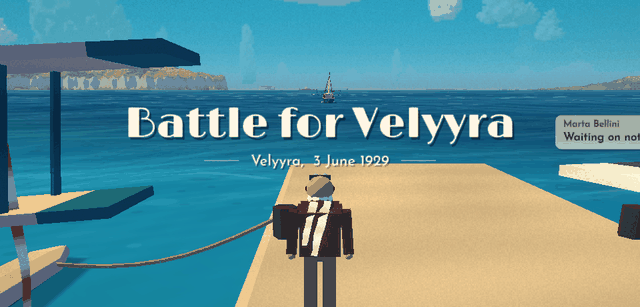

### Game slots and autosave

- **Definition:** three player-selected saved games, each with two recovery **banks**. A complete
  checkpoint includes the living world, exact player/aircraft state, physical battle/fleet,
  races, notebook, cat friendship and other presentation progress. **Autosave** updates the
  active slot after reaching a safe mooring or town on foot, and on a safe timer.
- **Code:** `src/game_session.jo`, `src/game_slots.jo`, `src/living_save.jo`; shell requests in
  `aegean.jo`. API, format and failure rules: [Game saves](../game-saves.md).
- **Rules:** a queued request is not a successful save. Browser completion means the IndexedDB
  transaction committed. Never overwrite an unknown schema or the last intact bank on failure;
  never attach a new story to a previous slot without a selection. Rendering handles are rebuilt,
  not serialized. Slots are numbered 0–2 in the API; the menu chooses their displayed labels.

### Title screen

- **Definition:** what the game starts on: the name alone, then Continue (the newest save), New
  game, Saved games and, quieter, Situations, over the **title reel**. No tagline or subtitle,
  ever. The **loading propeller** shows before it, with no words: a small two-bladed propeller
  turning slowly on the dusk, a faint ring round it filling as the islands and towns are prepared
  (the web page's own card while the module loads; natively the game draws the same).
- **Code:** `src/title_screen.jo` (`title_screen`, `title_latest`, `_soft_shade`); `aegean.jo`
  (`title_wanted`, `title_prepare`, `title_update`, `draw_title_screen`); `src/web_compat.js`
  (the loading card and its progress); `draw_loading_propeller`.
- **Rules:** the world loads once; the title only stands in front of it. Continue never asks;
  New game asks only before it would save over a slot. A soft radial shade behind the buttons and
  a fainter one behind the name, no visible edge. Test and capture runs skip it
  ([Game saves](../game-saves.md#the-title-screen)).
- **Capture:** `AEGEAN_TITLE=1 SLOPPY_FRAMES=600` (with `SLOPPY_SAVE_DIR` holding saves for the
  Continue state; `SLOPPY_WINDOW=390x844 SLOPPY_TOUCH=1` for a phone).

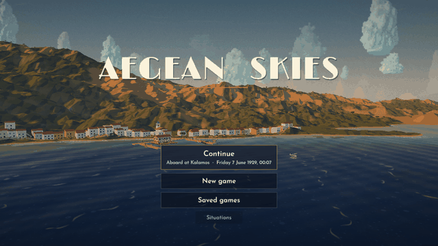

### Title reel

- **Aliases:** the backdrop, the title's shots.
- **Definition:** the live world behind the title in unordered shots of 18-28 s with a dip to dusk
  between them: a **low pass** over open water at the top speed (free, chasing a Gull, overtaken by
  one, or a **race**: two Falcos, flown by the real flight model, overtake, bank hard round an
  air-race pylon and pull away); **high at sunset** above the clouds; a **town and its waterfront** (a low
  run along the harbour front from just offshore, a slow golden-hour arc, or along Neravessa's
  canals). Each shot sets its own hour and fair weather. The Adagietto plays as from a cockpit
  radio and leads; aircraft sounds are a faint bed about 20 dB under it.
- **Code:** `src/title_shots.jo` (`title_next_shot`, `title_view`); `aegean.jo` (`title_cut`,
  `title_sound`, the free camera it flies).
- **Rules:** never rain; never the same kind twice running; banks of 7 degrees at most, except the
  race, whose camera rolls with its swing after the racers up to some 14 degrees (`RACE_PAN_ROLL`,
  in proportion to the swing, never a step); a town shot
  never looks straight down into the streets; the low pass's water reads as flight's at that speed
  (the sea gets the reel camera's velocity; the eye at the chase camera's height, 13-16 m;
  `tests/title_reel_detail_test.py`). The world behind it is never saved: a new game puts
  back the startup's world. It costs no more than ordinary play at each quality tier.
- **Capture:** `AEGEAN_TITLE=1 AEGEAN_TITLE_SHOT=low-pass|high|city-Kalyrassa:arc|...`,
  `AEGEAN_TITLE_SEED`, `AEGEAN_TITLE_FRAMES=dir`; `tests/title_shots_test.jo` checks the rules.

### Voices

- **Definition:** the fourteen ways townsfolk talk, chosen from trade, age and temperament: salt,
  shop, formal, anxious, warm, measured, wry, guarded, plain, devout, brisk, chatty, eager and
  elder.
- **Code:** `enum VoiceKind` in `src/life_types.jo`; `voice_of_context` in
  `src/living_talk_context.jo`.

### Openers and tiered topics

- **Definition:** an **opener** is the interjection that starts a line ("Well!", "Oh,"), said
  once per listener per conversation. **Tiered topics** are how a subject unfolds when you ask
  again: first a personal answer, then a dated, second-hand particular, then a referral to whoever
  would know, then an honest end. A second notice of the same kind gets a short **follow-on**
  ("They're after grain as well") instead of the same frame again.
- **Code:** `src/living_talk_context.jo:42 fresh_opener`; `src/living_talk_words.jo`
  (`say_money`, `say_ago`, `who_said`, referrals).
- **Rules:** greetings are at most 140 characters, with no exact figures, record words or clock
  times (`tests/living_speech_style.jo`).
- **Capture:** `AEGEAN_TALK=1`; `tools/talklog.jo` for transcripts.

### Rotating far checks

- **Aliases:** check slices, rotated validation.
- **Definition:** how the game (recovery mode) checks the far world each minute without a frame
  stall: every dimension, index, uniqueness and conservation check runs every minute, while the
  per-record details (restocking orders, dated reports, field crops, supplier quotes, journey
  agreements) run for one sixteenth of the districts, vehicles and journeys, a different sixteenth
  each minute, so each record is checked at least every 16 game minutes.
- **Code:** `src/living_far_checks.jo:11 FAR_CHECK_SLICES`, `validate_far(w, route_points, slice,
  slices)`; chosen in `src/living_far_economy.jo` `far_economy_minute`.
- **Rules:** strict runs (tests, tools), saves and loads always check everything. The checks only
  read the world, so rotation never changes what the simulation does; the test is
  `tests/living_far_check_rotation.jo`.

### Spread minute

- **Aliases:** world-minute slices, held clock.
- **Definition:** a world minute's rules run as ordered pieces over a few frames (about 4 ms a
  frame) instead of in one frame. While a minute is in progress the scene takes no new tick and
  the frame's other World writers wait, so nothing else touches the World between its pieces: the
  same rules, in the same order, on the same World. A frame with input, a menu or the pause
  screen finishes the minute at once first; a save or load waits until it is done.
- **Code:** `src/living_sim.jo` `MinuteRun`, `minute_run_step`, `_minute_unit`;
  `src/living_scene.jo` `scene_clock_end_spread` / `scene_clock_resume`; `src/traffic.jo`
  (the held tick); `aegean.jo` `update` (`world_held`, the frame budget).
- **Rules:** headless runs and tests run each minute whole; a minute in pieces gives exactly the
  World the whole minute gives (`tests/living_minute_spread.jo`). NPC aircraft, which move only on
  scene ticks, pause for the held frames and catch up after.
## Leisure

Optional activities: eating, drinking, music, resting and working on the aircraft, for the pleasure
of it. There are no needs meters and no penalties, ever (`docs/leisure.md`).

### Leisure places

- **Definition:** a spot in a town that offers activities: its keeper (a living-world person whose
  purse takes the money), opening hours, menu, and rooms if any. Every order and room is one
  `transfer` from the player to the keeper, so the money balance holds.
- **Code:** `src/leisure.jo` (`LeisurePlace`, `leisure_order`, `leisure_take_room`,
  `spare_room_hosts`, `leisure_tinker`); menus in `src/leisure_menu.jo` (`HOTEL_FOOD`,
  `drinks_catalogue`, `keeper_remark`); panels in `src/leisure_view.jo`.
- **Rules:** dishes and drinks made from a market good follow that good's price in the town; the
  keeper's remarks never read out figures; a spare room is offered only by someone grateful (a
  remembered delivery or rescue, or warmth enough) and is free.
- **Capture:** `AEGEAN_LEISURE=menu|search|order|rest|coffee|tinker|spare` with
  `AEGEAN_CAPTURE_MINUTES` for the hour.

### Hotel Ancora

- **Definition:** the pilots' bar: a two-storey hotel on a stone pier off the Porto Vecchio
  waterfront, a plank terrace on piles over the water with four tables, a bar under a striped
  awning, lanterns on wires and a bandstand; kept by Sofia Marinou. Pilots (couriers, racers, the
  patrol) and its keeper go there of an evening as a living-world rule, so whoever is in town is
  really there, seated at its tables.
- **Code:** `src/bar_scene.jo` (`hotel_site`, `build_hotel`, `draw_band`, `draw_served`);
  the venue rule in `src/living_life_seed.jo` (`choose_life_venue`, `life_aviator`) and
  `src/living_life.jo`; seating in `src/townsfolk.jo`.
- **Rules:** the walkable deck is published as quays; the building's walls are published solids,
  so it is not walked into: its [bar room](#bar-room) is gone into at a door. The terrace venue key ends with `TERRACE_VENUE_SUFFIX`.
- **Capture:** `AEGEAN_LEISURE=exterior|harbour|terrace|sit`.

### Bar room

- **Definition:** the Hotel Ancora's ground floor, an indoor evening room: a stone arch across it,
  the band's stand in a curtained corner with the piano, a long dark counter against a back bar of
  bottles with a mirror and a clock, tables under hanging lamps, palms in pots, and walls crowded
  with pictures, pinned papers, a propeller and a shelf of cups. Lit by lamps only: warm pools
  under the shades, deep brown beyond (by day in the rain, the sea windows' grey light too).
- **When:** only while it rains: everything (tables, waiter, band) is inside; on any other
  evening the terrace (its sky and the sea). The hotel's places (`HotelSpots`) shift into the
  room, so the seated view, company, the waiter and the band follow without their own code
  knowing. The switch happens out of sight: not while the pilot sits at the hotel, else with the
  camera 70 m away.
- **Walked into:** the ground floor's walls have two open doorways (from the terrace by the bar's
  end, and off the east walk), leaves folded back, reveals through the wall, stone sills; the room
  is drawn whenever one is within 70 m, its floor published for walking, its furniture solid. One
  walks in and out: no button, no cut. Capture: `AEGEAN_LEISURE=walk-in|walk-in-side`, and the
  doorways close to: `doorway|doorway-in|doorway-side|doorway-side-in`.
- **The world:** keeps the terrace's places (the band's numbers, the patrons' seats), so saves and
  replays don't change; whoever it has at the terrace's tables, bar or stand is drawn, found and
  talked to at the same place in the room (`room_place_folk`); those crossing the terrace aren't
  drawn. In rough weather the band still plays, and at Porto Vecchio of an evening the keeper and
  the pilots go to the hotel rather than shelter.
- **Light:** baked into the vertices (`bake_bar_room`): shaded hanging lamps throw their light
  down, wall lamps all round, a soft shoulder on the brightest; drawn in a flat light so the bake
  shows, with the lamps glowing. People inside are drawn in `room_figure_light`. Built the first
  time one comes near (rain is not drawn with the camera inside).
- **Code:** `src/bar_room.jo`; `HotelSpots`, `hotel_as_built`, `room_camera_inside` in
  `src/bar_scene.jo`; the floor for seats in `src/walk_shapes.jo` (`walk_publish_floors`).
- **Capture:** `AEGEAN_LEISURE=sit|seat-bar|band` at an evening hour (`AEGEAN_CAPTURE_MINUTES`),
  with `AEGEAN_WEATHER=rain` for everything inside; `AEGEAN_ROOM=0|1|2` forces the room's state.
- **Tests:** `tests/bar_room_test.jo`; the storm evening in `tests/band_life_test.jo`.

### Lantern light

- **Definition:** after dark, things near the hotel or the coffee house (the building, the people,
  the band, the table) are drawn with a warm fill added to the shade, as if lit by its lanterns
  and windows; the sea and the hills stay dark.
- **Code:** `src/bar_scene.jo` `leisure_light`.

### Bar set and singer

- **Definition:** the hotel's evening music, live from 19:00 to 23:30: a quiet set of real
  public-domain pieces (Satie's Gymnopédie No. 1, Gounod's Ave Maria, Debussy's Clair de lune,
  Tárrega's Adelita, Fauré's Berceuse) arranged for the small band (piano, violin, guitar,
  mandolin), heard through the terrace's room (the facade's reflection, a short tail, air by
  distance; no radio filter). A singer (a harmonic formant voice) sings the Ave Maria's line while
  the violin plays softer. Each evening starts one number further on, so every piece comes round.
  The players are townspeople, and a number begins only when they are in their places (see
  [The band's people](#the-bands-people)).
- **Code:** `src/bar_band.jo` (`BAR_SET`, `bar_band_position`, `singer_line`, `singer_render`,
  `bar_room_sample`); the line-ups on the stand in `src/bar_scene.jo` (`band_spots`); clips with
  `tools/bar_music_clip.jo`; note sources and permissions in `data/music/SOURCES.md`.
- **Rules:** kept by the living world (its minutes), so it is where it should be after resting.

### Live source

- **Aliases:** positional live music, the band heard in place.
- **Definition:** live music heard from where it is played rather than straight into the ears: a
  constant-power pan from the camera's right with a little interaural delay and head shadow, a
  softened top when the source is behind, level and treble falling with distance (the room's share
  falling more slowly), muffled and quieter through walls and a shut door, and a room that depends
  on where the listener stands (the terrace's open air and facade, the quay with a late slap off
  the buildings, a small dense room indoors). Close by, the harbour's background ambience is
  ducked (the cafe's own murmur excepted). For the bar's band now; for a gramophone or a street
  musician later.
- **Code:** `src/live_source.jo` (`live_hearing`, `live_targets`, `live_process`, `live_duck`,
  `box_blocks`); the band's geometry in `src/bar_scene.jo` (`band_hearing`, `hotel_occlusion`,
  `hotel_zone`); `Ambience.duck` in `src/ambience.jo`; the camera's look kept as `ear_forward` in
  `aegean.jo`; `tests/live_source_test.jo`.
- **Rules:** only a tenth of a second is queued ahead, so a turn of the head is heard at once.
- **Capture:** `AEGEAN_LEISURE=listen-turn|listen-walk` with `AEGEAN_AUDIO_CAPTURE`; offline paths
  with `BAR_PATH=turn|walk|room` in `tools/bar_music_clip.jo`.

### Plane work

- **Aliases:** working on the aircraft, tinkering.
- **Definition:** a job on one's own moored aircraft done by hand: the pilot walks there, hauls the
  line in if she lies off, does the job from the quay when it is within an arm's reach, else steps
  aboard (onto a float or a flying boat's deck) and climbs a strut to the lower wing's root (over
  the fuselage to the far side if need be), works in a pose that fits (reaching up, leaning in,
  crouching), and comes back ashore. The sun moves while he works; the world's clock catches up at
  the end.
- **Code:** `src/plane_work.jo` (`craft_layout` from each model's flat parts, hub, head and
  step-off point; `task_stops`, `choose_stand`, `choose_boarding`, `craft_route`, `plan_work`);
  the stepper `plane_job_step` in `aegean.jo`; `tests/plane_work_test.jo`.
- **Rules:** reach is 1.15 m from the feet, from 0.35 m below them to 2.1 m above; the quay is
  preferred over climbing, and the near side over the far one. Small real effects only on light
  wear (`leisure_tinker`).
- **Capture:** `AEGEAN_LEISURE=work:wipe|inspect|oil|tune|patch|polish` with
  `AEGEAN_LEISURE_FRAMES=<dir>` (and `AEGEAN_CRAFT` for another airframe).

### Tavli

- **Aliases:** Portes, backgammon.
- **Definition:** the board game at the coffee house, played against a townsperson for small stakes.
  The rules are Portes: as many dice as can be played must be, the larger die when only one of two
  can be, and a gammon counts double. Each opponent plays with a personality from their traits and
  age: care (from fast and loose to careful), boldness, pace, and a voice for their remarks. The
  stake moves by one `gambling` transfer. Wins and losses are kept per person, warm their regard a
  little, and bring a word about the last game when one meets them.
- **Code:** `src/tavli.jo` (rules, `tavli_choose`, `tavli_settle`, `tavli_partners`),
  `src/tavli_view.jo` (the drawn board, dice physics, input); `tavli_frame` in `aegean.jo`;
  `tests/tavli_test.jo`; `tools/tavli_board.jo` stages a position.
- **Plakoto:** the second game, chosen with the stake: a single checker on a point is pinned, not
  hit, and freed when the pinner leaves; pinning the other's last checker at home (the "mother")
  wins double. The opponent sits across the table in the scene, framed in a window the board's
  panel leaves open (`camera_into_window`), with gestures from the game (`src/tavli_view.jo`); the
  dice's rattle and clacks and the checkers' clicks are made in code (`src/tavli_sound.jo`).
- **Capture:** `AEGEAN_LEISURE=tavli-choose|tavli|tavli-mid|tavli-plakoto`
  (`AEGEAN_TAVLI_GESTURE` for a gesture).

### The band's people

- **Aliases:** the musicians, the players walking on and off, the band as people.
- **Definition:** the Hotel Ancora's players are Porto Vecchio people with the rest of their day:
  Leila Demir (the telegraphist) sings, Yannis Markou (the clerk) plays the piano, Petros Laskaris
  (a fisher) the guitar and the bass, Marta Bellini (a merchant) the violin, the mandolin and the
  reeds. From 17:30 they make their way to the terrace and sit at the band's table by the stand.
  When a number wants them they walk to the stand's step, step up, walk to their place, pick up the
  instrument and settle; the number begins only when all its players have; the music is followed
  as before. Between numbers those in the next stay put; those not in it put the instrument down
  where it lives at the back of the stand (or close the piano), walk back to the step and down, and
  sit again. After the last number of the evening (the one playing at 23:30 is finished) they all
  do, and go home. One who can't come (at work, laid up, away, the weather) means their numbers are
  passed over. Nobody appears or vanishes in view: off the stand they are the town's walkers.
- **Code:** the people and where each is wanted in `src/band_roster.jo` (`BAND_ROSTER`,
  `band_wanted`, `band_step_point`, `band_on_stage`); the programme in `src/band_life.jo`
  (`band_minute`, each world minute after the daily life; `band_publish`); its state saved in the
  world (`World.band`, `BandState`, `BandNumber` in `src/life_types.jo`); the intents in
  `src/living_life.jo` (`life_daily_goal`, the band's table and steps in `set_life_destination`;
  meetings leave a player at the stand alone, `src/living_social.jo`); the stand drawn in
  `src/band_stage.jo` (`band_numbers`, `draw_band_people`); `tests/band_life_test.jo`.
- **Rules:** the programme is the world's, so it runs the same near or far, and after a rest. A
  number's start waits a minute for its players' climb and settling (`BAND_CLIMB`, `BAND_SETTLE`);
  putting away and stepping down take `BAND_PACK`. The world keeps a player's place at the step while
  they are on the stand; the town doesn't draw them there. Company at the table doesn't take a
  player while the band wants them; one already sitting with the pilot when called excuses
  themselves and goes to the stand (`company_called_away`, `src/company.jo`).
- **Capture:** `AEGEAN_LEISURE=band` with `AEGEAN_BAND_CAM` and `AEGEAN_CAPTURE_MINUTES`;
  `AEGEAN_BAND_LOG=1` prints the band's state twice a second.

### Tip jar

- **Definition:** a glass jar on the band's stand (on the piano when the band plays in the
  [bar room](#bar-room)), filling over the evening. On foot by it, or seated at the hotel (a
  table or the bar), while the band's evening is on: "Tip the band", a small coin (20 λ) or a note
  (¤5). The tables drop coins in too, now and then after each number. Between numbers the player
  at the front of the stand thanks the pilot; for a note, "This one's for the pilot."
- **The world:** each tip is a ledger transfer to the house (the hotel's keeper), which keeps the
  jar for the band (`BandState.jar`, `jar_pieces`); at closing the house pays it out in equal
  shares to those who played that evening (`played_by`), as wages. A tip is a warm act toward the
  front player (`.tipped`; a note, `.gift`).
- **Code:** `band_tip`, `band_share_jar`, `band_jar_house` in `src/band_life.jo`; `leisure_tip`,
  `band_front` in `src/leisure.jo`; `band_jar_at`, `build_tip_jar`, `draw_tip_jar`,
  `band_thanks_from` in `src/band_stage.jo`; `tip_frame`, `tip_thanks_step` in `aegean.jo`.
- **Capture:** `AEGEAN_LEISURE=tip|tip-panel|tip-jar|tip-thanks` (`AEGEAN_TIPS=n` drops n
  coins and a note in first).
- **Tests:** the tip jar in `tests/band_life_test.jo`.

### Band request

- **Definition:** a number asked of the Hotel Ancora's band, with a phoenix in the hat (a transfer
  to the house), at any hour the hotel is open. It is played as soon as the number playing (and the
  pause after it) is over and its players are in their places; the set then carries on where it
  was. Only one request may wait at a time. A player who isn't here (and won't be coming of
  themselves: it isn't the evening) can be sent for: the house's boy goes, for a small tip (another
  transfer to the house), and they come walking in from wherever they are a while later. Not in
  the night, not one away or laid up, and not one busy with work.
  The panel says where each missing player is and offers three buttons: send the boy (the tip on
  it), ask for another number, never mind; the boy is seen running out of the bar's door, across
  the terrace and down the side walk toward the town.
- **Code:** `band_ask`, `band_missing`, `band_fetch`, `band_fetch_refusal` in `src/band_life.jo`;
  `leisure_request`, `leisure_fetch` (`FETCH_TIP`) in `src/leisure.jo`; `fetch_panel` in
  `src/leisure_view.jo`; the panel's step (`band_fetch_for`, `band_whereabouts`) and the boy
  (`draw_boy_errand`, `BOY_ROUTE`) in `aegean.jo`; `BandRequest` (`src/band_request.jo`) is the
  notebook's.
- **Capture:** `AEGEAN_LEISURE=fetch|fetch-sent` (with `AEGEAN_CAPTURE_MINUTES` for the
  afternoon).

### The paper

- **Aliases:** the newspaper, the Courier.
- **Definition:** today's paper at the coffee house: a broadsheet column made from what the town
  has heard. It carries the harbour's and its people's news, telegrams (far reports), shortages,
  the market's prices with the latest word of them elsewhere, the harbour office's weather, and
  posted work and air meets as notices. It is read-only, and bought once a day.
- **Code:** `src/newspaper.jo`, `src/newspaper_view.jo`; `leisure_buy_paper` in `src/leisure.jo`.
- **Capture:** `AEGEAN_LEISURE=paper` (`AEGEAN_PAPER_SCROLL=<px>`).

### Dock fishing

- **Aliases:** fishing from the dock, the catch, the bucket, the fish stall, the locker.
- **Definition:** fishing from a dock or quay in a harbour town: cast, wait for the float, and
  strike while it is under. Bites come livelier at dawn and dusk.
  - **The catch in hand:** a fish landed is in the pilot's hand, at its kind's size and colours,
    flapping hard at first and then in fits. He walks with it.
  - **No casting while holding one:** the fish goes into a bucket within reach (B) or back into
    the sea (X, an arc and a small splash). No card offers what wants the hand he holds it in
    (fishing again, a cat, hauling the line, the waters, work on the aircraft).
  - **Buckets are objects in the world:** each belongs to someone and is always somewhere: in the
    player's locker, at its owner's (by a fisherman's boat, a chandler's or office counter), set
    down on a dock, or carried. Nothing appears in the hand; B picks a bucket up where it is and
    puts it down where he stands, and a bucket left on a dock stays there and is saved.
  - **Where buckets come from:**
    - his own is in his locker at the home port;
    - he can borrow one: ask a fisherman, the harbour office or the chandler; friendlier people
      lend more readily, and they remember whether it came back, and how late;
    - he can buy one at a chandler's or store, where it is put on the counter for him.
  - **Returning:** a borrowed bucket goes back to its owner, handed over in talk or set at their
    boat or counter.
  - **Carrying:** a bucket of fish is carried by its handle: no running with fish in it. A crate
    wants both hands, so the bucket goes down first.
  - **The stock:** the catch is not in the living world's stock while held. It enters it only at
    the town's fish stall, sold there through the ledger (production into his pocket at the
    market, `record_creation` and `cargo_mint`, then `trade`), or at the Hotel Ancora, where the
    kitchen grills a plate of it (production, then consumption, both recorded, and the cook's
    charge to the house). The fish sold from a borrowed bucket are his own.
  - **The stall:** each harbour town but the smugglers' cove has a fish stall on open quay ground
    (or its square), found from the town's fixed geometry, clear of buildings, props, paths and
    moorings. Its trestle and poles are solid to walk round. The world audit fails one in a
    building or out of reach.
  - **Saves** keep the fish in the hand and every bucket: where it is, whose, its fish, and the
    loans remembered.
- **Code:**
  - `src/fishing.jo`: `Angling`, `FishHold`, `Bucket`, `BucketLoan`; `fish_take`,
    `fish_into_bucket`, `fish_pick_up`, `fish_put_down`, `fish_ask_bucket`,
    `fish_return_bucket`, `fish_sell`, `fish_grill`, `fish_buy_bucket`.
  - `src/fish_buckets.jo`: where the world's buckets are kept.
  - `src/fish_stall.jo`: the stall's and the locker's spots, and their solids.
  - `src/fish_view.jo`: the fish, the bucket, the stall, the locker, and the held pose via
    `figure_hand` in `src/folk.jo`.
  - `fishing_frame`, `fish_offers` and `draw_catch_scene` in `aegean.jo`.
  - Tests: `tests/fishing_test.jo`; the stall and locker checks in `tests/world_audit_test.jo`.
- **Capture:** `AEGEAN_LEISURE=fishing|fishing-bite|fish-dock|fish-hold|fish-walk|fish-market|fish-throw|fish-locker|fish-stow|fish-borrow|fish-borrowed`.
  - `AEGEAN_FISH_KIND`: the kind held.
  - `AEGEAN_FISH_AGE`: seconds since it was landed.
  - `AEGEAN_FISH_VIEW`, `AEGEAN_FISH_DIST`, `AEGEAN_FISH_PITCH`: the camera's turn from behind, its
    distance and its pitch.
  - `AEGEAN_FISH_BACK`: the step back from the locker.
  - `AEGEAN_FISH_WARM`: the lender's regard.

### Venue piano

- **Aliases:** the bar's upright, the honky-tonk, the concert grand.
- **Definition:** the piano follows where the music is heard, not the piece.
  - Live at the bar or any period venue: the 1920s honky-tonk upright, whatever the number.
  - On the radio: the classical programme the grand; popular and dance programmes the upright.
  - Elsewhere (auditions): the grand.
- **Code:** `music_set_piano` (`src/music_synth.jo`), set by `bar_music_load` (`src/bar_band.jo`)
  and `radio_music_program` (`src/radio_synth.jo`); `MusicPiece.piano` is only the usual venue's
  piano, for the tools. See `docs/music-orchestra.md`.

### Things to tap

- **Aliases:** clicking the thing itself, walking over to it, the look highlight, the gleam.
- **Definition:** the game's standing preference is the thing in the world over a button or a card.
  On foot, these are tapped, or looked at and clicked, instead of their cards:
  - one's own aircraft at her mooring: the cockpit ("Climb aboard"), and the engine ("Work on her");
  - the pilot's table and the bar's stool ("Sit", "Sit at the bar");
  - the hotel's desk ("Ask for a room") and the barber's chair ("A shave");
  - the band's jar ("Tip the band") and its stand ("Ask for a song");
  - the coffee house's table, its closed tavli board ("A game of tavli") and the folded paper
    ("The paper");
  - the people about: walk over and talk.
- **How it works:** he walks over until what the thing's card would offer is in reach, then does it,
  exactly as the card's key does (`foot_things`, `foot_go`, `foot_pick`; the act is matched in the
  walk's own offers). The board and the paper then open once he has sat down. Walking himself
  cancels the walk. So does no progress for three seconds, or 25 seconds gone. A thing is offered
  only from the same side of the bar room's walls (`way_clear`), except the desk, which stands at
  its door. The keys work as ever. A card whose thing is on the screen isn't shown
  (`shown_offers`), unless a pad is in use, whose buttons go by the cards' order.
- **Seated:** at a table or the bar, the band's stand and the jar are tapped or clicked the same
  way, and so are the board and the paper at the coffee house (`seat_things`). They are no longer
  buttons on the table's bar, but their keys T, P, S and B still work.
- **Looked at:** on foot, the thing the view looks at is lit, with no words: a thin white line
  round it and a faint band of light passing slowly down over it, with a few flecks in it like a
  bar of static over a paused screen, then from the top again (`foot_look`, `draw_look`). The line
  follows the thing's own shape where it has meshes of its own: one's own aircraft (all of her,
  wings, floats and tail, whether her cockpit or her engine is looked at), the townspeople, the
  springs' keeper, and the coffee house's board and paper. As the scene draws that thing, its
  meshes are taken (`look_take`), then drawn alone into a small mask covering only its rectangle
  on the screen, and one pass over that rectangle draws the line just outside the mask's edge and
  the band inside it (`src/look_outline.jo`). The pilot is never in the mask. The mask keeps the
  thing's nearest point at each pixel (a depth buffer of its own), and the line, band and flecks
  are left out wherever the scene's depth there is nearer (the pilot in front of it, a nearer
  thing), all but a faint line (a fifth as bright) where the edge is hidden, so a thing wholly
  behind him still shows where it is (`AEGEAN_LOOK_DEPTH=0`: drawn over everything, as before). Nothing is rendered while nothing is looked at. The
  things that are part of a larger mesh (the hotel's tables, the bar's stool, the desk at the
  room door, the barber's chair, the band's stand and jar, the coffee house's table, the hot
  pool) keep their box's outline, and so does the software renderer. `AEGEAN_LOOK_SHAPE=0` keeps
  the box's outline for everything (for measuring what the shape costs). It goes
  by where the camera looks, not where he faces: a ray from the camera through the middle of the
  screen, or a thing within about three and a half degrees of it, the one nearest the ray first,
  then the nearest one. His own body never counts. A click uses it, whether the mouse is locked to
  the view or not; a click on nothing takes the mouse for the view. There is no pointer on foot.
  On a touch screen the same thing is lit, showing what a tap there would do, and a tap on any
  thing still goes to it. Seated, the band's stand, the jar, the board and the paper are pointed
  at with the mouse free, and a small label over the thing says what it does
  (`draw_thing_label`). A touch screen has no hover. When the view comes to rest, the things near
  and in view catch the light for a moment instead, and again every eight seconds while it stays
  still: a small four-pointed glint with no words (`gleam_step`, `gleam_now`, `draw_gleams`). This
  works in the rooms of a stay and at a table too.
- **Capture:** `AEGEAN_LEISURE=foot-hotel|foot-craft|sit-coffee AEGEAN_FOOT_GO=<frame>:<label or
  index>` sends him to a thing (or, seated, uses one) and prints a `FOOT` trace with the cards shown.
  `AEGEAN_LOOK_TRACE=1` prints a `LOOK <frame> <label>` line each time the view comes to look at
  another thing (`-` for nothing).

### Pleasure flight

- **Aliases:** a joyride, taking someone up, a passenger for the pleasure of it.
- **Definition:** someone from the town in the second seat for a short flight:
  - **How it starts:** they ask (about one approach in five to the moored aircraft, when someone
    grown is within 15 m), or the pilot offers with K at the dock. Only types with a seat to spare
    can take them.
  - **Boarding:** they walk to the aircraft's side and sit in the second cockpit (or just behind
    the pilot), drawn there; the pilot climbs aboard as usual.
  - **In the air:** each moment is spoken of once, at most every seven seconds, nervous or calm by
    their boldness: aboard, the throttle, the run, up, the boats below, their house (an arm out at
    it) within 450 m, another town by name within 2.5 km, the height, coming down, landed, or a
    ditching.
  - **Back at a dock:** their thanks fit the flight. They climb out and go back to the town's
    routine.
- **Rules:** no fare, no needs, no penalty. On the pilot's name a flight given counts as a small
  act of kindness, a gift (`rep_act(.gift)`: warmth for them and a little for their town; a kind
  of its own could be added to `RepKind`); the world also remembers it as a private meeting
  (`emit_event(.met)` with `remember`). A game saved mid-flight comes back without the passenger.
- **Waiting:** stepping ashore with them seated, before they have flown, asks once: "Back in a few
  minutes" or "Sorry, another day".
  - **Back in a few minutes:** they wait in the seat (`RideStage.waiting`) up to an hour of the
    world's time (`RIDE_WAIT_MINUTES`), or until the pilot leaves the island. Within 30 m they
    say "Still going up?" after 20 minutes and once more after 40. Back aboard, the flight goes
    on ("There you are! I'd started to wonder.").
  - **Sorry, another day:** they climb out with a kind word and go home, and are not asked about
    again for a day.
  - The question comes only once the pilot has been aboard with them seated (`ride_boarded`).
    Seated while he is still on the dock, they simply wait for him.
  - **Offered (K):** they answer out loud ("Really? Now? Oh, yes please!", `ride_accept_line`) in
    the caption at the top. While they're out of view (behind the camera, or off the side), a small
    marker with their name sits at the screen's edge and points toward them (`offscreen_pointer`
    in `src/panels.jo`). Capture: `AEGEAN_LEISURE=ride-offer`.
  - **Giving up:** they go home. The pilot's name takes a mild mark (`rep_act(.cut_short)`), the
    notebook has a line, and the next time they pass the pilot they say so ("I waited by your
    aeroplane an hour! Another day, then."), instead of asking again from scratch.
- **Code:** `src/joyride.jo` (`Joyride`, `RideView`, `ride_step`, `ride_next`, `ride_thanks`,
  `ride_wait_begin`, `ride_wait_over`, `ride_wait_remark`, `ride_resume`, `ride_put_off`);
  `ride_candidate`, `ride_start`, `ride_tick`, `ride_give_up`, `ride_finish`, `draw_ride_seated`,
  leisure stage 16 (the asking) and 18 (stepping ashore) in `aegean.jo`; `tests/joyride_test.jo`.
  `AEGEAN_RIDE_WAIT_SKIP=<frame>` moves the world on 25 minutes at that frame, and
  `AEGEAN_RIDE_TRACE` prints the ride's stage.
- **Capture:** `AEGEAN_LEISURE=ride-ask|ride-seated|ride-house|ride-thanks` (ride-house with
  `AEGEAN_FLYING`); `AEGEAN_RIDE_FRAMES=<dir>` with `AEGEAN_CAPTURE_TAKEOFF=1` writes the take-off
  clip's frames.

### A night under a roof

- **Aliases:** the hotel room, staying the night, the family's spare room, supper with the family.
- **Definition:** a stay is somewhere one is, not a dark card:
  - **The hotel's room** is upstairs behind the French window at x = 4 on the sea side. It has an
    iron bed, a washstand, a chair by the window and a lamp, with the harbour beyond its own
    balcony; the hotel's mesh is not drawn while one is inside.
  - **A family's stay** is in the host's own house (their home venue in the living world). At
    supper (18:00 to 21:30) the host and the household residents they look after sit at the
    table. The host's lines are their own passing talk from the dialogue (their day, the
    weather), between the ordinary words of a meal at home; a child asks a question now and then.
    There is coffee in the morning (05:30 to 11:30).
  - **Time passes visibly**: the living world's clock runs a few minutes a frame, the light at the
    window turns, a small clock shows it, the lamp is lit after dark and out while asleep.
- **By its things, not buttons:** there is no button bar in a room. One taps or clicks the thing
  itself (`src/room_walk.jo`): the bed, the chair (at a family's, one's place at their table), the
  hotel's French window, or the door.
  - **Getting there:** the pilot gets up out of the chair or the bed by degrees, walks round the
    furniture (`room_path`: straight when the floor is clear, else by the open floor), turns to
    the thing, and sits or lies down by degrees (`RoomPilot`, `room_step`, `room_body`; the
    figure's `settle` amount in `src/folk.jo`). He never jumps to a new spot. The view eases from
    one of its places to the next.
  - **Into bed in three steps, one at a time:** he turns about where he stands until his back is
    to the bed, then sits down on its edge, then swings round onto it and lies back
    (`room_bed_edge`; the figure's posture 7, lying back from sitting; `ROOM_LIE_SECONDS` for the
    three). Getting up is the same the other way.
  - **The bed:** lying down sleeps until morning of an evening or at night, else rests until the
    evening (`room_sleep_until`). A tap or click on a thing wakes him, and once he's up he goes
    there. A key wakes him only (Back or Escape among them, never also the way out). He stays
    lying until he's sent somewhere: the bed clicked again, or Back, gets him up in the room.
  - **The night paid for:** the room is his until eleven the next morning. The desk then offers
    "go up to your room" (`hotel_room_paid`), not another night.
  - **The window:** he stands at it and the view goes out over the harbour. Clicking it again, or
    Escape, brings him back to the chair.
  - **The door:** "Leave", or at a family's "Thank them and go". Escape goes there too.
  - **What is pointed at** (the mouse; or the arrow keys, Tab, or a pad's d-pad, with Enter or A
    to use it) is drawn again a shade brighter (`hotel_things`, `family_things`: each thing's own
    vertices, cut from the baked room). A small label over it says what it does now (`room_label`:
    "Sleep", "Lie down", "Get up", "Sit", "Look out", "Back inside", "Leave").
  - **The view:** it turns all the way round by a drag, a finger or the right stick, so the door
    can be behind. On a phone held upright it is wider. The pilot isn't drawn while he passes
    within a metre of the eye. One small corner line lists the keys; with a pointer or a finger,
    nothing else is shown.
- **Lit and lived in:** walls, floor and ceiling are tiled and each room is baked three times
  into its vertex colours (`bake_room`): by day, the window's cool light falling off into the room;
  of an evening, the lamps' warm pools, turned by each surface's facing, with dark brown corners
  beyond them (the film's interiors: a median value around L*30–40, lamp hotspots above 80);
  asleep, the lamp out and moonlight at the window. They are drawn in a flat light that shows the
  baked colours as they are (`stay_room_light`). A family's house shows its trade (`trade_of`): the
  sea (nets, floats, an oar), the land (oil jars, sacks, a hoe), a craft (a workbench and tools),
  reading (a desk and books), or the house (a sewing table).
- **Rules:** the hotel's room is one `rent` transfer at the desk; the family takes nothing. No
  needs, no penalty. One leaves by the hotel's door, or into the street outside the family's door.
  The rooms are drawn last over a cleared depth (`clear_depth`), so the town's walls never
  show through them; a game saved during a stay loads with the pilot outside, where he went in.
- **Code:** `src/stay.jo` (`Stay`, `stay_household`, `stay_next_speaker`, `stay_line`,
  `stay_note`), `src/stay_scene.jo` (`build_hotel_room`, `build_family_house`), `src/room_walk.jo`
  (`room_objects`, `room_furniture`, `room_hubs`, `room_pick`, `room_path`, `room_step`,
  `room_body`, `room_label`); `stay_begin_hotel`, `stay_begin_family`, `stay_sleep`, `stay_woke`,
  `stay_end`, `room_setup`, `room_use`, `room_arrive`, `room_step_frame`, `stay_frame`, `draw_stay`,
  `draw_room_label` and leisure stage 15 in `aegean.jo`; the time skip's `visible` mode;
  `tests/stay_test.jo`, `tests/room_walk_test.jo`.
- **Capture:** `AEGEAN_LEISURE=stay-hotel|stay-hotel-window|stay-hotel-asleep|stay-family-supper|
  stay-family-asleep|stay-family-morning`; `AEGEAN_STAY_FRAMES=<dir>` writes a clip's frames, and
  `AEGEAN_STAY_SLEEP=1` sends the pilot to sleep at frame 120.
  `AEGEAN_ROOM_SCRIPT="<frame>:<bed|chair|window|door|focus-<thing>|wake> ..."` sends him to a thing
  at that frame, lights one, or wakes him, and prints a `ROOM` trace.

### A new pilot's welcome

- **Aliases:** the newcomer's guidance, Paolo's welcome, the note by the compass, Hints.
- **Definition:** an opt-in welcome for a new pilot (Options, Accessibility: **Hints for a new
  pilot**, off by default: the game is found by playing), from the living world and never with
  arrows:
  - **Paolo,** the home harbour's mechanic, is on the dock at the pilot's right hand as the game
    opens. He is kept there for the first hour by his own day in the living world, so the scene and the
    far simulation agree. A couple of seconds in he says *"You'll be the new pilot. Paolo — I keep the
    engines here running."* Walk off without a word and he calls once after about 40 s.
  - **A mechanic's two answers,** for anyone who asks any mechanic, Hints or not: **Where's the
    work?** gives the board, then the soonest-due open job on foot and a flying one, read from the
    real board; **How does she handle?** gives the throttle and the take-off in a pilot's words.
  - **A note by the compass,** in his hand, shows for 8 s the first time aboard: throttle, stick and
    view.
  - **A fisherman** about says once to wait for the float, after the first strike too soon.
  - Every key is named as the player's hands have it: a keyboard's keys, the controller's bound
    buttons and axes, or a touch screen's own controls.
- **Rules:** it begins only with **New game** from the title (never in a scenario, never in a loaded
  game: a world saved before it existed loads with it done). It ends for good with the first job
  delivered, two minutes in the air, a job taken after asking Paolo, or the Hints turned off. It
  is a few short lines, said once. The corner's "H  all the keys" stays for everyone, as do the
  board's keys and the radio's work line.
- **Code:** `src/newcomer.jo` (`welcome_finished`, `welcome_jobs`, the words, `throttle_said` and
  the rest by `Hands`); `src/living_life.jo` `welcome_begin`, `welcome_holds` (Paolo's day);
  `World.welcome` (`WelcomeState`, `src/life_types.jo`); `welcome_frame`, `draw_welcome`,
  `welcome_spot` and the talk panel's two answers in `aegean.jo`; `Options.guidance`. Tests
  `tests/newcomer_test.jo`.
- **Capture:** `AEGEAN_TITLE=1` and New game (Enter at frame 300) with `Options(guidance=true)` in
  the save folder's options file, or `AEGEAN_WELCOME=1` for a welcome without the title.

### Company

- **Aliases:** someone joining the pilot, company at the table, a neighbour at the bar.
- **Definition:** now and then (one sitting in about seven at a table, a little more at the bar)
  someone from the town comes over while the pilot sits: one of the townsfolk about, a pilot more
  likely at the hotel, and someone the pilot has talked with more likely than a stranger. At a
  table they stop beside it and ask ("May I join you?": Please, sit down / I'd rather sit alone);
  turned away, they go and nobody else comes that sitting. At the bar they simply take the next
  stool, and about half of them talk. Sitting, they pass an ordinary remark every half minute or
  so (the dialogue's own passing talk: their day, the weather; never designer trivia), and Talk to
  them opens the whole conversation. They go when the pilot gets up, or after a few minutes.
  Fewer come to one known for turning people away, more to good company, and one who has heard of
  something he did says so first ([The pilot's name](#the-pilots-name)). On foot, talking with
  someone sat at a terrace table, "Mind if I sit?" asks to join them: yes, and he sits across
  from them at their table (the "guest" sitting, `leisure_sit_with`), they the company already
  sat; or they say why not.
- **Code:** `src/company.jo` (`company_plan`, `company_pick`, `company_step`, `company_answer`);
  `company_come`, `company_tick`, `draw_company`, `draw_company_talk` and leisure stage 14 (the
  asking) in `aegean.jo`; `tests/company_test.jo`.
- **Capture:** `AEGEAN_LEISURE=company-ask|company-sit|company-bar`; `AEGEAN_COMPANY=<seconds>`
  makes someone come that soon after sitting, from a few steps away; `AEGEAN_SEAT_FRAMES=<dir>`
  writes the seated clip's frames.

### Table service

- **Aliases:** the waiter, the tray, drinking at one's own pace, holding a drink.
- **Definition:** what is ordered is paid at once and brought: the hotel's waiter from the end of
  the bar on a tray (three things a trip), the barkeep across the counter to one on a stool at the
  bar, the coffee house's boy from the door. Each thing goes on a free spot; empties stay until
  the waiter has seen them stand a while (45 s) and comes for them, never one in hand or not
  finished. Something with some left is never taken while the pilot sits; after it has stood
  untouched a good while (`ASK_AFTER`, 150 s) the waiter comes and asks "Finished with this?"
  (Yes, thank you / Not yet, leisure stage 19); "not yet" leaves it alone for longer
  (`NOT_YET`), and a sip starts the wait again. Holding an item's number or button lifts it: a drink to the lips (the arm bent at
  the elbow, the forearm turned in), the level going down only while it is there; a plate stays
  on the table and the fork goes to the mouth with a bite. Let go: the glass is held at the chest.
  Another item, or Escape, puts it down. Glasses and plates are drawn in two parts, the vessel
  and what is in it, which goes down (a glass's level, a plate's food all round); the hotel's
  china has a blue band so a plate reads on the white cloth. The tipsy sway is as it was. Each
  thing's button on the table's bar is a bar too, filled as far as there is still of it; its
  label is the thing's plain name.
- **Left on the table:** getting up leaves what was served where it stood. Sitting at the same
  table again before it is cleared finds it there to carry on with. Some while after the pilot
  has gone (`AEGEAN_LEFT_WAIT`, 40 s by default) a second waiter (`clear_waiter`) walks out, puts
  the lot on his tray and carries it back.
- **Seated view:** at a table or on a bar stool (`hotel.stools`, the figure raised `STOOL_LIFT`),
  the camera turns about the pilot as the taxiing orbit does: a drag of either mouse button begun
  off the table's bar, the right stick, a finger; the wheel or a pinch for nearer and farther
  (1.4 to 7 m), the follow camera keeping it out of the walls (`seat_orbit_step`). Each drag goes
  on from where the last one left the view (`ViewTurn`, `view_turn` in `src/ui_state.jo`; a
  press's first frame is ignored, since a touch screen's pointer jumps there). On a touch screen
  the seated view has a pad mode of its own (4): fingers on the scene turn and pinch, and only the
  top corner's buttons show. Getting up and sitting again starts from the usual view. A touch
  screen never keeps the pointer locked (the browser would grant it on a tap): its first finger is
  also the mouse, and a locked mouse turned the view, on foot or in the air, by that finger's jump
  from where one touch lifted to where the next landed. The hotel
  room's "look out of the window" turns the same way, within a window's reach
  (`stay_look_step`).
- **Code:** `src/table_service.jo` (`Waiter`, `waiter_step`, `Taking`, `take_step`, `take_label`);
  `Served.amount`, `held`, `empty_for` and `LeisureState.coming` in `src/leisure.jo`;
  `build_serve_parts`, `draw_serving` in `src/bar_scene.jo`; `service_step`, `draw_service`,
  `draw_table_things`, `pilot_arm_pose` in `aegean.jo`; the bent arm (`Figure.upper`, `fore`,
  `elbows`, `reach`, `twist`, `figure_hand_local`) in `src/folk.jo`; `table_bar` in
  `src/leisure_view.jo`; `tests/table_service_test.jo`. A save keeps what is still coming (the
  waiter brings it again after a load).
- **Going over to sit:** on foot, the pilot's table, the bar's stool and the coffee house's table
  are tapped or clicked: he walks over and sits ([Things to tap](#things-to-tap)).
- **Capture:** `AEGEAN_LEISURE=deliver|drink|held|eat|bar-drink|empties|table-leave|table-back|table-clear|table-empty|table-ask`
  (the last five print a `TABLE` trace).

### Bill of fare

- **Aliases:** the menu card, the chalk board, the secret line.
- **Definition:** what a house offers at a glance: the Hotel Ancora's printed card (double rule,
  dotted leaders) and the coffee house's chalk board, a handful of things by section with their
  prices, ordered by 1 to 9 or a click. The faint line at the foot ("Other wines and spirits on
  request"; "and whatever else the house has"), or 0, opens the house's whole book: the deep
  drinks list, searchable, unchanged. The line stays faint but is a finger's height on a phone.
- **Code:** `BILL_HOTEL`, `BILL_COFFEE`, `leisure_bill` in `src/leisure.jo`; `bill_of_fare` in
  `src/leisure_view.jo`; leisure stage 13 and `leisure_open_book` in `aegean.jo`.
- **Capture:** `AEGEAN_LEISURE=bill|bill-coffee`; the book: `menu|search`.

### The barber

- **Definition:** Stavros's chair on the waterfront at the Hotel Ancora's corner, facing a gilt
  mirror on the hotel wall: a shave and a trim, or a new mustache (clean-shaven, handlebar,
  walrus, chevron) seen in the glass as one chooses, paid by one transfer to the house while time
  passes and he talks in the dialogue's way. The style is saved with the game.
- **Code:** `src/barber.jo`; `GameSession.mustache`, `set_pilot_mustache` in `aegean.jo`;
  `tests/barber_test.jo`.
- **Capture:** `AEGEAN_LEISURE=barber|barber-walrus|barber-clean`.

### Swimming

- **Definition:** in from a beach or off the end of a dock (a dive): wading while one can stand,
  then the crawl along the surface, riding the swell from the unified water query; quays and pier
  stone are walls; out where the ground rises, or climbing onto a dock from deep water. Spray in
  the approved splash look. At night the moon's glitter lies on the sea (silver and faint, only
  once the sun is well down; the speed flecks untouched). Saving mid-swim keeps the pilot where he
  went in.
- **Rules:** swimming, wading and coming out go by the depth under the still water (`still` in
  `swim_step`), with a band of 15 cm either side of the swimming depth so a passing wave never
  flips one into the other, and the swell only lifts the swimmer (never below the ground). In a
  rough sea the troughs once ended a swim on sand two metres under still water, where walking
  refused every step; `tests/swim_ashore_test.jo` swims ashore in a 14 m/s wind at several beaches
  and wave phases and walks up the beach and back.
- **Code:** `src/swimming.jo`; the moon in `src/sea.jo`; `tests/swimming_test.jo`,
  `tests/swim_ashore_test.jo`.
- **Capture:** `AEGEAN_LEISURE=swim-dock|swim-beach|swim-wade|swim-night`.

### Stargazing

- **Definition:** lying back at night on a hilltop or the end of the hotel's pier, the view drifting
  slowly round the sky. The brighter stars stand at their places on the game's own celestial
  sphere (its pole 20 degrees up toward the north, the summer sun at 6h on the equator, as
  `src/celestial.jo` turns the sun and moon), and the names of stars, constellations, the
  planets and the moon show faintly, in transliterated period Greek and in English, as one looks
  at them. T lets an hour pass. The pilot's scarf is not drawn while he lies back (tied at a
  standing neck, it hung over the view).
- **Code:** `src/stargazing.jo` (`SKY_NAMES`, `sky_star`, `Gaze`, `name_alpha`); `gaze_*` and
  `draw_gaze_sky` in `aegean.jo`; `tests/stargazing_test.jo`.
- **Capture:** `AEGEAN_LEISURE=stars|stars-hill` (`AEGEAN_GAZE_TURN` turns the view).

### Rising notes

- **Aliases:** the floating notes, musical notes over the band.
- **Definition:** each note played in the world (not the radio) leaves its player as it is played,
  floats up and away, bobbing, drifting a little with the wind, and fades, so music heard from
  afar can be found by looking round. Each is a real note from the source's note feed
  (`src/live_notes.jo`), shown with its written value (see [Note value](#note-value)); a note's
  height says nothing of its pitch. Notes played together (`note_chord`: the same part's notes
  started within 35 ms, struck, rolled or strummed, as far as one hand reaches) float off as one
  cluster, their heads spaced by their intervals as on a staff (no staff drawn), the longest
  setting the value. Each sets off quickly, then floats, a little its own way so quick notes
  spread; when notes come quickly the older ones still in the air fade sooner: never more than
  four from one player at once. Under the bar room's ceiling they keep below it; no wind indoors.
  Ink by day, warm cream after dark; fainter with distance about as the music is (gone at 140 m)
  and through walls. Shown at the hotel's tables too. Options: "Musical notes rising from music
  played nearby" (on by default).
- **Sources:** the Hotel Ancora's band (its feed `band_notes`, as `band_step` keeps it with what is
  heard; each part from its player, `band_spots`) and the nearest street musician, the one
  `src/life_audio.jo` plays (their phrase, `street_events`, loaded as a feed about now; heard to
  70 m). A cue keeps its place in a feed by frame (`note_cue_take`), so a whole piece and a sliding
  window read alike, and it never steps the shared feed itself.
- **Code:** `src/note_cue.jo` (`NoteCue`, `note_cue_take`, `note_cue_rise`, `note_pos`,
  `draw_note_cue`); `music_cues_step`, `draw_music_cues` in `aegean.jo`; `tests/note_cue_test.jo`;
  `tools/note_cue_bench.jo`, `tools/note_draw_bench.jo`.
- **Capture:** `AEGEAN_LEISURE=band` with `AEGEAN_BAND='8 4 40'` (Ave Maria) or in the evening
  (`AEGEAN_CAPTURE_MINUTES=690`).

### Note value

- **Aliases:** a note's written length, whole/half/quarter/eighth/sixteenth.
- **Definition:** a played note's written value from how long it lasts against the score's
  quarter note: its MIDI ticks over the ticks a quarter (PPQ), or its seconds against the tempo
  (microseconds a quarter). Snapped to the nearest value by ratio (in log-time), the dotted values
  (one and a half of the plain) among them; longer than a whole is a whole, shorter than a
  sixteenth a sixteenth. The quarter's seconds per piece, as played, come from the source MIDI's
  tempo map stretched by how much longer the performance is than the score (`MUSIC_TEMPO`); a
  street musician's beat is an eighth, each note lasting to the next one played.
- **Code:** `src/note_value.jo` (`NoteValue`, `note_value_of`, `note_value_ticks`,
  `note_value_tempo`, `note_value_seconds`, `music_quarter_at`); `src/music_tempo.jo`, generated
  by `tools/music_tempo.py` (no dependencies; run it after a score or `performance.json` changes);
  `STREET_QUARTER` in `src/street_phrase.jo`; `tests/note_value_test.jo`.
- **Rules:** the performance's rubato and legato move a note's length a little; a ratio within
  about a fifth of a value still reads as that value.

### Time skip

- **Definition:** time passing at an inn, a table or the aircraft: the screen darkens to a card with
  the clock, the scene's people and craft are folded back into the world, the world's clock runs
  on in fifteen-minute steps, and the screen comes back.
- **Code:** `leisure_time_step` in `aegean.jo`; `rest_minutes` in `src/leisure.jo`.

### Tipsy sway

- **Definition:** a gentle sway of the view after several strong drinks within three hours; it wears
  off. Nothing else changes. Off with the Options page's "A gentle sway after a few drinks".
- **Code:** `leisure_sway` in `src/leisure.jo`; `tipsy_sway` in `src/options.jo`.

---

## Rendering and engine

### Workshop repair desk

- **Aliases:** the Neravessa workshop, the repair panel.
- **Definition:** the paid repair service at Neravessa's canal workshop as the player meets it: on
  foot within 70 m with one's own aircraft moored at the slipway, a card (or the aircraft's G
  panel) asks for a quote (part, condition, parts, materials, labour, total, work time); starting
  charges for the parts and holds the labour; a mechanic works through the world's own minutes
  (waiting it out is the ordinary time skip); stopping keeps the fitted parts used and refunds the
  unused labour. Repairs bring a part to 80%, the engine first, then the hull.
- **Code:** `src/repair_desk.jo` (read-only view of the saved obligation; `desk_start`,
  `desk_cancel` through the standard dispatchers), `src/repair_panel.jo`, `workshop_panel` in
  `aegean.jo`; backend `src/canal_service.jo`; `tests/repair_desk_test.jo`.
- **Rules:** never advance the work from the UI; read progress from the obligation.
- **Capture:** `AEGEAN_CAPTURE_WORKSHOP=prompt|quote|underway|confirm|interrupted|done|refused|poor`.

### Render chart

- **Aliases:** camera-relative rendering, local chart, render origin.
- **Definition:** all GPU geometry is placed relative to an origin near the camera (snapped to
  1024 m), so 32-bit floats keep sub-centimetre precision anywhere in a country-sized world.
  Geography, saves and audio stay in absolute world coordinates.
- **Code:** `src/render_space.jo` (`render_origin`, `render_view_proj`, `render_model`,
  `precise_camera`); `docs/render-precision.md`.
- **Rules:** never build the local view-projection by multiplying an absolute one by
  `translation(origin)`; an already-local mesh uses `params.model = mat4()`. `ObjOut.world` and
  `GroundOut.world` are render-chart coordinates, not geography.
- **Not to be confused with:** the paper chart (the in-game map).

### Reversed depth

- **Aliases:** reversed Z, reversed float depth.
- **Definition:** the depth buffer holds the camera near distance divided by view distance. The near plane is 1 and clear sky is 0. Sloppy selects an infinite reversed perspective and the corresponding comparisons and clears.
- **Code:** `src/depth_space.jo` (`enable_world_depth`, `world_depth_params`).

### Log depth

- **Aliases:** logarithmic depth.
- **Definition:** when reversed depth is unavailable, each world fragment writes `log2(1 + view_distance) / 20`. Reciprocal clip w gives the distance across coarse triangles.
- **Code:** `src/depth_space.jo` (`world_depth_encode`, `world_depth_decode`).
- **Diagnostics:** `AEGEAN_LOG_DEPTH=1` forces this path. `AEGEAN_LINEAR_DEPTH=1` selects conventional perspective depth.

### Z-fighting

- **Definition:** flicker where two surfaces lie in the same plane and the depth test can't decide
  which is in front.
- **Rules:** never lay coplanar overlays (a plinth on a wall, a disc on a disc); share edges
  instead (`src/planes.jo`, `src/port_mesh.jo`).

### Near clipping

- **Aliases:** near plane, the web-near bug, cut-away quay.
- **Definition:** geometry cut away because it is closer than the active camera’s near plane. In
  browsers a bug once clipped whole quay triangles that crossed behind the eye; it was fixed by
  keeping the camera projection for clipping and writing logarithmic depth in the fragment stage.
- **Code:** `src/depth_space.jo`; regression check `tools/test_web_near.mjs`.

### Crisp-text split

- **Aliases:** crisp text, scene resolution versus HUD resolution.
- **Definition:** the 3D scene renders at a capped pixel budget, while the HUD, menus, speech and
  touch controls draw at the full device resolution, so text stays sharp without paying for a
  full-resolution world.
- **Code:** `full_resolution()` in `aegean.jo` before the HUD; `src/quality.jo
  quality_next_frame`; the canvas logic in `src/web_compat.js`.
- **Rules:** change the render scale only after drawing, never mid-frame. The software renderer
  can't split, so its text stays low-resolution.

### Quality tiers

- **Aliases:** low, medium, high; tier 0, 1, 2; `AEGEAN_QUALITY`.
- **Definition:** startup-only rendering budgets; auto picks low for phones, medium for
  integrated or software GPUs and high otherwise. Simulation, controls and canonical terrain never
  depend on the tier.

  | | Low | Medium | High |
  |---|---|---|---|
  | Scene pixel cap | 230,400 | 518,400 | 2,600,000 |
  | Cloud fields | 28 | 45 | 70 |
  | Tree stride, tree distance | 3, 2.5 km | 2, 5 km | 1, 9 km |
  | Grove distance | 450 m | 550 m | 700 m |
  | Grass blades per cell, base radius (reach ahead) | 24, 8 m (20 m) | 72, 11 m (27.5 m) | 1024, 12 m (30 m) |
  | Terrain error | 2.0 | 1.5 | 1.0 |

- **Code:** `src/quality.jo` (`RenderQuality`, `quality_profile`, `init_quality`); per-feature
  choices read `render_quality.tier`.
- **Rules:** coastlines and horizon silhouettes stay complete on every tier; near-contact terrain
  is canonical on every tier. Performance gates are measured on low and medium.

No image: the tiers differ in budgets more than in any single view.

### Terrain LOD and contact tiles

- **Definition:** distant terrain is drawn from nested patch grids chosen by screen error, with
  balanced neighbours and continuous morphing so it never pops. **Contact tiles** are the nine
  finest tiles around the player; collision always uses them, never a camera-dependent level of
  detail.
- **Code:** `src/terrain_lod.jo select_terrain`, `src/world_terrain.jo` (`prepare_world_terrain`,
  `world_prepare_contact`); `docs/world-renderer-design.md`.

### Canonical surface

- **Definition:** the one 14 m triangle surface (from the 8 m source) that drawing, placement and
  collision all share, so what you see is what you touch.
- **Code:** `src/world.jo surface_height`, `src/world_source.jo`; baked by `tools/bake.jo`.

### WebGL2 compatibility proxy

- **Definition:** headless Chromium (on redfox: ANGLE over Vulkan on the Intel UHD 620, 844×390
  at device pixel ratio 3, low tier), standing in for a phone.
- **Rules:** always call it a proxy; never claim its numbers as phone performance. Respect the
  WebGL2 minimum limits for uniforms, varyings, samplers and texture size.

---

## Audio

### Receiver chain

- **Aliases:** the radio chain, AM character.
- **Definition:** the radio's sample-by-sample signal model in three layers: record wear (narrow
  band, horn resonance, wow and flutter, hiss and dust), reception (fading, detuning, treble loss,
  the adjacent-carrier whistle) and the receiver itself (filters, cabinet resonance, speaker
  roll-off and a soft clip).
- **Code:** `src/radio_chain.jo` (`RadioChain`, `make_radio_chain`, `radio_chain_sample`).
- **Rules:** controls are smoothed per sample, so block size never changes the sound; its noise
  uses its own random stream and never touches the game's.

### Station levelling

- **Aliases:** the leveller.
- **Definition:** a slow gain leveller, compressor and look-ahead peak limiter on the station's
  music, before record wear and reception, so quiet passages can be heard without loud ones
  blaring.
- **Code:** `src/radio_station.jo` (`StationLevel`, `station_level`, `station_level_block`);
  applied in `src/radio_synth.jo radio_render`; the "Station levelling" checkbox on the pause
  menu's Music page.
- **Rules:** on by default. The block path must equal the per-sample path exactly
  (`tests/radio_station.jo`).

### Crackle

- **Definition:** the dense fine crackle of a weak signal: overlapping packets of tiny contacts,
  not isolated pops.
- **Code:** `src/radio_chain.jo`; `RadioSynth.crackle` in `src/radio_synth.jo`.
- **Rules:** no isolated large pops or crashes, and crackle never feeds the station leveller's
  detector.

### Programme clock

- **Definition:** each station's half-hour schedule: five minutes of news, five of editorial,
  advertisement or quiz, then music; it runs on the living world's clock. There are six stations,
  including the Aegean Maritime Service (spoken weather, Morse shipping notices) and The Night Gull
  (19:00 to 03:00). Spoken bulletins repeat on this clock.
- **Code:** `src/radio.jo` (`radio_stations`, `radio_tune`, `radio_receive`); `docs/radio.md`.

### Announcer

- **Aliases:** the radio voice, the newsreader, the WORLD voice.
- **Definition:** the synthesized voice that reads radio bulletins: a classical vocoder voice
  (WORLD-style source/filter: pulses and noise mixed by band aperiodicity, shaped by a measured
  spectral envelope), driven by a rule-based text stage and a prosody model measured from a
  newsreel-style narrator. One voice; each station gives it its own pitch, tempo and diction.
- **Code:** `src/voice_text.jo` (`voice_load`, `voice_tokens`, `voice_pronounce`, `voice_plan`),
  `src/voice_synth.jo` (`make_voice_synth`, `voice_start`, `voice_render`), `src/voice_model.jo`
  (generated prosody numbers); in the radio `src/radio_synth.jo radio_speech_program` and
  `src/radio.jo radio_spoken`, `radio_voice_style`. Tools: `tools/voice_world/`, `tools/voicelab.jo`.
- **Rules:** nothing recorded or AI-generated is shipped, only averaged spectral and prosodic
  numbers with their provenance; reference narration stays in scratch. The stream must be
  identical however it is cut into blocks (`tests/voice_test.jo`).

### Diphone trajectory

- **Aliases:** diphone unit, unit.
- **Definition:** the announcer's measured spectral path from the middle of one phone to the middle
  of the next (12 points of mel-cepstrum, band aperiodicity and voicing), averaged over the
  narrator's tokens of that pair. Consecutive trajectories meet at phone centres, where the step
  is smoothed; a missing pair borrows each half from its nearest observed neighbour.
- **Code:** `tools/voice_world/build_units.py` (made), the announcer data file named by
  `AEGEAN_VOICE_DATA` (outside the repository until a final voice is chosen),
  `src/voice_text.jo voice_half`, `voice_frames` (used).

### Broadcast colour

- **Aliases:** studio colour, the carbon mic.
- **Definition:** the period sound put on the announcer before the station and the receiver: a
  small studio (reflections, tail, room tone, mains hum), a carbon microphone (resonant narrow
  band, granule distortion, signal-dependent hiss) and transmitter compression and limiting.
- **Code:** `src/radio_studio.jo` (`Studio`, `studio_sample`, `studio_block`); amount from
  `VoiceStyle.colour`, applied in `src/radio_synth.jo radio_render`.
- **Rules:** amount 0 is exactly transparent; deterministic, own noise stream (`tests/voice_test.jo`).

### Ambience

- **Definition:** the world's background sound in nine switchable categories: bells, harbour,
  cafés, music, shore, nature, animals, ships and weather.
- **Code:** `src/ambience.jo` (scheduler and mixer), `src/ambience_synth.jo` (instruments),
  `src/ambience_scene.jo`; `docs/ambience.md`.
- **Rules:** sounds are synthesized, except the recorded crowd and river beds (`docs/CREDITS.md`); ambient murmurs are never dialogue.

### Crowd bed

- **Aliases:** the harbour murmur, the cafe murmur, the village chatter; recorded beds.
- **Definition:** the looped sound of people talking under the harbour, square and cafe ambience:
  recordings edited into seamless 30 s loops, streamed as they play. The harbour bed (a busy quay,
  square or market), the village bed (a few people; an open terrace) and the bar bed (a cafe or bar
  room), with the river bed beside them. Sources and licences: `docs/CREDITS.md`.
- **Code:** `src/ambience_beds.jo`, `assets/ambience/`; `src/ambience_scene.jo` (`ambience_talk`:
  the village bed for one to three people, crossfading into the harbour bed between four and fourteen).
- **Rules:** only the edited beds named in `tools/check_tracked_files.py` `ALLOWED_AUDIO` may be
  committed, never a raw recording. Two synthesized crowds came first: four gated pure hums, heard
  as a little tune on the quay, then layered formant talkers, heard as "awful" beside these
  recordings and retired; so were the single synthesized greetings, laughs and calls of passers-by
  (a buzz through three vowel formants, the same way), 2026-11-16.

### River sound

- **Definition:** flowing water heard from the nearest bank of a river (a canal at a third of
  the level, louder for a wider river, to about 160 m), from the recorded river bed.
- **Code:** `src/ambience_scene.jo` (`ambience_river`), `src/ambience_beds.jo`.

### Birdsong

- **Definition:** single phrases of birds in the trees and fields about the listener by day (not
  in rain or strong wind): four synthesized birds (a trill, a warble, chips, a whistled phrase),
  notes of 10-60 ms at 3-8 kHz sweeping fast, each tree its own singer at uneven moments.
- **Code:** `src/ambience_synth.jo` (`ambience_bird_note`), `src/ambience_scene.jo`.

### Uneven events

- **Definition:** single ambient sounds (hammering, creaks, halyard slaps, waves, animals, birds)
  played at uneven moments: time is cut into cells of the event's mean period and
  each cell holds one event at its own hashed moment, so gaps run from almost nothing to nearly
  twice the period. Each event plays one of a few takes, its pitch spread a little.
- **Code:** `src/ambience.jo` (`ambience_due`, `ambience_hash`, `ambience_take`);
  `src/ambience_scene.jo` (`ambience_event`).
- **Rules:** never a fixed period (hull hammering was once a blow every 4.7 s to the frame).

### Note events

- **Aliases:** the note feed, what the band is playing note by note.
- **Definition:** a live music source's notes as they are heard, for anything that shows the music
  rather than plays it: the musicians' hands and bows, notes floating over a source. A feed is
  loaded with the note events the synthesizer plays when a piece starts (the bar's with the
  singer's line as part 14) and stepped to the frame being heard: the audio stream's position
  (what was pushed less what still waits to be heard) while the music plays, the schedule's when
  it is silent. It gives the notes that started since the last step; a seek or a skip re-syncs it
  without a burst of old ones. The live source has no travel delay, so neither has this.
- **Code:** the shared feed `src/live_notes.jo` (`LiveNote`, `LiveNoteFeed`, `live_notes_load`,
  `live_notes_step`, `live_notes_heard_frame`, `live_notes_clock_frame`; `feed.notes` sorted by
  start; velocity against the piece's loudest note, as the scores' gains run past 1); the band's in `src/bar_band.jo` (`BandFeed`,
  `bar_note_feed`, `bar_note_events`); the street phrase in `src/street_phrase.jo`; the players'
  places in `src/bar_scene.jo` (`band_spots`); `band_notes` in `aegean.jo`.
- **Rules:** one feed interface for every consumer, so what is seen and what is heard can't drift
  apart. The scores carry no slur marks, so no note is slurred.

### Musicians at play

- **Aliases:** the players' motion, bowing, the musicians' poses.
- **Definition:** the hotel band's players and the street musicians holding their instruments the
  way they are held and playing what is heard (see [Note events](#note-events)). The violin under
  the chin on the left shoulder, the left hand on the neck (higher up for the higher notes), the
  bow across the strings by the bridge: a stroke per note, down and up in turn (down again to open
  a phrase after a breath), as long as the note and as fast as it is loud, the bow tipped for the
  string the note is on, the strokes shared out over the bow so none runs out of it (a short rest
  lets the bow be lifted and set down again). The pianist at the keys, each hand over the part of
  the keyboard its notes are in (below middle C the left), dipping on each onset, the body leaning
  toward the hand furthest out. A guitar, a mandolin or a bouzouki across the body, the left hand
  along the neck with the pitch, the right hand plucking at the sound hole, sweeping across for a
  chord. The accordion's bellows opening through one phrase and closing through the next, the
  right hand on the keys (high notes lower down). A clarinet to the mouth, the fingers moving on
  the notes, the bell lifting into the phrases and the accents. The double bass plucked, the left
  hand lower on the neck for the higher notes. The singer swaying, her mouth open on the sung
  notes. The arms are two bones each, reaching for where the hands must be. The players' clock
  runs with the frame and is drawn to the frame being heard, set outright a quarter second off.
- **Code:** `src/musician_pose.jo` (`InstrumentKit`, `Rig`, `draw_rig`, `rig_elbow`,
  `Performance`, `perform_follow`, `note_groups`, `bow_strokes`, `bow_at`, `bellows_strokes`, `hand_track`, `play_violin`,
  `play_piano`, `play_plucked`, `play_accordion`, `play_clarinet`, `play_bass`, `play_singer`,
  `play_street`); the stand's places in `src/bar_scene.jo` (`band_spots`, `draw_band`); the street
  musicians in `src/townsfolk.jo` (`draw_folk`); `tests/musicians_test.jo`; every player side by
  side in `tools/musician_view.jo`.
- **Rules:** every number of the set and its players' motions are made when the game starts
  (about 16 ms on the desktop, the violin's bow plan most of it), so a number starting costs
  nothing; a piece forced for a capture is made when it starts. The piano's keys (white, the
  black in their groups) are drawn within 25 m of the stand. The violin is drawn 1.4 times a
  real one's size, as the figures' heads are large; the players' arm bones are a little longer
  than the walking figures' so the hands reach (`tests/musicians_test.jo` checks the violinist's).
- **Capture:** `AEGEAN_BAND='piece lineup [from]'` (a catalogue piece in a line-up, 0 the pianist
  alone ... 6 violin and guitar, from that second, at any hour; not heard) with
  `AEGEAN_LEISURE=band` and `AEGEAN_HOUR`.

---

## Process

### Redfox

- **Aliases:** the laptop.
- **Definition:** the quiet, always-on laptop (`ssh dsamson@192.168.1.79`; Intel i5-8350U with
  UHD 620 graphics), the only machine used for wall-clock and GPU timing and for anything that
  opens a window. Not to be confused with the desktop, `desktop-msi-redfox`, which runs builds,
  tests and instruction counts headless.
- **Rules:** work only in your own clone or `~/dev/tmp` there; one job at a time under the bench
  lock; label every measurement with its host.

### Bench lock and bench ledger

- **Definition:** the **bench lock** (`flock ~/dev/tmp/bench.lock` on redfox) lets only one timing
  job run at a time. The **bench ledger** (`~/dev/tmp/aegean-skies/bench-ledger.md`) gets one
  line per booking: who, base and candidate SHA, expected minutes, and queued, start and end
  times.
- **Rules:** build and copy outside the lock; keep each locked batch under about 20 minutes and
  release it between matrices; reject candidates first with desktop instruction counts where
  possible.

### Pinned base

- **Aliases:** base SHA, frozen base.
- **Definition:** the main commit you last merged, named by its SHA, against which a candidate is
  measured with the same camera, seed, resolution, warm-up and statistic.
- **Rules:** merge main at the start and before final measurement, then freeze base and
  candidate. The default frame budget is +0.5 ms at the harbour and on open water while moving,
  on the low and medium tiers; an optimisation must gain at least 1%.

### Sample gate

- **Definition:** before a full measurement matrix on creative work, show cheap in-game samples
  (near, far and moving captures, or a short audio clip) and wait for a go. The user's eye and ear
  are the gate; "like the film" is an aspiration judged by the user, not a pass/fail test.

### Known failures

- **Definition:** test failures on main accepted by their exact signature, so reports can say
  "known failures unchanged" instead of re-diagnosing them. Any other failure must be explained.
  The list lives in `~/dev/tmp/aegean-skies/common.md`. `tests/flight_test.jo` must always pass.

### Test tiers

- **Definition:** **smoke** (`sloppy check`, the tests of the files you touched, and
  `tests/flight_test.jo`) on every iteration; **affected subsystems** before handing back; **long
  replays** (multi-seed living saves, the 30-day market) only when the work touches the living
  world or saves, once on the final candidate.

### Judging round

- **Definition:** a rare milestone review by independent outside judges (Sol, a fresh Astra,
  Grok) of a fixed capture pack, each scoring a seven-item rubric and naming the three worst
  problems. Single-judge claims are checked before acting.
- **Code:** `docs/JUDGING.md`; the pack is built by `tools/judge_pack.sh`.

### Tweaks and trials

- **Aliases:** the Tweaks page, trial flags, baseline tags.
- **Definition:** when the user approves a feel, tag it in git (for example `liked-speed-3.3x`).
  Later changes to feel, handling, sound or camera ship as checkboxes on the pause menu's Tweaks
  page, off by default, so they can be compared with the approved baseline.
- **Code:** `src/tweaks.jo` (`Tweaks`, `set_tweaks`); the page in `src/debugmenu.jo`.

### Game page and Saved card

- **Aliases:** the save menu, the slots page, the autosave toast.
- **Definition:** the **Game page** is the pause menu's first tab: the three saved-game slots, each
  with its world time, place and a short summary (aircraft, purse, day), a mark on the slot the
  autosave writes to, and Save here, Load and Delete. Saving over a slot, loading and deleting
  each ask first; a successful load closes the menu. A note under the slots says where the
  autosave goes or why it is off. The **Saved card** is the quiet "Saved" that fades in and out
  at the upper right, under the clock and the purse, when an autosave finishes.
- **Code:** `src/debugmenu.jo game_page` (drawing, confirmation); `src/game_menu.jo game_row`
  (slot header to words); `aegean.jo game_page_view` / `game_page_apply` (backend requests,
  notes); `src/hud.jo saved_toast`. Backend contract in `docs/game-saves.md`.
- **Rules:** reads only cached slot headers, never a World, so it is cheap to draw every frame.
  Upright on a phone the panel spans the screen and the page's type and buttons are 1.45 times
  bigger (1.15 on a phone on its side, where three slots must still fit); tabs grow with it.
  There is no start screen, so there is no Continue: a fresh start with saves present plays on,
  and the player loads from this page.
- **Capture:** `AEGEAN_CAPTURE_PANEL=game` (or `game-confirm`, a load waiting on slot 2) with an
  `SLOPPY_SAVE_DIR` holding slots, `SLOPPY_FRAMES=150`; `AEGEAN_CAPTURE_PANEL=saved` shows the
  Saved card; add `AEGEAN_TOUCH=1` and `SLOPPY_WINDOW=390x844` for a phone.

### Spread save

- **Aliases:** incremental save, stepped save.
- **Definition:** how the game saves without a frame stall: the request frame only takes a
  copy-on-write checkpoint; then, a few milliseconds after each frame's update (more while paused,
  none on a frame that ran a world minute), the save's checks run in steps, the World's text is
  written a container element at a time from a small template, hashed as it goes and compressed
  by a resumable deflate; the finished save is stored as before. Picking the bank to overwrite
  reads only headers and body sizes; the full check of a stored game happens on load.
- **Code:** `src/game_slots.jo save_game_slot` (spread) / `step_game_slots`;
  `src/living_save_stream.jo world_text_build_step`; `src/save_stream.jo` (text, hash, deflate);
  `src/living_save.jo save_check_step`; `aegean.jo step_game_save`.
- **Rules:** same save format; the streamed text is byte for byte `canonical_text`
  (`tests/living_save_stream.jo`). `tools/test_stutter.py --autosave-at` measures a stay that
  spans one.
### Coordinator

- **Definition:** the thread (Claude Opus) that plans, dispatches agents, merges their branches and
  owns UI and UX; agents expose clean APIs and data and list the UI they need.

---

## Airfield

- **Aliases:** aerodrome, strip, turf, apron.
- **Definition:** a grass military field for landplanes: a mown **strip** (bands of light and dark
  turf, white boundary markers and threshold bars, a landing circle and a landing T), the **apron**
  of worn grass before arched hangars, the office, a fuel point and windsocks that stream with the
  wind. It lies on naturally flat ground, never regraded. The **turf** is laid on the terrain's own
  14 m lattice cells and stands 0.2 m above them inside, meeting the ground over its edge cells;
  the wheels and feet stand on the turf, the same surface that is drawn. The fuel point sells from
  the stores of the town the field serves.
- **Code:** `src/airfields.jo` (data, turf, contact, walls), `src/airfield_render.jo` (meshes,
  windsocks), `src/airfield_audit.jo` (audit checks), `tools/airfield_survey.jo` (site search).
- **Rules:** a field is axis-aligned and on the 14 m lattice; trees are cleared from the whole
  field, tall grass from the turf; no road or house may cross the field (the audit checks).
- **In the living world:** a save made on the field is named after it and filed under its town;
  the autosave counts it a safe place (parked on the wheels, or on foot there); the paper maps that
  print airfields (the military sheets, the pilots' mooring sheet) list it, and the chart draws it
  (a strip, a ring, its name) where the sheet prints it, survey error and all
  (`publish_airfield_features` in `src/map_scene.jo`, `chart_fields` in `aegean.jo`). Stands 0 and
  1 are the [air arm](#air-arm)'s, stand 2 the visitors' (the player's landplane).

### Air arm

- **Definition:** a country's fighters at an aerodrome: two C.R.20s bought once by the town the
  field serves (its household purse, two pilots reserved over the civil cohort, no harbour berth:
  their stands), each flying once a day by the flight model's controls alone: the first the
  morning circuits at 09:30 (two laps of a racetrack round the field), the second a display over
  the town at 16:00 (a figure eight). A sortie taxis out, lines up and runs, climbs away, flies its
  mission, joins a long final, flares, rolls out on the brakes and taxis back to its stand. Fuel
  comes from the town's market at the stand; bad weather, a hurt engine or a wreck keeps it down.
- **Code:** `src/air_arm.jo` (`arm_tick`, `prepare_air_arm`, `update_air_arm`), `ArmPilot` in
  `src/air_race.jo` (saved with the air events), the stand registration and fuel in
  `src/living_far_aircraft.jo`; `tests/air_arm_test.jo`.
- **Rules:** at a save boundary the air arm's records are the world's again, their exact flight
  state beside each record (`release_air_owners`, as for the clubs); after a load a pilot
  mid-sortie takes the scene back (`restore_air_owners`); `tests/air_arm_save_test.jo`.

## World audit

- **Definition:** the offline sanity check over every harbour, landing, placed prop, building, door,
  bath, airfield and road: harbours that cannot be walked to their houses, landings whose approach is
  blocked, props floating above or buried in the walking surface or on ground too steep to stand
  on, berths aground or within 6 m of rock, cliffs behind quays, buildings built into one another,
  doors that open onto nothing, airfields whose strip is uneven or wet, whose approaches are blocked
  or that a road crosses, and roads that end away from their places.
- **Code:** `src/world_audit.jo` (checks, walking search), `src/world_audit_run.jo`
  (enumeration), `tools/world_audit.jo OUT.txt [all|legacy|ID,...] [reach]` (ranked report),
  `tests/world_audit_test.jo` with `tests/world_audit_allow.txt` (reviewed exceptions).
- **Rules:** walking means the real contact (stairs, quays, bridges, baths) and the collision
  grid, with steps allowed and no slope steeper than 45° over two metres. A new severe finding
  fails the test unless its key is reviewed into the allow-list.

---

## Combat

### Lead marker

- **Aliases:** the lead ring, lead marks, the deflection marker, "where to aim".
- **Definition:** a small ring on every hostile within 700 m on screen, where the rounds and that
  hostile would meet: Sky Barons' lead ring, drawn as it draws it with its markers plain (6 px
  radius, 2 px line, its quiet warm white at 0.75 alpha). It follows `lead_from`: time of flight refined twice, the
  rounds keeping the aircraft's own velocity, drop added back as aim above.
- **Code:** `src/lead_marker.jo` `gun_lead`, `lead_marks`, `draw_lead_marks`.
- **Capture:** `AEGEAN_SCENARIO=strait AEGEAN_CAPTURE_DOGFIGHT_PILOT=1 AEGEAN_FRAMES="dir 900 2400 30"`.

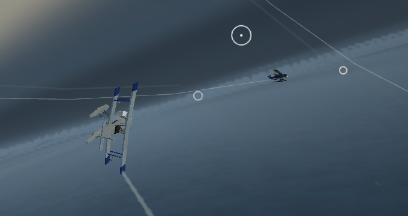

### Player toughness, generous hits, aim assist

- **Aliases:** the player's armour, hit margin, bullet magnetism.
- **Definition:** three Tweaks under Combat. **Player toughness** (2.0) divides combat damage to
  the player's own aircraft. **Generous hits** (on) lets the player's rounds hit within **Player
  hit margin** (2 m) of each part an aircraft is hit as. **Aim assist** (on) bends the
  player's rounds, after they leave the guns, a little toward the enemy most plainly in their
  path (within 3° and 700 m, at most 4°/s, for their first 0.6 s); it never moves the controls or
  the aircraft.
- **Code:** `src/tweaks.jo`; `src/combat.jo` `bullet_damage`, `Round.wide`, `Round.assist`,
  `_assist_target`; tests `tests/burst_test.jo`.
- **Capture:** `AEGEAN_TWEAKS=aim` (the aim assist on), `AEGEAN_TWEAKS=plainhits` (generous hits
  off); in `tools/dogfight_lab.jo`, `DOGFIGHT_AIM=1` and `DOGFIGHT_PLAIN_HITS=1`.

### Ground fire

- **Aliases:** ground posts, riflemen and machine-gun posts, the gunners on the roofs.
- **Definition:** scenario-owned fixed guns (`GroundGun` in a Battle) with stable negative owner IDs.
  Riflemen take aimed single shots; machine guns fire bursts behind sandbags. They lead with the
  round's time of flight and drop, wander by skill, swing at a limited rate (a close crossing
  outruns them and the fire falls in behind), and wait a reaction time after first sighting. Their
  rounds are ordinary combat rounds: the same hits, damage, tracers, muzzle flashes, whizzes and
  splashes. Posts can be shot and fall silent.
- **Code:** `src/combat.jo` `step_ground_fire`, `ground_sight`; `src/canal_ground_fire.jo`
  (the canal takeoff's posts); `src/ground_fire_view.jo` (figures, sandbags, guns).
- **Rules:** they belong to the scenario, never to the living world's population; they hold fire
  until the slipway hand-over. A machine-gun nest swings only 110° either side of the way it faces
  (its sandbag ring's open back stays behind the gunner). Rooftop posts stand on flat-roofed houses
  only (their parapet slab), the iron bridge's gun at the head of its approach stair, clear of the
  truss. `tests/canal_scenario_test.jo` bounds their hits on a takeoff run; `tests/ground_fire_test.jo`
  the arc, waking, silencing and the sounds.
- **Sound:** a rifle's crack or a machine gun's duller report, dulled further with distance and
  heard late by the sound's travel, then the canal's **flutter echo** (slaps off either wall in
  turn, each duller) and a short tail; a ground round passing close makes a sharp supersonic snap;
  each spout a short spit and plunk. `src/combat_sound.jo` `ground_report`, `bullet_snap`,
  `spout_report`, `ground_shot_cue`; offline listening: `sloppy --release tools/groundfire_audio.jo DIR`.

### Dogfight brain

- **Aliases:** the AI pilots, the enemy pilots' tactics.
- **Definition:** how combat pilots fight: Sky Barons' fighter (lead pursuit, target choice, break
  off when too close) with lag pursuit, defensive breaks and scissors, head-on passes, extending
  and coming back, unloading, zooming and wingmen's cover made explicit, shaped by skill,
  aggression, caution and nerve, with deliberate mistakes. Gunners lead a turning target's swing
  and keep aiming between thoughts when far from the player.
- **Code:** `src/combat.jo` `_dogfight`, `_gun_aim`, `_retrack`, `combat_controls`; personalities in `src/scenarios.jo`
  `STRAIT_PILOTS`; tests `tests/dogfight_test.jo`; harness `tools/dogfight_lab.jo`.
- **Capture:** `AEGEAN_SCENARIO=strait AEGEAN_CAPTURE_DOGFIGHT_PILOT=1 AEGEAN_FRAMES="dir 840 1740 2"`
  (the brain flies the player's aircraft; frames for a clip).

### Side colours

- **Aliases:** friend and foe colours, the side palette.
- **Definition:** one colour scheme for sides wherever the game marks them: enemies red-orange,
  friends blue, everyone else cream. Lead rings, the target brackets and names, people in the
  water, the formation's place and the radio's speakers all take it from one place, so the
  colour-vision preset swaps the whole set at once. A side's lines lie over a halo and its
  names over an outline (dark under a light colour, pale under a dark one), so they read on sea,
  cloud and sky alike.
- **Code:** `src/side_colours.jo` (`Standing`, `SidePalette`, `side_colour`, `side_line`,
  `side_ring`, `side_text`, `side_sign`, `battle_standing`, `country_standing`).

### Colour-vision preset

- **Aliases:** colour-blind setting, colours of the sides, the Accessibility palettes.
- **Definition:** the Settings page's "Colours of the sides" (Accessibility), kept with the
  options: Standard; Red-green (protanopia, deuteranopia: enemy orange against friend blue, never
  red against green); Blue-yellow (tritanopia: enemy orange against friend bright teal); No colour
  (enemy white, friend dark, others grey, and a shape on every mark). Each is its own set of
  colours for the player, never a filter. In the three presets one side is a dark mark in a pale
  halo (others in the colour presets, friends with no colour) and the marks are firm: full
  strength, a pixel heavier, a whole halo, names on a wide outline. "A shape for each side on
  every mark" adds the signs in any preset. The war chart's country inks change with the preset
  (Okabe and Ito's orange, blue and black in the colour presets), and with No colour each
  country's held ground is hatched its own way.
- **Rules:** a preset is checked under a simulation of the eye it is for (Machado 2009 and
  Brettel 1997 at full severity; luminance alone for no colour): sides 20 or more apart in
  CIEDE2000 and CAM02-UCS (Petroff 2021), every mark 15 or more from sea, sky and cloud and at
  3:1 against them (WCAG 1.4.11), names at 4.5:1 (WCAG 1.4.3), shape as a second cue (WCAG
  1.4.1). The standard look is scored the same way and its figures pinned. docs/accessibility.md
  has the thresholds, the scores and the sources.
- **Code:** `src/side_colours.jo` (`ColourVision`, `side_palette_for`, `set_colour_vision`,
  `palette_halo`, `side_is_dark`, `country_ink_for`, `country_hatch`, `side_shapes`),
  `src/colour_vision.jo` (`simulate_colour`, `delta_e_2000`, `ucs_of`, `contrast_ratio`),
  `src/colour_vision_scores.jo` (the scores and thresholds), `Options.colour_vision`,
  `Options.side_shapes`; `tests/colour_vision_test.jo`.
- **Capture:** `AEGEAN_COLOUR_VISION=standard|red_green|blue_yellow|monochrome` (`+shapes` for
  the shapes option); `AEGEAN_CAPTURE_SIDES=4` lays every side's mark in rows over the view
  (`src/side_samples.jo`); `AEGEAN_CAPTURE_PANEL=settings-accessibility`; `sloppy --release
  tools/colour_vision_view.jo in.png out.png protan|deutan|tritan|achromat|sheet` shows a capture
  as that eye sees it; `tools/colour_vision_report.jo` prints the score tables.

### Sandbox switches

- **Aliases:** sandbox settings, playing freely, cheats.
- **Definition:** the Settings page's Sandbox section, each a separate switch, each off, kept with
  the options: paint the aircraft anywhere at any time; any aircraft at any time (the Aircraft
  page among the player's tabs); unlimited money (the purse then reads ¤∞, on the view and at
  the foot of every counter's panel); no damage; no fuel use; endless ammunition. The
  simulation runs as usual: a switch lifts only the player's own constraint.
- **Rules:** nobody else's money, cargo or wear is changed by a switch, and the world's books
  balance with one on. Unlimited money holds the purse at a level (the purse hold): what is spent
  is made good from outside the world, entered in the ledger as the outside's, so everyone is
  really paid; switched off, what was lent goes back and the purse is what the player had and
  earned. No fuel use undoes the burning of the player's own step, so nothing is consumed from
  the tank or the goods ledger. No damage raises the damage shield round the player's own step
  (contacts shake and sound, and break nothing) and mends what guns did. A game saved with a
  switch on is a valid save: the session keeps the purse hold, and loads to the right purse with
  the switch on or off.
- **Code:** `src/sandbox.jo` (`Sandbox`, `sandbox`, `sandbox_purse`, `PurseHold`, `sandbox_fuel`),
  `src/sandbox_world.jo` (`sandbox_money_step`), `src/damage.jo` `set_damage_shield`,
  `Options.sandbox`, `GameSession.purse`, `shown_pages` in `src/debugmenu.jo`; hooks in
  `aegean.jo` (`no_damage_now`, `purse_hold`); `tests/sandbox_test.jo`,
  `tests/sandbox_settings_test.jo`. A paint shop asks `sandbox.paint_anywhere` before it charges
  money or time.
- **Capture:** `AEGEAN_SANDBOX="money,damage,fuel,aircraft,paint,ammunition"` (or `all`);
  `AEGEAN_CAPTURE_PANEL=settings-sandbox`; `AEGEAN_SANDBOX_TRACE=1` prints the purse, the tank
  and the airframe each second.

### Going home

- **Aliases:** breaking off, the formation home, landing in turn.
- **Definition:** after the strait, each side flies to its base harbour: beaten (half lost and
  outnumbered two to one) or with no enemy left. Scattered, they first regroup at a rally point,
  circling and calling in for a minute or two; then its pilots form on the leader in their own slots
  (the player's left open, marked with a faint ring), and land in turn at their moorings. The
  radio says each step in words over a Morse cue.
- **Code:** `src/combat.jo` `_turn_for_home`, `_homeward`, `home_leader`, `home_slot`,
  `home_runway`, `BattleHome`; `src/scenarios.jo` `strait_homes`; `src/homeward_view.jo`; tests
  `tests/homeward_test.jo`.
- **Capture:** `AEGEAN_SCENARIO=strait AEGEAN_CAPTURE_STRAIT_AFTER=home|arrive`.
- **The canal escape** goes home the same way: its sides' harbours nearest Neravessa (never the
  occupied city itself), once the pursuers are beaten or lost, the courier leading in.

### A situation's end

- **Aliases:** the hand-back, coming in safe.
- **Definition:** a fight's situation (the strait, the canal escape) ends where the pilot comes safe
  into harbour: moored, or ashore in a town, with no enemy of that fight flying within 8 km; whether
  it was won, lost and towed home, or run from. The game simply goes on from there, in the same
  world with its war and towns, and can be saved; a note and one line say so. Saving a game with a
  battle in it hands the battle's aircraft back to the world at the checkpoint, and the battle takes
  those still in the fight again after a load.
- **Code:** `aegean.jo` `situation_arrival`; `src/scenarios.jo` `battle_homes`;
  `src/game_session.jo` `release_battle_owners`, `restore_battle_owners`; played through by
  `tools/playtest_probe.jo` (`tests/playtest_loops_test.py`).

### Pilots in the water

- **Aliases:** survivors, ditching, rescue at sea, prisoners.
- **Definition:** a pilot down in the sea, after a parachute or a ditching, waits in a life vest
  (kapok in buff canvas, as vests were before the bright yellow of the 1940s), waving at aircraft near. The player can land, taxi alongside, take them
  aboard and set them ashore at a harbour: a friend thanked, a foe held as a prisoner or let go.
- **Code:** `src/combat.jo` `_can_ditch`, `_ditch_controls`, `_ditched_out`;
  `src/survivor_view.jo`; `src/rescue_exchange.jo`; the living world's `board_survivors`,
  `land_survivors`; tests `tests/sea_rescue_flight_test.jo`.
- **Capture:** `AEGEAN_SCENARIO=strait AEGEAN_CAPTURE_STRAIT_AFTER=rescue`.

### Deeds

- **Aliases:** what was done, the reputation's evidence.
- **Definition:** an append-only log, saved with the world, of deeds: rescued a friend or a foe,
  shot down, flew home in formation, left the fight, took or released a prisoner; each with the
  actor, the country it touched, the place, who saw it and when. The reputation reads it.
- **Code:** `src/deeds.jo` `deed_record`, `deeds_since`, `deeds_by`; `World.deeds`; tests
  `tests/deeds_test.jo`.

### Water strikes

- **Aliases:** bullet spouts, strikes on the water.
- **Definition:** where a round (any gun's, aircraft or ground) hits the water: a thin spout a
  metre or two tall that falls back within half a second, so a burst's strikes walk along the water
  in a line. Only a wreck going in raises the big lingering mist column.
- **Code:** `src/combat_view.jo` `combat_effect_events` (`.splash`); `src/combat.jo`
  `step_combat_rounds` raises the event for every owner, ground guns included.

### Screen aim

- **Definition:** mouse and drag moves push the flight aim ring along the drawn camera's right
  and up (chase, target or cockpit view, any roll), so the ring always moves the way the hand
  did on the screen.
- **Code:** `src/pilot.jo` `screen_aim`, `remember_screen_axes`.

### Target view righting

- **Definition:** the target-follow camera's up rolls back toward the horizon at a bounded rate
  (never a snap; held when looking near the vertical), and every chase frame's up is carried
  from the frame last drawn, so a look-at never flips. Before this, a target passing overhead
  could leave the picture upside down for good.
- **Code:** `src/pilot.jo` `camera_horizon_up`, `steady_camera_up`, `chase_frame`;
  `tests/camera_mouse_test.jo`.

### Slipway launch

- **Definition:** the canal takeoff's opening: the aircraft on a timber cradle on the greased ways
  inside Neravessa's workshop, engine running; the chocks come away, it slides down into the canal,
  floats off the cradle with the ordinary splash bodies, and the yard swings it to the canal's
  heading before handing over. The cradle stays at the foot of the ways.
- **Code:** `src/slipway.jo` `step_slip_launch`, `draw_slip_cradle`; `src/canal_geometry.jo`
  `slip_point` (the ramp); `src/canal_render.jo` (ways, sleepers, winch).

---
## Input

### Passing on foot

Near the pilot, a walker looks ahead for people in the way and steps to one side. A tight pass
shortens the stride and turns the shoulders. At a blocked opening the walker waits, steps back
to give room and checks for a way past. The pilot's shoulders also turn slightly while walking
close to someone. Walls, stairs and quay edges constrain the paths through the walking collision
queries. The detour is drawn from transient state in `src/walk_avoidance.jo`. The living world
advances the person's route on its fixed clock.

### Panels own the wheel

- **Aliases:** the wheel leak, the menu zooming the camera.
- **Definition:** while any menu, panel or overlay is open, the mouse wheel is the panel's (one
  that scrolls, scrolls) and never brings a camera nearer or farther: every `Ui` state
  (conversations, the board, handling, trade, contracts, the map counter, fuel, the leisure panels
  with their table bar, bill of fare, book, tavli, paper, barber and fishing, the workshop), the
  pause menu, the notebook, the chart and its maps, time passing, and a menu opened over a table
  or the bar. A new panel is covered by being a `Ui` state. The one exception: sitting with only
  the table's own bar along the bottom (`seat_view`), the wheel is the seated view's, which zooms.
- **Code:** `src/ui_state.jo` (`Ui`, `Overlays`, `overlays_open`, `wheel_kept`); `menus_open()` in
  `aegean.jo`, applied after every camera step that can read the wheel: the walking follow camera
  (the library's zoom and the game's own), the aboard orbit camera (`fly`), the parachute camera.
- **Tests:** `tests/camera_wheel_test.jo` (every state against the rule); `tools/wheel_probe.jo`
  turns the real wheel (`SLOPPY_INPUT` `n:wheel=1`) in the running game with each state open in
  turn, and once with nothing open to see it zoom (the command is at the top of the file).

### Gamepads and flight sticks

- **Aliases:** controllers, the pad, HOTAS, the Controls page.
- **Definition:** any device Sloppy reports (a standard gamepad, a flight stick, a HOTAS throttle,
  pedals) flies the aircraft, walks and works the menus alongside the keyboard, the mouse and the
  touch pad. Two profiles, each kept with the options: the **gamepad** profile reads the standard
  layout (left stick pitch and roll, the bumpers the rudder, RT opening and LT closing the
  throttle, the right stick looking about: a turn of the head in the cockpit, an orbit outside,
  coming back ahead when let go; X guns, Y the camera view, B the clutch or wheels, D-pad down to
  bail out or open the parachute, D-pad up the gun safety, A interact, Start pause, Back the
  chart); the **flight stick** profile reads a device's own numbered axes and buttons (stick X and
  Y, the throttle lever taking the throttle when it moves, the twist or pedals as rudder, the hat
  looking). A device counts as a flight stick when the platform says it is not a standard gamepad (`gamepad_standard`; the Controls page's Advanced row can say otherwise). Each axis
  has a binding (set by choosing it and moving the control), an inversion, a dead zone and a
  sensitivity; each profile has a response curve. Bindings name their device, so a stick, a
  throttle and pedals plugged in together each give their part. The controller's buttons press the
  game's own keys (`vdown`/`vpressed`), sorted by where the player is (in the air, on the water, on
  foot, in a menu), so everything a key does a button can do.
- **Code:** `src/controller.jo` (`update_controller`, `Ctl`, `ControlProfile`, `pad_defaults`,
  `stick_defaults`, `shape`, `capture_begin`); `src/controls_page.jo` (`controls_page`, the pause
  menu's Controls page); `src/pilot.jo` `key_controls` (the analog axes and the right-stick look);
  `src/options.jo` (`Options.controls`).
- **Rules:** no hardware is needed to test it: `controller_inject` puts in a synthetic device (a
  standard pad or a flight stick) for unit tests, and in the running game `SLOPPY_INPUT`'s pad items
  drive a standard pad (`40:rt=1 930:lstick=0x0.8`) or a flight stick's own controls
  (`1:pad_name=T.16000M 40:pad_axis3=-1 930:pad_axis1=0.8`; Sloppy 0.37.0). An older options file loads with the default controls.
- **Tests:** `tests/gamepad_play_test.py` (the game by a scripted pad and flight stick:
  `tools/gamepad_probe.jo`); `tests/gamepad_test.jo` (shaping, contexts, menus, a flight stick, binding by moving,
  saving, offers and hints, and a take-off, a turn and a landing flown on a synthetic gamepad
  through `key_controls`). Captures: `AEGEAN_CAPTURE_PANEL=controls`, `AEGEAN_CAPTURE_TAKEOFF=pad`.
  In a browser: `WEBPAD_GPU=1 node tools/web_gamepad.mjs <chrome-headless-shell> <page.html> <outdir>`
  fakes a standard-mapping pad (`navigator.getGamepads`), works the pause menu to the Controls
  page and flies a take-off, steering by the trace lines (SwiftShader without `WEBPAD_GPU` is too
  slow to fly).

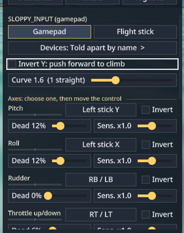

### Pad focus

- **Aliases:** the menu ring, menu nav, hud_nav.
- **Definition:** the ring the keys and a controller move through menus and panels, Sloppy's own
  `hud_nav` (Sloppy 0.37.2): the pause menu (each page keeps its own focus; a page turned by the
  bumpers starts on its content, one chosen by its tab on that tab: `hud_nav_focus`), the title's
  panels (the title's main list has its own focus, by up and down), the Paint and Controls pages,
  and the panels that draw their own buttons (the leisure menus, the paper, the notebook, the fuel
  and map counters, the workshop desk), each button a `hud_nav_box` (`pad_hit`: the panel's own
  click on the press still counts, so a held press still holds). The d-pad or left stick moves it
  to the nearest box that way, A (Enter) chooses, left and right step a slider, LB and RB turn the
  pause menu's pages, B goes back (closes the pause menu, a panel). A flight stick (any device that
  is not a standard gamepad) works it too: its look binding (the hat) and its trigger or Interact
  button are given to hud_nav (`hud_nav_input`), its Camera view button goes back. Moving the mouse
  hides it. It is off while the Controls page waits for a control to be moved. Tavli keeps its own
  keys (the d-pad and A over the board, X throws and finishes, Y takes back); talking and trading
  take the d-pad as their arrows, A as Enter, X and Y as trade's B and S.
- **Code:** `hud_nav(...)` calls in `src/debugmenu.jo` `debug_panel`, `src/title_screen.jo` and
  `aegean.jo` `draw` (the panels); `pad_hit` in `src/touch.jo`; `mkey` and `mrepeat` there for
  the keys a panel reads itself.
- **Tests:** `tests/gamepad_play_test.py` (the title, the pause menu to the Controls page, by a
  scripted pad and by a scripted flight stick); in a browser, `tools/web_gamepad.mjs`.

### Pad hints

- **Aliases:** button prompts.
- **Definition:** once a controller is the last thing used (until a key or the mouse is), every
  hint names its buttons instead of keys: the prompt cards ("A  step ashore      RT  open the
  throttle"), the H card (its bindings, aboard or on foot, made from the profile in use), the
  corner hint, and the pause menu's title ("Start to carry on"). On foot A, X and Y choose the
  first, second and third thing on offer whatever its key (aboard, A the first); with nothing on
  offer they press F, R and T. A key with no button where the player is stays a key.
- **Code:** `src/controller.jo` (`pad_hints`, `pad_words`, `key_button_name`, `offer_button_name`,
  `pad_card_lines`, `controller_offers`); `offer_card_at` and `offer_pressed` in `aegean.jo`;
  `prompt_card`, `controls_card` and `keys_hint` in `src/hud.jo`.

## House style

Everything a player reads or hears (radio copy, notices, dialogue, menus, livery and vessel
names, the notebook, the newspaper) is written in British spelling: harbour, colour, grey, metre
and kilometre, centre, travelling and travelled, honour, labour, neighbour, manoeuvre, programme
(a broadcast), moustache, and -ise rather than -ize (recognise, realise). Players never read or hear "quay": the
waterside is a dock, pier, harbour or waterfront, whichever fits (see [Quay (code) and dock
(player)](#quay-code-and-dock-player); `.quay` and other code names stay). Code keeps its own
names: identifiers, field names inside interpolations, save keys and ids (such as `harbor-boat-{id}`)
and internal failure codes are not text and are not renamed, so saves and checks keep working.
Docs and comments follow the same spelling for new prose. `tests/spelling_test.jo` scans the
sources' string literals for American spellings; a string that never reaches a player goes on its
list of internal strings, with the reason.

## Capture switches

The game and its tools take environment switches for repeatable headless captures. Run them with
`env -u DISPLAY -u WAYLAND_DISPLAY SLOPPY_NO_AUDIO=1 SLOPPY_THREADS=1 SLOPPY_SEED=12345
SLOPPY_WINDOW=1280x720 SLOPPY_FRAMES=<n> SLOPPY_SCREENSHOT=<out.png> sloppy --release <program>`.

| Switch | What it does |
|---|---|
| `AEGEAN_FLYING='alt [speed] [cockpit]'` | start in the air off the home harbour: altitude m, true airspeed m/s (the speedometer's; drawn 3.3 times faster), by default 1.3 times the aircraft's stall; `cockpit`: in the cockpit view |
| `AEGEAN_AIRFIELD=stand|fuel|runway` | aboard at the nearest airfield: on its apron stand, at its fuel point, or at the strip's southern threshold heading down it (a landplane; with `AEGEAN_CRAFT`) |
| `AEGEAN_CAPTURE_PANEL=aircraft` | the pause menu open on its Aircraft page (the picker) |
| `AEGEAN_CAPTURE_PANEL=plane` | the pause menu open on its Plane page (fuel, damage, mending, the scales) |
| `AEGEAN_CAPTURE_PANEL=paint` | the pause menu open on its Paint page |
| `AEGEAN_CAPTURE_PANEL=controls` | the pause menu open on its Controls page (gamepads and flight sticks) |
| (the pause-menu panels) | `aircraft`, `plane`, `paint`, `scenarios`, `flight`, `flight-levers`, `tweaks`, `controls` pause at frame 60, once the camera is placed: paused from the first frame the world was drawn from an eye never put anywhere (terrain floating over the sea). Script `SLOPPY_INPUT` presses after frame 60 |
| `AEGEAN_SWITCH=id` | after the start, change to that aircraft (Craft ID) as the pause menu's Aircraft page does |
| `AEGEAN_HOUR=h` | time of day (also overrides a scenario's own start hour, for captures) |
| `AEGEAN_RADIO=kc` | the cockpit radio on and tuned to that frequency from the start (620 Archipelago Radio, 1100 Blue Lantern, 1260 the Maritime Service reach the home harbour by day; 780 Voice of Kalyra and 940 Orenthia National do not; heard aboard, with `AEGEAN_AUDIO_CAPTURE` for its sound) |
| `AEGEAN_RADIO_VOLUME=0..1` | the radio's volume knob set there from the start (0.5 the usual level, 1 the top, 20 dB louder; kept with the options; captures) |
| `AEGEAN_CAPTURE_MINUTES=m` | advance the living world m minutes before the start (the radio's programme clock follows it: news at each half hour) |
| `AEGEAN_WEATHER=<name>` | weather fixture (`AEGEAN_WEATHER_CENTER='x z'` for storms) |
| `AEGEAN_CAPTURE=<recipe>` | fixed cameras from `tools/judge_scene.jo`: `home`, `dock`, `flight`, `weather-above`, `weather-below`, `weather-storm`, `weather-fog`, `cliff`, `mainland`, `place:<kind>:air|ground|old`, `port:<id>:air|warehouse|board` |
| `AEGEAN_VIEW='x y z yaw pitch hour'` | free camera |
| `AEGEAN_SETTLE=1` | terrain generation without its per-frame budget, so slow headless captures show settled ground |
| `AEGEAN_AT='x z yaw'` | on foot at a spot |
| `AEGEAN_SHOTS='dir 120 600'` | save those frames of a scripted (`SLOPPY_INPUT`) session as `dir/<frame>.png`, each with a `SHOT` line: mode, position, open panel, minute, purse, people within 40 m |
| `AEGEAN_QUALITY=low|medium|high` | quality tier |
| `AEGEAN_CAPTURE_PANEL=notebook|options|scenarios|speech|game|game-confirm|saved` | open a panel (`game`: the pause menu's Game page; `saved`: the autosave's card) |
| `AEGEAN_TALK=1` | talk to the nearest person |
| `AEGEAN_CAPTURE_DOGFIGHT='ahead across up'` | after a battle scenario loads, the nearest hostile placed crossing ahead (lead marker captures) |
| `AEGEAN_CRAFT_VIEW='yaw pitch distance'` | the free camera on the player's aircraft from that side (radians round from its nose and up, metres): moored with `AEGEAN_CRAFT`, or a few frames into `AEGEAN_FLYING` |
| `AEGEAN_CAPTURE_ORBIT='distance yaw pitch'` | the close orbit camera about the aircraft (applies after `AEGEAN_SCENARIO`) |
| `AEGEAN_CAPTURE_DOGFIGHT_PILOT=1` | in a battle, the dogfight brain flies the player's aircraft (chase-camera ride into the melee) |
| `AEGEAN_CAPTURE_STRAIT_AFTER=rescue\|home\|arrive` | after the strait: a foe in the water ahead and the player landing beside them (F taken for the player); the flight forming up for home with the player in its slot; that flight near its base, landing in turn |
| `AEGEAN_FRAMES='dir from to step'` | save every step-th frame from..to as `dir/fNNNNN.png` (for clips) |
| `AEGEAN_FLYING_OVER=airfield` | with `AEGEAN_FLYING`: start over the nearest airfield's grass, along its runway, the height above the ground (see [Aircraft shadow](#aircraft-shadow)) |
| `AEGEAN_CAPTURE_SHADOW_VIEW=1` | with `AEGEAN_FLYING`: a free camera behind and above, looking between the aircraft and its shadow |
| `AEGEAN_CAPTURE_LOW_PASS=h` | with `AEGEAN_FLYING`: the production autopilot holds the player's aircraft at that height (a low pass for a clip) |
| `AEGEAN_OLD_SHADOWS=1` | the aircraft's older shadows (rectangles on the sea, flattened meshes on land), for comparisons |
| `AEGEAN_CAPTURE_TAKEOFF=1\|worn` | the player's aircraft, serviced (or `worn`: as the save has it), at rest on the water off the home harbour, and the production take-off autopilot flying it off and up, the stick held back on a hydrofoil racer's foils (with `AEGEAN_CRAFT`, `AEGEAN_CAPTURE_ORBIT`, `AEGEAN_FRAMES`; see [Hydrofoil take-off](#hydrofoil-take-off)) |
| `AEGEAN_CAPTURE_TAKEOFF=pad` | placed as `AEGEAN_CAPTURE_TAKEOFF`, serviced, but flown by the player's controls: script a gamepad with `SLOPPY_INPUT` (`40:rt=1 150:rt=0 930:lstick=0x0.8 1010:lstick=0x0.35`) |
| `AEGEAN_NO_GROUND_FIRE=1` | remove a scenario's ground posts (A/B timing in one binary) |
| `AEGEAN_CAPTURE_CANAL_RUN=1` | after the slipway hand-over, the tests' canal steering flies the run |
| `AEGEAN_CAPTURE_CANAL_EYE="x y z"` | with the run: past the footbridge (57), a camera fixed there follows her across the lagoon and up |
| `AEGEAN_CAPTURE_POST=k` (`AEGEAN_CAPTURE_POST_LOOK=1`) | watch the run from behind ground post k (or look at the post itself from beside it) |
| `AEGEAN_CAPTURE_WAR=card|chart|board|contract` | stage war news |
| `AEGEAN_LEISURE=sit|order|menu|search|rest|coffee|tinker|spare|terrace|bar|exterior|harbour|sleep|band|work:<job>|listen-turn|listen-walk|listen-run` | stage a leisure activity at the start (`AEGEAN_LEISURE_QUERY`, `AEGEAN_LEISURE_SECTION`) |
| `AEGEAN_BAND_LOG=1` | print the hotel band's state (number, start, who is called, up, packing) twice a second |
| `AEGEAN_BAND='piece lineup [from]'` | the hotel's band plays that catalogue piece in that line-up from that second, whatever the hour (not heard; see [Musicians at play](#musicians-at-play)) |
| `AEGEAN_LEISURE=sit|order|menu|search|rest|coffee|tinker|spare|terrace|exterior|harbour|sleep|band|work:<job>|listen-turn|listen-walk` | stage a leisure activity at the start (`AEGEAN_LEISURE_QUERY`, `AEGEAN_LEISURE_SECTION`) |
| `tools/splash_frames.jo` | `POLISH_CASE=takeoff|landing|skim|stall-in|turn|night`, `POLISH_TIME` |
| `tools/prop_disc_frames.jo` | `PROP_VIEW`, `PROP_THROTTLE`, `PROP_SWEEP` |
| `tools/coast_capture.jo` | `COAST_SITE`, `COAST_RANGE` |
| `tools/grass_sample.jo`, `tools/stripe_capture.jo`, `tools/folkview.jo`, `tools/hangar.jo` | fixed sample scenes |
